# Semantic correspondence con DINOv3: tutti gli esperimenti e la pipeline finale

**AML Challenge 2026/27.** Nota tecnica che ricostruisce, dall'inizio, ogni esperimento dei cinque notebook, spiega la pipeline finale passo per passo e indica come migliorarla.

Metrica di riferimento: $\mathrm{PCK}@0.10$ sul val-split (695 query, 102 coppie). Il miglior risultato è **0.604** (IC 95% [0.553, 0.656]), ottenuto con DINOv3 ViT-L/16 fine-tuned, multiscala, soft-argmax e zoom a un giro.

---

## Indice

1. [Sintesi](#1-sintesi)
2. [Problema, dati, metrica e validazione](#2-problema-dati-metrica-e-validazione)
3. [Cronologia degli esperimenti](#3-cronologia-degli-esperimenti)
   - [3.1 Notebook 1: DINOv3-B congelato](#31-notebook-1-dinov3-b-congelato)
   - [3.2 Notebook 2: fine-tuning di 2 blocchi e trucchi d'inferenza](#32-notebook-2-fine-tuning-di-2-blocchi-e-trucchi-dinferenza)
   - [3.3 Notebook 3: ritagli in training e zoom a più giri](#33-notebook-3-ritagli-in-training-e-zoom-a-più-giri)
   - [3.4 Notebook 5: DINOv3-L e tre ricette](#34-notebook-5-dinov3-l-e-tre-ricette)
4. [La pipeline finale passo per passo](#4-la-pipeline-finale-passo-per-passo)
   - [Fase A: addestramento](#fase-a-addestramento-offline)
   - [Fase B: inferenza](#fase-b-inferenza-per-ogni-coppia-di-test)
   - [Fase C: validazione e modello finale](#fase-c-validazione-e-modello-finale)
5. [Come si arriva a 0.604](#5-come-si-arriva-a-0604)
6. [Dove si sbaglia ancora](#6-dove-si-sbaglia-ancora)
7. [Cosa non ha funzionato, e perché](#7-cosa-non-ha-funzionato-e-perché)
8. [Come migliorare: proposte e roadmap](#8-come-migliorare-proposte-e-roadmap)
9. [Solidità dei dati: avvertenze](#9-solidità-dei-dati-avvertenze)
- [Appendice A: parametri con la fonte](#appendice-a-parametri-con-la-fonte)
- [Appendice B: simboli](#appendice-b-simboli)
- [Appendice C: figure e come rigenerarle](#appendice-c-figure-e-come-rigenerarle)

### Convenzioni

| Etichetta | Significato |
|---|---|
| **validato** | presente nei notebook, con un risultato misurato |
| **proposto** | aggiunta ragionevole non ancora testata; le stime sono mie |
| **scartato** | provato e risultato neutro o peggiore |

**Nomi dei file.** Notebook 1 = `aml-challenge.ipynb` (identico a `aml-challenge_1.ipynb`), notebook 2 = `aml-challenge_1_.ipynb`, notebook 3 = `aml-challenge_3_.ipynb`, notebook 5 = `aml-challenge_5_.ipynb` (nel suo titolo si chiama "Notebook 4").

**Dati delle figure.** Le figure di risultati (F06, F10, F12 a destra, F14–F16, F18–F24) usano numeri letti dai notebook. Le mappe di similarità e i punti delle figure di meccanismo (F04, F07, F08, F09, F11, F12 a sinistra) sono **sintetici** e servono solo a illustrare il funzionamento.

---

## 1. Sintesi

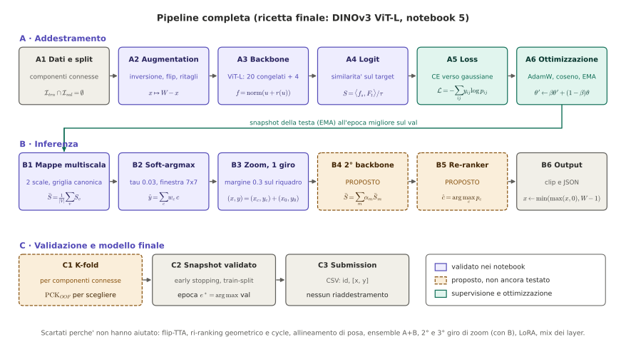

**Percorso.** Si passa da 0.197 (DINOv3-B congelato, argmax) a 0.604 (DINOv3-L fine-tuned con zoom) in quattro fasi:

| Fase | Notebook | Risultato finale (val) | Idea |
|---|---|---|---|
| 1 | nb1 | 0.374 | backbone congelato, decodifica e un adapter lineare |
| 2 | nb2 | 0.488 | fine-tuning di 2 blocchi, multiscala, zoom |
| 3 | nb3 | 0.532 | 4 blocchi, ritagli centrati sull'oggetto in training, zoom a 2 giri |
| 4 | nb5 | **0.604** | backbone ViT-L, early stopping, zoom a 1 giro |

**Cinque risultati da ricordare.**

1. **Il fine-tuning vale i due terzi del guadagno totale** (+24.9 punti nel nb5, +22.6 nel nb3, +16.5 nel nb2). Tutto il resto vale pochi punti a testa.
2. **Il backbone più grande aiuta**: +6.9 punti rispetto al ViT-B a parità di ricetta. Il guadagno riduce per la prima volta gli errori semantici (dal 34–35% al 25% delle query), mentre prima funzionavano solo tecniche di precisione.
3. **Lo zoom rende di più con uno stadio 1 migliore**: +5.4 con ViT-L, +1–2 con ViT-B. È un guadagno di sola precisione: il PCK@0.20 non si muove.
4. **Molte idee non funzionano**: ri-ranking geometrico, flip-TTA, ensemble di teste con lo stesso backbone, mix appreso dei layer, LoRA, schedule lunghe, terzo giro di zoom.
5. **Il limite attuale è la generalizzazione**: sul train il PCK@0.10 è 0.973, sul val 0.604. Il 25% di errori semantici (> 0.2 $L$) è la parte più dura.

**Cautele.** L'incertezza (IC 95%) vale circa ±5 punti. Il numero 0.604 è scelto sul val (snapshot e configurazione), quindi è leggermente ottimistico. Il punteggio di leaderboard non compare in nessun notebook.

---

## 2. Problema, dati, metrica e validazione

### 2.1 Il problema

Sono date due immagini della stessa categoria (sorgente e target) e un punto $p=(x,y)$ sulla sorgente. Bisogna indicare il punto $\hat y$ sul target che corrisponde *semanticamente* a $p$ (la punta del naso, non lo stesso pixel). La difficoltà è che le due foto possono differire per punto di vista, posa, sfondo e scala, e che la tolleranza è stretta.

### 2.2 Metrica

Per ogni query $q$ si hanno i target accettati $A(q)$ (spesso più di uno: le due ruote, i due occhi) e la lunghezza $L_q$ (lato lungo del riquadro dell'oggetto target). L'errore normalizzato e il PCK sono

$$e_q=\frac{\min_{a\in A(q)}\lVert\hat y_q-a\rVert_2}{L_q},\qquad
\mathrm{PCK}@\alpha=\frac{1}{N}\sum_q\mathbb{1}[e_q\leq\alpha].$$

La soglia ufficiale è $\alpha=0.10$. Si riportano anche $\alpha=0.05$ (precisione fine) e $\alpha=0.20$ (tolleranza larga, che separa gli errori di imprecisione da quelli semantici).

### 2.3 Dati e split

| Insieme | Query | Coppie | Note |
|---|---|---|---|
| train | 2495 | 392 | 517 immagini in 142 componenti connesse |
| train-split | 1800 | | usato per addestrare |
| val-split | 695 | 102 | seed 0, 25% del train |
| test | 577 | 98 | senza etichette |

Il 52.5% delle query ha più di un target accettato. Lo split di validazione è **per componenti connesse di immagini** (immagini che hanno almeno una query in comune), quindi nessuna immagine compare sia in train sia in val: si evita il leakage. Lo stesso seed produce lo stesso val-split in tutti i notebook, quindi i numeri sono confrontabili.

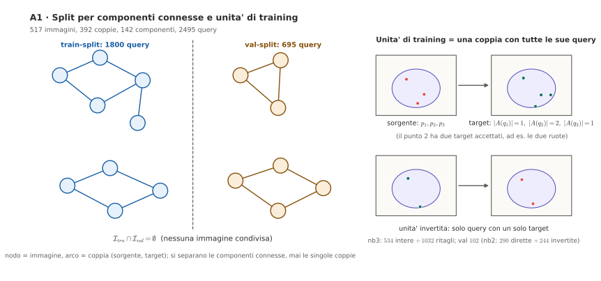

**Controllo di correttezza.** Se sorgente e target coincidono, l'errore è 0.010–0.013 $L$: le conversioni di coordinate sono corrette.

### 2.4 Incertezza

Gli intervalli di confidenza sono bootstrap *per coppia* (le query della stessa coppia sono correlate). Sul val l'IC è circa ±5 punti. Quindi:

- una differenza di 1–3 punti tra due configurazioni **non è distinguibile dal rumore**;
- un confronto tra due metodi sulle stesse query ha incertezza minore dell'IC di ciascuno, ma i notebook non calcolano un bootstrap *appaiato*: è una lacuna da colmare (sezione 8).

### 2.5 Baseline senza guardare i pixel (nb1)

| Baseline | PCK@0.10 | IC 95% |
|---|---|---|
| punto al centro del target | 0.047 | [0.022, 0.077] |
| stessa posizione relativa $(x/W_s\cdot W_t,\ y/H_s\cdot H_t)$ | 0.022 | [0.010, 0.036] |
| posizione media dei target nel train | 0.016 | [0.003, 0.031] |

Sono il pavimento: ogni metodo successivo ha senso solo se lo batte nettamente.

---

## 3. Cronologia degli esperimenti

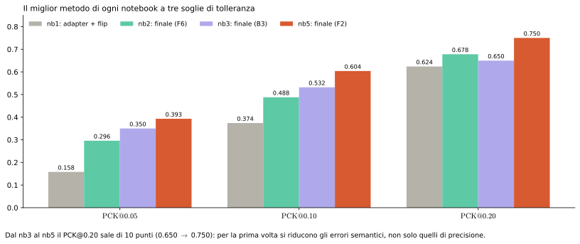

### 3.1 Notebook 1: DINOv3-B congelato

**Idea di base.** DINOv3 ViT-B/16 trasforma ogni patch $16\times16$ in un vettore; parti con lo stesso significato ottengono vettori simili. Per un punto sorgente $p$ si procede così:

1. si estrae la feature densa $F_s$ della sorgente e $F_t$ del target (L2-normalizzate);
2. si legge il vettore del punto per interpolazione bilineare, $f_s=\mathrm{bilinear}(F_s,p)/\lVert\cdot\rVert$;
3. si calcola la mappa di similarità coseno $S(i,j)=\langle f_s,F_t(i,j)\rangle$;
4. la risposta è il picco, $\hat y=\arg\max S$ (NN + argmax).

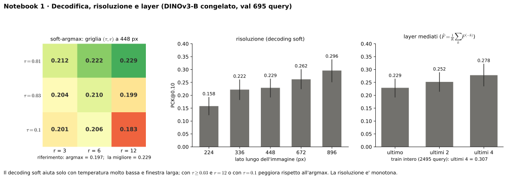

#### B0: NN argmax (448 px)

**PCK@0.10 = 0.197** [0.164, 0.233], @0.05 = 0.079, @0.20 = 0.445, errore mediano 0.225 $L$. È la baseline vera: sa già "guardare", ma quattro query su cinque sbagliano.

#### B1: decodifica soft-argmax

L'argmax è quantizzato alla patch (16 px). Il soft-argmax calcola il baricentro in una finestra attorno al picco:

$$\hat y=\sum_{c\in W}w_c\,c,\qquad w_c=\frac{\exp((S_c-S_{\max})/\tau)}{\sum_{c'\in W}\exp((S_{c'}-S_{\max})/\tau)}.$$

Griglia completa a 448 px:

| $\tau$ \ raggio $r$ | 3 | 6 | 12 |
|---|---|---|---|
| 0.01 | 0.212 | 0.222 | **0.229** |
| 0.03 | 0.204 | 0.210 | 0.199 |
| 0.1 | 0.201 | 0.206 | 0.183 |

Il decoding aiuta (+3.2) solo con temperatura molto bassa e finestra larga. Con $\tau=0.1$ e $r=12$ la risposta si "spalma" e peggiora (0.183 contro 0.197 dell'argmax). Non può comunque spostare un picco caduto sulla parte sbagliata.

#### C: risoluzione di input (decoding soft migliore)

| Lato lungo (px) | 224 | 336 | 448 | 672 | 896 |
|---|---|---|---|---|---|
| PCK@0.10 | 0.158 | 0.222 | 0.229 | 0.262 | **0.296** |

Andamento monotono: più pixel significano patch più piccole rispetto all'oggetto, ed è l'effetto più pulito del notebook. A 896 il guadagno sul 448 è +6.7.

#### D: quali layer

Si mediano le feature normalizzate degli ultimi $K$ layer:

| Layer mediati | ultimo | ultimi 2 | ultimi 4 |
|---|---|---|---|
| PCK@0.10 | 0.229 | 0.252 | **0.278** |

Sul train intero (2495 query) gli ultimi 4 layer danno 0.307. Gli strati intermedi sono meno astratti e più locali dell'ultimo. (Una variante "ultimo + strato centrale" è fallita per un errore di indicizzazione `tuple index out of range` e non è stata valutata.)

#### E: TTA con specchio

Si specchiano entrambe le immagini, si calcola la mappa, la si specchia indietro e si media: $S=\tfrac12(S_{orig}+\mathrm{flip}(S_{flip}))$. PCK@0.10 invariato (0.229), ma @0.20 sale da 0.466 a 0.481 e l'errore medio scende da 0.349 a 0.340. Più stabile, non più corretto nei casi difficili.

#### F: altri backbone

La lista `EXTRA_MODELS` era vuota, quindi il test ha riconfrontato lo stesso modello e ha dato lo stesso numero (0.229). Non è mai avvenuto un confronto tra backbone diversi in questo notebook.

#### G: ensemble

Media delle mappe di più configurazioni. L'ensemble reale era "448 + 672 + una copia del 448", quindi di scarsa diversità: **0.233**, con flip **0.240**. Dentro il rumore.

#### H: diagnostica

Classificazione degli errori (vicino, parte sbagliata, altrove) incrociata con scala, numero di target e orientamento. È solo grafica, senza numeri leggibili; l'errore mediano di ~0.2 $L$ indicava già che molti picchi cadono sulla parte *sbagliata* dell'oggetto, non solo vicino.

#### I: ri-ranking geometrico

Si stimano i match degli altri punti della coppia, si fitta un'affine pesata con IRLS robusto e, tra i primi $K$ picchi, si sceglie

$$\mathrm{score}(c)=S(c)-\lambda\,\frac{\lVert c-\hat p^{aff}\rVert}{\max(W_t,H_t)},\qquad \hat p^{aff}=[x\ y\ 1]\,M.$$

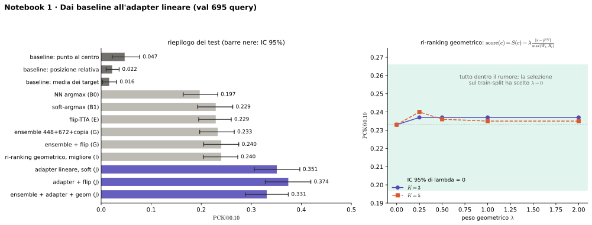

| $\lambda$ | $K=3$ | $K=5$ |
|---|---|---|
| 0 | 0.233 | 0.233 |
| 0.25 | 0.237 | 0.240 |
| 0.5 | 0.237 | 0.236 |
| 1.0 | 0.237 | 0.235 |
| 2.0 | 0.237 | 0.235 |

Tutto in 0.233–0.240, dentro l'IC. La selezione sul train-split ha scelto $\lambda=0$ (nessuna geometria). **Scartato**: con ~75% dei match già sbagliati, l'affine stimata è a sua volta sbagliata e rinforza l'errore.

#### J: adapter lineare addestrato

Si lascia DINO congelato e si impara una mappa residua $F\mapsto\mathrm{norm}(F+WF)$ con $W_0=0$. La loss è la cross-entropia tra la softmax della similarità e gaussiane attorno a *tutti* i target accettati. Training sul train-split con early stopping sul val.

- Andamento (argmax a patch): epoca 0 = 0.188, epoca 1 = 0.273, epoca 2 = 0.285, migliore (epoca 7) = **0.295**, poi ~0.28. Loss da 4.59 a 3.24.
- Con soft-argmax: **0.351** [0.306, 0.397]; con flip: **0.374** [0.328, 0.419] (@0.05 = 0.158, @0.20 = 0.624, mediano 0.139).
- Ensemble + adapter + geometria: 0.331, peggio dell'adapter da solo: mescolare feature adattate e non adattate le diluisce.

#### Riepilogo nb1

| Metodo | PCK@0.10 |
|---|---|
| baseline "centro" | 0.047 |
| B0 NN argmax | 0.197 |
| B1 soft | 0.229 |
| E flip | 0.229 |
| G ensemble + flip | 0.240 |
| I geometria (migliore) | 0.240 |
| D ultimi 4 layer | 0.278 |
| C 896 px | 0.296 |
| J adapter soft | 0.351 |
| **J adapter + flip** | **0.374** |

**Lettura.** Senza addestramento il tetto è ~0.30. Un solo livello di apprendimento (lineare) vale già +12–15 punti. Nella cella finale di submission l'adapter era disattivato da un `and False`: il file prodotto valeva circa 0.24, non 0.374.

### 3.2 Notebook 2: fine-tuning di 2 blocchi e trucchi d'inferenza

**Novità.** Il backbone si divide in un **tronco congelato** (primi 10 layer, token in cache su disco) e una **testa addestrabile**: copia degli ultimi 2 blocchi, norma finale e una piccola rete di upsampling ×2 con residuo inizializzato a zero. Il residuo a zero fa coincidere la testa con DINOv3 all'epoca 0 (verificato con coseno 1.0000).

Configurazione: lato 512 px, 15 epoche, batch 8, LR 2e-5 (blocchi) e 2e-4 (testa), weight decay 0.05, $\tau=0.05$, $\sigma$ da 3 a 1, EMA 0.98, coppie invertite (solo query a target singolo). Unità: 534 in train (di cui 244 invertite), 102 in val.

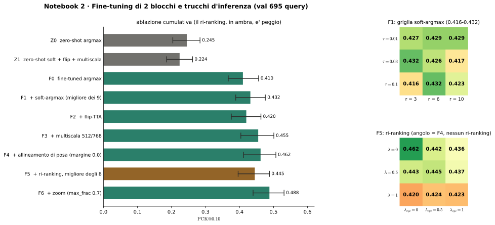

**Curva di training (val, argmax).** 0.224 (epoca 0) → 0.299 (ep. 2) → 0.377 (ep. 5) → 0.410 (ep. 11) → 0.416 (ep. 14–15). La validazione sale per tutte le 15 epoche, quindi questo run non era in overfitting e forse non era saturo.

#### Ablazione cumulativa

| ID | Configurazione | PCK@0.05 | PCK@0.10 | PCK@0.20 | IC 95% |
|---|---|---|---|---|---|
| Z0 | zero-shot argmax | 0.127 | 0.245 | 0.473 | [0.204, 0.284] |
| Z1 | zero-shot soft + flip + multiscala | 0.101 | 0.224 | 0.499 | [0.186, 0.262] |
| F0 | fine-tuned argmax | 0.226 | 0.410 | 0.647 | [0.367, 0.456] |
| F1 | + soft ($\tau=0.03$, $r=3$) | 0.230 | 0.432 | 0.652 | [0.389, 0.476] |
| F2 | + flip-TTA | 0.235 | 0.420 | 0.635 | [0.376, 0.463] |
| F3 | + multiscala 512/768 | 0.262 | 0.455 | 0.663 | [0.404, 0.501] |
| F4 | + allineamento di posa (margine 0.0) | 0.269 | 0.462 | 0.659 | [0.412, 0.507] |
| F5 | + ri-ranking (8 varianti) | | 0.420–0.445 | | tutte sotto F4 |
| F6 | **+ zoom ($\mathrm{max\_frac}=0.7$)** | 0.296 | **0.488** | 0.678 | [0.440, 0.531] |

Dettagli:

- **Z0 → F0: +16.5.** Il fine-tuning è il salto principale.
- **Z1 peggiora** (0.224 contro 0.245 a @0.10): sul modello *non* addestrato i trucchi d'inferenza non servono.
- **F1** ha 9 varianti di soft-argmax, tra 0.416 e 0.432, tutte dentro il rumore.
- **F2** (flip) peggiora di 1.2 prima della multiscala.
- **F3** multiscala: +3.5 rispetto a F2.
- **F4** allineamento di posa (Geo-SC): +0.7 al meglio (margini 0.0, 0.02, 0.05 danno 0.462, 0.459, 0.452). Neutro.
- **F5** ri-ranking con 8 combinazioni $(\lambda,\lambda_{cyc})$: tutte tra 0.420 e 0.445, cioè da −1.7 a −4.2 rispetto a F4. Sempre dannoso.
- **F6** zoom: +2.6 rispetto a F4 (con $\mathrm{max\_frac}=0.5$ dà 0.485).

Questo notebook ha prodotto una submission completa (577 righe, ID identici al campione), con testa riaddestrata su tutto il train per 14 epoche.

### 3.3 Notebook 3: ritagli in training e zoom a più giri

**Diagnosi di partenza.** La validazione stava ancora salendo quando il learning rate arrivava a zero, e il limite era la risoluzione *relativa all'oggetto*: una patch da 16 px copre il 15–40% di un oggetto piccolo, mentre la soglia è il 10%.

**Novità.**

1. **4 blocchi** addestrabili invece di 2, LR $6\cdot10^{-5}$ (blocchi) e $6\cdot10^{-4}$ (testa), $\sigma_{min}=0.75$, EMA 0.97.
2. **Ritagli centrati sull'oggetto in training** (ricetta B). La sorgente è ritagliata sul riquadro dei suoi punti, il target sul riquadro dei suoi target corretti, con margini casuali e jitter. Il modello vede in addestramento ciò che vedrà durante lo zoom.
3. **Zoom a 2 giri** in inferenza.

Unità: 534 intere + 1032 ritagli in train, 102 in val; 196 passi per epoca; 304 s per epoca.

**Importante.** Una cella sovrascrive `EPOCHS = 3`. Tutti i risultati dei test vengono da **3 epoche** (val: 0.226 → 0.378 → 0.453 → 0.473 per la ricetta B, con $\sigma$ da 3 a 1.88 a 0.75).

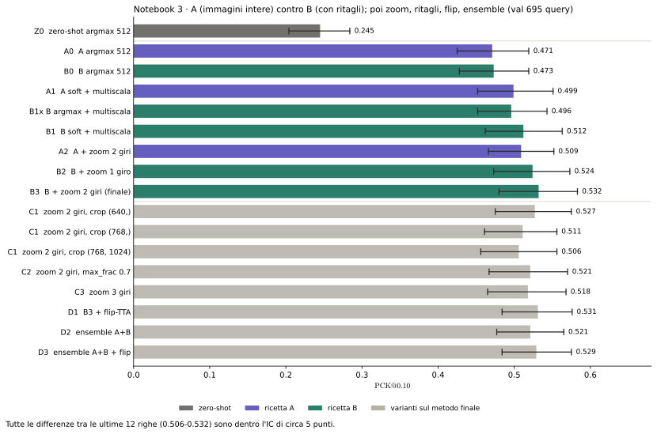

| ID | Configurazione | PCK@0.05 | PCK@0.10 | PCK@0.20 | IC 95% |
|---|---|---|---|---|---|
| Z0 | zero-shot argmax 512 | 0.127 | 0.245 | 0.473 | [0.204, 0.284] |
| A0 | A (solo immagini intere), argmax | 0.263 | 0.471 | 0.647 | [0.425, 0.519] |
| B0 | B (con ritagli), argmax | 0.266 | 0.473 | 0.645 | [0.428, 0.519] |
| A1 | A + soft + multiscala | 0.289 | 0.499 | 0.669 | [0.452, 0.551] |
| B1x | B argmax + multiscala | 0.338 | 0.496 | 0.658 | [0.452, 0.543] |
| B1 | B + soft + multiscala | 0.317 | 0.512 | 0.658 | [0.462, 0.563] |
| A2 | A + zoom 2 giri | 0.329 | 0.509 | 0.645 | [0.466, 0.552] |
| B2 | B + zoom 1 giro | 0.351 | 0.524 | 0.658 | [0.473, 0.573] |
| **B3** | **B + zoom 2 giri (finale)** | **0.350** | **0.532** | 0.650 | [0.480, 0.583] |

Varianti sul metodo finale:

| ID | Configurazione | PCK@0.05 | PCK@0.10 | PCK@0.20 |
|---|---|---|---|---|
| C1 | zoom 2 giri, ritaglio (640,) | 0.344 | 0.527 | 0.647 |
| C1 | ritaglio (768,) | 0.355 | 0.511 | 0.636 |
| C1 | ritaglio (768, 1024) | 0.357 | 0.506 | 0.632 |
| C2 | max_frac 0.7 | 0.338 | 0.521 | 0.656 |
| C3 | zoom 3 giri | 0.350 | 0.518 | 0.640 |
| D1 | B3 + flip-TTA | 0.354 | 0.531 | 0.666 |
| D2 | ensemble A+B | 0.344 | 0.521 | 0.643 |
| D3 | ensemble A+B + flip | 0.360 | 0.529 | 0.652 |

Letture:

- **Fine-tuning** (Z0 → A0): +22.6.
- **A contro B** a 512 px: uguali (0.471 contro 0.473), come previsto, perché i ritagli servono solo per lo zoom. Con lo zoom B vale +2.3 su A (0.532 contro 0.509).
- **Multiscala + soft**: +2.3 (argmax, B) e +1.6 (soft).
- **Zoom**: +1.2 al primo giro, +2.0 al secondo.
- **Giri e ritagli più grandi peggiorano**: con 3 giri il risultato cala (0.518); con ritagli più grandi il PCK@0.10 scende ma il @0.05 sale. Il modello è addestrato a risoluzioni minori e l'errore del primo riquadro si compone.
- **Flip** e **ensemble A+B** non aiutano: stesso backbone, errori correlati.

**Diagnostica del metodo finale B3.**

| | @0.05 | @0.10 | @0.20 |
|---|---|---|---|
| train (sottoinsieme, 183 query) | 0.732 | 0.891 | 0.940 |
| val | 0.350 | 0.532 | 0.650 |

| Gruppo (val) | n | zero-shot | A0 | B3 |
|---|---|---|---|---|
| oggetto piccolo | 263 | 0.373 | 0.475 | **0.639** |
| oggetto medio | 201 | 0.204 | 0.408 | 0.423 |
| oggetto grande | 231 | 0.134 | 0.519 | 0.506 |
| 1 target | 426 | 0.218 | 0.430 | 0.521 |
| più target | 269 | 0.286 | 0.535 | 0.550 |

Oracolo top-$K$ (stadio 1, senza zoom): top-1 = 0.496, top-3 = 0.649, top-5 = 0.712, top-10 = 0.783. Tassonomia degli errori su 695 query: 370 corrette, 82 vicine (0.10–0.20), 141 parte sbagliata (0.20–0.50), 102 altrove (> 0.50).

**Stato del run finale.** Il riaddestramento su train+val (8 epoche) compare interrotto alle epoche 1–2 e senza submission. Il piano prevedeva un ensemble di 3 seed della ricetta B, mai validato.

**Un secondo run, riportato nel nb5.** L'introduzione del notebook 5 riferisce un nb3 rieseguito a 24 epoche: picco del val a metà schedule (argmax 0.483, contro 0.473 con 3 epoche), poi calo di circa 5 punti; train 0.934 contro val 0.535; con zoom a 1 giro 0.535. **Quel run non è tra i file analizzati**: lo cito dal testo del nb5. La conseguenza è che la schedule lunga *non* aggiunge nulla (+1 punto, dentro il rumore) e conviene l'early stopping.

### 3.4 Notebook 5: DINOv3-L e tre ricette

Stessa pipeline e stesso val-split del nb3, con **DINOv3 ViT-L/16** (24 layer, $C=1024$). Le ricette:

| Ricetta | Cosa | Parametri addestrabili |
|---|---|---|
| **F** | fine-tuning pieno degli ultimi 4 layer | 50.7M |
| **M** | F + mix appreso dei layer: $h=\mathrm{last}+\sum_k\alpha_k(\mathrm{layer}_k-\mathrm{last})$, $\alpha_0=0$ | 50.7M |
| **L** | LoRA di rango 16 ($\alpha=32$) su tutte le Linear degli ultimi 4 layer, pesi base congelati | 1.4M |

Tutte con ritagli (ricetta B del nb3), early stopping (pazienza 4, minimo 5 epoche), addestramento solo sul train-split e **nessun riaddestramento su train+val**. Un self-check all'epoca 0 verifica che tutte le teste coincidano con DINOv3-L completo (coseno 1.0000).

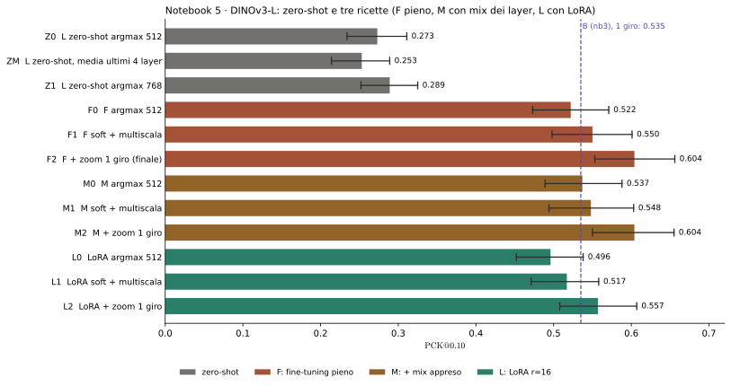

#### Zero-shot ViT-L

| ID | Configurazione | PCK@0.05 | PCK@0.10 | PCK@0.20 | IC 95% |
|---|---|---|---|---|---|
| Z0 | ultimo layer, argmax 512 | 0.131 | 0.273 | 0.567 | [0.234, 0.311] |
| ZM | media degli ultimi 4 layer | 0.111 | 0.253 | 0.447 | [0.214, 0.289] |
| Z1 | ultimo layer, argmax 768 | 0.163 | 0.289 | 0.574 | [0.252, 0.325] |

Il ViT-L zero-shot (0.273) batte il B (0.245), soprattutto a soglia larga (@0.20: 0.567 contro 0.473). La media degli ultimi layer, che nel nb1 aiutava di 5 punti con B, qui **peggiora** (0.253).

#### Ricette addestrate

| Ricetta | argmax 512 | soft + multiscala | + zoom 1 giro | IC 95% (finale) |
|---|---|---|---|---|
| **F** | 0.522 | 0.550 | **0.604** | [0.553, 0.656] |
| **M** | 0.537 | 0.548 | 0.604 | [0.550, 0.655] |
| **L** | 0.496 | 0.517 | 0.557 | [0.508, 0.607] |

Altre metriche del finale F2: @0.05 = 0.393, @0.20 = 0.750, errore mediano 0.070.

**Curve di validazione** (epoca 0 = DINOv3-L originale, 0.283):

| Ricetta | epoche eseguite | snapshot | val allo snapshot | andamento |
|---|---|---|---|---|
| F | 10 | 6 | 0.514 | +15.7 alla prima epoca, poi plateau da epoca 4–6 |
| M | 11 | 7 | 0.527 | stesso profilo, picco più tardi |
| L | 12 | 8 | 0.479 | più lenta e più bassa |

Tempi: 331 s per epoca (F), 333 s (M), 282 s (LoRA).

**Letture.**

- **Fine-tuning pieno e mix dei layer sono equivalenti** (0.604 contro 0.604). I pesi $\alpha$ appresi sono piccoli e negativi, $(-0.046,\ -0.061,\ -0.085)$: il modello si *allontana* dagli strati intermedi, invece di recuperarli. L'ipotesi di "più informazione locale" è smentita.
- **LoRA perde 4.7 punti** (0.557 contro 0.604) e anche a soglia larga (0.708 contro 0.750). Non risolve l'overfitting: sembra sotto-addestrare, con 1.4M parametri contro 50.7M.
- **Lo zoom vale +5.4** (0.550 → 0.604), il @0.20 non cambia (0.754 → 0.750): è un guadagno di precisione.

#### Diagnostica del metodo finale (F2)

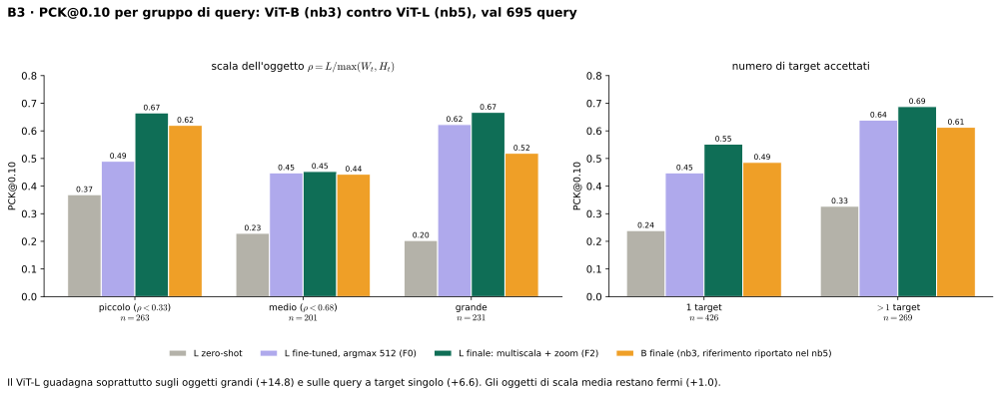

| Gruppo | n | L zero-shot | L argmax (F0) | **L finale (F2)** | B (nb3, rerun) |
|---|---|---|---|---|---|
| oggetto piccolo | 263 | 0.369 | 0.490 | **0.665** | 0.620 |
| oggetto medio | 201 | 0.229 | 0.448 | 0.453 | 0.443 |
| oggetto grande | 231 | 0.203 | 0.623 | **0.667** | 0.519 |
| 1 target | 426 | 0.239 | 0.448 | **0.552** | 0.486 |
| più target | 269 | 0.327 | 0.639 | **0.688** | 0.613 |

Il guadagno sul ViT-B si concentra sugli **oggetti grandi** (+14.8) e sulle query a **target singolo** (+6.6). Gli oggetti di scala media non cambiano (+1.0): è un punto debole persistente e non spiegato.

Gap di generalizzazione di F2: train (30 coppie, 183 query) = 0.913 / 0.973 / 0.978 a @0.05 / 0.10 / 0.20, contro val 0.393 / 0.604 / 0.750. Gap di 37 punti a @0.10 (nel nb3: 40).

Oracolo top-$K$ (stadio 1, senza zoom):

| $K$ | 1 | 3 | 5 | 10 |
|---|---|---|---|---|
| ViT-L (nb5) | 0.548 | 0.660 | 0.712 | 0.781 |
| ViT-B (nb3, rerun) | 0.512 | 0.645 | 0.686 | 0.753 |

Tassonomia degli errori (695 query):

| Categoria | ViT-L (F2) | ViT-B (nb3, rerun) |
|---|---|---|
| corretto ($e\leq0.10$) | 420 (60.4%) | 372 (53.5%) |
| vicino ($0.10<e\leq0.20$) | 101 (14.5%) | 88 (12.7%) |
| parte sbagliata ($0.20<e\leq0.50$) | 112 (16.1%) | 131 (18.8%) |
| altrove ($e>0.50$) | 62 (8.9%) | 104 (15.0%) |

**Lettura.** Gli errori semantici ($e>0.2$) scendono dal 33.8% al 25.0%. Il PCK@0.20 sale a 0.750.

---

## 4. La pipeline finale passo per passo

Il metodo finale è la ricetta **F** del nb5. Ogni passo ha figura, formule, parametri, risultato misurato e insidie.

### Fase A: addestramento (offline)

#### A1. Dati e unità di training

**Scopo.** Preparare le coppie evitando il leakage e riusare le feature dell'immagine per tutte le query della coppia.

**Come funziona.**

1. Split per componenti connesse (sezione 2.3): 1800 query in train-split, 695 in val-split.
2. Un'**unità** è una coppia con *tutte* le sue query: la mappa di feature si calcola una volta sola e serve tutti i punti.
3. Unità del nb5 (e del nb3): 534 intere (di cui parte invertite) e 1032 ritagli in train, 102 in val.

**Insidia.** I ritagli e le inversioni sono varianti della stessa coppia: appartengono tutti allo stesso lato dello split, altrimenti si reintrodurrebbe leakage.

#### A2. Augmentation

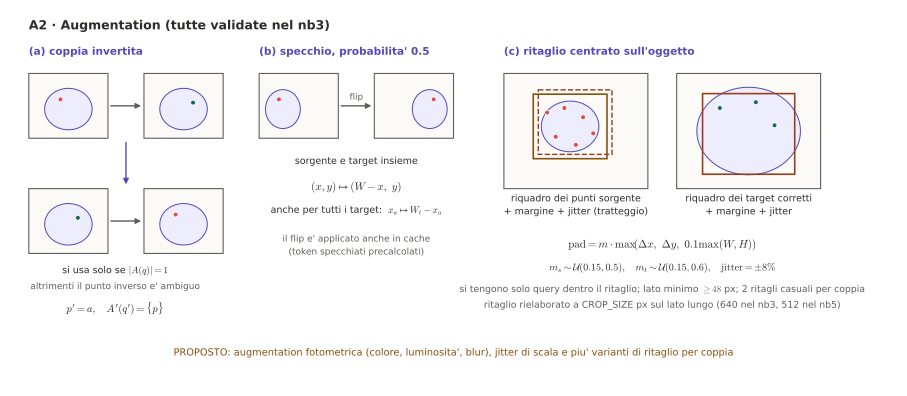

**Scopo.** Con 534 unità di base il modello memorizza: servono varianti che lo rendano robusto, e un addestramento che assomigli all'inferenza con zoom.

**Tre trasformazioni (validate).**

1. **Coppia invertita.** Si scambiano sorgente e target; il target diventa il punto sorgente. Si usa solo se $\lvert A(q)\rvert=1$ (con più target il punto inverso sarebbe ambiguo).
2. **Specchio** di sorgente e target insieme, con probabilità 0.5: $(x,y)\mapsto(W-x,\,y)$ e $x_a\mapsto W_t-x_a$ per i target. I token specchiati sono precalcolati in cache.
3. **Ritagli centrati sull'oggetto.** Per ogni coppia, 2 ritagli casuali (`CROP_VARIANTS=2`):
   - riquadro sorgente = riquadro dei punti sorgente + margine $m_s\sim\mathcal{U}(0.15,0.5)$;
   - riquadro target = riquadro dei target corretti + margine $m_t\sim\mathcal{U}(0.15,0.6)$;
   - jitter di $\pm8\%$; $\mathrm{pad}=m\cdot\max(\Delta x,\Delta y,0.1\max(W,H))$;
   - scartati se il lato minimo è sotto 48 px; si tengono solo le query con punto e target dentro il ritaglio.

**Parametro.** `CROP_SIZE` = 512 px nel nb5 (640 nel nb3).

**Proposto.** Augmentation fotometrica (colore, luminosità, blur), jitter di scala e più varianti di ritaglio. Il gap train/val (0.973 contro 0.604) è il limite attuale.

#### A3. Backbone: tronco congelato e testa addestrabile

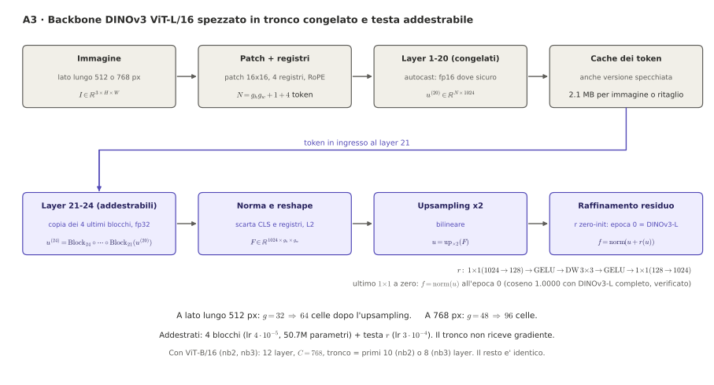

**Scopo.** Addestrare solo ciò che serve, a costo contenuto.

**Come funziona.** DINOv3 ViT-L/16 ha 24 layer.

1. **Tronco congelato** (layer 1–20): patch embedding $16\times16$, 4 registri, RoPE. Calcolo in modalità `autocast` (fp16 dove sicuro): il ViT-L in fp16 puro può andare in overflow (max |hidden| osservato: $1.6\cdot10^5$, finito).
2. **Cache dei token** in ingresso al layer 21, anche per la versione specchiata (2.1 MB per immagine o ritaglio, ~8–10 GB in totale). Così addestrare costa solo gli ultimi 4 layer.
3. **Testa addestrabile**: copia dei layer 21–24, norma finale, scarto di CLS e registri, normalizzazione L2, upsampling ×2 bilineare e raffinamento residuo:

$$u=\mathrm{up}_{\times2}(F),\qquad f=\mathrm{norm}\bigl(u+r(u)\bigr),\qquad F\in\mathbb{R}^{1024\times g_h\times g_w}.$$

La rete $r$ è $1{\times}1(1024\to128)\to\mathrm{GELU}\to\mathrm{DW}\,3{\times}3\to\mathrm{GELU}\to1{\times}1(128\to1024)$, con l'ultimo $1{\times}1$ inizializzato a zero. Quindi all'epoca 0 la testa riproduce esattamente DINOv3-L (coseno 1.0000, verificato per tutte le ricette).

**Dimensioni.** A 512 px: $g=32$ celle sul lato lungo, 64 dopo l'upsampling. A 768 px: $g=48$ e 96.

**Parametri.** 50.7M addestrabili (4 blocchi con LR $4\cdot10^{-5}$ + testa con LR $3\cdot10^{-4}$). Il tronco non riceve gradiente.

#### A4. Descrittore del punto e mappa di similarità

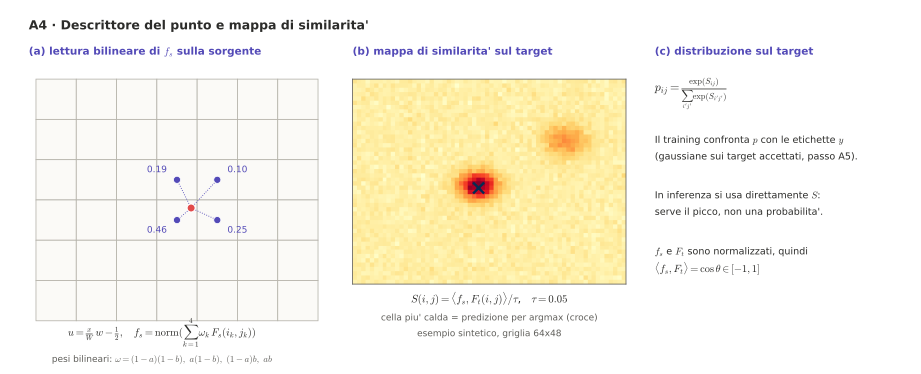

**Scopo.** Trasformare un punto sorgente in un vettore, e il target in una mappa di punteggi.

**Come funziona.**

1. Coordinate in unità di griglia: $u=\frac{x}{W}w-\frac12$ (e analogamente per $y$).
2. Descrittore: interpolazione bilineare dei 4 vicini, $f_s=\mathrm{norm}\bigl(\sum_{k=1}^4\omega_kF_s(i_k,j_k)\bigr)$ con $\omega=(1-a)(1-b),\ a(1-b),\ (1-a)b,\ ab$.
3. Logit sul target: $S(i,j)=\langle f_s,F_t(i,j)\rangle/\tau$, con $\tau=0.05$.

Poiché $f_s$ e $F_t$ sono normalizzati, $\langle f_s,F_t\rangle=\cos\theta\in[-1,1]$. In training si usa la softmax $p_{ij}=\exp S_{ij}/\sum\exp S$; in inferenza serve direttamente $S$, perché interessa il picco.

#### A5. Loss con etichette gaussiane

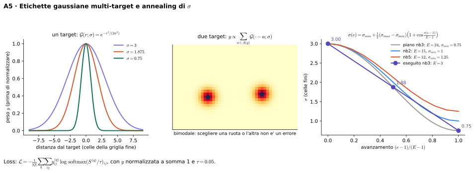

**Scopo.** Insegnare al modello a concentrare la probabilità sui target corretti, senza penalizzare i target multipli.

**Come funziona.** Per ogni query, il bersaglio è la somma di gaussiane centrate su *tutti* i target accettati, normalizzata:

$$y_{ij}\propto\sum_{a\in A(q)}\exp\Bigl(-\frac{\lVert(i,j)-a\rVert^2}{2\sigma^2}\Bigr),\qquad
\mathcal{L}=-\frac1{|Q|}\sum_q\sum_{ij}y^{(q)}_{ij}\log\mathrm{softmax}(S^{(q)})_{ij}.$$

Con due ruote la distribuzione è bimodale e scegliere l'una o l'altra non è un errore.

**Annealing di $\sigma$.** Parte larga (si impara prima la regione giusta), poi si stringe (si impara la precisione):

$$\sigma(e)=\sigma_{min}+\tfrac12(\sigma_{max}-\sigma_{min})\Bigl(1+\cos\frac{\pi(e-1)}{E-1}\Bigr),\qquad \sigma_{max}=3,\ \sigma_{min}=1.25,\ E=12.$$

Le unità di $\sigma$ sono celle della griglia fine (dopo l'upsampling).

#### A6. Ottimizzazione

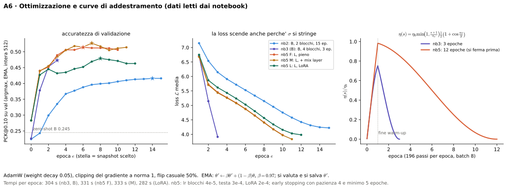

**Come funziona.**

1. AdamW con weight decay 0.05, tre gruppi di LR (blocchi $4\cdot10^{-5}$, testa $3\cdot10^{-4}$, LoRA $2\cdot10^{-4}$).
2. Warm-up di 1 epoca e coseno:

$$\eta(s)=\eta_0\,\min\!\Bigl(1,\tfrac{s+1}{s_w}\Bigr)\cdot\tfrac12\Bigl(1+\cos\tfrac{\pi s}{S}\Bigr).$$

3. Batch 8 unità con **backward per unità** (gradient accumulation): il ViT-L non starebbe in memoria con 8 coppie nello stesso grafo. Clipping del gradiente a norma 1, flip casuale 50%.
4. **EMA** dei pesi, $\theta'\leftarrow\beta\theta'+(1-\beta)\theta$ con $\beta=0.97$: si valuta e si salva $\theta'$.
5. **Early stopping vero**: a ogni epoca si valuta l'EMA (PCK@0.10 argmax a 512 px sulle immagini intere del val, senza ritagli né inversioni), si tiene lo snapshot migliore e ci si ferma dopo 4 epoche senza miglioramento (minimo 5 epoche).

**Risultati.** Snapshot all'epoca 6 (F), 7 (M), 8 (LoRA). Nel nb3 una schedule senza early stopping portava a un calo di ~5 punti nelle ultime epoche.

### Fase B: inferenza (per ogni coppia di test)

Per ogni coppia: mappe di similarità a più scale, soft-argmax, zoom a 1 giro, riporto delle coordinate.

#### B1. Mappe a più scale su griglia canonica

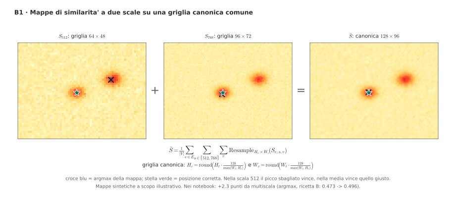

**Come funziona.**

1. L'immagine è ridimensionata a 512 e a 768 px sul lato lungo.
2. Per *ogni* punto sorgente della coppia (anche quelli senza query, che nel test sono disponibili) si calcola $S$.
3. Ogni mappa è ricampionata in modo bicubico sulla **griglia canonica** (128 celle sul lato lungo, stesso rapporto d'aspetto del target): $H_c=\mathrm{round}(H_t\cdot128/\max(W_t,H_t))$ e analogamente $W_c$.
4. Si media:

$$\bar S=\frac1{|V|}\sum_{s\in\{512,768\}}\sum_{v}\mathrm{Resample}_{H_c\times W_c}(S_{s,v}).$$

**Perché.** La griglia canonica mette scale, modelli e giri di zoom nello stesso sistema di coordinate: si possono mediare senza altro lavoro. Alcune parti si abbinano meglio a una scala, altre a un'altra.

**Risultato.** +2.3 punti da multiscala (argmax, ricetta B, nb3: 0.473 → 0.496).

#### B2. Decodifica soft-argmax

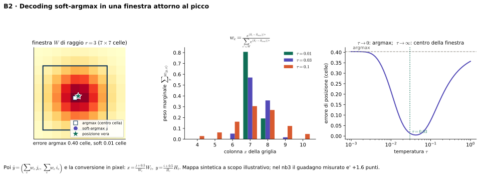

**Come funziona.** Si trova la cella di picco, poi il baricentro in una finestra $7\times7$ ($r=3$):

$$\hat y=\Bigl(\sum_c w_c\,j_c,\ \sum_c w_c\,i_c\Bigr),\quad w_c\propto e^{(\bar S_c-\bar S_{max})/\tau},\ \tau=0.03,$$

e la conversione in pixel è $x=\frac{j+0.5}{W_c}W_t$, $y=\frac{i+0.5}{H_c}H_t$.

**Cosa fa e cosa no.** Stima dove cade il picco *tra* le celle (correzione di quantizzazione). Non sposta un picco caduto sulla parte sbagliata. Nel nb3 vale +1.6, nel nb2 +2.2. Nel nb5 non si misura da solo: con la multiscala dà +2.8.

#### B3. Zoom

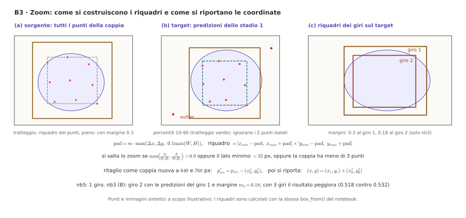

**Scopo.** Un oggetto piccolo ha pochi pixel utili; ritagliandolo e rielaborandolo, la stessa patch diventa molto più piccola rispetto all'oggetto.

**Come funziona** (1 giro, nb5):

1. Si calcola lo stadio 1 (B1 + B2) e si hanno predizioni sul target per tutti i punti della coppia.
2. **Riquadro sorgente** = riquadro di tutti i punti sorgente + margine 0.3. **Riquadro target** = percentili 10–90 delle predizioni (robusto ai punti isolati; min/max se ci sono meno di 5 punti) + margine 0.3.
3. Si salta lo zoom se la coppia ha meno di 3 punti, se un riquadro occupa più del 90% dell'immagine ($\mathrm{max\_frac}=0.9$) o se il lato minimo è sotto 32 px.
4. Il ritaglio è trattato come una **coppia nuova** (scale 512 e 768), con i punti sorgente traslati: $p'_{src}=p_{src}-(x_0^s,y_0^s)$.
5. Si riportano le coordinate nell'originale: $(x,y)=(x_c,y_c)+(x_0^t,y_0^t)$.

**Risultati.** nb2: +2.6. nb3 (B): +1.2 al primo giro, +2.0 al secondo (margine 0.18). nb5 (L): **+5.4** con un giro. Il terzo giro con B peggiora (0.518 contro 0.532), perché un errore del riquadro precedente si compone.

Lo zoom aiuta soprattutto gli **oggetti piccoli** e le **query a target singolo**.

#### B4. Secondo backbone (proposto)

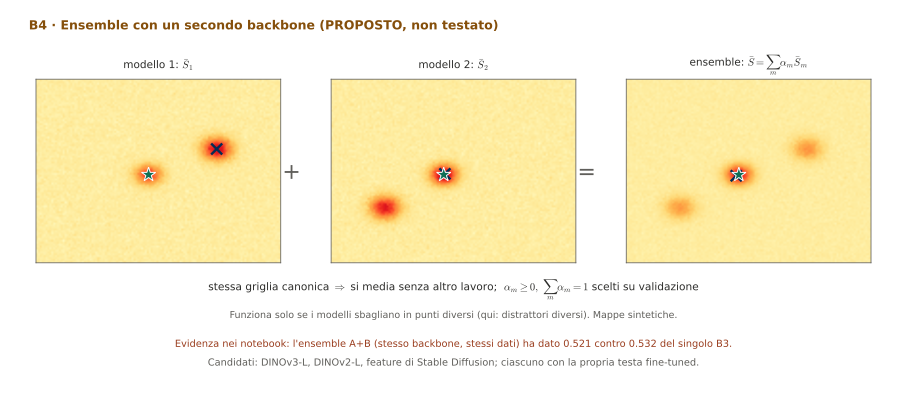

Con un altro modello (DINOv3-L, DINOv2-L, feature di Stable Diffusion, ciascuno con la propria testa fine-tuned), la combinazione è banale grazie alla griglia canonica:

$$\bar S=\sum_m\alpha_m\bar S_m,\qquad \alpha_m\geq0,\ \sum_m\alpha_m=1\ \text{(scelti su validazione)}.$$

Condizione: i modelli devono sbagliare in punti *diversi*. L'ensemble A+B del nb3 (stesso backbone, stessi dati) ha dato 0.521 contro 0.532 del singolo.

#### B5. Re-ranker appreso (proposto)

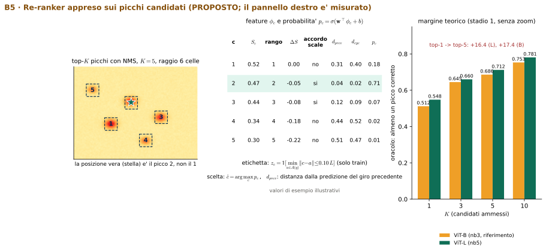

Dalla mappa media si estraggono i primi $K=5$ picchi con soppressione dei non-massimi (raggio 6 celle). Per ogni candidato $c$ si calcolano feature $\phi_c$: punteggio $S_c$, rango, distacco dal migliore, accordo tra le due scale, distanza dalla predizione del giro precedente $d_{prev}$ e consistenza ciclica $d_{cyc}$ (il match inverso torna vicino al punto sorgente?). Un piccolo modello stima

$$p_c=\sigma(\mathbf w^\top\phi_c+b),\qquad \hat c=\arg\max_c p_c,\qquad z_c=\mathbb 1\bigl[\min_{a\in A(q)}\lVert c-a\rVert\leq0.10\,L\bigr].$$

Va addestrato su predizioni **out-of-fold** (K-fold per componenti), perché il modello fine-tuned è troppo sicuro di sé sul train. Il ri-ranking a mano ha fallito due volte (nb1, nb2); questo impara quali segnali sono affidabili. Margine misurato dall'oracolo: top-1 → top-5 = +16.4 (ViT-L) e +17.4 (ViT-B); è un tetto ottimistico perché con 5 candidati una parte del successo è fortuna.

#### B6. Output

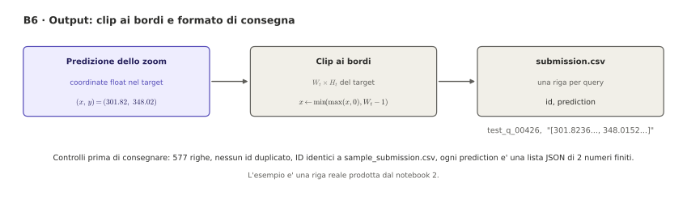

Le coordinate vengono troncate ai bordi, $x\leftarrow\min(\max(x,0),W_t-1)$, scritte come lista JSON `[x, y]` nel `submission.csv`. Controlli: 577 righe, nessun id duplicato, ID identici a `sample_submission.csv`.

### Fase C: validazione e modello finale

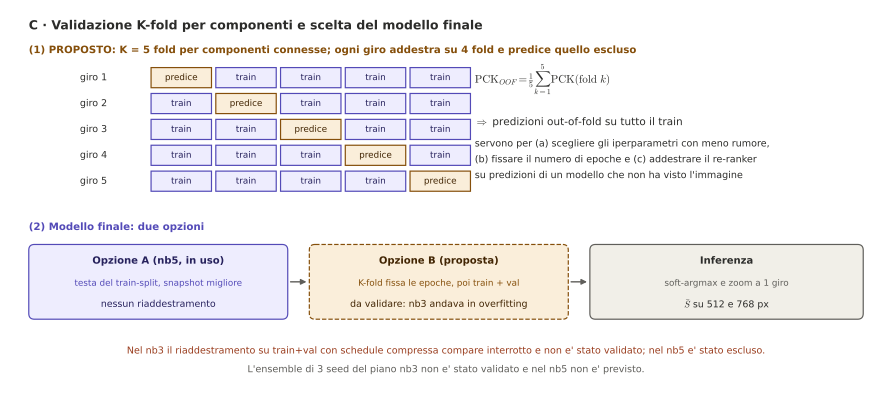

**Stato attuale (nb5).** La testa addestrata sul solo train-split, snapshot all'epoca migliore sul val, senza riaddestramento (nel nb3 la schedule compressa portava in overfitting).

**Proposto.**

1. **K-fold per componenti** ($K=5$): ogni giro addestra su 4 fold e predice quello escluso. Serve a scegliere gli iperparametri con meno rumore, a fissare il numero di epoche e a produrre le predizioni out-of-fold per il re-ranker.
2. **Riaddestramento su train+val** con il numero di epoche scelto dai fold: +39% di dati, utile in un regime dominato dalla generalizzazione. Non è validabile con un val separato.

---

## 5. Come si arriva a 0.604

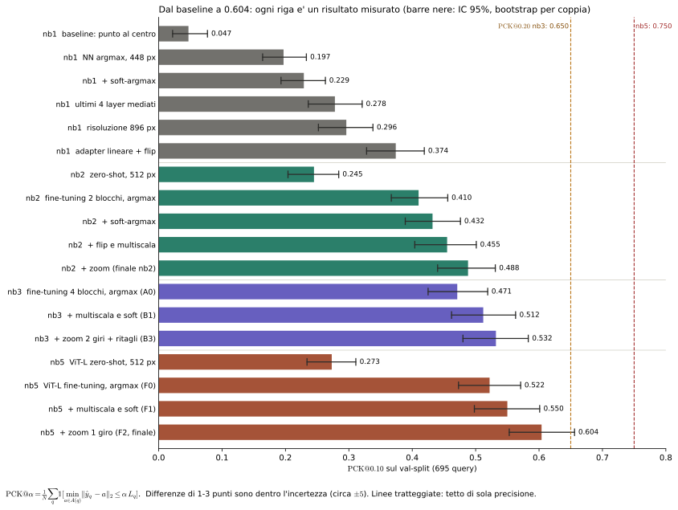

### 5.1 Scomposizione del guadagno

Lungo il percorso del metodo finale (stesso val-split, +40.7 punti totali):

| Passo | Da → A | Punti | Quota |
|---|---|---|---|
| baseline NN argmax 448 px (nb1) → ViT-L zero-shot a 512 (nb5) | 0.197 → 0.273 | +7.6 | 19% |
| fine-tuning di 4 layer con ritagli | 0.273 → 0.522 | **+24.9** | **61%** |
| soft-argmax e multiscala | 0.522 → 0.550 | +2.8 | 7% |
| zoom a 1 giro | 0.550 → 0.604 | +5.4 | 13% |

Lungo il percorso del ViT-B (nb3): +4.8 (pipeline zero-shot migliore) +22.6 (fine-tuning) +4.1 (multiscala e soft) +2.0 (zoom e ritagli) = 0.532. Il passaggio da B a L aggiunge **+6.9** a parità di ricetta (0.604 contro 0.535).

**Quanto vale lo stack d'inferenza.** Multiscala, soft-argmax e zoom insieme valgono +7.8 nel nb2 (0.410 → 0.488), +6.1 nel nb3 (0.471 → 0.532) e +8.2 nel nb5 (0.522 → 0.604). Non c'è un rendimento decrescente netto: con ViT-L lo zoom da solo vale +5.4, perché con uno stadio 1 più accurato il riquadro è più preciso.

### 5.2 Ogni tecnica, in tutti i notebook

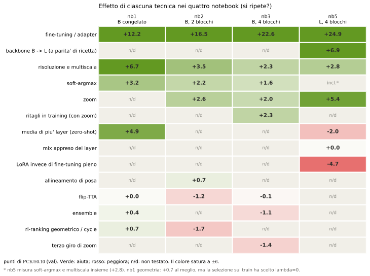

Lettura della matrice (punti di PCK@0.10):

| Tecnica | Esito |
|---|---|
| **Fine-tuning** | decisivo e crescente con la capacità (+12, +16.5, +22.6, +24.9) |
| **Backbone più grande** | +6.9, soprattutto sulla semantica |
| **Risoluzione e multiscala** | reali, +2–7 |
| **Zoom** | piccolo con B (+2), grande con L (+5.4) |
| **Ritagli in training** | +2.3 (solo insieme allo zoom) |
| **Soft-argmax** | piccolo, vicino al rumore (+1.6–3.2) |
| **Flip-TTA** | nullo (0, −1.2, −0.1) |
| **Ensemble A+B** | nullo o negativo (+0.4, −1.1) |
| **Ri-ranking geometrico** | nullo o dannoso (+0.7 al meglio, −1.7…−4.2 nel nb2) |
| **LoRA** | −4.7 |
| **Mix dei layer** | 0 |
| **Media di layer (zero-shot)** | dipende dal backbone (+4.9 con B, −2.0 con L) |

### 5.3 Le tre soglie

Il PCK@0.05, @0.10 e @0.20 del miglior metodo di ogni notebook (figura F24, nella sezione 3):

| | @0.05 | @0.10 | @0.20 |
|---|---|---|---|
| nb1 adapter + flip | 0.158 | 0.374 | 0.624 |
| nb2 finale | 0.296 | 0.488 | 0.678 |
| nb3 finale | 0.350 | 0.532 | 0.650 |
| nb5 finale | 0.393 | 0.604 | 0.750 |

Dal nb3 al nb5 il PCK@0.20 sale di 10 punti (0.650 → 0.750). Tra nb2 e nb3 era sceso (0.678 → 0.650) mentre il @0.10 saliva: le tecniche di precisione aumentavano la quota di query vicine al bersaglio, non il tetto semantico.

---

## 6. Dove si sbaglia ancora

### 6.1 Budget d'errore

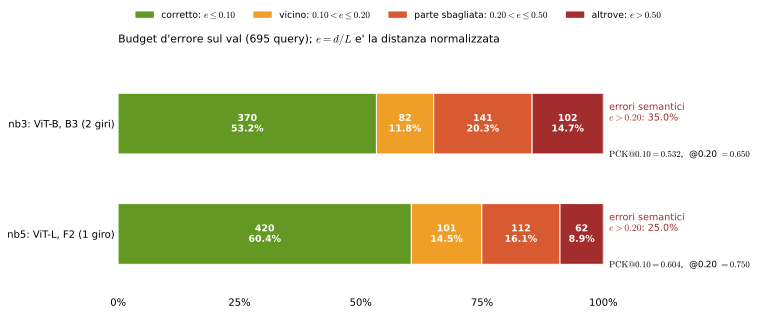

Nel nb3 il PCK@0.20 (0.650) era un tetto: azzerando tutta l'imprecisione non si superava il 65%. Nel nb5 il tetto è salito a 0.750. L'errore residuo è per il 63% semantico: 174 delle 275 query sbagliate (25.0% del totale) cadono oltre 0.2 $L$. Nel nb3 la quota era del 75% (243 su 325).

### 6.2 Generalizzazione

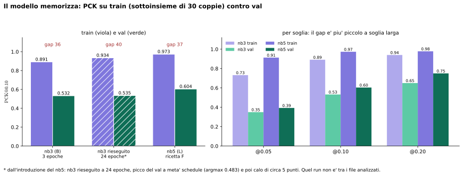

Sul train il PCK@0.10 è 0.973, sul val 0.604. Il modello memorizza; il val si appiattisce già dall'epoca 4–6. Più epoche non aiutano (nb3 rieseguito: +1 punto, poi calo di ~5). La LoRA, che ci si aspettava regolarizzasse, ha perso 4.7 punti.

### 6.3 Per tipo di query

Gli **oggetti grandi** (0.667) e i **piccoli** (0.665) sono a buon punto; gli **oggetti medi** restano a 0.453 e non migliorano né con il backbone più grande né con lo zoom. Le query a **target singolo** (0.552) sono più difficili di quelle a più target (0.688), perché non c'è un secondo bersaglio accettato.

### 6.4 Candidati

Con ViT-L, il top-1 sale a 0.548 e il top-10 a 0.781: anche con un backbone più grande, **circa il 22% delle query non ha la posizione giusta tra i primi 10 candidati**. Per quelle serve una famiglia di feature diversa, non un DINO più grande.

---

## 7. Cosa non ha funzionato, e perché

| Tentativo | Esito | Spiegazione probabile |
|---|---|---|
| Ri-ranking geometrico (affine, nb1) | 0, scelto $\lambda=0$ | con ~75% di match sbagliati, l'affine stimata è sbagliata e rinforza l'errore |
| Ri-ranking geometrico + cycle (nb2) | da −1.7 a −4.2 | idem; più rigido della realtà (rotazioni, deformazioni) |
| Allineamento di posa (nb2) | +0.7 | neutro |
| Flip-TTA | 0, −1.2, −0.1 | gli errori principali non sono rumore ma sistematici |
| Ensemble A+B (nb3) | −1.1 | stesso backbone e dati, errori correlati |
| Zoom a 3 giri (nb3) | −1.4 | un errore del riquadro si compone |
| Ritagli più grandi (768, 1024) | −2.1, −2.6 | il modello è addestrato a risoluzioni minori (ipotesi) |
| Schedule lunga (24 epoche) | +1 poi −5 | il modello memorizza (dal nb3 rieseguito, riportato nel nb5) |
| Mix appreso dei layer (nb5) | 0 | $\alpha$ finiscono piccoli e negativi |
| LoRA (nb5) | −4.7 | troppo poca capacità per questo compito |
| Media dei layer (ViT-L, zero-shot) | −2.0 | l'ultimo layer del ViT-L è già il migliore |
| Zero-shot + trucchi (nb2, Z1) | −2.1 | i trucchi servono solo dopo il fine-tuning |

---

## 8. Come migliorare: proposte e roadmap

Il principio che emerge: combinare componenti *correlate* non funziona (ensemble A+B, flip + ensemble, adapter + geometria); sommare componenti che attaccano errori *diversi* sì (fine-tuning, poi risoluzione, poi zoom). Le leve rimaste devono agire sul 25% di errori semantici e sul gap di generalizzazione.

Le stime sono mie, non misurate, e non si sommano perché in parte si sovrappongono.

| Priorità | Proposta | Costo | Effetto atteso |
|---|---|---|---|
| 1 | **Bootstrap appaiato B contro L** sui singoli errori per query | minuti | dà la significatività di +6.9 |
| 2 | **Zoom a 2 giri con L** (solo inferenza) | basso | con B era negativo; ora il primo riquadro è più accurato: da testare |
| 3 | **K-fold per componenti** (selezione e re-ranker) | alto | meno bias di selezione |
| 4 | **Augmentation** fotometrica, jitter di scala, più ritagli | medio | +1–3: la schedule lunga non aiuta, resta questa leva |
| 5 | **Più layer addestrabili** nel ViT-L (K = 6 o 8) | medio, nuova cache | ipotesi: la LoRA sotto-addestra, quindi più capacità potrebbe aiutare |
| 6 | **Secondo backbone** di famiglia diversa (Stable Diffusion) | alto | +2–5: serve a quel 22% senza candidato corretto |
| 7 | **Re-ranker appreso** sui top-$K$, addestrato out-of-fold | medio | +2–4: margine top-1 → top-5 = 16.4 punti |
| 8 | **Diagnosi degli oggetti di scala media** (viewpoint, clutter, effetto di `max_frac`) | basso | capire perché non migliorano |

Combinazione prudente: partendo da 0.604, uno scenario ottimistico porterebbe a circa **0.63–0.67 sul val**, con ±5 di incertezza e senza garanzia di trasferimento al test. I passi 1, 2 e 8 non richiedono nuovi addestramenti.

**Non conviene.** Seed multipli con lo stesso backbone (A+B è stato −1.1, tre volte il costo), LoRA, mix dei layer, schedule lunghe, geometria affine.

---

## 9. Solidità dei dati: avvertenze

1. **Incertezza di ±5 punti.** Solo differenze oltre ~5 sono affidabili. Fanno eccezione le differenze di zoom e di backbone, che sono coerenti in direzione ma non provate da un test appaiato.
2. **Bias di selezione.** Lo snapshot (epoca migliore) e la configurazione (migliore su 9 per il nb5, 17 per il nb3) sono scelti sul val, che serve anche a riportare il risultato: 0.604 è leggermente ottimistico. Sul leaderboard aspettiamo valori un po' più bassi.
3. **Il confronto B contro L non isola il backbone.** Nel nb5 cambiano anche `CROP_SIZE` (512 contro 640), $\sigma_{min}$ (1.25 contro 0.75), LR, early stopping e numero di giri di zoom (1 contro 2).
4. **Run citati ma non visti.** Il nb3 rieseguito a 24 epoche (0.483 argmax al picco, 0.535 con zoom a 1 giro, gap 0.934 contro 0.535, tabelle di confronto) è riportato dall'introduzione e dalle celle di riferimento del nb5.
5. **Stato delle submission.** Il nb2 produce una submission completa (config da 0.488 sul val, riaddestrata sul train). Il nb3 compare interrotto. Il nb5 prepara la submission con la testa F2 ma l'output non mostra il file né il punteggio. Il punteggio di leaderboard non compare in nessun notebook.
6. **`EPOCHS = 3` nel nb3.** I risultati del nb3 vengono da 3 epoche con schedule compressa, non da 24.

---

## Appendice A: parametri con la fonte

| Parametro | nb2 | nb3 | nb5 (finale) |
|---|---|---|---|
| backbone | DINOv3 ViT-B/16 | ViT-B/16 | **ViT-L/16** (24 layer, $C=1024$) |
| layer addestrabili $K$ | 2 | 4 | 4 |
| `UP` (upsampling) | 2 | 2 | 2 |
| `TRAIN_SIZE` | 512 | 512 | 512 |
| epoche | 15 | 3 (sovrascritto) | 12 con early stopping (pazienza 4, minimo 5) |
| batch | 8 | 8 | 8 (backward per unità) |
| LR blocchi / testa | 2e-5 / 2e-4 | 6e-5 / 6e-4 | 4e-5 / 3e-4 (LoRA 2e-4) |
| weight decay | 0.05 | 0.05 | 0.05 |
| $\tau$ (logit) | 0.05 | 0.05 | 0.05 |
| $\sigma_{max}\to\sigma_{min}$ | 3 → 1 | 3 → 0.75 | 3 → 1.25 |
| EMA $\beta$ | 0.98 | 0.97 | 0.97 |
| coppie invertite | sì | sì | sì |
| ritagli in training | no | sì, `CROP_SIZE` 640 | sì, `CROP_SIZE` 512, 2 varianti |
| `INF_SIZES` | (512, 768) | (512, 768) | (512, 768) |
| canonica `CANON` | 128 | 128 | 128 |
| soft-argmax | $\tau=0.03$, $r=3$ | idem | $\tau=0.03$, $r=3$ |
| flip-TTA | sì | no | no |
| zoom: giri | 1 | 2 | 1 |
| zoom: margine | 0.3 | 0.3 poi 0.18 | 0.3 |
| zoom: `max_frac` | 0.7 | 0.9 | 0.9 |
| zoom: scale | (512, 768) | (640, 768) | (512, 768) |
| tronco | primi 10 layer | primi 8 | primi 20 (`autocast`) |

**Origine dei valori.** I parametri del nb2 e del nb5 sono letti dal codice. Quelli del nb3 provengono dal codice letto in precedenza; `CROP_VARIANTS=2` e i margini di ritaglio coincidono con quelli del nb5.

## Appendice B: simboli

| Simbolo | Significato |
|---|---|
| $p$, $\hat y$ | punto sorgente; predizione sul target |
| $A(q)$ | insieme dei target accettati della query $q$ |
| $L_q$ | lato lungo del riquadro dell'oggetto target |
| $e_q$ | errore normalizzato $d/L$ |
| $F_s$, $F_t$ | feature dense di sorgente e target |
| $f_s$ | descrittore del punto sorgente |
| $S$ | mappa di similarità |
| $\bar S$ | mappa media sulla griglia canonica |
| $\tau$ | temperatura (logit di training e soft-argmax: valori diversi) |
| $\sigma$ | ampiezza delle gaussiane delle etichette |
| $y_{ij}$ | etichetta gaussiana normalizzata |
| $r(\cdot)$ | rete di raffinamento residuo |
| $H_c\times W_c$ | dimensioni della griglia canonica |
| $m$ | margine del riquadro dello zoom |
| $\theta'$, $\beta$ | pesi EMA; coefficiente dell'EMA |
| $\rho$ | scala relativa dell'oggetto $L/\max(W_t,H_t)$ |

## 10. Piano sperimentale: cosa provare e in che ordine

Questa sezione sostituisce la tabella di priorità della sezione 8, ora che è chiaro il vincolo delle regole e l'idea da riprendere da MARCO. Tutte le voci sono **proposte** (non testate) e le stime di guadagno sono mie.

### 10.1 Vincoli e principi

**Regole della challenge (regola 2).** Si usano solo immagini e annotazioni fornite; i modelli preaddestrati sono permessi. Quindi:

- **Lecito:** DINOv3, DINOv2 e altri backbone preaddestrati in modo generico; reimplementare idee da paper (anche MARCO) e addestrarle solo sui dati forniti.
- **Da evitare:** dataset esterni (SPair-71k, AP-10k, PF-Pascal, MP-100) e checkpoint già addestrati su semantic correspondence (`marco_spair.pth`, `marco_ap_spair.pth`). Prima di usarli serve conferma scritta dell'host. Il piano non li usa.

**Principi di metodo.**

1. **Una modifica alla volta**, a parità di tutto il resto (stesso split, seed, ricetta). Il confronto B contro L del nb5 cambia sei variabili insieme (sezione 9, punto 3): non va ripetuto.
2. **Si decide sulla differenza appaiata**, non sul punteggio assoluto. Con IC di ±5 punti (sezione 2.4), due configurazioni a 1–3 punti di distanza non sono distinguibili.
3. **Si salvano le predizioni per query** di ogni esperimento, così ogni confronto successivo è un bootstrap appaiato gratuito.
4. **Si registrano anche i risultati negativi**, con la spiegazione probabile (come nella sezione 7).

**Regola di accettazione.** Una modifica entra nella pipeline solo se, in K-fold per componenti, la differenza media rispetto alla baseline è positiva e l'IC bootstrap appaiato (per coppia) non include 0. Altrimenti è **scartato**, anche se il valore sul singolo val-split è più alto.

### 10.2 Ordine di lavoro

| Fase | Obiettivo | Costo | Dipende da |
|---|---|---|---|
| 0 | valutazione affidabile | basso | |
| 1 | esperimenti a sola inferenza | basso | 0 |
| 2 | isolare il backbone | medio | 0 |
| 3 | ridurre il gap di generalizzazione | medio | 0 |
| 4 | idee da MARCO | medio-alto | 0, 3 |
| 5 | candidati e secondo backbone | alto | 0 |
| 6 | modello finale e submission | alto | tutte |

Le fasi 2 e 3 possono procedere in parallelo; la fase 4 conviene dopo la 3 per non confondere gli effetti.

### 10.3 Fase 0: valutazione affidabile

**F0.1 K-fold per componenti.** $K=5$ sulle componenti connesse (stesse regole dello split attuale, sezione 2.3), seed fissati. Ogni esperimento riporta media e deviazione standard tra fold, oltre al PCK sul val-split storico, per continuità con i numeri già in nota.

**F0.2 Bootstrap appaiato.** Per ogni coppia di configurazioni $(A,B)$: $\Delta_q=\mathbb 1[e^B_q\leq0.10]-\mathbb 1[e^A_q\leq0.10]$, ricampionamento *per coppia*, IC 95% su $\overline{\Delta}$. Si riesegue subito su B contro L (nb3 contro nb5) per sapere se il +6.9 è significativo.

**F0.3 Calibrazione sul leaderboard.** Una submission della baseline attuale (testa F2) per misurare quanto il val sia ottimistico rispetto al test (sezione 9, punti 2 e 5). Il numero va annotato in nota: oggi non compare da nessuna parte.

**Criterio di uscita.** Esiste uno script che, data una configurazione, produce le predizioni per query su tutti i fold e il confronto appaiato con la baseline.

### 10.4 Fase 1: esperimenti a sola inferenza

Nessun nuovo addestramento, quindi si fanno subito.

| ID | Esperimento | Cosa si misura |
|---|---|---|
| 1a | zoom a 2 giri con la testa L (nel nb3, con B, il secondo giro valeva +2.0 e il terzo era negativo) | se uno stadio 1 migliore rende utile il secondo giro |
| 1b | `max_frac` e margine dello zoom, griglia piccola (0.7/0.9, 0.18/0.3) | sensibilità, e se spiega gli oggetti di scala media |
| 1c | diagnosi degli **oggetti di scala media** (0.453, +1.0 sul B): per query, stadio 1 contro zoom, punto di vista, clutter, numero di punti nella coppia | perché non migliorano |

**Criterio.** 1a e 1b si accettano con la regola di 10.1. 1c produce una tabella, non una modifica.

### 10.5 Fase 2: isolare il backbone

Il confronto attuale non dice se il guadagno viene dal backbone o dalla ricetta. Si tiene la **ricetta del nb5 invariata** e si cambia solo il backbone.

| ID | Backbone | Note |
|---|---|---|
| 2a | DINOv3 ViT-B/16 (ricetta nb5) | isola il +6.9 |
| 2b | DINOv2 ViT-L/14 | patch 14: griglia ~36 celle a 512 px invece di 32, cache nuova |
| 2c | DINOv2 ViT-L/14 con registri | verifica se i registri riducono gli artefatti nei match |

Per DINOv2 si adatta il numero di blocchi addestrabili (stessi 4 su 24) e si ricontrolla lo scarto dei token speciali.

**Criterio.** Si tiene DINOv3-L come default salvo che 2b o 2c lo battano con IC appaiato. Una vittoria di DINOv2 sarebbe un risultato da riportare, non un fallimento.

### 10.6 Fase 3: ridurre il gap di generalizzazione

Il collo di bottiglia è il gap (train 0.973, val 0.604): la schedule lunga non aiuta e la LoRA ha peggiorato. Restano due leve.

**3a. Augmentation fotometrica e di scala.** Variazioni di colore, luminosità, contrasto e blur; jitter di scala e di rapporto d'aspetto dei ritagli; più di 2 varianti di ritaglio per coppia. Le feature sono in cache per immagine, quindi le augmentation fotometriche richiedono di ricalcolare la cache (oppure di generare alcune varianti fisse, per esempio 2–3 per immagine).

**3b. Più capacità addestrabile.** $K=6$ e $K=8$ blocchi invece di 4. Ipotesi: la LoRA sotto-addestrava (1.4M contro 50.7M), quindi più capacità non necessariamente peggiora il gap. Va controllato con early stopping, perché il rischio è l'opposto.

**Criterio.** Per ogni voce: PCK@0.10 sui fold *e* gap train/val. Una modifica che alza il val ma anche il gap va guardata con sospetto.

### 10.7 Fase 4: idee riprese da MARCO

**Premessa.** Non ho letto il pseudo-codice dell'algoritmo (Sec. F del materiale supplementare di MARCO). Le descrizioni sotto sono una mia interpretazione del paper e del README; il primo passo è leggerle e correggere questa sezione.

Il vincolo è che si usano **solo i dati della challenge** e il backbone preaddestrato: niente pesi MARCO, niente dataset esterni, niente SAM senza verifica delle regole (i bounding box già disponibili fanno da maschera grezza).

**4a. Dense self-distillation con flow anchoring.**

*Idea.* Dai keypoint annotati si ricavano corrispondenze dense affidabili sui punti non annotati dell'oggetto, e si usano come supervisione extra.

*Adattamento proposto.*
1. Teacher = pesi EMA (già disponibili), congelati durante il passo.
2. Per ogni coppia, si campionano punti sorgente dentro il riquadro dell'oggetto (non annotati) e si calcolano i loro match col teacher.
3. **Ancoraggio ai keypoint:** si tengono i match coerenti con il flusso locale definito dai keypoint annotati vicini (idea: un punto vicino a un keypoint deve finire vicino al suo target). La definizione esatta va presa dal paper.
4. **Filtro di confidenza:** consistenza ciclica e accordo tra le scale 512/768. Senza filtro, il 25% di errori semantici dello stadio 1 verrebbe propagato.
5. Loss extra: $\mathcal L=\mathcal L_{kp}+\lambda\,\mathcal L_{pseudo}$, con $\lambda$ scelto in K-fold.

*Aspettative.* Nel supplementare di MARCO il guadagno è piccolo sui keypoint visti e grande su quelli non visti. Qui il gap è su immagini nuove, quindi l'effetto atteso è incerto: stima prudente +0–3 punti, non verificata.

*Varianti da separare.* (i) Solo le coppie del train; (ii) anche le immagini di test **senza etichette**. La seconda usa solo immagini fornite, ma è una scelta di protocollo da dichiarare nel report e da verificare con l'host: non usa risposte del test, ma si addestra su immagini di test.

**4b. Loss coarse-to-fine.**

*Idea.* Portare nel training la supervisione a più risoluzioni, oggi solo in inferenza (zoom).

*Adattamento proposto.* Termine di loss aggiuntivo sulla griglia ×1 (32 celle) oltre a quella ×2 (64), oppure su due scale di input. La forma esatta della loro loss è ignota: è una variante mia, non una copia.

*Aspettative.* Guadagno di precisione (@0.05), possibile sovrapposizione con lo zoom. Si prova dopo 4a.

**Criterio.** Per 4a e 4b: stesso K-fold, un solo cambiamento alla volta, $\lambda$ scelto sui fold interni. Si riportano anche il numero di pseudo-label tenuti e la loro precisione (misurabile sul train, dove le etichette ci sono).

### 10.8 Fase 5: candidati e secondo backbone

L'oracolo top-$K$ dice che circa il 22% delle query non ha la posizione corretta tra i primi 10 candidati (sezione 6.4): il re-ranker non può recuperarle, il secondo backbone forse sì.

**5a. Re-ranker appreso** (sezione 4, B5), con feature del candidato (punteggio, rango, accordo tra scale, distanza dal giro precedente, consistenza ciclica). Va addestrato su predizioni **out-of-fold**, quindi dipende dalla fase 0. Il margine dell'oracolo top-1 → top-5 è 16.4 punti, ma è un tetto ottimistico.

**5b. Secondo backbone di famiglia diversa** (per esempio feature di un modello di diffusione preaddestrato), con testa fine-tuned come per DINO, combinato sulla griglia canonica: $\bar S=\sum_m\alpha_m\bar S_m$, con $\alpha_m$ scelti in CV. Un ensemble ha senso solo se gli errori sono diversi: va misurata prima la correlazione degli errori per query (overlap delle query corrette).

**Criterio.** 5a si accetta solo con predizioni out-of-fold; 5b solo se l'overlap degli errori è basso e il guadagno appaiato è significativo. Il costo di 5b è alto (memoria e tempo), quindi si decide dopo le fasi 2–4.

### 10.9 Fase 6: modello finale

1. **Configurazione finale** = baseline + le sole modifiche accettate dalla regola di 10.1.
2. **Numero di epoche** dal K-fold (mediana degli snapshot migliori).
3. **Riaddestramento su train+val** con quel numero di epoche, senza early stopping (non validabile con un val separato). Il rischio è non avere un controllo: si mitiga con almeno 2 seed e controllando che la loss di train sia paragonabile a quella dei fold.
4. **Selezione delle submission:** poche e motivate, non una ricerca sul leaderboard pubblico. Il leaderboard privato decide il risultato (regola 7), quindi il val locale resta il criterio principale.
5. **Controlli di formato:** 577 righe, ID identici al campione, coordinate nell'immagine originale e dentro i bordi.

### 10.10 Cosa non si prova

Per i motivi già misurati nella sezione 7: flip-TTA, ensemble di seed con lo stesso backbone e la stessa ricetta, ri-ranking geometrico a mano, LoRA, mix appreso dei layer, schedule lunghe, zoom a 3 giri.

### 10.11 Tabella di tracciamento

Da compilare man mano; lo stato iniziale è **proposto**.

| ID | Esperimento | Stato | Δ medio (fold) | IC appaiato | Decisione |
|---|---|---|---|---|---|
| 0.1 | K-fold + bootstrap appaiato | proposto | | | |
| 0.3 | submission baseline | proposto | | | |
| 1a | zoom 2 giri con L | proposto | | | |
| 1b | `max_frac` e margine | proposto | | | |
| 1c | diagnosi scala media | proposto | | | |
| 2a | ViT-B con ricetta nb5 | proposto | | | |
| 2b | DINOv2-L | proposto | | | |
| 2c | DINOv2-L con registri | proposto | | | |
| 3a | augmentation fotometrica e scala | proposto | | | |
| 3b | $K=6$ e $K=8$ blocchi | proposto | | | |
| 4a | self-distillation densa | proposto | | | |
| 4b | loss coarse-to-fine | proposto | | | |
| 5a | re-ranker out-of-fold | proposto | | | |
| 5b | secondo backbone | proposto | | | |
| 6 | riaddestramento su train+val | proposto | | | |

### 10.12 Rischi e punti aperti

1. **Tempo.** La competizione chiude fra circa un mese. Le fasi 0–3 sono realistiche; 4 e 5 vanno scelte in base ai risultati, non fatte tutte.
2. **Pseudo-label rumorosi** (4a): se la precisione dei pseudo-label sul train è bassa, la fase si ferma.
3. **Interpretazione di MARCO.** Le sezioni 4a e 4b dipendono dalla lettura del pseudo-codice; potrebbero cambiare.
4. **Uso delle immagini di test non etichettate** (4a, variante ii): da chiarire con l'host prima di usarla.
5. **Bias di selezione.** Anche con K-fold, scegliere la configurazione migliore tra molte gonfia leggermente il risultato: va dichiarato nel report finale.