# Formalizzazione matematica (6): Self-Supervised Learning

> **Fonte**: slide `09_AML_SSL.pdf` (*Advanced Machine Learning and Computer Vision*, Prof. Fabio Galasso, 122 slide). I riferimenti «slide N» sono i **numeri di pagina del PDF** (le ultime slide hanno anche un numero stampato diverso, perché alcune pagine nascoste sono state tolte).
>
> **Convenzione di marcatura**: tutto ciò che è presente nelle slide è riportato senza etichetta; i passaggi aggiunti per rendere completa la formalizzazione sono marcati **[Aggiunta]**, i chiarimenti e le avvertenze **[Nota]**.

## Contenuto / Scopo

| Parte | Argomento | Slide |
|---|---|---|
| 1 | Perché serve l'SSL: *supervision collapse*, pretext e downstream, come si valuta | 2–15 |
| 2 | Pretext task da trasformazioni: rotazione, posizione relativa, jigsaw, inpainting, colorizzazione (immagini e video) | 18–50 |
| 3 | Reconstruction-based learning: Masked Autoencoder (MAE) | 51–61 |
| 4 | Apprendimento contrastivo: formulazione e InfoNCE | 62–74 |
| 5 | SimCLR e MoCo (v1, v2) | 75–96 |
| 6 | Senza negativi: BYOL e SimSiam | 97–108 |
| 7 | Self-distillation: DINO, DINOv2, DINOv3 e Gram anchoring | 109–116 |
| 8 | Riepilogo, collegamenti, quando usare cosa | 117–122 |

**Scopo**: dare a ogni metodo la sua formulazione matematica completa (input, rete, loss, gradiente, ciò che impedisce la soluzione banale) e verificarla con numeri calcolati dallo script delle figure.

---

## 0. Convenzioni e notazione

Vettori **colonna** (come nelle note 3–5). Le lettere sono scelte per **non** collidere con le note precedenti: dove un simbolo cambia significato rispetto a un'altra nota, è indicato nell'ultima colonna.

| Simbolo | Significato | Nota di disambiguazione |
|---|---|---|
| $x,\ \tilde x$ | immagine originale; vista trasformata / corrotta | $x$ = input come nella nota 1 |
| $y$ | etichetta *gratuita* del pretext (es. angolo di rotazione); $\hat y$ = predizione | nel downstream $y$ è l'etichetta umana |
| $f_\theta$ | encoder (rete di feature) con parametri $\theta$ | si tiene dopo il pre-training |
| $g$, $g_\phi$ | projector (MLP che porta in uno spazio dove si applica la loss) | si butta dopo il pre-training |
| $p(\cdot)$ | **predictor** di BYOL/SimSiam | **senza pedice** $p$ = predictor; le probabilità hanno sempre un pedice o una maiuscola: $p_k$, $p_\theta(\cdot\mid\cdot)$, $P_s$, $P_t$ |
| $y_i,\ h_i,\ z_i$ | nelle slide BYOL: rappresentazione $y=f(x)$, embedding $h=g(y)$, predizione $z=p(h)$ | in SimCLR/MoCo $h=f(x)$ e $z=g(h)$ (convenzione di Chen et al., slide 75–77) |
| $f_m,\ g_m$ | encoder e projector **a momento** (target) | $m$ = coefficiente di momentum |
| $s(a,b)$ | funzione di *score* tra due embedding; con $\cos$: $s=\dfrac{a^\top b}{\|a\|\,\|b\|}$ | $s$ è sempre uno score, mai lo stride/stato delle altre note |
| $x^+,\ x^-_j$ | campione positivo; $j$-esimo negativo | $x$ = riferimento (slide 68–69) |
| $N$ | numero di campioni nel softmax InfoNCE (1 positivo + $N-1$ negativi); in SimCLR: batch di $N$ immagini → $2N$ viste | **nella nota 4 $N$ era la lunghezza della sequenza**; qui per i patch MAE si usa $N_p$ (nelle figure è scritto $N$) |
| $K$ | numero di chiavi nella coda di MoCo; numero di dimensioni/prototipi in DINO; numero di permutazioni nel jigsaw | il contesto è sempre esplicito |
| $\tau$ | **temperatura** del softmax contrastivo ($\tau$, $\tau_s$, $\tau_t$) | non è il coefficiente EMA: quello è $m$ o $\lambda$ |
| $m,\ \lambda$ | coefficienti di momentum (EMA) dei pesi, e del centro $c$ in DINO | nelle slide di DINO l'EMA è scritta con $\tau$ (slide 110): qui $\lambda$ per non confonderlo con la temperatura |
| $\mathcal L$ | loss | calligrafica come nelle note 3 e 5 |
| $\mathcal T$ | insieme/distribuzione delle augmentation; $t,t'\sim\mathcal T$ | |
| $M$ | maschera binaria (inpainting) / insieme dei patch mascherati $\mathcal M$ (MAE) | |
| $r$ | rapporto di masking del MAE (es. $0.75$) | |
| $\mathrm{sg}(\cdot)$ | *stop-gradient*: valore usato ma senza gradiente | |
| $X_S,\ X_G$ | matrici dei patch dello student e del *Gram teacher* (DINOv3) | |

**[Nota]** «$\mathbb E$» è la media sulla distribuzione dei dati (e delle augmentation) e nella pratica è sostituita dalla media sul mini-batch.

---

## 1. Perché l'SSL: il problema della supervisione (slide 2–15)

### 1.1 Rappresentazioni apprese e *supervision collapse* (slide 2–7)

Una CNN addestrata con etichette produce, prima del classificatore, un vettore (nelle slide, 4096 dimensioni): i **vicini nello spazio delle feature** (distanza L2) sono molto più sensati dei vicini nello spazio dei pixel. Ma addestrare così richiede **molti dati etichettati** (slide 4–6).

Il rischio descritto a slide 7 è il *supervision collapse*: la rete è brava a trovare i pattern che portano al **target**, quindi

- la varietà delle feature dipende dal **task** scelto;
- le feature possono **ignorare tutto ciò che non serve al target**;
- c'è il rischio di **correlazioni spurie** che non generalizzano (CrossTransformers, Doersch et al. 2020).

Formalmente, minimizzando $\frac1n\sum_i\mathrm{CE}(W f_\theta(x_i),y_i)$ l'encoder è libero di mappare in modo identico tutto ciò che non cambia la classe: l'informazione non utile all'etichetta **non è obbligata** a sopravvivere.

### 1.2 Pretext task e downstream task (slide 8–11)

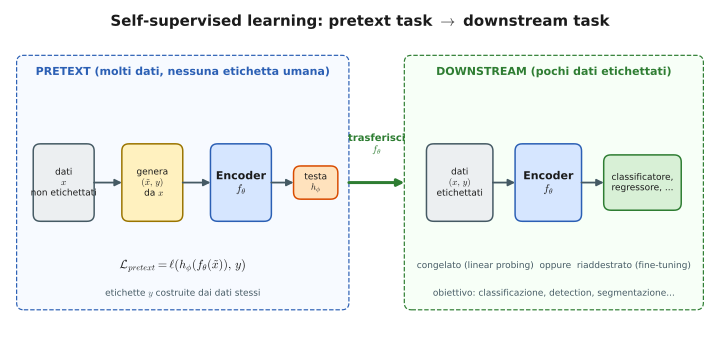

*Figura 1 — Pretext → downstream.*

- **Pretext**: un task definito **dai dati stessi**, senza annotazioni manuali. È «non supervisionato» perché non servono etichette umane, ma si addestra con obiettivi **supervisionati** (classificazione, regressione) su etichette generate automaticamente.
- **Downstream**: l'applicazione che interessa; pochi dati, etichettati.

**[Aggiunta] Formalizzazione.** Dato un dataset non etichettato $\{x_i\}_{i=1}^{M}$ e una procedura che produce coppie $(\tilde x_i,y_i)$ a partire da $x_i$, si risolve

$$
\theta^\star,\phi^\star=\arg\min_{\theta,\phi}\ \frac1M\sum_{i=1}^{M}\ \ell\Big(h_\phi\big(f_\theta(\tilde x_i)\big),\,y_i\Big)\qquad\text{(pretext)}
$$

poi si **trasferisce** $f_{\theta^\star}$ e si addestra solo la testa del downstream su pochi dati $\{(x_j,y_j)\}_{j=1}^{n}$:

$$
\min_{W,b}\ \frac1n\sum_{j=1}^{n}\mathrm{CE}\big(W f_{\theta^\star}(x_j)+b,\ y_j\big)\qquad(\theta^\star\ \text{fisso: linear probing}).
$$

Due proprietà (slide 11): (1) risolvere il pretext **impone** di imparare buone feature; (2) le etichette del pretext si generano **automaticamente**.

### 1.3 Come si valuta un metodo SSL (slide 12–14)

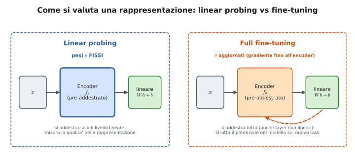

*Figura 2 — Linear probing e fine-tuning.*

Le slide elencano cinque criteri: performance sul **pretext**; **qualità della rappresentazione** (protocollo lineare, clustering, t-SNE); **robustezza e generalizzazione**; **efficienza computazionale**; **trasferimento** a un task downstream.

| Protocollo | Cosa si addestra | Cosa misura |
|---|---|---|
| **Linear probing** | solo un livello lineare su feature **congelate** | qualità *intrinseca* della rappresentazione, in condizioni ristrette |
| **Fine-tuning** | encoder (non fisso) + una o più teste, anche non lineari | il «vero potenziale» del modello sul nuovo task |
| **Semi-supervised** | encoder fine-tunato con 1% / 10% delle etichette (slide 87) | efficienza sulle etichette |

**[Nota]** Le slide 13–14 riassumono il flusso in due passi: (1) imparare un feature extractor dal pretext (es. predire rotazioni) con molti dati non etichettati; (2) attaccare una rete poco profonda (o un classificatore lineare) e addestrarla sul task target con **poche** etichette.

La slide 15 colloca l'SSL in un quadro più ampio: computer vision (Doersch et al. 2015), language modeling (GPT-4), speech synthesis (WaveNet), robotica/RL (Dense Object Net).

---

## 2. Pretext task da trasformazioni dell'immagine (slide 18–50)

### 2.1 Predire la rotazione (slide 18–23)

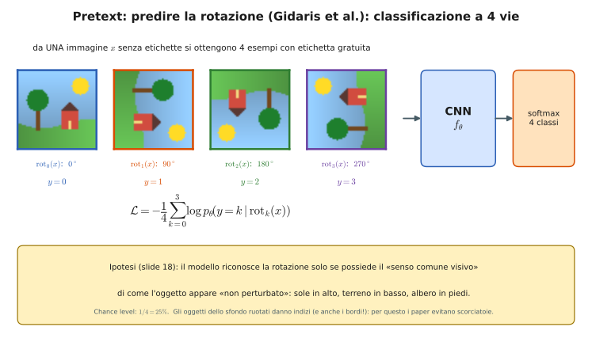

*Figura 3 — Da una sola immagine, 4 esempi con etichetta gratuita.*

**Ipotesi** (slide 18): un modello riconosce la rotazione corretta di un oggetto **solo se** possiede il «senso comune visivo» di come l'oggetto appare non perturbato.

**Costruzione.** Si ruota l'intera immagine di $0^\circ,90^\circ,180^\circ,270^\circ$ ottenendo $\mathrm{rot}_k(x)$, $k\in\{0,1,2,3\}$; la rete predice **quale** rotazione è stata applicata (classificazione a 4 vie, slide 19–20).

**[Aggiunta] Loss.** Con $p_\theta(k\mid\cdot)$ softmax a 4 uscite:

$$
\mathcal L_{rot}=-\frac1{4}\ \mathbb E_{x}\sum_{k=0}^{3}\log p_\theta\big(k\mid \mathrm{rot}_k(x)\big).
$$

A caso, $p_\theta=1/4$ e $\mathcal L_{rot}=\log 4\approx1.386$. Da una sola immagine si ottengono **4 esempi con etichetta esatta**: il dataset del pretext è 4 volte più grande, senza costo di annotazione.

**Valutazioni (slide 21–23).**

- *Semi-supervised su CIFAR10*: SSL su tutto il training set, poi si **congelano** conv1+conv2 e si addestrano conv3+lineari con un sottoinsieme di etichette.
- *Trasferimento*: SSL su ImageNet con AlexNet, fine-tuning su Pascal VOC 2007, confrontato con pre-training supervisionato e con nessun pre-training.
- *Attenzioni visualizzate* (slide 23): visualizzazione delle attenzioni apprese dalla rete.

### 2.2 Posizione relativa dei patch e jigsaw (slide 24–26)

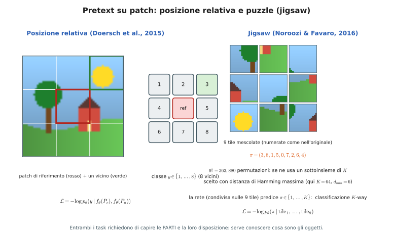

*Figura 4 — Doersch et al. (2015) e Noroozi & Favaro (2016).*

**Posizione relativa (slide 24).** Si estrae un patch centrale $P_c$ e un vicino $P_n$ tra gli 8 possibili; la rete predice **in quale degli 8 intorni** si trova $P_n$ rispetto a $P_c$:

$$
\mathcal L=-\log p_\theta\big(y\mid f_\theta(P_c),f_\theta(P_n)\big),\qquad y\in\{1,\dots,8\}.
$$

**Jigsaw (slide 25–26).** Si divide l'immagine in $3\times3$ tile, le si **rimescola** con una permutazione $\pi$ e la rete predice $\pi$:

$$
\mathcal L=-\log p_\theta(\pi\mid\mathrm{tile}_{1},\dots,\mathrm{tile}_{9}),\qquad \pi\in\Pi,\ |\Pi|=K.
$$

**[Aggiunta] Perché un sottoinsieme.** Le permutazioni di 9 tile sono $9!=362\,880$: classificare su tutte è troppo difficile e non necessario. Si sceglie un sottoinsieme $\Pi$ di $K$ permutazioni con **distanza di Hamming** grande tra loro, così le classi sono distinguibili e il compito non ha soluzioni ambigue. Con la selezione greedy nello script ($K=64$) la distanza minima tra due permutazioni è $d_{min}=6$. La rete è **condivisa** sulle 9 tile.

**[Nota]** Nella slide 26 «Ours» è la feature del jigsaw e Doersch et al. è la posizione relativa (confronto di trasferimento); la slide 32 mostra il trasferimento dell'inpainting a classificazione e detection (Pascal VOC 2007) e segmentazione semantica (VOC 2012).

### 2.3 Inpainting: Context Encoders (slide 27–32)

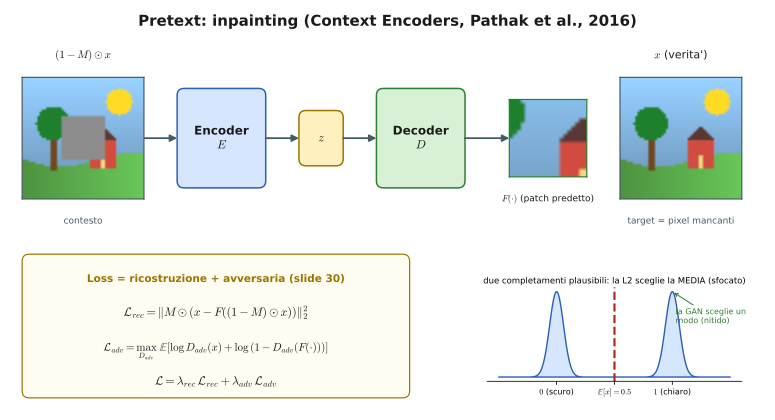

*Figura 5 — Ricostruzione + loss avversaria.*

Si **cancella** una regione dell'immagine e la si fa **predire** da un encoder–decoder (autoencoder, slide 28) dal solo contesto.

**[Aggiunta] Loss (slide 30: «reconstruction + adversarial»).** Con maschera $M\in\{0,1\}^{H\times W}$ ($1$ = pixel da predire), $\odot$ prodotto elemento per elemento (slide 30) e $F$ l'intera rete encoder–decoder:

$$
\mathcal L_{rec}=\Big\|M\odot\big(x-F((\mathbf 1-M)\odot x)\big)\Big\|_2^2,
$$

$$
\mathcal L_{adv}=\max_{D_{adv}}\ \mathbb E\big[\log D_{adv}(x)+\log\big(1-D_{adv}(F((\mathbf 1-M)\odot x))\big)\big],
\qquad
\mathcal L=\lambda_{rec}\mathcal L_{rec}+\lambda_{adv}\mathcal L_{adv}.
$$

La loss avversaria confronta immagini **reali** e immagini **inpainted** (slide 30).

**[Aggiunta] Perché la sola L2 non basta.** Se per un pixel esistono due completamenti plausibili $v\in\{0,1\}$ con probabilità $\tfrac12$ ciascuno, il valore $c$ che minimizza l'errore atteso è

$$
\arg\min_c\ \mathbb E\big[(v-c)^2\big]=\mathbb E[v]=0.5,\qquad \mathbb E\big[(v-0.5)^2\big]=0.25>0 .
$$

La L2 sceglie la **media** → output sfocato (la slide 31 confronta ricostruzione, sola componente avversaria e ricostruzione+avversaria). La loss avversaria costringe il generatore a scegliere **un modo** nitido.

### 2.4 Colorizzazione e Split-Brain Autoencoder (slide 33–40)

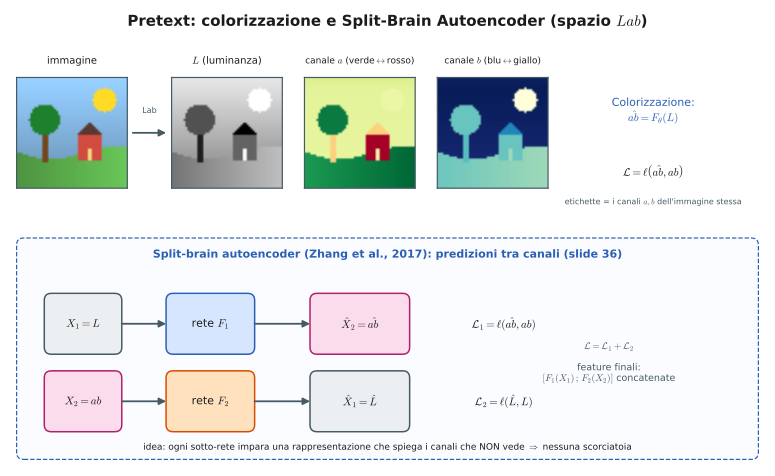

*Figura 6 — Canali $L$, $a$, $b$ e predizione tra canali.*

**Colorizzazione.** Si converte l'immagine in spazio **Lab**: $L$ è la luminanza (immagine in grigio), $a,b$ sono i canali di colore. Il pretext è predire $ab$ da $L$:

$$
\widehat{ab}=F_\theta(L),\qquad \mathcal L=\ell\big(\widehat{ab},\,ab\big),
$$

e le etichette sono i canali $a,b$ **dell'immagine stessa** (nessuna annotazione).

**Split-brain autoencoder (slide 35–38).** Idea: **predizioni tra canali** (cross-channel prediction). Due reti $F_1,F_2$ sono addestrate su canali complementari: $F_1$ vede $X_1$ e predice $X_2$; $F_2$ vede $X_2$ e predice $X_1$:

$$
\mathcal L=\ell\big(F_1(X_1),X_2\big)+\ell\big(F_2(X_2),X_1\big),
\qquad \text{feature finali}=\big[F_1(X_1)\,;\,F_2(X_2)\big].
$$

Le feature **concatenate** da $F_1$ e $F_2$ sono usate per il trasferimento (slide 38, valutazione sul dataset Places).

### 2.5 Colorizzazione di video (slide 41–50)

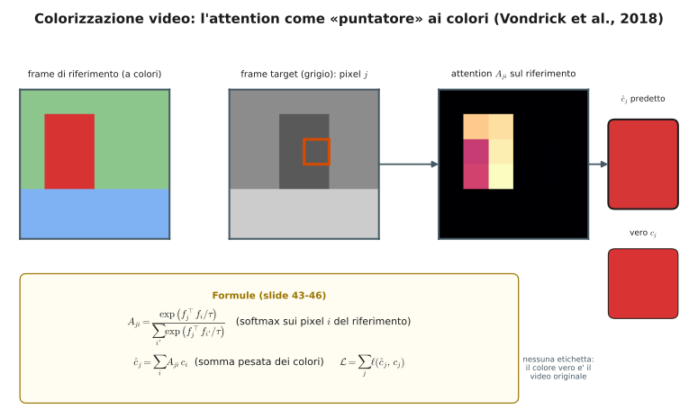

*Figura 7 — L'attention come «puntatore» ai colori.*

**Idea** (slide 41–42): modellare la **coerenza temporale** dei colori: la stessa parte di un oggetto, in frame diversi, deve avere lo stesso colore. Il colore del frame di riferimento ($t=0$) è noto; si colorano i frame $t=1,2,3,\dots$ in grigio.

**Obiettivo** (slide 43): stabilire **mappature tra frame di riferimento e frame target** in uno spazio di feature appreso e usarle come «puntatori» per copiare i colori (in Lab).

**[Aggiunta] Formule (slide 44–46).** Con $f_i$ la feature del pixel $i$ del riferimento e $f_j$ quella del pixel $j$ del target:

$$
A_{ji}=\frac{\exp\big(f_j^{\top}f_i/\tau\big)}{\sum_{i'}\exp\big(f_j^{\top}f_{i'}/\tau\big)},\qquad
\hat c_j=\sum_{i}A_{ji}\,c_i,\qquad
\mathcal L=\sum_j\ell\big(\hat c_j,\,c_j\big).
$$

Il colore predetto è una **somma pesata** (combinazione convessa: $A_{ji}\ge0$, $\sum_iA_{ji}=1$) dei colori del riferimento; la loss confronta il colore predetto con quello **vero** (che è il video stesso: nessuna etichetta). **[Nota]** Nel paper originale i colori sono quantizzati e si usa una cross-entropy; per le slide basta una loss generica.

**Numeri dello script** (Fig. 7): griglia $6\times6$, il pixel da colorare è dentro l'oggetto rosso spostato di una colonna; **il 97.9%** della massa di attention cade sui pixel-oggetto del riferimento, e il colore predetto è $(0.84,0.21,0.21)$ contro il vero $(0.85,0.20,0.20)$.

**Il tracking emerge** (slide 49–50). Poiché $A$ è una mappa di corrispondenza, la si può riusare per propagare **maschere di segmentazione** e **keypoint di posa**: se $m_i$ è la maschera nel riferimento,

$$\hat m_j=\sum_iA_{ji}\,m_i.$$

Nessuna etichetta di tracking è stata vista in addestramento.

---

## 3. Reconstruction-based learning: Masked Autoencoder (slide 51–61)

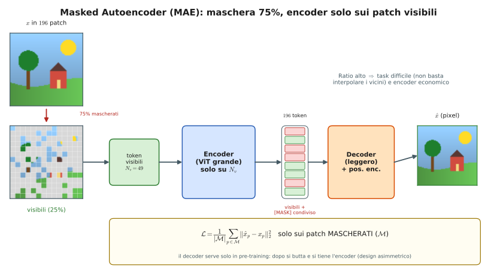

*Figura 8 — MAE: encoder solo sui patch visibili, decoder leggero.*

### 3.1 Architettura

**Masking (slide 53).** Come nel ViT, l'immagine è divisa in **patch non sovrapposti**; si campiona **uniformemente** una proporzione molto alta (75%) di patch e li si **maschera**. Mascherare molto rende il task difficile e significativo; non usare mask token nell'encoder e dargli solo il 25% di patch visibili permette di usare un encoder **molto grande**.

**Encoder (slide 54).** Opera **solo** sui patch non mascherati (25%): proiezione lineare + positional embedding + blocchi transformer. Poiché vede pochi token è scelto molto grande (oltre 9 volte il calcolo per token rispetto al decoder).

**Decoder (slide 55).** Unisce gli output dell'encoder con **mask token condivisi** nelle posizioni mascherate, aggiunge positional encoding, usa blocchi transformer e una **proiezione lineare** finale per ricostruire i pixel. È usato solo in pre-training, quindi è **indipendente** dal progetto dell'encoder (design asimmetrico, a differenza degli AE classici/UNet).

**Loss (slide 56).** MSE nello spazio dei pixel, calcolata **solo sui patch mascherati**:

$$
\mathcal L=\frac{1}{|\mathcal M|}\sum_{p\in\mathcal M}\big\|\hat x_p-x_p\big\|_2^2 .
$$

**[Nota]** Calcolare la loss solo sul mascherato evita che la rete debba imparare a copiare i patch visibili (compito triviale).

### 3.2 Perché l'encoder può essere grande: il costo

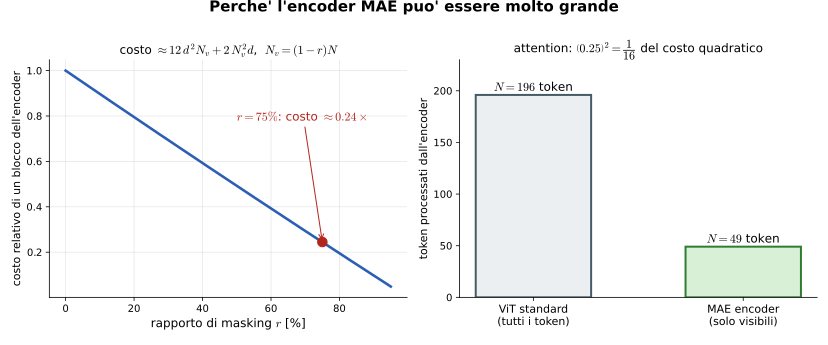

*Figura 9 — Costo dell'encoder in funzione del masking ratio.*

**[Aggiunta]** Con $N_p$ patch totali, $r$ rapporto di masking e $N_v=(1-r)N_p$ token visibili, un blocco transformer con dimensione $d$ costa circa

$$
\text{costo}\ \approx\ \underbrace{12\,d^{2}N_v}_{\text{proiezioni}+\text{MLP}}+\underbrace{2\,N_v^{2}d}_{\text{attention}}.
$$

Per un'immagine $224\times224$ con patch $16\times16$: $N_p=14\times14=196$. Con $r=0.75$: $N_v=49$, e

- il costo quadratico dell'attention scende di $(1-r)^2=\dfrac1{16}$;
- il costo totale del blocco (con $d=1024$) scende a circa $0.245\times$ (valore calcolato dallo script).

Per questo il MAE può permettersi un encoder molto grande.

### 3.3 Linear probing vs fine-tuning, ablazioni (slide 57–59)

Slide 57: nel **linear probing** il modello pre-addestrato è fisso e si aggiunge un solo livello lineare (misura la qualità della rappresentazione in condizioni ristrette); nel **fine-tuning** il modello è addestrato ulteriormente e si possono aggiungere layer anche non lineari (sfrutta il potenziale del modello).

Slide 58: le scelte di modellazione da studiare con ablazioni sono molte: **masking ratio**, profondità e larghezza del decoder, uso del mask token nell'encoder, target di ricostruzione, data augmentation, metodo di campionamento della maschera, schedule di training. La slide 59 confronta il MAE con altri metodi.

### 3.4 Riepilogo dei pretext da trasformazioni (slide 60–62)

- I pretext puntano al «senso comune visivo»: predire rotazioni, inpainting, riarrangiamenti, colorizzazione.
- Il modello è **obbligato** a imparare feature buone su immagini naturali (es. la semantica di una categoria) per risolverli.
- **Non** interessa la performance sul pretext, ma l'utilità delle feature sui downstream (classificazione, detection, segmentazione).
- **Limite** (slide 62): le rappresentazioni possono restare **legate allo specifico pretext**. Esiste un pretext più generale?

---

## 4. Apprendimento contrastivo: formulazione (slide 63–74)

### 4.1 Intuizione (slide 63–68)

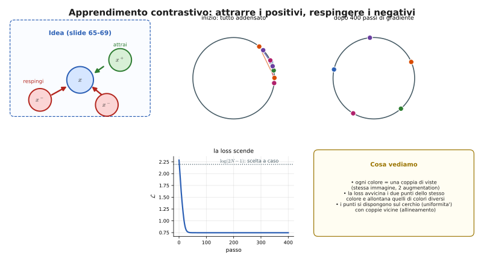

*Figura 10 — Attrarre i positivi, respingere i negativi: InfoNCE ottimizzata a mano.*

Un pretext più generale: stessa istanza → vicini; istanze diverse → lontani. Si definiscono un **riferimento** $x$, un **positivo** $x^+$ e dei **negativi** $x^-$ (slide 68). Data una funzione di score $s$, si vuole un encoder $f$ tale che $s\big(f(x),f(x^+)\big)$ sia **alto** e $s\big(f(x),f(x^-)\big)$ **basso** (slide 69).

### 4.2 La loss InfoNCE (slide 70–74)

Con 1 positivo e $N-1$ negativi (slide 70–72):

$$
\boxed{\ \mathcal L=-\,\mathbb E_X\left[\log\frac{\exp\big(s(f(x),f(x^+))\big)}{\exp\big(s(f(x),f(x^+))\big)+\displaystyle\sum_{j=1}^{N-1}\exp\big(s(f(x),f(x_j^-))\big)}\right]\ }
$$

È la **cross-entropy di un classificatore softmax a $N$ vie** (slide 73): imparare a trovare il positivo tra gli $N$ campioni. Con punteggi $s_0=s^+$, $s_j=s^-_j$ e $p_k=e^{s_k}/\sum_{k'}e^{s_{k'}}$:

$$
\mathcal L=-\log p_0 .
$$

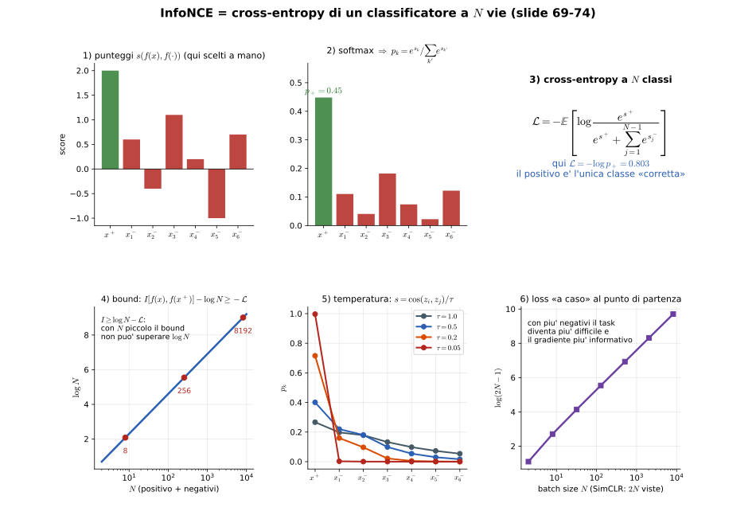

*Figura 11 — Score → softmax → cross-entropy; il bound; la temperatura; la loss a caso.*

**[Aggiunta] Gradiente rispetto agli score.** Come per ogni softmax + cross-entropy (nota 1):

$$
\frac{\partial\mathcal L}{\partial s_k}=p_k-\mathbf 1[k=0]
\quad\Longrightarrow\quad
\frac{\partial\mathcal L}{\partial s^+}=-(1-p_0),\qquad \frac{\partial\mathcal L}{\partial s^-_j}=p_j .
$$

Il positivo è spinto in su con forza $1-p_0$ (si ferma quando $p_0\to1$); ogni negativo è spinto in giù **proporzionalmente a quanto è già confuso con il positivo**: i negativi «difficili» (score alto) pesano di più.

**Esempio numerico.** Score $[2,1,0]$ → esponenziali $[7.389,\ 2.718,\ 1]$, somma $11.107$ → $p=[0.665,\ 0.245,\ 0.090]$; $\mathcal L=-\ln0.665=0.408$; gradiente rispetto agli score $=[-0.335,\ +0.245,\ +0.090]$.

**Legame con l'informazione mutua (slide 74).** La loss prende il nome InfoNCE (van den Oord et al., 2018) ed è un **limite inferiore** dell'informazione mutua tra $f(x)$ e $f(x^+)$:

$$
I\big[f(x),f(x^+)\big]-\log N\ \ge\ -\mathcal L
\quad\Longleftrightarrow\quad
I\ \ge\ \log N-\mathcal L .
$$

**Più grande è $N$, più stretto è il bound.**

**[Aggiunta] Perché $\log N$.** Con score ottimale $e^{s}\propto \dfrac{p(x^+\mid x)}{p(x^+)}$, la loss ottimale vale

$$
\mathcal L^\star=\mathbb E\,\log\Big[1+\frac{p(x^+)}{p(x^+\mid x)}\,(N-1)\Big]\ \approx\ \mathbb E\,\log\Big[\frac{p(x^+)}{p(x^+\mid x)}\,N\Big]=\log N-I,
$$

da cui la disuguaglianza. **[Nota]** Questo è il ragionamento di van den Oord et al., che usa l'approssimazione valida per $N$ grande; la derivazione rigorosa è in Poole et al., 2019 (citato a slide 74). Conseguenza pratica: $I$ non può mai essere stimata oltre $\log N$, quindi servono **molti negativi**.

**[Aggiunta] Temperatura.** Con score $s=\cos(z_i,z_j)/\tau$, $\tau$ controlla quanto il softmax è *acuto*. Con coseni $[0.9,0.6,0.5,0.2,-0.1,-0.4,-0.7]$ (positivo = il primo) lo script calcola:

| $\tau$ | $p_+$ | $\mathcal L=-\log p_+$ |
|---|---|---|
| 1.0 | 0.267 | 1.322 |
| 0.5 | 0.401 | 0.914 |
| 0.2 | 0.716 | 0.334 |
| 0.05 | 0.997 | 0.003 |

$\tau$ piccolo → distribuzione acuta, la loss si concentra sui negativi più vicini (difficili); $\tau$ grande → quasi uniforme, gradiente poco selettivo.

---

## 5. SimCLR e MoCo (slide 75–96)

### 5.1 SimCLR: un semplice framework contrastivo (slide 75–85)

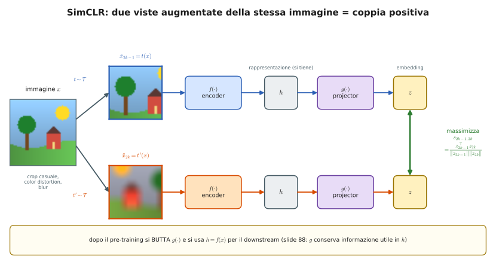

*Figura 12 — Due viste augmentate della stessa immagine formano la coppia positiva.*

**Ingredienti (slide 75–77).**

- **Score**: similarità coseno, $s(a,b)=\dfrac{a^\top b}{\|a\|\,\|b\|}$.
- **Projector** $g(\cdot)$: porta le feature in uno spazio dove si applica la loss.
- **Positivi** tramite **data augmentation**: crop casuale, distorsione di colore, blur. Da $x$ si campionano $t,t'\sim\mathcal T$ e si ottengono due viste $\tilde x_i=t(x)$, $\tilde x_j=t'(x)$.
- Pipeline: $\tilde x\xrightarrow{f}h\xrightarrow{g}z$ (rappresentazione $h$, embedding $z$).

**Positivi e negativi (slide 77–80).** Le viste della **stessa istanza** sono positive (si aumenta la loro similarità); **tutti gli altri campioni** del batch sono negativi (si diminuisce).

**Algoritmo (slide 81–83).** Dato un batch di $N$ immagini, per ciascuna $k=1,\dots,N$ si generano due viste $\tilde x_{2k-1},\tilde x_{2k}$, quindi $2N$ viste con $z_i=g(f(\tilde x_i))$. Si calcola

$$
s_{i,j}=\frac{z_i^\top z_j}{\|z_i\|\,\|z_j\|},\qquad
\ell(i,j)=-\log\frac{\exp(s_{i,j}/\tau)}{\displaystyle\sum_{k=1}^{2N}\mathbf 1[k\ne i]\,\exp(s_{i,k}/\tau)},
$$

$$
\boxed{\ \mathcal L=\frac1{2N}\sum_{k=1}^{N}\Big[\ell(2k-1,2k)+\ell(2k,2k-1)\Big]\ }
$$

La loss è calcolata prendendo **ognuna delle $2N$ viste come riferimento** e facendo la media (slide 83); i negativi sono tutte le viste **non positive** del batch (slide 82).

**[Nota] Quanti negativi?** Per ogni riferimento: 1 positivo e $2N-2$ negativi, cioè un softmax su $2N-1$ classi: nella notazione InfoNCE, $N_{InfoNCE}=2N-1$. Con pesi casuali tutte le classi sono equiprobabili e la loss iniziale è

$$\mathcal L_0=\log(2N-1).$$

(Figura 11, ultimo pannello: per $N=256$ immagini, $\log 511=6.236$.)

### 5.2 Mini-batch e matrice di affinità (slide 84–85)

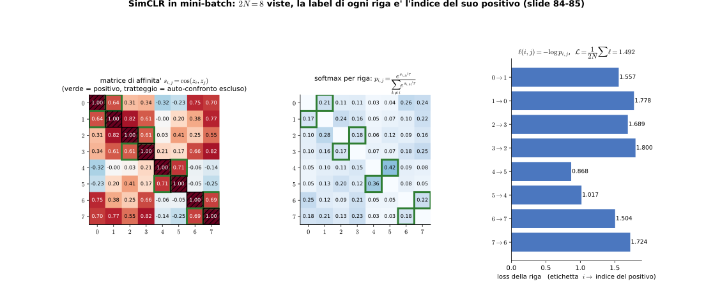

*Figura 13 — Matrice di affinità $s_{i,j}$, softmax per riga e loss per riga.*

Si calcola la **matrice di affinità** $S=[s_{i,j}]\in\mathbb R^{2N\times2N}$ (slide 84), in cui gli elementi $2k$ e $2k+1$ sono una coppia positiva (indici da 0 nelle slide). Escludendo la diagonale e applicando la softmax su ogni riga, la loss diventa una **cross-entropy di classificazione** in cui la *label di ogni riga è l'indice del suo positivo* (slide 85).

**Esempio numerico** (script, Fig. 13): $N=4$ immagini → $2N=8$ viste, embedding di dimensione 6, $\tau=0.5$. Loss per riga:

$$[1.557,\ 1.778,\ 1.689,\ 1.800,\ 0.868,\ 1.017,\ 1.504,\ 1.724]\ \Rightarrow\ \mathcal L=1.492.$$

La riga 4 (positivo con coseno $0.71$) ha la loss più bassa; le righe 1 e 3, dove il positivo non è il più simile, quella più alta. Il valore di partenza «a caso» sarebbe $\log7=1.946$.

### 5.3 Risultati e scelte di progetto (slide 86–89)

- **Linear classifier su feature SimCLR** (slide 86): encoder addestrato con SimCLR su ImageNet, poi **congelato**, e si addestra un classificatore lineare con le etichette.
- **Semi-supervised** (slide 87): fine-tuning dell'encoder con l'1% / il 10% delle etichette.
- **Projection head** (slide 88): una testa lineare o non lineare migliora la rappresentazione. Spiegazione possibile: l'obiettivo contrastivo può **scartare informazione utile** al downstream; lo spazio $z$ è addestrato a essere **invariante alle trasformazioni**; con $g(\cdot)$ si **conserva più informazione** nello spazio $h$.
- **Batch grande** (slide 89): è cruciale per SimCLR (più negativi → bound più stretto, Fig. 11); ma causa un grande consumo di memoria nella backpropagation e richiede training distribuito su TPU (esperimenti ImageNet).

### 5.4 MoCo: Momentum Contrast (slide 90–92)

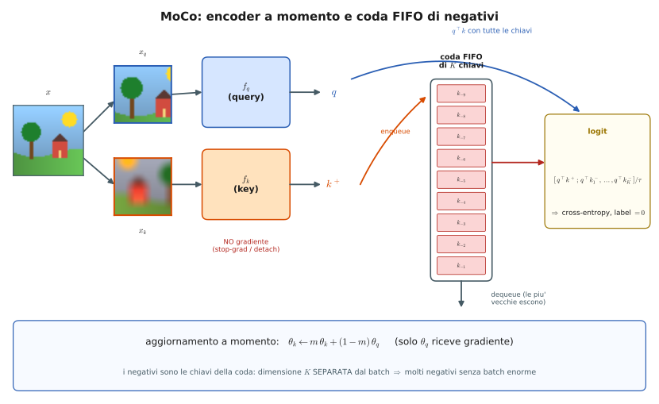

*Figura 14 — Encoder a momento e coda FIFO.*

Differenze chiave rispetto a SimCLR:

1. **Il ramo destro usa una versione a momento dell'encoder** $f_k$ (le «chiavi»): il gradiente passa **solo** per le *query* $q=f_q(x_q)$; $f_k$ è aggiornato lentamente.
2. **Coda di chiavi** (FIFO) come negativi: si aggiorna con le nuove chiavi, **disaccoppia** mini-batch e dimensione del dizionario dei negativi e permette tanti negativi **senza** batch grande.

$$
\boxed{\ \theta_k\leftarrow m\,\theta_k+(1-m)\,\theta_q\ }\qquad(m\ \text{vicino a }1)
$$

**Loss.** InfoNCE con logit $\big[q^\top k^+\,;\,q^\top k_1^-,\dots,q^\top k_K^-\big]/\tau$ e label $0$ (il positivo è la posizione 0). La chiave positiva viene dall'altra vista della stessa immagine; le $K$ negative dalla coda.

**Pseudocodice (slide 92, stile PyTorch).**

```python
f_k.params = f_q.params                       # inizializzazione
for x in loader:                              # minibatch con N campioni
    x_q = aug(x); x_k = aug(x)                # due viste augmentate
    q = f_q.forward(x_q)                      # query:  N x C
    k = f_k.forward(x_k)                      # chiavi: N x C
    k = k.detach()                            # NESSUN gradiente alle chiavi
    l_pos = bmm(q.view(N,1,C), k.view(N,C,1))     # logit positivi  N x 1
    l_neg = mm(q.view(N,C), queue.view(C,K))      # logit negativi  N x K
    logits = cat([l_pos, l_neg], dim=1)
    labels = zeros(N)                         # il positivo e' lo 0-esimo
    loss = CrossEntropyLoss(logits / t, labels)   # InfoNCE
    loss.backward(); update(f_q.params)       # SGD solo sulla query
    f_k.params = m * f_k.params + (1 - m) * f_q.params   # aggiornamento a momento
    enqueue(queue, k); dequeue(queue)         # aggiorna la coda FIFO
```

**[Aggiunta] Perché il momentum.** Srotolando la ricorsione, il parametro delle chiavi è una **media mobile esponenziale** dei parametri della query:

$$
\theta_k^{(t)}=(1-m)\sum_{s\le t}m^{\,t-s}\,\theta_q^{(s)}+m^{t}\theta_k^{(0)}.
$$

Il peso di un vecchio passo decade come $m^{\Delta}$, quindi la «memoria» effettiva è $\approx1/(1-m)$ passi: $m=0.9\to10$, $m=0.99\to100$, $m=0.999\to1000$, $m=0.9999\to10\,000$ (Fig. 15).

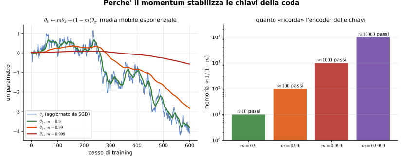

*Figura 15 — Media mobile esponenziale: più $m$ è vicino a 1, più le chiavi cambiano lentamente.*

È ciò che rende **coerenti** le chiavi accumulate nella coda: sono state calcolate da encoder molto simili, quindi i confronti tra una query attuale e una chiave vecchia hanno senso. Questo «aiuta a stabilizzare ed estendere il training» (slide 90).

### 5.5 MoCo v2 e confronto (slide 93–96)

**MoCo v2** è un ibrido (slide 93): da SimCLR prende la **projection head non lineare** e l'**augmentation forte**; da MoCo prende le **code a momento** che permettono tanti negativi **senza TPU**.

Take-away (slide 94–96):

- projection head non lineare e augmentation forte sono **cruciali**;
- **disaccoppiare** batch e numero di negativi permette a MoCo v2 di superare SimCLR con batch più piccolo (**256 contro 8192**);
- tutto ciò con un'impronta di memoria **molto minore** («end-to-end» = SimCLR).

---

## 6. Senza negativi: BYOL e SimSiam (slide 97–108)

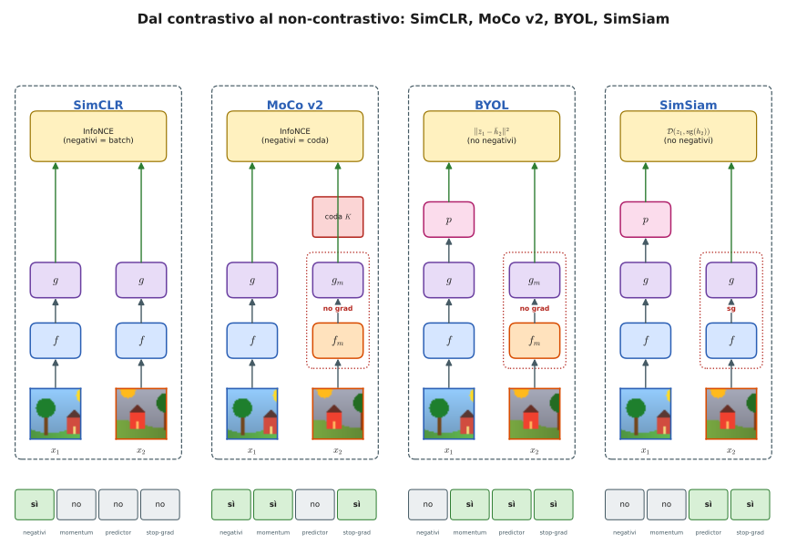

*Figura 16 — Le quattro architetture a confronto.*

### 6.1 Notazione e architettura di BYOL (slide 97–98)

Differenze rispetto a MoCo v2 (slide 97): (1) **niente negativi**; (2) un **predictor** $p$ (architettura asimmetrica). Notazione (slide 98):

$$
y_1=f(x_1),\quad y_2=f_m(x_2)\ \text{(rappresentazioni)};\qquad
h_1=g(y_1),\quad h_2=g_m(y_2)\ \text{(embedding)};\qquad
z_1=p(h_1)\ \text{(predizione)}.
$$

Il ramo destro ($f_m,g_m$) è a momento e **non riceve gradiente**.

### 6.2 Perché rimuovere i negativi è pericoloso (slide 99–101)

Con i negativi (slide 99, come SimCLR/MoCo): il riferimento è **attratto** dal positivo e **respinto** dai negativi → «good representations». Senza negativi (slide 100): tutto viene solo attratto → «bad representations».

**Scenario banale (slide 101).** Se $f=f_m=\mathbf 0$ e $g=g_m=$ random (togliendo il predictor):

$$
y_1=f(x_1)=y_2=f_m(x_2)=0,\qquad h_1=g(y_1)=h_2=g_m(y_2)=c .
$$

Gli embedding sono una **costante $c$** indipendente dall'input e la distanza è **zero**: la soluzione **collassa**.

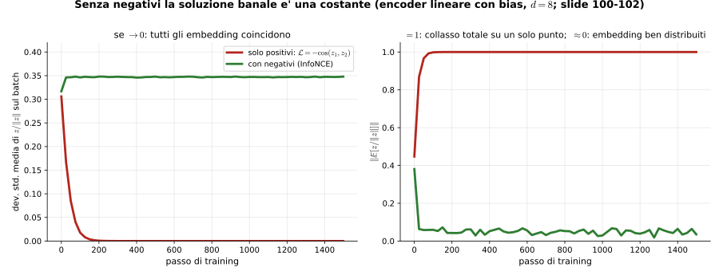

*Figura 17 — Collasso con solo positivi, in un esperimento controllato.*

**[Aggiunta] Esperimento controllato (script).** Encoder lineare con bias $z=W[x;1]$, $d=8$, due viste con rumore. Con sola loss $-\cos(z_1,z_2)$ la dev. std. degli embedding normalizzati va da $0.306$ a $0.000$ e la norma dell'embedding medio $\big\|\mathbb E[z/\|z\|]\big\|$ da $0.447$ a $1.000$ (**tutto su un punto**). Con InfoNCE (negativi) gli stessi indicatori restano sani: $0.317\to0.348$ e $0.381\to0.035$. È un'illustrazione del fenomeno, non una prova per BYOL.

### 6.3 Come BYOL evita il collasso (slide 102)

1. **Predictor** (architettura **asimmetrica**): un ramo ha $p$, l'altro no.
2. **Encoder e projector a momento** nel ramo target (EMA).

$$
\xi\leftarrow m\,\xi+(1-m)\,\theta\qquad(\xi:\ \text{parametri di } f_m,g_m).
$$

**[Aggiunta] Loss.** Si regredisce il target normalizzato:

$$
\mathcal L_{BYOL}=\left\|\frac{z_1}{\|z_1\|}-\frac{h_2}{\|h_2\|}\right\|_2^2=2-2\,\frac{\langle z_1,h_2\rangle}{\|z_1\|\,\|h_2\|},
$$

simmetrizzata scambiando i ruoli di $x_1$ e $x_2$. Per vettori unitari $\|a-b\|^2=2-2\cos(a,b)$: minimizzare la distanza equivale a **massimizzare il coseno**. Nessuna coppia negativa compare.

**[Nota]** Le slide non danno una prova formale del perché predictor + momentum evitino il collasso: lo presentano come ingredienti **necessari**. L'esperimento di Fig. 17 mostra solo il fallimento *senza* questi ingredienti.

### 6.4 SimSiam (slide 105–108)

Differenza chiave: **niente momentum** (slide 105): i due rami **condividono** i pesi. Per evitare il collasso restano due ingredienti (slide 106–107):

1. **Predictor head** (architettura asimmetrica);
2. **Stop-gradient** sul ramo che fa da target.

$$
\mathcal L_{SimSiam}=\frac12\,\mathcal D\big(z_1,\mathrm{sg}(h_2)\big)+\frac12\,\mathcal D\big(z_2,\mathrm{sg}(h_1)\big),\qquad
\mathcal D(a,b)=-\frac{a}{\|a\|}\cdot\frac{b}{\|b\|}.
$$

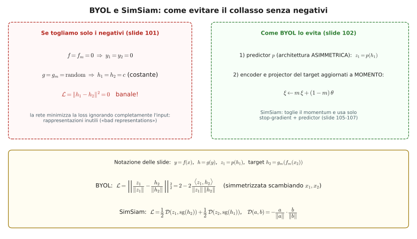

*Figura 18 — Scenario banale e rimedi.*

**[Nota]** Le slide 103–104 (BYOL) e 108 (SimSiam: ImageNet, linear classification e fine-tuning) sono tabelle di confronto con i metodi precedenti: i valori sono nelle immagini delle slide.

---

## 7. Self-distillation: DINO e successori (slide 109–116)

### 7.1 DINO (slide 109–111)

Titolo: *DINO — Self-distillation with NO labels* (Caron et al., 2021). Dall'abstract (slide 109): le feature di un ViT autosupervisionato contengono informazione **esplicita sulla segmentazione semantica** dell'immagine e sono ottimi classificatori k-NN (78.3% top-1 con un ViT piccolo); ViT-Base raggiunge 80.1% in linear evaluation. Gli ingredienti chiave: **momentum encoder**, **multi-crop training**, **patch piccoli** con i ViT. La figura 1 mostra le mappe di self-attention del token `[CLS]` dell'ultima testa (segmentazioni non supervisionate).

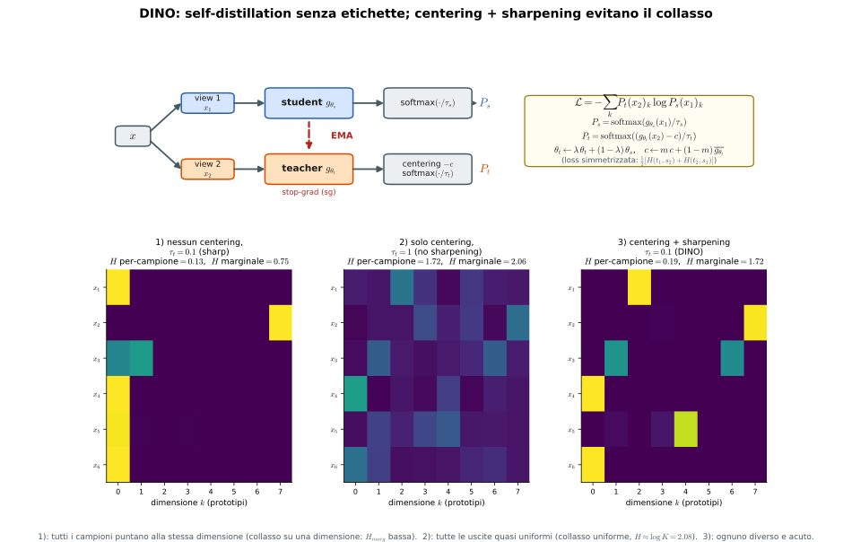

*Figura 19 — Student/teacher, centering + sharpening e i due modi di collasso.*

**Architettura (slide 110).** Due viste $x_1,x_2$ della stessa immagine: $x_1$ allo **student** $g_{\theta_s}$, $x_2$ al **teacher** $g_{\theta_t}$. Il teacher non riceve gradiente (stop-grad) ed è l'**EMA** dello student; le sue uscite sono **centrate** e poi **appuntite** (sharpening).

$$
P_s(x)=\mathrm{softmax}\!\Big(\frac{g_{\theta_s}(x)}{\tau_s}\Big),\qquad
P_t(x)=\mathrm{softmax}\!\Big(\frac{g_{\theta_t}(x)-c}{\tau_t}\Big),
$$

$$
\boxed{\ \mathcal L=-\sum_{k=1}^{K}P_t(x_2)_k\,\log P_s(x_1)_k\ }
\qquad(\text{slide 110: }-p_2\log p_1)
$$

$$
\theta_t\leftarrow\lambda\,\theta_t+(1-\lambda)\,\theta_s,\qquad
c\leftarrow m\,c+(1-m)\,\frac1B\sum_{b}g_{\theta_t}(x_b).
$$

Si noti: **non ci sono negativi**; è una cross-entropy tra due distribuzioni su $K$ dimensioni (i «prototipi»).

**Pseudocodice (slide 111, senza multi-crop).**

```python
# gs, gt: student e teacher;  C: centro (K);  tps, tpt: temperature;  l, m: momentum
gt.params = gs.params
for x in loader:                                  # minibatch di n campioni
    x1, x2 = augment(x), augment(x)               # due viste casuali
    s1, s2 = gs(x1), gs(x2)                       # uscite student  n x K
    t1, t2 = gt(x1), gt(x2)                       # uscite teacher  n x K
    loss = H(t1, s2)/2 + H(t2, s1)/2              # loss simmetrizzata
    loss.backward()
    update(gs)                                    # SGD sullo student
    gt.params = l*gt.params + (1-l)*gs.params     # EMA del teacher
    C = m*C + (1-m)*cat([t1, t2]).mean(dim=0)     # aggiornamento del centro

def H(t, s):
    t = t.detach()                                # stop gradient
    s = softmax(s / tps, dim=1)
    t = softmax((t - C) / tpt, dim=1)             # centering + sharpening
    return -(t * log(s)).sum(dim=1).mean()
```

### 7.2 Perché centering e sharpening

**[Aggiunta]** Senza negativi esistono due soluzioni banali: **(i)** il teacher dà sempre la **stessa dimensione dominante** per ogni input (collasso su una dimensione); **(ii)** il teacher dà una distribuzione **uniforme** (collasso uniforme). I due meccanismi si compensano:

- il **centering** (sottrarre $c$, la media del teacher) impedisce che una dimensione domini, ma spinge verso l'uniforme;
- lo **sharpening** (temperatura bassa $\tau_t$) rende la distribuzione acuta, ma da solo favorisce la dimensione dominante.

Esperimento dello script (Fig. 19): $B=6$ campioni, $K=8$ dimensioni, logit con un forte bias sulla dimensione 0. Misure: entropia media **per-campione** (bassa = acuta) ed entropia della **media sul batch** (alta = ogni dimensione è usata); riferimento $\log K=2.079$.

| Caso | $H$ per-campione | $H$ marginale | Esito |
|---|---|---|---|
| 1) nessun centering, $\tau_t=0.1$ | 0.13 | 0.75 | collasso su una dimensione |
| 2) solo centering, $\tau_t=1$ | 1.72 | 2.06 | quasi uniforme ($\approx\log K$) |
| 3) centering + sharpening ($\tau_t=0.1$) | 0.19 | 1.72 | campioni acuti **e** diversi ✓ |

### 7.3 DINOv2 e DINOv3 (slide 112–116)

**DINOv2** (slide 112): visualizzazione delle **prime componenti PCA** dei patch di immagini dello stesso gruppo; parti corrispondenti sono abbinate nonostante cambi di posa, stile o perfino oggetto; lo sfondo si toglie sogliando la prima componente.

**DINOv3** (slide 113–116, Siméoni et al., 2025): stessa ricetta DINO, ma con dati, architettura e ottimizzazione riprogettati per la scala.

| | DINOv2 | DINOv3 |
|---|---|---|
| Scala del teacher | 1.1B | **7B** (ViT, patch 16) |
| Dati | — | ~17B immagini pubbliche → **1.689B** curate (clustering gerarchico + campionamento bilanciato) |
| Posizioni | — | RoPE assiale + *box jitter* (evita artefatti posizionali) |
| Loss | — | DINO + iBOT + KoLeo distribuito, batch 4096 |
| Ottimizzazione | più schedule a coseno | **costanti** (LR, weight decay, EMA dopo il warm-up), 1M iterazioni |

Intuizione di fondo (slide 113): training più lungo e più grande migliora il riconoscimento **globale** ma può **degradare la coerenza locale dei patch**.

**Gram anchoring (slide 115).** Si osserva il guasto (1), si **ancora la matrice di similarità** dei patch a quella di un teacher precedente (2) e si ripara le feature dense (3). Con $X_S$ i patch L2-normalizzati dello student e $X_G$ quelli del vecchio *Gram teacher*:

$$
X_SX_S^\top\approx X_GX_G^\top,\qquad
\boxed{\ \mathcal L_{Gram}=\big\|X_SX_S^\top-X_GX_G^\top\big\|_F^2\ }
$$

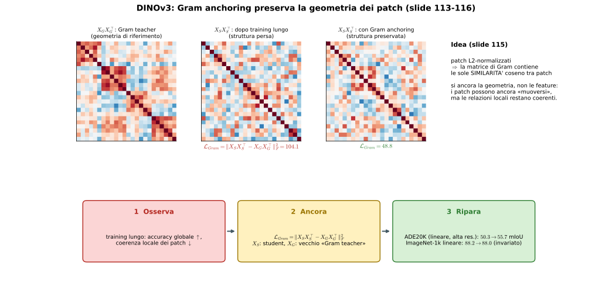

*Figura 20 — Matrici di Gram del teacher, dello student dopo training lungo e dello student ancorato.*

**[Aggiunta] Perché la Gram.** $X_SX_S^\top$ contiene solo i **coseni tra patch** (le feature sono normalizzate): si vincola la *geometria relativa* e **non** le feature stesse, che restano libere di muoversi mentre le relazioni locali rimangono coerenti. Esempio dello script ($n=24$ patch, $d=12$): $\mathcal L_{Gram}=104.1$ per lo student degradato contro $48.8$ per quello ancorato.

Risultati riportati a slide 115 (ADE20K, segmentazione lineare ad alta risoluzione; ImageNet-1k, linear): con il Gram teacher la segmentazione passa da $50.3$ a $55.7$ mIoU, mentre la accuracy lineare globale resta praticamente invariata ($88.2$ contro $88.0$).

**Distillazione e adattamento (slide 116).** Il teacher ViT-7B viene **distillato** in una famiglia di backbone più piccoli: ViT-S (21M), S+ (29M), B (86M), L (0.3B), H+ (0.8B). Pre-training principale a $256^2$; poi adattamento ad alta risoluzione (crop globali misti a 512/768, +10k iterazioni; feature map stabili oltre 4K). I backbone sono usati **congelati** per segmentazione, profondità, corrispondenze 3D, tracking, retrieval, classificazione.

---

## 8. Riepilogo, collegamenti, quando usare cosa (slide 117–122)

### 8.1 Riepilogo (slide 117–120)

- **InfoNCE** (slide 117): classificazione a $N$ vie tra positivo e negativi; limite inferiore dell'informazione mutua tra $f(x)$ e $f(x^+)$.
- **SimCLR** (118): framework semplice ed efficace; idea chiave la **projection head non lineare**; richiede **batch grande** e molta memoria.
- **MoCo v1/v2** (119): contrastivo con encoder a momento; **disaccoppia** negativi e batch; MoCo v2 combina projection head e augmentation forte di SimCLR con il momentum.
- **BYOL e SimSiam** (120): i positivi sono viste augmentate dello stesso campione; si **tolgono** i negativi (BYOL) e anche il **momentum** (SimSiam). Ingredienti: augmentation pesante, projection + predictor head, nessun batch grande (SimSiam), **stop-gradient**.

### 8.2 Formule chiave

| Concetto | Formula |
|---|---|
| Pretext/downstream | $\min_{\theta,\phi}\ \ell\big(h_\phi(f_\theta(\tilde x)),y\big)$; poi $\min_{W,b}\mathrm{CE}\big(Wf_{\theta^\star}(x)+b,y\big)$ |
| Rotazione | $\mathcal L=-\frac14\sum_{k=0}^3\log p_\theta(k\mid\mathrm{rot}_k(x))$; a caso $=\log4$ |
| Jigsaw | classificazione su $K$ permutazioni di Hamming massima; $9!=362\,880$ |
| Inpainting | $\mathcal L=\lambda_{rec}\|M\odot(x-F(\cdot))\|^2+\lambda_{adv}\mathcal L_{adv}$; L2 $\Rightarrow$ media |
| Video coloring | $A_{ji}=\mathrm{softmax}_i(f_j^\top f_i/\tau)$, $\hat c_j=\sum_iA_{ji}c_i$ |
| MAE | $\mathcal L=\frac1{|\mathcal M|}\sum_{p\in\mathcal M}\|\hat x_p-x_p\|^2$; costo $\propto N_v=(1-r)N_p$ |
| InfoNCE | $-\mathbb E\log\frac{e^{s^+}}{e^{s^+}+\sum_je^{s^-_j}}$; $\partial\mathcal L/\partial s_k=p_k-\mathbf 1[k=0]$ |
| Bound | $I\ge\log N-\mathcal L$ |
| SimCLR | $\mathcal L=\frac1{2N}\sum_k[\ell(2k{-}1,2k)+\ell(2k,2k{-}1)]$; a caso $\log(2N-1)$ |
| MoCo | $\theta_k\leftarrow m\theta_k+(1-m)\theta_q$; coda di $K$ negativi; memoria $\approx1/(1-m)$ |
| BYOL | $2-2\cos(z_1,h_2)$; $z=p(h)$; target a momento |
| SimSiam | $\frac12\mathcal D(z_1,\mathrm{sg}(h_2))+\frac12\mathcal D(z_2,\mathrm{sg}(h_1))$ |
| DINO | $-\sum_kP_t(x_2)_k\log P_s(x_1)_k$; centering $-c$ e $\tau_t$ basso |
| Gram anchoring | $\|X_SX_S^\top-X_GX_G^\top\|_F^2$ |

### 8.3 Quando usare cosa

| Situazione | Scelta | Motivo |
|---|---|---|
| Pochissime risorse, voglio un baseline semplice | rotazione / colorizzazione | pretext economico, nessun batch grande |
| Immagini + tanta capacità, voglio pre-training efficiente | **MAE** | encoder solo sul 25% dei patch |
| Posso usare batch enormi / molti acceleratori | SimCLR | semplice, i negativi vengono dal batch |
| Memoria limitata ma voglio molti negativi | **MoCo v2** | coda FIFO, batch 256 |
| Non voglio gestire i negativi | BYOL / SimSiam | niente negativi; attenzione al collasso (predictor, stop-grad) |
| Feature dense per segmentazione/profondità/tracking | **DINO / DINOv3** | feature forti su patch; Gram anchoring |
| Dati da video | colorizzazione video | il tracking emerge dalla corrispondenza |

### 8.4 Come si collega tutto

```
Supervisione (etichette costose, supervision collapse)
        │
        ▼
Pretext task (etichette gratuite)          ← valutazione: linear probing / fine-tuning
   ├─ trasformazioni: rotazione, patch, jigsaw, inpainting, colorizzazione
   ├─ ricostruzione: MAE (maschera 75%, encoder sui visibili)
   └─ legate al pretext?  ──► serve un task più generale
                                   │
                                   ▼
Contrastivo: positivi ≈ , negativi ≠   (InfoNCE = CE a N vie, bound su MI)
   ├─ SimCLR  (negativi = batch grande, projection head)
   └─ MoCo v1/v2 (negativi = coda, encoder a momento)
                                   │  togliere i negativi → COLLASSO
                                   ▼
Non contrastivo
   ├─ BYOL    (predictor + momentum + stop-grad)
   ├─ SimSiam (predictor + stop-grad)
   └─ DINO → v2 → v3 (self-distillation, centering + sharpening, Gram anchoring)
```

### 8.5 Collegamenti con le note precedenti

- **Nota 1** (softmax, cross-entropy, CNN): InfoNCE è una softmax + cross-entropy; il gradiente $p_k-\mathbf 1[k=0]$ è lo stesso.
- **Nota 2** (training): EMA di MoCo/BYOL/DINO, normalizzazione, schedule; il momentum dei pesi **non** è il momentum dell'ottimizzatore.
- **Note 3–4** (sequenze, Transformer): MAE e DINO usano **ViT** (patch, positional encoding, blocchi transformer); il costo $\approx 12d^2N_v+2N_v^2d$ è quello dei blocchi della nota 4.
- **Nota 5** (detection, segmentazione): sono i **downstream** su cui si misura il trasferimento (Pascal VOC, ADE20K); l'encoder–decoder dell'inpainting è l'autoencoder che si ritrova nella segmentazione.

### 8.6 Esercizi (con soluzione)

1. **Loss iniziale SimCLR.** $N=256$. *Sol.*: $2N=512$ viste; softmax su $511$ classi; $\mathcal L_0=\ln511=6.236$.
2. **MAE.** Immagine $224^2$, patch $16^2$, $r=0.75$. Quanti token vede l'encoder e di quanto scende il costo dell'attention? *Sol.*: $N_p=196$, $N_v=49$; il termine quadratico scende di $(49/196)^2=1/16$.
3. **Gradiente InfoNCE.** Score $[1,1,1,1]$, positivo il primo. *Sol.*: $p=0.25$ per tutti; $\mathcal L=\ln4=1.386$; $\partial\mathcal L/\partial s=[-0.75,\,0.25,\,0.25,\,0.25]$.
4. **EMA.** $m=0.99$: che frazione del peso totale è sugli ultimi 100 passi? *Sol.*: $1-m^{100}=1-0.366=0.634$; il peso di $\theta_q$ di 100 passi fa è $(1-m)m^{100}=0.0037$.
5. **BYOL.** Se $\cos(z_1,h_2)=0.8$, quanto vale la loss? *Sol.*: $2-2\cdot0.8=0.4$; è $0$ solo se $z_1\parallel h_2$.
6. **Jigsaw.** Due permutazioni distinte di 9 tile possono differire in meno di 2 posizioni? *Sol.*: no (una trasposizione cambia 2 posizioni, $d_{min}\ge2$); la selezione greedy con $K=64$ dello script porta $d_{min}$ a $6$.
7. **Collasso.** Perché con $f=\mathbf 0$ la loss $\|h_1-h_2\|^2$ è nulla ma inutile? *Sol.*: $h_1=h_2=g(0)=c$ per ogni input: perfetta *e* indipendente dall'immagine.

### 8.7 File generati

- `nota6_self_supervised.md` — questa nota.
- `genera_figure_ssl.py` — script con **tutto** il codice delle figure (21 SVG); eseguendolo si riscrivono gli `.svg` nella stessa cartella e si stampano i numeri calcolati (permutazioni jigsaw, maschera MAE e costo, InfoNCE ottimizzata su una circonferenza, matrice di affinità SimCLR, temperatura, EMA, collasso, centering/sharpening, matrici di Gram, ecc.). Richiede solo `numpy` e `matplotlib`; le formule sono in sintassi LaTeX rese con il font Computer Modern.
- `fig_*.svg` — le figure referenziate nel testo: `fig_ssl_paradigm`, `fig_probe_vs_finetune`, `fig_rotation`, `fig_patch_tasks`, `fig_inpainting`, `fig_colorization`, `fig_video_coloring`, `fig_mae`, `fig_mae_cost`, `fig_contrastive_intuition`, `fig_infonce`, `fig_simclr_pipeline`, `fig_simclr_matrix`, `fig_moco`, `fig_moco_momentum`, `fig_architectures`, `fig_collapse`, `fig_byol_simsiam`, `fig_dino`, `fig_dinov3`, `fig_landscape`.

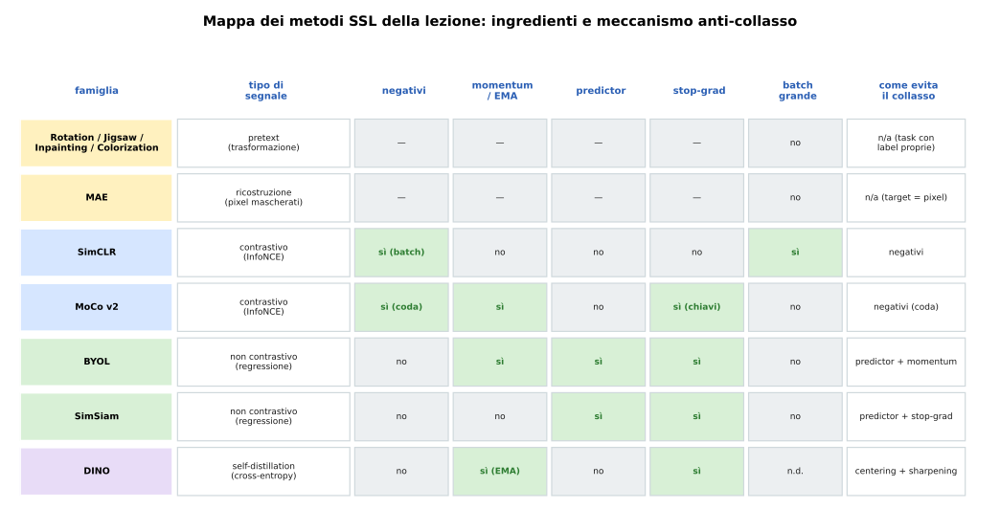

*Figura 21 — Mappa dei metodi della lezione: ingredienti e meccanismo anti-collasso.*
