# Advanced Machine Learning and Computer Vision — Formalizzazione matematica (2)

**Contenuto:** *05 – Training Neural Networks* (Prof. F. Galasso, Sapienza), 96 slide.
**Scopo:** formalizzare ogni concetto delle slide, esplicitare tutti i passaggi e aggiungere le derivazioni che nelle slide sono solo accennate o sono mostrate come immagini senza spiegazione. Questa nota continua quella su *Recap on Image Classification, NN e CNN*: i rimandi del tipo «nota 1, sez. X» si riferiscono a quel documento.

> Le parti marcate con **[Aggiunta]** non sono nelle slide ma servono a completare il ragionamento.
> Le parti marcate con **[Nota]** segnalano imprecisioni, convenzioni o dettagli delle slide.
> Le figure sono generate da `genera_figure.py` (stessa cartella, output in `img/`). Le statistiche delle attivazioni (sez. 4) sono **simulazioni reali** con seed fisso che riproducono i numeri delle slide.

---

## 0. Notazione e mappa della lezione

| Simbolo | Significato |
|---|---|
| $x$, $X\in\mathbb{R}^{N\times D}$ | input / matrice dati (un esempio per riga) |
| $W_l, b_l$ | pesi e bias dello strato $l$ |
| $s_l = h_{l-1}W_l+b_l$ | pre-attivazione dello strato $l$ |
| $h_l=\phi(s_l)$ | attivazione (output) dello strato $l$ |
| $\delta_l=\partial L/\partial s_l$ | gradiente della loss rispetto alla pre-attivazione |
| $D_{in}$ | *fan-in*: numero di ingressi di un neurone (per conv: $k^2C_{in}$) |
| $\mu,\sigma^2$ | media e varianza (di batch, o di training) |
| $\gamma,\beta$ | scala e traslazione apprese della normalizzazione |
| $p$ | probabilità di **tenere** un neurone nel dropout (vedi [Nota] sez. 7.2) |
| $\eta$ | learning rate; $\lambda$ weight decay |

**Perché questa lezione.** Nella nota 1 abbiamo definito *che cosa* è una rete e *come* si calcola il gradiente (backprop). Qui si risponde a: *come si fa a far funzionare l'addestramento in pratica?* Le slide seguono questo ordine:

```
Componenti delle CNN (slide 2)
 ├─ Attivazioni            (3-20)   → quale non linearità usare
 ├─ Preprocessing          (21-24)  → come preparare i dati
 ├─ Inizializzazione       (25-34)  → da dove partire con i pesi
 ├─ Normalizzazione        (35-50)  → BatchNorm, LayerNorm, InstanceNorm, GroupNorm
 ├─ Train vs test          (51-53)  → gap di generalizzazione, early stopping
 ├─ Regolarizzazione       (54-80)  → L2, Dropout, data augmentation, Cutout, Mixup
 ├─ Iperparametri          (81-85)  → ricetta in 7 passi + diagnosi delle curve
 └─ Transfer learning      (86-95)  → riusare reti pre-addestrate
```

---

## 1. Componenti delle CNN (slide 2)

La slide elenca i blocchi con cui si costruisce una CNN:

| Blocco | Cosa fa | Dove è trattato |
|---|---|---|
| **Convolution layers** | estraggono feature locali con pesi condivisi | nota 1, sez. 13-16 |
| **Pooling layers** | sotto-campionano le mappe | nota 1, sez. 18 |
| **Fully-connected layers** | combinano le feature in score di classe | nota 1, sez. 4, 10 |
| **Activation function** | introduce non linearità | questa nota, sez. 2 |
| **Regularization** | riduce l'overfitting (Dropout, BN, augmentation, …) | questa nota, sez. 5 e 7 |

Una CNN è quindi una composizione
$$
f(x)=\text{FC}\Big(\text{pool}\big(\phi(\text{conv}(\cdots\text{pool}(\phi(\text{conv}(x)))\cdots))\big)\Big),
$$
e questa lezione riguarda tutto ciò che sta **intorno** a questi blocchi (come sceglierli e come addestrarli).

---

## 2. Funzioni di attivazione (slide 3–20)

Slide 4 elenca: Sigmoid, tanh, ReLU, Leaky ReLU, Maxout, ELU (e poi GELU). Le formule base sono già nella nota 1, sez. 11; qui si ricostruiscono i **problemi** di ciascuna con le derivazioni.

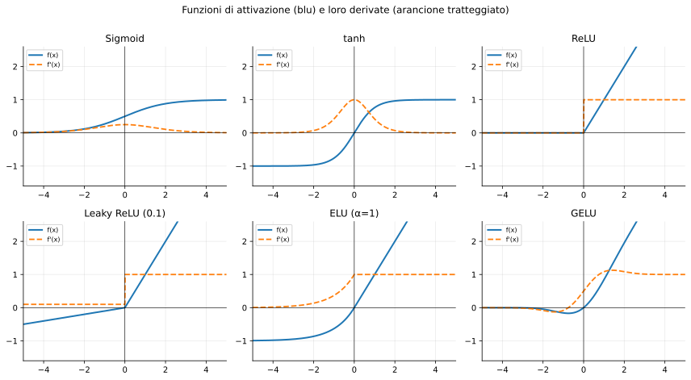

### 2.1 Sigmoide (slide 5–10)

$$
\sigma(x)=\frac{1}{1+e^{-x}}\in(0,1),\qquad \sigma'(x)=\sigma(x)\big(1-\sigma(x)\big)
$$

*Derivazione di $\sigma'$:* $\sigma'(x)=\dfrac{e^{-x}}{(1+e^{-x})^2}=\dfrac{1}{1+e^{-x}}\cdot\dfrac{1+e^{-x}-1}{1+e^{-x}}=\sigma(1-\sigma)$.

Pro (slide): storicamente popolare perché interpretabile come *firing rate* saturante di un neurone. **Tre problemi:**

#### Problema 1 — I neuroni saturi «uccidono» i gradienti (slide 6–8)

Il *sigmoid gate* riceve $x$ in avanti e dall'indietro un gradiente upstream $\dfrac{\partial L}{\partial\sigma}$. La regola della catena (nota 1, sez. 9.2) dà il gradiente downstream:

$$
\frac{\partial L}{\partial x}=\underbrace{\frac{\partial\sigma}{\partial x}}_{\text{locale}}\ \underbrace{\frac{\partial L}{\partial\sigma}}_{\text{upstream}}=\sigma(x)\big(1-\sigma(x)\big)\,\frac{\partial L}{\partial\sigma}.
$$

Valori numerici (calcolati):

| $x$ | $\sigma(x)$ | $\sigma'(x)$ | commento |
|---|---|---|---|
| $-10$ | $4.54\cdot10^{-5}$ | $4.54\cdot10^{-5}$ | saturo a sinistra |
| $0$ | $0.5$ | $\mathbf{0.25}$ | massimo possibile |
| $+10$ | $0.99995$ | $4.54\cdot10^{-5}$ | saturo a destra |

Domanda della slide 7 («Why is this a problem?») e risposta della slide 8: se $x$ è molto grande in modulo, $\sigma'\approx0$, quindi **tutti i gradienti che fluiscono indietro sono ≈ 0 e i pesi non cambiano più**.

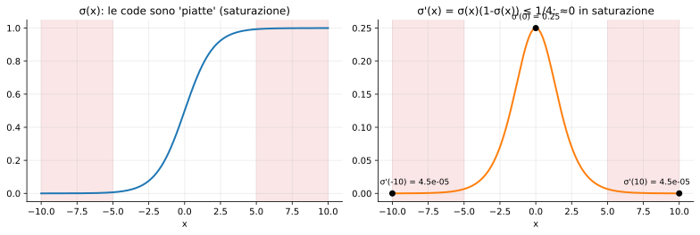

**[Aggiunta] Effetto cumulato (vanishing gradient).** Il gradiente rispetto a un parametro dello strato $1$ in una rete di $L$ strati sigmoidali contiene il prodotto
$$
\prod_{l=2}^{L}\sigma'(s_l)\cdot\|W_l\|\ \lesssim\ (0.25\,\|W\|)^{L-1}.
$$
Anche nel caso migliore ($\sigma'=1/4$) ogni strato attenua di un fattore 4 (se $\|W\|\approx1$); con 10 strati: $4^{-10}\approx10^{-6}$. Con un solo neurone saturo ($\sigma'=4.5\cdot10^{-5}$) il gradiente passa da $1$ a $4.5\cdot10^{-5}$.

#### Problema 2 — Output non zero-centered (slide 9)

Gli output $\sigma\in(0,1)$ sono **sempre positivi**. Un neurone dello strato successivo calcola $a=\sum_i w_ix_i+b$ con tutti gli $x_i>0$. Il gradiente rispetto ai pesi è

$$
\frac{\partial L}{\partial w_i}=\frac{\partial L}{\partial a}\cdot\frac{\partial a}{\partial w_i}=\underbrace{\frac{\partial L}{\partial a}}_{\delta\ (\text{scalare})}\,x_i .
$$

Poiché $x_i>0$ per ogni $i$, **tutte le componenti di $\nabla_wL$ hanno lo stesso segno** (quello di $\delta$): in un passo i pesi possono solo aumentare tutti oppure diminuire tutti. In 2D, gli aggiornamenti ammessi stanno nel 1° e 3° quadrante.

Se la soluzione ottima richiede, p.es., $w_1\uparrow$ e $w_2\downarrow$, non si può andare in linea retta: serve una sequenza di passi alternati $(+,+)$ e $(-,-)$, cioè un **percorso a zig-zag** (lento).

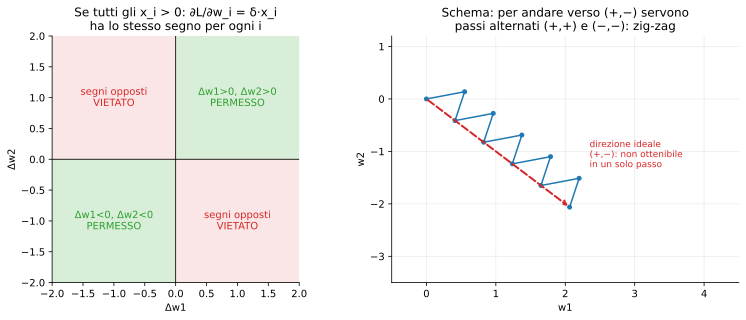

**[Aggiunta]** Il problema si attenua (ma non scompare) con minibatch perché campioni diversi hanno $\delta$ di segno diverso e si sommano; è un fastidio di ottimizzazione, meno grave del problema 1.

#### Problema 3 — $\exp()$ è costosa (slide 10)

Il calcolo di $e^{-x}$ costa molto più di un confronto o di una moltiplicazione (confronta con ReLU).

### 2.2 tanh (slide 11, [LeCun et al., 1991])

$$
\tanh x=\frac{e^x-e^{-x}}{e^x+e^{-x}}=2\sigma(2x)-1,\qquad \tanh'(x)=1-\tanh^2(x)\le 1.
$$

*Derivazione di $\tanh'$:* con $u=e^x-e^{-x}$, $v=e^x+e^{-x}$: $\tanh'=\dfrac{v\cdot v-u\cdot u}{v^2}=1-\tanh^2$ (perché $u'=v$, $v'=u$).

- Range $[-1,1]$, **zero-centered** (risolve il problema 2);
- **ma** satura ancora: per $|x|$ grande $\tanh^2\to1$, quindi $\tanh'\to0$ («still kills gradients when saturated»).

### 2.3 ReLU — Rectified Linear Unit (slide 12–14, [Krizhevsky et al., 2012])

$$
f(x)=\max(0,x),\qquad f'(x)=\mathbb{1}[x>0].
$$

Vantaggi (slide): **non satura** nella regione positiva (derivata $=1$, il gradiente passa intatto); molto efficiente (un confronto); converge molto più in fretta di sigmoide/tanh (circa **6×** in AlexNet).

Svantaggi:
- **Non zero-centered** (output $\ge0$, vedi problema 2).
- **«An annoyance»** (slide 14, hint: *what is the gradient when $x<0$?*): per $x<0$ la derivata è **0**. Se per un neurone $a=w^\top x+b<0$ per *tutti* gli esempi di training, il gradiente verso $w,b$ è sempre zero → il neurone non si aggiorna mai più: **dead ReLU**. Cause tipiche: inizializzazione sfortunata (iperpiano fuori dalla nuvola di dati) e learning rate troppo alto (un grosso passo spinge il bias molto negativo). Per questo la TLDR dice «be careful with your learning rates».

**[Aggiunta]** In $x=0$ la ReLU non è derivabile; per convenzione si usa un sotto-gradiente (0 o 1), irrilevante in pratica perché $x=0$ esatto ha probabilità trascurabile.

### 2.4 Leaky ReLU (slide 15, [Maas et al., 2013], [He et al., 2015])

$$
f(x)=\max(\alpha x,\,x),\qquad f'(x)=\begin{cases}1&x>0\\ \alpha&x<0\end{cases}
$$

con $\alpha$ piccolo (0.01 in Maas et al.; la tabella della nota 1 usava 0.1 come esempio grafico). Non satura, è efficiente, converge come ReLU e **«non muore»** perché la derivata per $x<0$ è $\alpha\neq0$.

**[Aggiunta] PReLU** (He et al., 2015, citata nella slide): $\alpha$ diventa un parametro appreso. Dalla regola della catena, per $x<0$ è $\partial f/\partial\alpha=x$, quindi $\partial L/\partial\alpha=\sum_{\text{pos. con }x<0}\frac{\partial L}{\partial f}\,x$.

### 2.5 Maxout (slide 4, solo elencata)

$$
f(x)=\max\big(w_1^\top x+b_1,\ w_2^\top x+b_2\big).
$$

Generalizza ReLU ($w_1=w,\,w_2=0$) e Leaky ReLU. Il gradiente va al ramo massimo (max gate, nota 1, sez. 9.4). Costo: **raddoppia i parametri** per neurone.

### 2.6 ELU — Exponential Linear Unit (slide 16, [Clevert et al., 2015])

$$
f(x)=\begin{cases}x&x>0\\ \alpha\,(e^{x}-1)&x\le0\end{cases}\qquad
f'(x)=\begin{cases}1&x>0\\ \alpha e^{x}=f(x)+\alpha&x\le0\end{cases}
$$

*Continuità in 0:* $\alpha(e^0-1)=0$. *Asintoto:* $f(x)\to-\alpha$ per $x\to-\infty$.

Slide: tutti i benefici della ReLU; uscite **più vicine a media zero** (i valori negativi bilanciano quelli positivi); il **regime di saturazione negativo** (rispetto alla Leaky ReLU) aggiunge robustezza al rumore (un input molto negativo non produce una risposta enorme); ma richiede $\exp()$. Usata in GAT (Veličković et al., 2018).

### 2.7 GELU — Gaussian Error Linear Unit (slide 17–19, [Hendrycks et al., 2016])

$$
\boxed{f(x)=x\,\Phi(x)},\qquad \Phi(x)=P(Z\le x)=\tfrac12\Big(1+\operatorname{erf}\tfrac{x}{\sqrt2}\Big),\ Z\sim\mathcal N(0,1).
$$

($\Phi$ è la CDF della normale standard: è la curva mostrata a destra nelle slide 17–19.)

**Interpretazione [Aggiunta].** $x\Phi(x)=\mathbb{E}_{Z}\big[x\cdot\mathbb 1[Z\le x]\big]$: l'ingresso viene «lasciato passare» con probabilità $\Phi(x)$, che cresce con $x$. È una versione **liscia e deterministica** di un gate stocastico (ReLU = gate $\mathbb 1[x>0]$).

**Derivata [Aggiunta].** Con $\varphi(x)=\frac1{\sqrt{2\pi}}e^{-x^2/2}$ la densità normale e $\Phi'=\varphi$:
$$
f'(x)=\Phi(x)+x\,\varphi(x).
$$

**Approssimazioni usate nelle librerie:** $x\,\sigma(1.702\,x)$ oppure $0.5x\big(1+\tanh\!\big[\sqrt{2/\pi}\,(x+0.044715x^3)\big]\big)$.

Proprietà (slide 19):
- **comportamento «molto bello» attorno a 0**, liscio ovunque (la smoothness facilita l'addestramento);
- costo computazionale maggiore della ReLU;
- è **non monotona**: ha un minimo $\approx-0.17$ in $x\approx-0.75$ (calcolato numericamente);
- per grandi valori negativi il gradiente tende comunque a 0 ($\Phi(x)\to0$);
- usata in **GPT-3, BERT** e nella maggior parte dei Transformer.

### 2.8 TLDR (slide 20)

| Raccomandazione | Motivo |
|---|---|
| **Usa ReLU**, attenzione ai learning rate | economica, non satura, converge in fretta |
| Prova Leaky ReLU / PReLU / GELU | piccoli guadagni marginali |
| **Non usare sigmoide né tanh** negli strati nascosti | saturazione → vanishing gradient |

**[Aggiunta]** La sigmoide resta lecita dove serve un output in $(0,1)$ (es. un gate, una probabilità binaria) e la tanh nelle RNN/LSTM; la raccomandazione riguarda gli strati nascosti delle reti feed-forward/CNN.

---

## 3. Data preprocessing (slide 21–24)

Sia $X\in\mathbb{R}^{N\times D}$ la matrice dati (un esempio per riga). Le due operazioni (slide 22):

$$
\boxed{X \leftarrow X-\mu,\ \ \mu_j=\frac1N\sum_{i=1}^{N}X_{ij}}\qquad\text{(zero-centering; \texttt{X -= np.mean(X, axis=0)})}
$$
$$
\boxed{X \leftarrow X/\sigma,\ \ \sigma_j=\sqrt{\frac1N\sum_i (X_{ij}-\mu_j)^2}}\qquad\text{(normalizzazione; \texttt{X /= np.std(X, axis=0)})}
$$

Dopo entrambe: ogni feature ha media 0 e varianza 1, quindi la nuvola di punti è centrata nell'origine e ha «dimensioni» simili lungo gli assi.

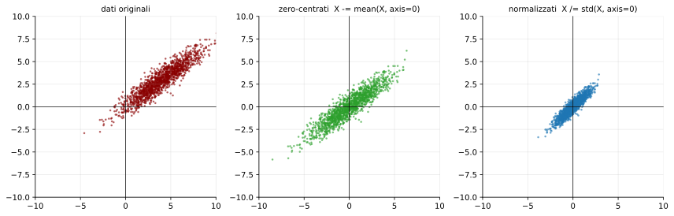

### 3.1 Perché serve (slide 23)

La slide dice: prima della normalizzazione la loss di classificazione è *molto sensibile ai cambi della matrice dei pesi* (difficile da ottimizzare); dopo, è *meno sensibile* (più facile).

**Derivazione.** Per un classificatore lineare lo score è $s=w^\top x+b$. Una piccola perturbazione $\Delta w$ cambia lo score di
$$
\Delta s=\Delta w^\top x,\qquad |\Delta s|\le\|\Delta w\|\,\|x\|.
$$
Se i dati sono lontani dall'origine ($\|x\|$ grande, es. tutti pixel positivi), anche una minuscola rotazione dell'iperpiano $w^\top x+b=0$ sposta molti punti da un lato all'altro: la loss varia moltissimo per cambi minimi di $W$ → paesaggio «ripido e stretto», serve un learning rate minuscolo.

La figura qui sotto lo mostra: la **stessa rotazione di 6°** del confine cambia il lato del 50% dei punti se la nuvola è lontana dall'origine, ma solo del 2% se è centrata (valori calcolati dalla simulazione).

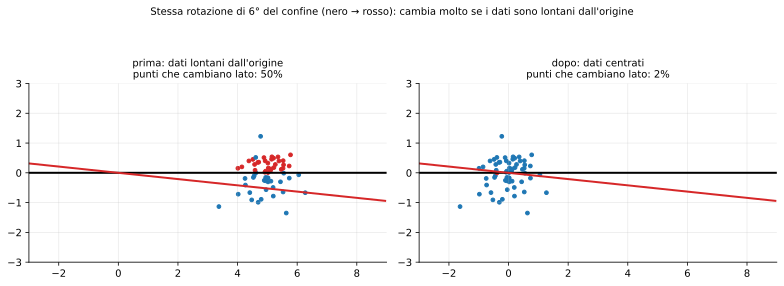

**[Aggiunta] Legame con la sezione 2.1.** Se gli ingressi non sono centrati, $\partial L/\partial w=\delta\,x$ è dominato dalla componente media di $x$ → stesso effetto zig-zag dei sigmoidi non zero-centered. Centrare i dati lo evita già al primo strato.

**[Aggiunta] Altre tecniche.** Decorrelazione (PCA) e *whitening* ($X\to\Lambda^{-1/2}U^\top X$ con $\operatorname{Cov}=U\Lambda U^\top$) rendono la covarianza identità; con le immagini non si usano perché i pixel sono ancora molto correlati ma la CNN sfrutta già la struttura spaziale (la slide 24 infatti dice «*center only*»).

### 3.2 Pratica per le immagini (slide 24) — esempio CIFAR-10, immagini $[32,32,3]$

| Metodo | Statistica | Dimensione | Usato in |
|---|---|---|---|
| Sottrai l'**immagine media** | $\bar I[i,j,c]=\frac1N\sum_n I_n[i,j,c]$ | array $[32,32,3]$ ($=3072$ numeri) | AlexNet |
| Sottrai la **media per canale** | $\mu_c=\frac1{NHW}\sum_{n,i,j}I_n[i,j,c]$ | 3 numeri | VGGNet |
| Sottrai la media per canale e **dividi per la std per canale** | $(I-\mu_c)/\sigma_c$ | 3 + 3 numeri | ResNet |

**Regole importanti [Aggiunta]:**
1. $\mu,\sigma$ si calcolano **solo sul training set** e si applicano *identici* a validation e test (altrimenti c'è *data leakage* e distribuzioni diverse).
2. Se si usa un modello pre-addestrato (sez. 10) bisogna usare **le stesse statistiche con cui è stato addestrato** (per i modelli ImageNet di torchvision: media $(0.485,0.456,0.406)$, std $(0.229,0.224,0.225)$ su RGB in $[0,1]$).
3. Si aggiunge un $\varepsilon$ al denominatore se una $\sigma_c$ può essere ≈ 0.

---

## 4. Inizializzazione dei pesi (slide 25–34)

### 4.1 Q: cosa succede con $W$ = costante? (slide 26)

Considera una rete (input, hidden, output) con tutti i pesi uguali a una costante $c$ (anche $0$).

**Dimostrazione della simmetria.** Siano $j,k$ due neuroni dello stesso strato nascosto con pesi in ingresso uguali: $w_{\cdot j}=w_{\cdot k}$ e pesi in uscita uguali: $v_{j\cdot}=v_{k\cdot}$.

1. *Forward:* $s_j=\sum_iw_{ij}x_i=s_k\Rightarrow h_j=\phi(s_j)=h_k$.
2. *Backward:* $\delta_j=\phi'(s_j)\sum_m v_{jm}\frac{\partial L}{\partial o_m}=\delta_k$ (stessi $v$, stessi $s$).
3. *Gradiente:* $\partial L/\partial w_{ij}=x_i\delta_j=x_i\delta_k=\partial L/\partial w_{ik}$.

Dopo l'aggiornamento $w_{ij}\leftarrow w_{ij}-\eta x_i\delta_j$ e $w_{ik}$ restano **uguali**: per induzione i neuroni sono identici per sempre. La rete è equivalente a una con **un solo neurone per strato** (perdita di capacità): serve **rompere la simmetria** con valori casuali.

Con $c=0$ e ReLU è anche peggio: $h=0$ ovunque e $\partial L/\partial W_1=x^\top\delta_1$ con $\delta_1\propto W_2^\top(\cdot)=0$ → nessun apprendimento (i bias invece possono partire da 0, che non crea simmetria).

### 4.2 Piccoli numeri casuali: $W=0.01\cdot\text{randn}$ (slide 27–30)

Codice della slide: rete a 6 strati, hidden size 4096, tanh, 16 esempi in input.

```python
dims = [4096] * 7
x = np.random.randn(16, dims[0])
for Din, Dout in zip(dims[:-1], dims[1:]):
    W = 0.01 * np.random.randn(Din, Dout)
    x = np.tanh(x.dot(W))
```

Domanda: *cosa succede alle attivazioni dell'ultimo strato?* Risposta: **tendono tutte a zero** per gli strati profondi.

**Derivazione della varianza [Aggiunta].** Assumi $w_{ij}$ i.i.d. a media zero e varianza $\sigma_w^2$, indipendenti dagli ingressi $h_i$. Per $s_j=\sum_{i=1}^{D_{in}}w_{ij}h_i$:
$$
\operatorname{Var}(s_j)=\sum_{i=1}^{D_{in}}\operatorname{Var}(w_{ij}h_i)=\sum_i\mathbb{E}[w_{ij}^2]\,\mathbb{E}[h_i^2]=D_{in}\,\sigma_w^2\,\mathbb{E}[h^2],
$$
(si usa $\mathbb E[w]=0$, quindi $\operatorname{Var}(wh)=\mathbb E[w^2h^2]=\mathbb E[w^2]\mathbb E[h^2]$). Con $\sigma_w=0.01$, $D_{in}=4096$:
$$
D_{in}\sigma_w^2=4096\cdot10^{-4}=0.41\ \Rightarrow\ \text{std}(s_l)\approx\sqrt{0.41}\,\text{std}(h_{l-1})=0.64\,\text{std}(h_{l-1}).
$$
Con la tanh vicino a zero ($\tanh x\approx x$) ogni strato moltiplica la scala per $\approx0.64$: $0.49\to0.29\to0.18\to0.11\to0.07\to0.05$ (valori delle slide, **riprodotti** dalla simulazione: sono *esattamente* i numeri mostrati).

**Gradienti (slide 29–30):** *«What do the gradients $dL/dW$ look like?»* → *«All zero, no learning»*. Infatti
$$
\frac{\partial L}{\partial W_l}=h_{l-1}^\top\,\delta_l,\qquad \delta_l=\big(\delta_{l+1}W_{l+1}^\top\big)\odot\phi'(s_l).
$$
Sia $h_{l-1}$ (che è ≈0 per gli strati profondi) sia $\delta_l$ (che a ritroso viene moltiplicato per $W^\top$, anch'esso con fattore ≈0.64 per strato) sono minuscoli → il prodotto è ≈ 0.

**[Aggiunta] Il caso opposto**: $W=0.05\cdot\text{randn}$ → $D_{in}\sigma_w^2=10.2$, fattore $\approx3.2$ per strato: le pre-attivazioni crescono, la tanh **satura** su $\pm1$ (std stabile ≈ 0.85 nella simulazione) e $\tanh'\approx0$ → di nuovo gradienti nulli. Entrambe le scelte «a caso» falliscono: serve una scala **adattata a $D_{in}$**.

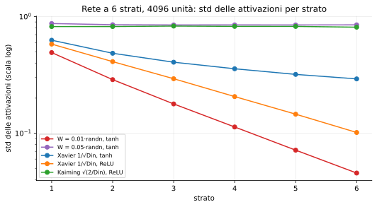

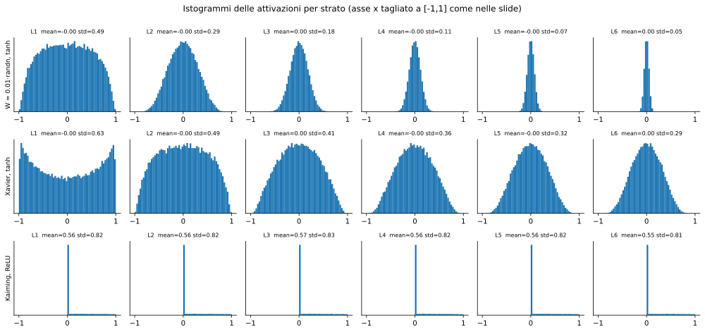

### 4.3 Inizializzazione «Xavier» / Glorot (slide 31–32, [Glorot & Bengio, 2010])

$$
\boxed{W\sim\mathcal N\!\Big(0,\ \tfrac{1}{D_{in}}\Big)\quad\Longleftrightarrow\quad \text{std}=\frac{1}{\sqrt{D_{in}}}}
$$
(nel codice: `np.random.randn(Din, Dout) / np.sqrt(Din)`).

**Perché funziona.** Dalla formula della varianza: $\operatorname{Var}(s)=D_{in}\sigma_w^2\mathbb E[h^2]=D_{in}\cdot\frac1{D_{in}}\cdot\mathbb E[h^2]=\mathbb E[h^2]$. In regime lineare ($\tanh x\approx x$, media 0) la varianza si **conserva** da uno strato al successivo.

**Per i layer conv** (slide 32): $D_{in}=k^2\cdot C_{in}$ (numero di ingressi di *ogni* neurone di output = i pesi del filtro). Es.: filtro $3\times3$ su 64 canali → $D_{in}=576$.

**[Nota]** La slide afferma «activations nicely scaled for all layers»: i numeri simulati sono $0.63,0.49,0.41,0.36,0.32,0.29$ (nella slide 0.30): **non** perfettamente costanti, perché la tanh comprime ($|\tanh s|<|s|$) quindi la std diminuisce lentamente; ma è un decadimento molto più dolce rispetto al caso $0.49\to0.05$.

**[Aggiunta]** Glorot e Bengio proponevano in realtà $\operatorname{Var}(w)=\frac{2}{D_{in}+D_{out}}$: nel forward si vorrebbe $D_{in}\sigma_w^2=1$, nel backward (il gradiente si propaga con $W^\top$, somma su $D_{out}$ termini) $D_{out}\sigma_w^2=1$; la media armonica dei due vincoli dà quel compromesso. La slide usa la versione semplificata con solo $D_{in}$.

### 4.4 Inizializzazione Kaiming / MSRA (slide 33, [He et al., 2015])

Con ReLU Xavier non va bene: la ReLU azzera metà delle unità, dimezzando la varianza a ogni strato. **Correzione per ReLU:**
$$
\boxed{\text{std}=\sqrt{\frac{2}{D_{in}}}}
$$

**Derivazione [Aggiunta].** Se $s$ è simmetrica attorno a 0, $h=\max(0,s)$ ha
$$
\mathbb E[h^2]=\int_0^\infty s^2p(s)\,ds=\tfrac12\,\mathbb E[s^2]=\tfrac12\operatorname{Var}(s).
$$
(*Nota: si usa il **momento secondo**, non la varianza, perché dopo la ReLU la media non è zero.*) Allora
$$
\operatorname{Var}(s_l)=D_{in}\sigma_w^2\,\mathbb E[h_{l-1}^2]=D_{in}\sigma_w^2\cdot\tfrac12\operatorname{Var}(s_{l-1}).
$$
Per avere $\operatorname{Var}(s_l)=\operatorname{Var}(s_{l-1})$ serve $\tfrac12D_{in}\sigma_w^2=1\Rightarrow\sigma_w^2=2/D_{in}$.

**Verifica con i numeri della slide.** Dopo ogni strato: media $\approx0.56$, std $\approx0.83$. Quindi $\mathbb E[h^2]=0.56^2+0.83^2\approx1.0$: il momento secondo resta $\approx1$ per tutti i 6 strati ✓. Coerente con la teoria: se $s\sim\mathcal N(0,2)$, allora $\mathbb E[h]=\sqrt2/\sqrt{2\pi}=0.56$ e $\mathbb E[h^2]=1$.

**[Aggiunta]** Con Xavier + ReLU la std dimezza in varianza per strato (fattore $1/\sqrt2$ in std): nella simulazione $0.58\to0.10$ in 6 strati (curva arancione in figura).

### 4.5 Riepilogo e stato dell'arte (slide 34)

| Attivazione | Init consigliata | std |
|---|---|---|
| tanh (o lineare) | Xavier | $1/\sqrt{D_{in}}$ |
| ReLU | Kaiming | $\sqrt{2/D_{in}}$ |

La slide ricorda che è un **campo di ricerca attivo** e cita: Glorot & Bengio 2010; Saxe et al. 2013 (soluzioni esatte della dinamica in reti lineari profonde, inizializzazione ortogonale); Sussillo & Abbott 2014 (*random walk initialization*); He et al. 2015; Krähenbühl et al. 2015 (inizializzazioni data-dependent); Mishkin & Matas 2015 (*All you need is a good init*); Zhang et al. 2019 (Fixup: reti residue senza normalizzazione); Frankle & Carbin 2019 (*Lottery Ticket Hypothesis*: sotto-reti sparse addestrabili); Rahman et al. 2023 (*Best Practices for 2-Body Pose Forecasting*, lavoro del gruppo del prof.).

---

## 5. Batch Normalization e altre normalizzazioni (slide 35–50)

### 5.1 Idea (slide 36, [Ioffe & Szegedy, 2015])

> «Vuoi attivazioni a media zero e varianza unitaria? Rendile tali.»

Dato un batch di attivazioni a un certo strato, per ogni dimensione $k$:
$$
\hat x^{(k)}=\frac{x^{(k)}-\mathbb E[x^{(k)}]}{\sqrt{\operatorname{Var}[x^{(k)}]}}
$$
e, come dice la slide, «*this is a vanilla differentiable function*»: si può inserire nella rete e propagare i gradienti (derivato in 5.3).

### 5.2 Forward in training (slide 37–39)

Input $x\in\mathbb{R}^{N\times D}$ (N esempi nel minibatch, D feature). Per ogni **colonna** $j$ (la slide dice «per-channel»):

$$
\mu_j=\frac1N\sum_{i=1}^{N}x_{i,j}\qquad(\text{shape }D)
$$
$$
\sigma_j^2=\frac1N\sum_{i=1}^{N}(x_{i,j}-\mu_j)^2\qquad(\text{shape }D)
$$
$$
\hat x_{i,j}=\frac{x_{i,j}-\mu_j}{\sqrt{\sigma_j^2+\varepsilon}}\qquad(\text{shape }N\times D)
$$

($\varepsilon\sim10^{-5}$ evita la divisione per zero.) Le frecce rosse della slide 37 indicano che la media è presa lungo la dimensione dei campioni $N$.

**Problema (slide 38):** *e se zero-media e varianza-unitaria è un vincolo troppo forte?* (per esempio la tanh potrebbe voler lavorare nella sua zona non lineare, o la rete potrebbe aver bisogno di scale diverse.)

**Soluzione (slide 39): scala e traslazione apprese** $\gamma,\beta\in\mathbb{R}^D$:
$$
\boxed{y_{i,j}=\gamma_j\,\hat x_{i,j}+\beta_j}\qquad(\text{shape }N\times D)
$$

**Recupero dell'identità.** Se la rete impara $\gamma_j=\sqrt{\sigma_j^2+\varepsilon}\ (\approx\sigma_j)$ e $\beta_j=\mu_j$:
$$
y_{i,j}=\sqrt{\sigma_j^2+\varepsilon}\cdot\frac{x_{i,j}-\mu_j}{\sqrt{\sigma_j^2+\varepsilon}}+\mu_j=x_{i,j}.
$$
Quindi aggiungere BN **non riduce l'espressività** della rete: può sempre annullare la normalizzazione.

### 5.3 [Aggiunta] Backward pass di BatchNorm (tutti i passaggi)

Per una colonna (si omette $j$), con $m=N$, $r=(\sigma^2+\varepsilon)^{-1/2}$ e gradiente upstream $dy_i=\partial L/\partial y_i$:

**Parametri.**
$$
\frac{\partial L}{\partial\gamma}=\sum_i dy_i\,\hat x_i,\qquad \frac{\partial L}{\partial\beta}=\sum_i dy_i .
$$
**Verso $\hat x$.** $g_i:=\dfrac{\partial L}{\partial\hat x_i}=\gamma\,dy_i$.

**Verso $\sigma^2$ e $\mu$.** Da $\hat x_i=(x_i-\mu)\,r$ e $\dfrac{\partial r}{\partial\sigma^2}=-\tfrac12 r^3$:
$$
\frac{\partial L}{\partial\sigma^2}=-\tfrac12 r^3\sum_i g_i(x_i-\mu),
$$
$$
\frac{\partial L}{\partial\mu}=\sum_i g_i(-r)+\frac{\partial L}{\partial\sigma^2}\cdot\underbrace{\Big(-\frac2m\sum_i(x_i-\mu)\Big)}_{=0}=-r\sum_i g_i .
$$
**Verso $x_i$** ($x_i$ influenza $\hat x_i$ direttamente, e tutti gli altri tramite $\mu,\sigma^2$):
$$
\frac{\partial L}{\partial x_i}=g_i\,r+\frac{\partial L}{\partial\sigma^2}\frac{2(x_i-\mu)}{m}+\frac{\partial L}{\partial\mu}\frac1m .
$$
Sostituendo e usando $r^3(x_i-\mu)(x_j-\mu)=r\,\hat x_i\hat x_j$:
$$
\boxed{\frac{\partial L}{\partial x_i}=r\Big[g_i-\frac1m\sum_jg_j-\frac{\hat x_i}{m}\sum_jg_j\hat x_j\Big]}
$$
**Interpretazione:** il gradiente viene **proiettato** togliendo la componente lungo il vettore costante $\mathbf 1$ e lungo $\hat x$ (perché spostare tutti gli $x_i$ di una costante, o scalarli, non cambia $\hat x$). Dipende da tutto il batch: i campioni sono accoppiati.

### 5.4 Test time (slide 40–42)

**Problema (slide 40):** $\mu_j,\sigma_j^2$ dipendono dal minibatch: «can't do this at test-time!» (a test time si vuole che l'output di un'immagine non dipenda da quali altre immagini ci sono nel batch; può esserci un solo esempio).

**Soluzione (slide 41–42):** si usano $\mu_j,\sigma_j^2$ **fissi** = *media (running) dei valori visti durante il training*:
$$
\mu^{run}\leftarrow(1-\rho)\,\mu^{run}+\rho\,\mu_B,\qquad (\sigma^2)^{run}\leftarrow(1-\rho)\,(\sigma^2)^{run}+\rho\,\sigma_B^2,
$$
con momentum $\rho$ (nel `print` di VGG nella slide 92: `momentum=0.1, eps=1e-5`).

**Perché «BN diventa un operatore lineare»** (slide 41): con $\mu,\sigma$ costanti, $y=\gamma\frac{x-\mu}{\sqrt{\sigma^2+\varepsilon}}+\beta$ è una funzione **affine** di $x$, con una scala per feature.

**Fusione con il layer precedente [Aggiunta].** Se $x=Wz+b$ (FC o conv), definendo $a_j=\gamma_j/\sqrt{\sigma_j^2+\varepsilon}$:
$$
y=\operatorname{diag}(a)\,(Wz+b-\mu)+\beta=\underbrace{\operatorname{diag}(a)W}_{W'}\,z+\underbrace{a\odot(b-\mu)+\beta}_{b'}.
$$
Per una conv si scala il filtro di ogni canale di output $c'$ per $a_{c'}$. Risultato (slide 45): **zero overhead a test time**.

### 5.5 BN per le ConvNet (slide 43)

| | Fully-connected | Convoluzionale (*Spatial BatchNorm, BatchNorm2D*) |
|---|---|---|
| input | $x:\ N\times D$ | $x:\ N\times C\times H\times W$ |
| $\mu,\sigma$ | $1\times D$ (media su $N$) | $1\times C\times1\times1$ (media su **$N,H,W$**) |
| $\gamma,\beta$ | $1\times D$ | $1\times C\times1\times1$ |
| formula | $y=\gamma(x-\mu)/\sigma+\beta$ | uguale |

**Perché si media anche su $H,W$ [Aggiunta].** La convoluzione condivide gli stessi pesi in tutte le posizioni (stazionarietà): tutte le $N\cdot H\cdot W$ posizioni sono «campioni» dello stesso canale, e la normalizzazione deve rispettare questa condivisione (altrimenti romperebbe l'equivarianza alla traslazione). Parametri apprendibili: solo $2C$.

### 5.6 Dove si mette, perché funziona (slide 44–45)

Si inserisce **dopo gli strati FC o convoluzionali e prima della non linearità**: $\ \text{FC}\to\text{BN}\to\tanh\to\text{FC}\to\text{BN}\to\tanh\cdots$

Vantaggi elencati nella slide e relativa motivazione:

| Affermazione | Motivazione |
|---|---|
| Rende le reti profonde molto più facili da addestrare | le pre-attivazioni restano in scala controllata, evitando le situazioni di sez. 4 |
| **Migliora il flusso del gradiente** | ingressi alla tanh/sigmoide restano nella zona non satura |
| Permette learning rate più alti, convergenza più rapida | meno rischio di divergenza |
| **Robusta all'inizializzazione** | vedi invarianza di scala qui sotto |
| Agisce da **regolarizzazione** | $\mu_B,\sigma_B$ sono rumorosi (dipendono dagli altri esempi del batch): ogni esempio è normalizzato in modo leggermente diverso a ogni passo |
| Zero overhead a test time | fusione (5.4) |
| Comportamento **diverso** in training e test: *fonte comune di bug* | vedi sotto |

**Invarianza di scala [Aggiunta].** Se $W\to aW$ ($a>0$), allora $s\to as$, $\mu\to a\mu$, $\sigma\to a\sigma$ (trascurando $\varepsilon$) e quindi $\hat x$ non cambia: l'output è indipendente dalla scala iniziale dei pesi → robustezza a init sbagliate (e il gradiente verso $W$ scala come $1/\|W\|$: pesi grandi → passi effettivi piccoli, effetto auto-stabilizzante).

**Bias ridondante [Aggiunta].** Se BN segue un FC/conv, il bias $b$ viene sottratto con la media: $x-\mu$ non dipende da $b$. Si può usare `bias=False` e il ruolo del bias lo svolge $\beta$. (Il `vgg11_bn` di torchvision della slide 92 **mantiene** il bias nelle conv, anche se ridondante: i suoi parametri sono inclusi nel conteggio della sez. 9.4.)

**Bug train/test.** Con `model.train()` si usano le statistiche del batch (e si aggiornano quelle running); con `model.eval()` si usano quelle running. Dimenticare `eval()` a test time o fare inferenza con batch piccoli in modalità train dà risultati diversi e instabili.

### 5.7 Layer Normalization (slide 46, [Ba, Kiros, Hinton, 2016])

Si normalizza **per esempio** (lungo $D$) invece che per feature:
$$
\mu_i=\frac1D\sum_{j}x_{i,j},\quad \sigma_i^2=\frac1D\sum_j(x_{i,j}-\mu_i)^2,\quad y_{i,j}=\gamma_j\frac{x_{i,j}-\mu_i}{\sqrt{\sigma_i^2+\varepsilon}}+\beta_j .
$$
Forme (slide): $\mu,\sigma$: $N\times1$; $\gamma,\beta$: $1\times D$. **Stesso comportamento in training e test** (non dipende dagli altri esempi), **usabile nelle reti ricorrenti** (e nei Transformer: lì ci si aspetta LN, non BN).

### 5.8 Instance Normalization (slide 47, [Ulyanov et al., 2017])

Per le conv: statistiche **per esempio e per canale**, lungo $H,W$:
$$
\mu_{n,c}=\frac1{HW}\sum_{h,w}x_{n,c,h,w},\qquad \mu,\sigma:\ N\times C\times1\times1,\quad \gamma,\beta:\ 1\times C\times1\times1.
$$
Stesso comportamento train/test. Nata per *style transfer* / sintesi di texture (rimuove contrasto e stile specifico dell'immagine).

### 5.9 Confronto e Group Normalization (slide 48–49, [Wu & He, 2018])

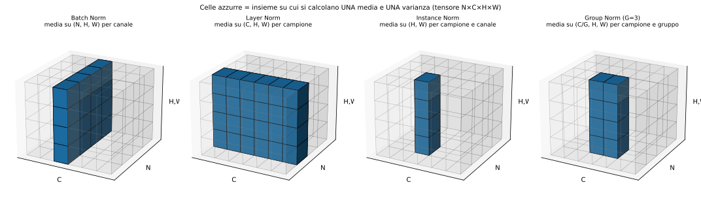

Per un tensore $N\times C\times H\times W$, le celle azzurre della figura sono l'insieme su cui si calcolano **una** media e **una** varianza:

| Metodo | Si normalizza su | N° di elementi per statistica | N° di statistiche | Dipende dal batch? |
|---|---|---|---|---|
| **Batch Norm** | $N,H,W$ (per canale) | $NHW$ | $C$ | **sì** |
| **Layer Norm** | $C,H,W$ (per esempio) | $CHW$ | $N$ | no |
| **Instance Norm** | $H,W$ (per esempio e canale) | $HW$ | $NC$ | no |
| **Group Norm** | $C/G,H,W$ (per esempio e gruppo) | $(C/G)HW$ | $NG$ | no |

**Group Normalization (slide 49).** I $C$ canali vengono divisi in $G$ gruppi da $C/G$; per ogni esempio e gruppo:
$$
\mu_{n,g}=\frac{1}{(C/G)HW}\sum_{c\in g}\sum_{h,w}x_{n,c,h,w},\qquad \hat x=\frac{x-\mu_{n,g}}{\sqrt{\sigma^2_{n,g}+\varepsilon}},\qquad y=\gamma_c\hat x+\beta_c .
$$
Casi limite: $G=1$ ⇒ Layer Norm; $G=C$ ⇒ Instance Norm. **[Aggiunta]** Vantaggio: indipendente dalla dimensione del batch (BN peggiora con batch piccoli perché le stime di $\mu,\sigma$ diventano rumorose, es. in detection/segmentazione con batch di 1–2 immagini); Wu & He usano $G=32$.

### 5.10 Riepilogo (slide 50)

| Argomento | TLDR |
|---|---|
| Activation functions | usa ReLU |
| Data preprocessing | per immagini: sottrai la media |
| Weight initialization | usa Xavier / He |
| Batch Normalization | usala |

---

## 6. Training vs Testing error (slide 51–53)

### 6.1 Oltre l'errore di training (slide 52)

Gli algoritmi di ottimizzazione migliori riducono la **loss di training**
$$
L_{train}=\frac1N\sum_{i\in\text{train}}L_i,
$$
ma ciò che ci interessa è l'errore su **dati nuovi**, $L_{test}=\mathbb E_{(x,y)\sim p}[L(f(x),y)]$. La slide chiede: *come ridurre il gap?* Il **gap di generalizzazione** è $L_{test}-L_{train}$ e tipicamente cresce con l'overfitting. La parte restante della lezione (regolarizzazione, augmentation, early stopping, transfer learning) serve a ridurlo.

### 6.2 Early stopping — «Always do this» (slide 53)

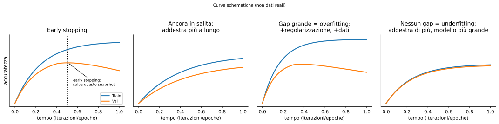

Osservazione: la loss di training scende sempre (curva blu a sinistra), ma l'**accuratezza di validation** cresce, raggiunge un massimo e poi comincia a scendere quando il modello inizia a memorizzare il training set. Due formulazioni equivalenti (slide):

1. **Fermare l'addestramento quando l'accuratezza di validation diminuisce.**
2. **Oppure addestrare a lungo ma tenere sempre lo snapshot del modello migliore su validation** (di solito preferibile, perché una singola diminuzione può essere rumore).

Formalmente: $\ t^*=\arg\max_t\ \text{Acc}_{val}(W_t)$ e si restituisce $W_{t^*}$.

**[Aggiunta]** In pratica si usa una *patience* (si ferma dopo $k$ epoche senza miglioramento). Poiché $t^*$ è scelto sul validation, quest'ultimo diventa leggermente ottimistico: il numero finale va riportato su un **test set separato**, usato una sola volta.

---

## 7. Regolarizzazione: più modelli, più robusti (slide 54–80)

Slide 55: *«How to improve single-model performance?»* → **Regolarizzazione**.

### 7.1 Aggiungere un termine alla loss (slide 56)

Già visto (nota 1, sez. 6):
$$
L(W)=\frac1N\sum_iL_i+\lambda R(W),\qquad R_{L2}=\sum W^2,\quad R_{L1}=\sum|W|,\quad R_{EN}=\sum(\beta W^2+|W|).
$$
**L2 = weight decay — derivazione.** Il gradiente è $\nabla_W L=\nabla_WL_{data}+2\lambda W$; l'aggiornamento SGD è
$$
W\leftarrow W-\eta(\nabla L_{data}+2\lambda W)=\underbrace{(1-2\eta\lambda)}_{<1}W-\eta\nabla L_{data}.
$$
A ogni passo i pesi vengono moltiplicati per un fattore $<1$ (*decadono*) oltre al passo di gradiente. (Molte librerie definiscono $R=\frac12\sum W^2$ e quindi il termine $\lambda W$.)

### 7.2 Dropout (slide 57–68, [Srivastava et al., JMLR 2014])

**Definizione (slide 57).** *In ogni forward pass, si azzerano a caso alcuni neuroni.* Per ogni unità $j$ si campiona una maschera binaria
$$
m_j\sim\text{Bernoulli}(p),\qquad \tilde h_j=m_j\,h_j .
$$

**[Nota]** Il testo della slide 57 dice «*probability of dropping* è un iperparametro, 0.5 è comune», ma il codice della slide 58 e 68 definisce `p = 0.5 # probability of keeping a unit active. higher = less dropout`, cioè $p$ è la probabilità di **tenere**. Con $0.5$ le due convenzioni coincidono; in generale $p_{keep}=1-p_{drop}$ (in PyTorch `nn.Dropout(p)` usa $p$ = prob. di *drop*).

**Codice (slide 58)** — rete a 3 strati, la maschera si applica dopo la ReLU:

```python
p = 0.5  # probabilità di tenere un'unità
def train_step(X):
    H1 = np.maximum(0, np.dot(W1, X) + b1)
    U1 = np.random.rand(*H1.shape) < p      # prima maschera
    H1 *= U1                                  # drop!
    H2 = np.maximum(0, np.dot(W2, H1) + b2)
    U2 = np.random.rand(*H2.shape) < p      # seconda maschera
    H2 *= U2                                  # drop!
    out = np.dot(W3, H2) + b3
```

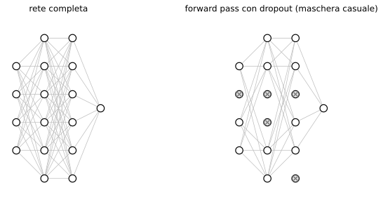

**Backward [Aggiunta].** Poiché $\tilde h=m\odot h$, $\ \partial L/\partial h=m\odot\partial L/\partial\tilde h$: le unità spente ricevono gradiente **zero** e i pesi che le alimentano non si aggiornano in quell'iterazione (stessa logica del *gate* moltiplicativo, nota 1, sez. 9.4).

#### Perché è una buona idea? (slide 59–60)

**Interpretazione 1 — rappresentazione ridondante / niente co-adattamento.** Esempio della slide: per lo score «gatto», le feature sono *ha un orecchio, ha una coda, è peloso, ha artigli, sguardo birichino*. Se in ogni passo alcune feature (con la X rossa) sono nascoste, la rete non può dipendere da una sola combinazione fragile di feature: deve distribuire l'evidenza su più feature. Questo impedisce la **co-adattazione**: neuroni che si correggono a vicenda in modo specifico per il training set.

**Interpretazione 2 — ensemble di reti che condividono i parametri.** Ogni maschera binaria definisce una sottorete diversa; addestrare con dropout equivale ad addestrare un **ensemble** enorme. Per uno strato FC con 4096 unità:
$$
2^{4096}=10^{4096\log_{10}2}=10^{1233}\ \text{maschere possibili}
$$
(calcolato: $4096\cdot0.30103=1233.0$). Confronto della slide: ci sono solo $\sim10^{82}$ atomi nell'universo. Ogni sottorete vede pochissimi passi di training, ma i **pesi sono condivisi**, quindi ciascun aggiornamento migliora tutte le sottoreti che usano quei pesi.

#### Dropout a test time (slide 61–66)

Il dropout rende **l'output casuale**: $y=f_W(x,z)$, con $z$ = maschera casuale. A test time si vuole un output deterministico, quindi si cerca di *mediare via* la casualità:

$$
y=f(x)=\mathbb E_z\big[f(x,z)\big]=\int p(z)\,f(x,z)\,dz.
$$
La slide dice: *«But this integral seems hard…»* (somma su $2^n$ maschere: intrattabile). Si approssima:

**Caso di un singolo neurone (slide 62–65).** $a=w_1x+w_2y$ con ingressi $x,y$ e maschera su ciascuno con probabilità di tenerli $p=\tfrac12$.

- *A test time* (nessuna maschera): $\ \mathbb E[a]=w_1x+w_2y$.
- *Durante il training*, le quattro maschere equiprobabili (prob. $\frac14$ ciascuna) danno:
$$
\mathbb E[a]=\tfrac14(w_1x+w_2y)+\tfrac14(w_1x+0\cdot y)+\tfrac14(0\cdot x+0\cdot y)+\tfrac14(0\cdot x+w_2y)=\tfrac12(w_1x+w_2y).
$$

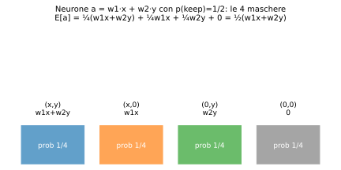

In generale, con probabilità di keep $p$ e $a=\sum_iw_im_ix_i$: $\ \mathbb E[a]=\sum_iw_i\,\mathbb E[m_i]\,x_i=p\sum_iw_ix_i$.

**Regola (slide 65–66):** *a test time tutti i neuroni sono sempre attivi*, quindi bisogna **scalare le attivazioni** (moltiplicare per $p$) affinché per ogni neurone
$$
\text{output a test time}=\text{output atteso in training}.
$$
Riassunto (slide 67): **drop nel forward pass in training, scala a test time.**

**[Aggiunta] Limiti dell'approssimazione.** Lo scambio $\mathbb E[\phi(a)]\approx\phi(\mathbb E[a])$ è esatto solo se $\phi$ è lineare; per le non linearità è un'approssimazione (*weight scaling inference rule*), che funziona bene in pratica.

#### Inverted dropout (slide 68) — la forma più comune

Invece di scalare a test time, si divide per $p$ **in training**:
$$
\tilde h=\frac{m\odot h}{p},\qquad \mathbb E[\tilde h_j]=\frac{p\,h_j}{p}=h_j .
$$
Nel codice: `U1 = (np.random.rand(*H1.shape) < p) / p`. **Il codice di test resta invariato** («test time is unchanged!», nessuna scala necessaria):

```python
def predict(X):
    H1 = np.maximum(0, np.dot(W1, X) + b1)   # nessuna scala necessaria
    H2 = np.maximum(0, np.dot(W2, H1) + b2)
    out = np.dot(W3, H2) + b3
```
**Backward con inverted dropout:** $\partial L/\partial h=m\odot\partial L/\partial\tilde h\,/p$.

### 7.3 Un pattern comune (slide 69–70, 80)

> **Training:** aggiungi un po' di casualità. **Testing:** media via la casualità (a volte in modo approssimato).

| Metodo | Training (casualità) | Test (media) |
|---|---|---|
| Dropout | maschera binaria casuale | usa tutte le unità, con scala |
| **Batch Normalization** (slide 70) | normalizza con statistiche di **minibatch casuali** | usa statistiche **fisse** (running) |
| Data augmentation | trasformazioni casuali | media di viste fisse (7.4) |
| Cutout | regioni a zero casuali | immagine intera |
| Mixup | miscele casuali di immagini | immagini originali |

In forma generale: *Training: add random noise; Testing: marginalize over the noise* (slide 80).

### 7.4 Data augmentation (slide 71–77)

**Pipeline classica (slide 71):** carica immagine+etichetta → CNN → loss. **Con augmentation (slide 72):** si **trasforma l'immagine** (preservando l'etichetta, «cat» resta «cat») prima di darla alla CNN.

**Formalizzazione [Aggiunta].** Sia $T\sim\mathcal T$ una trasformazione casuale che non cambia l'etichetta. Invece di minimizzare $\frac1N\sum_iL(f(x_i),y_i)$ si minimizza
$$
\frac1N\sum_i\mathbb E_{T\sim\mathcal T}\big[L\big(f(T(x_i)),y_i\big)\big],
$$
cioè si «gonfia» il dataset con infinite varianti dello stesso esempio, insegnando alla rete le invarianze volute.

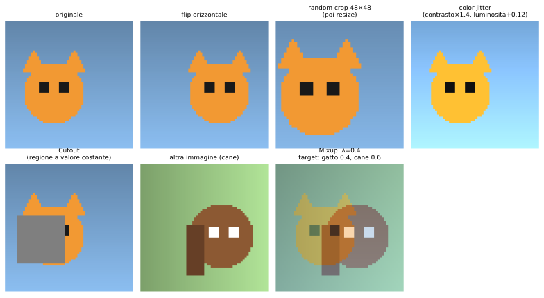

(Immagini giocattolo generate con numpy, solo per illustrare le trasformazioni.)

**Horizontal flips (slide 73):** $I'[i,j]=I[i,W-1-j]$.

**Random crops and scales (slide 74–75), ricetta ResNet:**

*Training:*
1. scegli $L$ a caso in $[256,480]$;
2. ridimensiona l'immagine in modo che il lato corto sia $L$;
3. campiona una patch casuale $224\times224$.

*Testing:* si **media** su un insieme fisso di viste:
1. ridimensiona l'immagine a 5 scale $\{224,256,384,480,640\}$;
2. per ogni dimensione, 10 crop $224\times224$: **4 angoli + centro** (5 crop) **+ i loro flip** (×2) = 10.

Totale: $5\times10=50$ viste per immagine, e la predizione finale è la media dei 50 output (probabilità softmax): è la «marginalizzazione sul rumore» della slide 80.

**Color jitter (slide 76–77).**
- *Semplice:* randomizzare contrasto e luminosità, es. $I'=c\,(I-\bar I)+\bar I+b$ con $c,b$ casuali.
- *Più complesso (slide 77)* [Krizhevsky et al., 2012]:
  1. si applica la **PCA** a tutti i pixel $[R,G,B]$ del training set (matrice di covarianza $3\times3$, autovettori $p_k$, autovalori $\lambda_k$);
  2. si campiona un «offset di colore» lungo le direzioni principali: $\alpha_k\sim\mathcal N(0,\sigma^2)$ (in AlexNet $\sigma=0.1$);
  3. lo si aggiunge a **tutti** i pixel dell'immagine: $\ I_{xy}\leftarrow I_{xy}+[p_1,p_2,p_3]\,[\alpha_1\lambda_1,\alpha_2\lambda_2,\alpha_3\lambda_3]^\top$.

  Idea: cambiare illuminazione/colore *lungo le direzioni in cui i colori variano davvero* nei dati (i dettagli 2–3 sono da AlexNet, non sulla slide). Usato in AlexNet, ResNet, ecc.

**[Aggiunta]** Altre trasformazioni comuni (non sulle slide): rotazioni, traslazioni, stretching, shearing, distorsioni dell'obiettivo. Regola: la trasformazione non deve cambiare la semantica (es. non fare flip per cifre/lettere).

### 7.5 Cutout (slide 78, [DeVries & Taylor, 2017])

**Training:** si imposta a zero (o a un valore costante) una **regione quadrata casuale** dell'immagine. **Testing:** immagine intera.

Funziona come un dropout **spazialmente contiguo** applicato all'input: obbliga la rete a usare più parti dell'oggetto (se l'orecchio è coperto, si deve usare la coda). Slide: *«works very well for small datasets like CIFAR, less common for large datasets like ImageNet»*.

La slide 78 elenca anche altri esempi del pattern (non spiegati): **[Aggiunta]**
- **DropConnect**: invece delle attivazioni si azzerano a caso i **pesi**: $\tilde W=M\odot W$, $M_{ij}\sim\text{Bernoulli}(p)$.
- **Fractional max pooling**: le regioni di pooling sono scelte a caso (con rapporto di riduzione non intero, es. $1.4$), non su una griglia fissa.
- **Stochastic depth**: in una rete residua $y=x+F(x)$, durante il training si salta a caso l'intero blocco residuo ($y=x$); a test time si usano tutti i blocchi.

### 7.6 Mixup (slide 79, [Zhang et al., ICLR 2018])

**Training:** si addestra su **miscele casuali di immagini**; **Testing:** immagini originali.

Date due coppie $(x_i,y_i),(x_j,y_j)$ con $y$ one-hot:
$$
\tilde x=\lambda x_i+(1-\lambda)x_j,\qquad \tilde y=\lambda y_i+(1-\lambda)y_j,\qquad \lambda\sim\text{Beta}(\alpha,\alpha).
$$
Esempio della slide: miscela dei pixel di un gatto e di un cane, $\lambda=0.4$ → *target label* **gatto 0.4, cane 0.6** (il $\lambda$ sui pixel è lo stesso che sulle etichette).

**Loss.** Con la cross-entropy $L=-\sum_k\tilde y_k\log p_k$ (nota 1, sez. 5.3), per linearità nel target:
$$
L(\tilde x,\tilde y)=-\sum_k\big[\lambda y_{i,k}+(1-\lambda)y_{j,k}\big]\log p_k=\lambda\,\big(-\log p_{c_i}\big)+(1-\lambda)\,\big(-\log p_{c_j}\big),
$$
dove $p=\text{softmax}(f(\tilde x))$. Si impone alla rete un comportamento **lineare tra i campioni**.

### 7.7 Consigli pratici (slide 80)

- considera il **dropout** per i grandi strati fully-connected;
- **Batch Normalization e data augmentation** sono quasi sempre una buona idea;
- prova **Cutout e Mixup**, soprattutto per piccoli dataset di classificazione.

---

## 8. Scegliere gli iperparametri (senza tonnellate di GPU) (slide 81–85)

### 8.1 La ricetta in 7 passi (slide 82)

| Passo | Cosa si fa | Spiegazione / formalizzazione |
|---|---|---|
| **1** | Controllare la **loss iniziale** (sanity check) | con $C$ classi e pesi piccoli le probabilità sono ≈ uniformi: $L\approx-\log\frac1C=\log C$. Es. CIFAR-10: $\ln10\approx2.30$; ImageNet: $\ln1000\approx6.91$. Se diverso → bug (o regolarizzazione molto grande: va controllata a parte con $\lambda=0$ e poi $>0$, dove la loss deve **aumentare** leggermente) |
| **2** | **Overfittare un piccolo campione** (100% accuracy di train) | pochi minibatch (5–10), senza regolarizzazione. Se non si raggiunge ≈0 di loss: bug nel codice/dati, LR troppo bassa o init sbagliata, modello troppo piccolo |
| **3** | Trovare un **LR che faccia scendere la loss** (su tutti i dati, con weight decay) | l'LR dev'essere abbastanza alto da far decrescere la loss nelle prime ~100 iterazioni ma senza esplodere (NaN) |
| **4** | **Griglia grossolana** di LR (e WD), addestrando ~1–5 epoche | si esplora su **scala logaritmica**: es. LR $\in\{10^{-1},\dots,10^{-5}\}$, WD $\in\{10^{-4},10^{-5},0\}$ |
| **5** | **Raffinare la griglia**, addestrare più a lungo | si restringe attorno ai valori migliori, si allunga il training |
| **6** | **Guardare le curve** di loss/accuratezza | diagnosi nella sez. 8.2 |
| **7** | GOTO passo 5 | iterazione |

**[Aggiunta]** I parametri come LR e WD vanno cercati su scala log perché hanno effetto *moltiplicativo* ($\log\eta$ è la variabile naturale). Spesso la ricerca casuale (anziché a griglia) esplora meglio le dimensioni importanti (Bergstra & Bengio, 2012).

### 8.2 Leggere le curve (slide 83–85)


| Situazione (slide) | Diagnosi | Azione |
|---|---|---|
| Accuracy di **train e val ancora in salita** (slide 83) | non convergito | **addestra più a lungo** |
| **Grosso gap** train/val, val cala o ristagna (slide 84) | **overfitting** | **aumenta la regolarizzazione**, **più dati** |
| **Nessun gap** train/val (slide 85) | **underfitting** | **addestra più a lungo, usa un modello più grande** |

**[Aggiunta]** In termini di errore: *underfitting* = bias alto ($L_{train}$ alta); *overfitting* = varianza alta ($L_{train}$ bassa, $L_{val}-L_{train}$ grande). Le curve sono schematiche, non dati reali.

---

## 9. Transfer learning (slide 86–95)

### 9.1 Il problema: servono molti dati? (slide 87)

Domanda della slide: *«Hai bisogno di un sacco di dati per addestrare/usare le CNN?»* Risposta: **no**, se si riusa conoscenza appresa altrove.

### 9.2 Perché funziona: la gerarchia di feature (slide 88–90)

La slide 88 mostra una CNN addestrata su ImageNet; poi si evidenziano le parti:

- **Primo strato** (slide 89): i filtri di AlexNet hanno forma $64\times3\times11\times11$ (64 filtri, 3 canali RGB, finestra $11\times11$), cioè $64\cdot3\cdot121=23\,232$ pesi. Visualizzati sono **bordi orientati, gabor-like e blob di colore**: feature *generiche*, utili per qualunque immagine.
- **Ultimi strati** (slide 90): usando il vettore di feature dell'ultimo strato FC (4096 dimensioni) e cercando i **vicini più prossimi in norma $L_2$ nello spazio delle feature**, immagini simili *semanticamente* (stessi fiori, elefanti, navi, zucche, cani) risultano vicine anche se i **pixel** sono molto diversi. Gli strati finali codificano concetti *semantici*.

Quindi le feature passano da **generiche** (strati bassi) a **specifiche del task** (strati alti): le prime si possono riusare per quasi ogni compito di visione.

### 9.3 Schema generale (slide 91)

Si ha un **modello sorgente** addestrato su una **grande quantità di dati/etichette** (es. ImageNet) e si **trasferisce la conoscenza appresa** a un **modello target** per cui si hanno **pochi dati/etichette** (es. CIFAR-10).

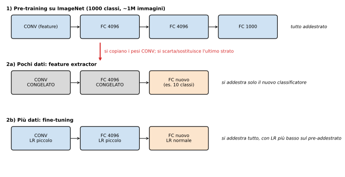

### 9.4 Esempio con VGG11_bn → CIFAR-10 (slide 92)

La slide mostra la struttura di `vgg11_bn` di torchvision: `features` (8 conv $3\times3$, ciascuna con BatchNorm2d e ReLU, e 5 max-pool) + `avgpool` + `classifier` (Linear $25088\to4096$, ReLU, Dropout(0.5), Linear $4096\to4096$, ReLU, Dropout(0.5), Linear $4096\to1000$).

**Ricetta della slide:**
1. **Tenere gli strati conv** (✔) come **estrattori di feature**;
2. **eliminare gli strati del classificatore** (✘) e aggiungere **nuovi strati fully-connected** per imparare la classificazione di CIFAR-10.

**[Aggiunta] Conteggio dei parametri (calcolato):**

| Parte | Parametri |
|---|---|
| Conv (8 strati, pesi+bias) | $9\,220\,480$ |
| BatchNorm (solo $\gamma,\beta$) | $5\,504$ |
| **Classifier originale** | $25088\cdot4096+4096\,+\,4096\cdot4096+4096\,+\,4096\cdot1000+1000=\mathbf{123\,642\,856}$ |
| **Totale** | $132\,868\,840$ |

Il 93% dei parametri è nel classificatore che si butta via: la parte riusata (conv+BN) ha $\approx9.2$M parametri. Nota: $25088=512\cdot7\cdot7$ (output delle conv dopo 5 pool: $224/2^5=7$). Con input CIFAR $32\times32$ le conv danno $512\times1\times1$, quindi una testa nuova può essere, ad es., $\text{Linear}(512,10)$ ($=5130$ parametri).

```python
# [Aggiunta] sketch con torchvision
import torch.nn as nn, torchvision
m = torchvision.models.vgg11_bn(weights=torchvision.models.VGG11_BN_Weights.IMAGENET1K_V1)
for p in m.features.parameters():          # feature extractor congelato
    p.requires_grad = False
m.classifier = nn.Sequential(nn.Linear(25088, 256), nn.ReLU(), nn.Dropout(0.5),
                             nn.Linear(256, 10))   # nuova testa per CIFAR-10
```

**[Aggiunta] Due regimi (schema della sez. 9.3):**
- **Pochi dati** → *feature extractor*: si congela la parte convoluzionale e si addestra solo il nuovo classificatore (un classificatore lineare/MLP su feature fisse).
- **Più dati** → *fine-tuning*: si addestra anche (parte del) la rete convoluzionale con learning rate più basso (tipicamente ~1/10) sugli strati pre-addestrati, per non distruggere le feature già buone.

Attenzione: (1) si deve **riutilizzare lo stesso preprocessing** del pre-training (sez. 3.2); (2) con strati BN congelati si tengono in modalità `eval()` (statistiche running dell'ImageNet) se il batch è piccolo.

### 9.5 È la norma, non l'eccezione (slide 93–95)

- **Object detection (Fast R-CNN, Girshick, ICCV 2015)**: la CNN di base è pre-addestrata su ImageNet.
- **Image captioning: CNN + RNN (Karpathy & Fei-Fei, CVPR 2015)**: di nuovo, la CNN è pre-addestrata su ImageNet (la slide 94 lo evidenzia), poi la RNN genera la didascalia.

**Takeaway per i progetti (slide 95)** — hai un dataset di interesse con **meno di ~1M immagini**?
1. **Trova un dataset molto grande con dati simili** e addestra lì una grande ConvNet;
2. fai **transfer learning** al tuo dataset.

I framework offrono un **Model Zoo** di modelli pre-addestrati, quindi non serve addestrare il proprio: TensorFlow (`github.com/tensorflow/models`) e PyTorch (`github.com/pytorch/vision`).

Slide 96: ringraziamenti (materiale da Fei-Fei Li, Justin Johnson, Serena Yeung).

---

## 10. Riepilogo operativo

| Fase | Scelta consigliata | Perché |
|---|---|---|
| Attivazione | ReLU (prova Leaky/PReLU/GELU) | non satura; no sigmoide/tanh negli strati nascosti |
| Dati | sottrai media (per canale), dividi per std | paesaggio di loss meno ripido |
| Init | Xavier ($1/\sqrt{D_{in}}$) / Kaiming ($\sqrt{2/D_{in}}$ con ReLU) | conserva la varianza delle attivazioni nei 6+ strati |
| Normalizzazione | BatchNorm dopo conv/FC, prima della non linearità; LN/GN se il batch è piccolo o per RNN/Transformer | flusso di gradiente, LR più alti, robusta all'init |
| Regolarizzazione | weight decay, dropout su grandi FC, data augmentation, Cutout/Mixup per piccoli dataset | riduce il gap di generalizzazione |
| Stop | early stopping / miglior snapshot su validation | evita l'overfitting |
| Iperparametri | ricetta 1→7 | controllo di errori e ricerca efficiente |
| Pochi dati | transfer learning da modello pre-addestrato | riuso di feature generiche |

| Formula chiave | Espressione |
|---|---|
| Derivata sigmoide | $\sigma'=\sigma(1-\sigma)\le\tfrac14$ |
| GELU | $x\Phi(x)$, $\ f'=\Phi+x\varphi$ |
| Varianza di uno strato lineare | $\operatorname{Var}(s)=D_{in}\sigma_w^2\,\mathbb E[h^2]$ |
| Xavier / Kaiming | $\sigma_w^2=1/D_{in}\ /\ 2/D_{in}$ |
| BatchNorm | $y=\gamma\frac{x-\mu_B}{\sqrt{\sigma_B^2+\varepsilon}}+\beta$ |
| BN backward | $\partial_{x_i}L=r\,[g_i-\overline g-\hat x_i\overline{g\hat x}]$ |
| Dropout (inverted) | $\tilde h=m\odot h/p$ |
| Mixup | $\tilde x=\lambda x_i+(1-\lambda)x_j$, $\ \tilde y=\lambda y_i+(1-\lambda)y_j$ |
| Loss iniziale softmax | $\log C$ |
