# Advanced Machine Learning and Computer Vision — Formalizzazione matematica (3)

**Contenuto:** *06 – Sequence Models I* (Prof. F. Galasso, Sapienza), 83 slide (la numerazione stampata sulle slide va fino a 171 ed è **non contigua**: il prof ha tolto parte delle slide originali; qui cito sempre i numeri stampati).
**Scopo:** formalizzare ogni concetto delle slide, esplicitare tutti i passaggi e aggiungere le derivazioni che nelle slide sono solo accennate o mostrate come immagini senza spiegazione. Questa nota continua le precedenti: i rimandi «nota 1, sez. X» si riferiscono a *Recap on Image Classification, NN e CNN* e «nota 2, sez. X» a *Training Neural Networks*.

> Le parti marcate con **[Aggiunta]** non sono nelle slide ma servono a completare il ragionamento.
> Le parti marcate con **[Nota]** segnalano imprecisioni, convenzioni o dettagli delle slide.
> Le figure sono generate da `genera_figure_sequenze.py` (stessa cartella). Le figure con numeri (char-LM, campi recettivi, norme dei gradienti) sono **calcolate**, non disegnate a mano.

---

## 0. Notazione e mappa della lezione

| Simbolo | Significato |
|---|---|
| $x_t\in\mathbb R^D$ | ingresso al passo (istante) $t$ |
| $h_t\in\mathbb R^H$ | stato nascosto (*hidden state*), la «memoria» della rete; $h_0$ = stato iniziale |
| $y_t$, $\hat y_t$ | uscita al passo $t$ (predetta / vera) |
| $W_{xh},W_{hh},W_{hy}$ | pesi ingresso→stato, stato→stato, stato→uscita |
| $T$ | lunghezza della sequenza |
| $K$, $d$, $L$ | dimensione del kernel, dilatazione, numero di strati (TCN) |
| $c_t$ | *cell state* della LSTM |
| $i,f,o,g$ | gate di ingresso, di oblio (*forget*), di uscita, e «gate gate» (valore candidato) |
| $\sigma$ | sigmoide; $\odot$ prodotto elemento per elemento (Hadamard) |
| $\mathcal L_t,\ \mathcal L$ | loss al passo $t$, loss totale |

(Uso $\mathcal L$ per la loss per non confonderla con $L$ = numero di strati.)

**Perché questa lezione.** Fin qui (note 1–2) la rete riceveva **un** ingresso di dimensione fissa e produceva **una** uscita. Ma molti dati sono *sequenze* (parole, frame di un video, posizioni nel tempo). Qui si risponde a: *come si costruiscono reti che leggono e/o producono sequenze di lunghezza arbitraria?* Due famiglie:

```
Modelli per sequenze (slide 2-17)  → quali compiti, perché servono
 ├─ Compiti: one-to-one … many-to-many  (2-11)
 ├─ Forecasting                         (14-17)
 ├─ Convoluzioni temporali (TCN)        (18-35)  → convoluzione 1D, causale, dilatata, residui
 └─ Reti ricorrenti (RNN)               (36-171)
      ├─ ricorrenza, grafo computazionale   (39-53)
      ├─ architetture: one-to-many, seq2seq (59-61)
      ├─ language model a caratteri         (62-70)  + BPTT
      ├─ image captioning                   (112-125)
      ├─ RNN multistrato                    (143)
      ├─ flusso del gradiente               (145-157) → esplodere/svanire
      ├─ tradeoff                           (158)
      └─ LSTM                               (159-165) → summary (171)
```

**Collegamenti con le note precedenti.**
- *Vanishing gradient* della sigmoide/tanh (nota 2, sez. 2.1–2.2) ⇒ ritorna qui, ma **attraverso il tempo** invece che attraverso gli strati.
- Inizializzazione Xavier/Kaiming (nota 2, sez. 4): serve a tenere la varianza costante *tra strati*; nelle RNN si vuole la stessa cosa *tra passi*.
- Regola della catena e *gate* additivi/moltiplicativi (nota 1, sez. 9): la LSTM è un'applicazione diretta (il «+» distribuisce il gradiente, il «⊙» lo scala).
- Dropout, normalizzazione (nota 2, sez. 5 e 7), connessioni residue e transfer learning (nota 2, sez. 9): riappaiono nel blocco TCN e nel captioning.

---

## 1. Dalle reti «vanilla» ai compiti su sequenze (slide 2–11)

### 1.1 Rete «vanilla» = one-to-one (slide 2–3)

Una rete *vanilla* (feed-forward / CNN) implementa una funzione
$$
f_\theta:\ \mathbb R^{D}\to\mathbb R^{C},\qquad x\mapsto \hat y ,
$$
con **un ingresso di dimensione fissa** e **una uscita di dimensione fissa**, **senza memoria**: l'uscita per $x$ non dipende da cosa è stato visto prima.

La slide 3 mostra la «scatola verde» come storia delle CNN per ImageNet: SuperVision/AlexNet (2012), GoogLeNet e VGG (2014), MSRA/ResNet (2015); l'ingresso è un'immagine (rosa) e l'uscita le classi (azzurro: *Scale, T-shirt, Steel drum, Drumstick, Mud turtle*, le 5 classi più probabili). È il caso già trattato nelle note 1–2.

### 1.2 Le cinque configurazioni (slide 4)

La slide 4 contrappone alle reti vanilla i **compiti su sequenze** (*captioning, video classification, forecasting, …*). Sia $x_{1:T}=(x_1,\dots,x_T)$ l'ingresso e $y_{1:T'}$ l'uscita; **$T$ e $T'$ possono essere diversi e variabili**.

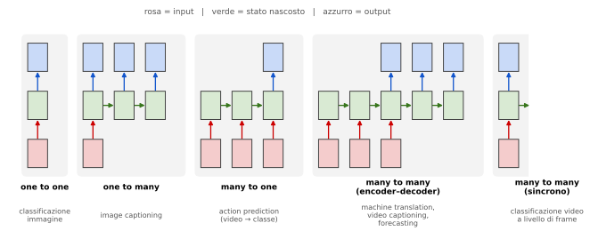

| Configurazione | $T_{in}$ | $T_{out}$ | Esempio nelle slide |
|---|---|---|---|
| **one to one** | 1 | 1 | classificazione di immagini (vanilla) |
| **one to many** | 1 | $T'$ | *image captioning*: immagine → sequenza di parole (slide 5–6) |
| **many to one** | $T$ | 1 | *action prediction*: sequenza di frame → classe di azione (slide 7–8) |
| **many to many** (encoder–decoder) | $T$ | $T'$ | *machine translation*: sequenza di parole → sequenza di parole (slide 9); *video captioning* (slide 10); *forecasting* (slide 14) |
| **many to many** (sincrono) | $T$ | $T$ | classificazione di video **a livello di frame** (slide 11) |

**[Nota]** Nelle slide 9–11 le due colonne «many to many» sono quelle del quarto e quinto pannello: nel **quarto** si *legge prima tutto l'ingresso e poi si produce l'uscita* (lunghezze indipendenti), nel **quinto** si produce un'uscita per *ogni* ingresso (stessa lunghezza, un'etichetta per frame).

### 1.3 Perché le reti vanilla non bastano [Aggiunta]

1. **Dimensione fissa**: un MLP con ingresso $T\cdot D$ non accetta sequenze di lunghezza diversa.
2. **Parametri che crescono con $T$**: il primo strato ha $T\cdot D\cdot H$ pesi.
3. **Nessuna condivisione nel tempo**: lo stesso «evento» (una parola, un gesto) in una posizione diversa verrebbe appreso da pesi diversi.
4. **Ordine ignorato** se si fa una media/pooling dei frame.

Le due soluzioni viste in questa lezione condividono i pesi **lungo il tempo**: la convoluzione 1D (sez. 3) li condivide su finestre locali, la RNN (sez. 4) li riusa a ogni passo mantenendo uno stato.

### 1.4 One-to-many: image captioning (slide 5–6)

Immagine (es. un cane marrone) → *«A happy brown dog.»*. L'uscita è una sequenza di parole $y_1,\dots,y_{T'}$ (con $T'$ non fissato: lo decide il modello emettendo un simbolo di fine, `<END>`). Per la regola della catena della probabilità
$$
p(y_{1:T'}\mid x)=\prod_{t=1}^{T'}p\big(y_t\mid y_{1:t-1},x\big).
$$
Ogni fattore è prodotto dalla rete (sez. 4.7).

### 1.5 Many-to-one: action prediction (slide 7–8)

Sequenza di frame (cane che salta un ostacolo) → una classe tra *Running, Jumping, Dancing, Fighting, Eating* (la spunta verde è su *Jumping*):
$$
p(c\mid x_{1:T}),\qquad c\in\{\text{Running, Jumping, Dancing, Fighting, Eating}\}.
$$
La rete deve **riassumere** $T$ frame in un solo vettore (lo stato finale $h_T$) e poi classificare.

### 1.6 Many-to-many (slide 9–11)

- **Machine translation** (slide 9): sequenza di parole → sequenza di parole; la frase di arrivo ha lunghezza diversa e l'ordine delle parole può cambiare ⇒ serve l'encoder–decoder (sez. 4.4).
- **Video captioning** (slide 10): frame → «A dog jumps over a hurdle.».
- **Classificazione di video a livello di frame** (slide 11): un'etichetta per ogni frame ⇒ configurazione sincrona.

---

## 2. Forecasting (slide 14–19)

### 2.1 Definizione (slide 14)

> «Given some observations (history), predict the future.»

Dati $T_o$ istanti osservati si vogliono predire i successivi $H$ (*orizzonte*):
$$
\hat x_{T_o+1:T_o+H}=f_\theta\big(x_{1:T_o}\big).
$$
È la configurazione many-to-many a due fasi (si **osserva**, poi si **predice**). Il vincolo fondamentale è la **causalità**: la predizione per l'istante $t$ può usare **solo** ingressi $\le t$ (vedi sez. 3.4: convoluzioni causali).

**[Aggiunta] Loss e metriche.** Con regressione sulle posizioni:
$$
\mathcal L=\frac1H\sum_{h=1}^{H}\big\|\hat x_{T_o+h}-x_{T_o+h}\big\|_2^2 .
$$
Metriche tipiche per le traiettorie: **ADE** (*Average Displacement Error*, errore medio su tutti gli istanti $\frac1H\sum_h\|\hat x_{T_o+h}-x_{T_o+h}\|$) e **FDE** (*Final Displacement Error*, errore solo all'ultimo istante $h=H$).

### 2.2 Trajectory forecasting (slide 15)

La slide mostra tre pedoni (riquadri verde, rosso, giallo): date le **posizioni precedenti** (linee punteggiate) si devono **predire le posizioni future** (stelle). Le frecce curve mostrano che le traiettorie future si *incrociano* ⇒ i pedoni interagiscono (si evitano) e la destinazione dipende dagli altri.

**[Aggiunta] Il futuro è multimodale.** Spesso ci sono più futuri plausibili con probabilità non trascurabile. Se si addestra con MSE, il minimizzatore è la **media condizionata**: infatti
$$
\frac{\partial}{\partial\hat y}\,\mathbb E\big[(y-\hat y)^2\mid x\big]=-2\big(\mathbb E[y\mid x]-\hat y\big)=0\ \Rightarrow\ \hat y^*=\mathbb E[y\mid x].
$$
Se, davanti a un ostacolo, il pedone va a destra o a sinistra con probabilità $\frac12$, la media cade **nel mezzo, cioè sull'ostacolo**: una predizione che nessun pedone seguirebbe.

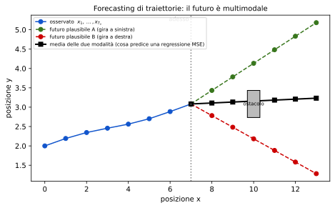

### 2.3 Applicazioni (slide 16–17)

| Dominio (slide) | Perché serve prevedere |
|---|---|
| Interazione uomo–robot (16) | il robot deve anticipare i movimenti della persona |
| *Long-term tracking* attraverso occlusioni (16) | se un oggetto sparisce dietro un altro, la sua posizione futura aiuta a ritrovarlo |
| Sicurezza dei veicoli autonomi (16) | anticipare, p.es., un bambino che rincorre un pallone |
| Meteo e disastri naturali, es. terremoti (17) | allerta |
| Andamenti di mercato (17) | finanza (S&P500 mensile in figura) |
| Pressione critica di una centrale (17) | sicurezza industriale |
| Domanda e offerta di gas (17) | la figura mostra *demand forecast* vs *supply forecast* e un *alert issued* quando l'offerta prevista è inferiore alla domanda |

**[Aggiunta]** Il grado di prevedibilità cambia molto: un pedone è abbastanza regolare, un terremoto o un mercato molto meno; l'errore di previsione cresce con l'orizzonte $H$.

### 2.4 Outline (slide 18–19)

Due famiglie di tecniche: **(1) basate su CNN** (sez. 3) e **(2) reti neurali ricorrenti** (sez. 4).

---

## 3. Temporal Convolution Networks (slide 20–35)

### 3.1 La convoluzione 1D modella sequenze (slide 22)

Per un segnale $f$ e un kernel appreso $g$ (supporto $\{0,\dots,K-1\}$):
$$
(f*g)(i)=\sum_{k}g(k)\,f(i-k).
$$

**[Nota] Convoluzione vs cross-correlazione.** La formula della slide ha $f(i-k)$ (il kernel è «ribaltato»). Le librerie (`Conv1d`) calcolano in realtà la **cross-correlazione** $y_i=\sum_k g(k)f(i+k)$. Poiché $g$ è *appreso*, la differenza è irrilevante (basta riordinare i pesi).

**Esempio (slide 22):** sorgente $x=(10,50,60,10,20,40,30)$ e kernel $g=(\frac13,\frac13,\frac13)$ (media mobile). La finestra scorre nel tempo:

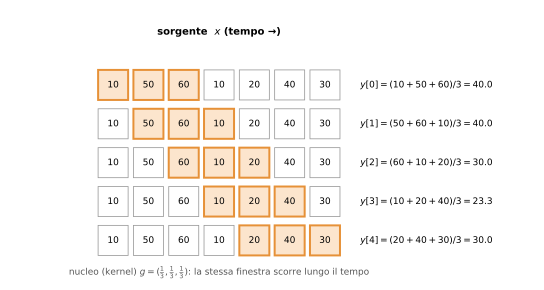

Con altri pesi cambia la funzione calcolata: con $g=(1,0,-1)$ la cross-correlazione dà $(-50,\,40,\,40,\,-30,\,-10)$, cioè la *differenza* tra due istanti a distanza 2 (un rilevatore di variazioni, la versione 1D di un filtro di bordo).

**Lunghezza dell'uscita.** Senza padding, un ingresso di lunghezza $N$ e un kernel di $K$ valori dà $N-K+1$ uscite (qui $7-3+1=5$). Con *padding* di $P$ zeri per lato e *stride* $S$:
$$
N_{out}=\Big\lfloor\frac{N+2P-K}{S}+1\Big\rfloor .
$$

**Più canali [Aggiunta].** Con $C_{in}$ canali in ingresso e $C_{out}$ filtri:
$$
y_{c'}[i]=b_{c'}+\sum_{c=1}^{C_{in}}\sum_{k=0}^{K-1}W[c',c,k]\;x_c[i+k],\qquad \#\text{parametri}=C_{out}\,C_{in}\,K+C_{out}.
$$
**I parametri non dipendono da $T$**: il kernel è condiviso a tutti gli istanti (equivarianza alla traslazione *nel tempo*, come per lo spazio nelle CNN, nota 1, sez. 13–16).

**Gradiente rispetto al kernel [Aggiunta].** Poiché $g(k)$ compare in ogni uscita, i contributi si **sommano** (regola della catena sui rami, nota 1, sez. 9):
$$
\frac{\partial\mathcal L}{\partial g(k)}=\sum_i\frac{\partial\mathcal L}{\partial y_i}\,x_{i+k}.
$$

### 3.2 «Quale kernel di taglia 3 predice il futuro?» (slide 23)

La slide propone la sequenza $7,8,9,\dots,14$ e chiede quali pesi $(a,b,c)$ trasformano una finestra di 3 valori nel valore **successivo**; le uscite mostrate sono $9,10,\dots,15$ cioè «ingresso $+1$».

**[Nota]** Nella figura la colonna di uscita è allineata alla riga $8$ (centro della finestra $7,8,9$): l'uscita $9$ è quindi il valore *successivo al centro*, ma coincide con l'ultimo elemento della finestra. Leggo l'esercizio nel senso utile per il forecasting: **da una finestra che termina in $x_t$ si vuole predire $x_{t+1}$**.

**Risoluzione.** Per la finestra $(7,8,9)\to10$ e la successiva $(8,9,10)\to11$:
$$
7a+8b+9c=10,\qquad 8a+9b+10c=11 .
$$
Sottraendo: $a+b+c=1$. Sostituendo nella prima: $7(a+b+c)+b+2c=10\Rightarrow b+2c=3$. Quindi
$$
b=3-2c,\qquad a=c-2,\qquad c\ \text{libero}.
$$
Alcune soluzioni: $c=1\Rightarrow(a,b,c)=(-1,1,1)$ (verifica: $-7+8+9=10$ ✓); $c=2\Rightarrow(0,-1,2)$, cioè $\hat x_{t+1}=2x_t-x_{t-1}$ (**estrapolazione lineare**); $c=3\Rightarrow(1,-3,3)$. **La soluzione non è unica** perché la sequenza è perfettamente lineare (due equazioni, tre incognite). Con dati reali e rumorosi si risolve ai minimi quadrati ⇒ è esattamente un modello **autoregressivo lineare AR(3)** $\hat x_{t+1}=ax_{t-2}+bx_{t-1}+cx_t$, con $a,b,c$ ora *appresi* dal gradiente.

**Le due domande in rosso:**

1. *«Can I leverage longer sequences for a better prediction?»* — Sì, aumentando il **campo recettivo** (kernel più largo o più strati, sez. 3.5): un kernel di taglia $K$ guarda solo gli ultimi $K$ istanti. Ma un kernel più largo ha più parametri.
2. *«If I consider a larger kernel, what happens if the sequence is shorter?»* — Se $N<K$ non esiste nessuna finestra completa ($N-K+1\le0$ uscite). Si risolve con **zero-padding** (alterando i dati ai bordi) o scartando la sequenza. È la ragione per cui la TCN ha un compromesso sulla *flessibilità*, per esempio rispetto al numero variabile di frame in ingresso (slide 34).

### 3.3 Applicabile a 2D e 3D (slide 27)

La stessa idea si estende a più dimensioni: **2D** per immagini (nota 1), **3D** per volumi o per «immagini + tempo» (video). Con ingresso $N\times C_{in}\times T\times H\times W$ e kernel $K_t\times K_h\times K_w$ (`torch.nn.Conv3d`):
$$
y_{c'}[t,i,j]=b_{c'}+\sum_{c}\sum_{a,b,e}W[c',c,a,b,e]\;x_c[t+a,\,i+b,\,j+e].
$$
Il kernel (cubo arancione in figura) scorre in tutte e tre le direzioni e ogni posizione produce un valore (cella rossa). Parametri: $C_{out}C_{in}K_tK_hK_w+C_{out}$. Esempio: 64 filtri $3\times3\times3$ su ingresso RGB ($C_{in}=3$): $64\cdot3\cdot27+64=5248$.

### 3.4 Anche per ingresso–uscita complessi; convoluzioni *causali* (slide 31)

La slide mostra la frase «Let's represent this sentence,»: ogni parola passa da un **embedding** $r_i$ (vettore appreso), poi da una **conv** su $(r_1,r_2,r_3)$ per ottenere una rappresentazione contestuale e infine da una rete feed-forward (FFNN) applicata *a ogni posizione con gli stessi pesi*, che produce $r'_i$. L'uscita $r'_2$ dipende da $r_1,r_2,r_3$ (vicino a sinistra e a destra).

Va bene se tutta la frase è **già nota** (comprensione del testo). Ma:

> **«But need causal convolutions in forecasting!»**

In una convoluzione *centrata* l'uscita al tempo $t$ usa anche $x_{t+1}$ (futuro): predire $x_{t+1}$ usando $x_{t+1}$ sarebbe un **leakage** (la rete imparerebbe a copiare l'ingresso). Una convoluzione **causale** usa solo il passato:
$$
y_t=\sum_{k=0}^{K-1}g(k)\,x_{t-k},\qquad x_{s}=0\ \text{per}\ s<0 .
$$
In pratica si **aggiungono $K-1$ zeri a sinistra** dell'ingresso (e nessuno a destra) così l'uscita ha la stessa lunghezza dell'ingresso.

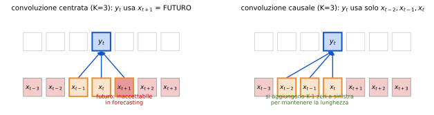

### 3.5 Temporal Convolutional Networks e campo recettivo (slide 32)

Una TCN (Bai et al., 2018) è una pila di convoluzioni 1D **causali** (più dilatazione, sez. 3.6). Vantaggi (slide): **banale da parallelizzare** (tutte le uscite si calcolano insieme, a differenza della RNN) e **sfrutta le dipendenze locali**. Limite: la **«interaction distance» è lineare nel numero di strati**.

**Derivazione del campo recettivo.** Il campo recettivo $R_\ell$ dopo $\ell$ strati è il numero di istanti d'ingresso da cui dipende un'uscita. Aggiungere uno strato con kernel $K$ e dilatazione $d$ (stride 1) estende la finestra a sinistra di $(K-1)d$ istanti:
$$
R_\ell=R_{\ell-1}+(K-1)\,d_\ell,\qquad R_0=1\ \Rightarrow\ R_L=1+(K-1)\sum_{\ell=1}^{L}d_\ell .
$$
- **Senza dilatazione** ($d_\ell=1$): $R_L=1+L(K-1)$ (formula della slide: «receptive field $1+L\cdot(K-1)$»). Per coprire $T$ istanti servono $L\approx\frac{T-1}{K-1}$ strati: **lineare**. Esempio $T=1000,\,K=3$: $L=500$.
- **Con dilatazione esponenziale** $d_\ell=2^{\ell-1}$: $\sum_\ell d_\ell=2^L-1$, quindi
$$
R_L=1+(K-1)(2^L-1)\ \Rightarrow\ L=\Big\lceil\log_2\!\Big(1+\tfrac{T-1}{K-1}\Big)\Big\rceil :
$$
**logaritmica** («Dilation makes it logarithmic»). Esempio $T=1000,\,K=3$: $L=9$ ($R_9=1+2\cdot511=1023\ge1000$).

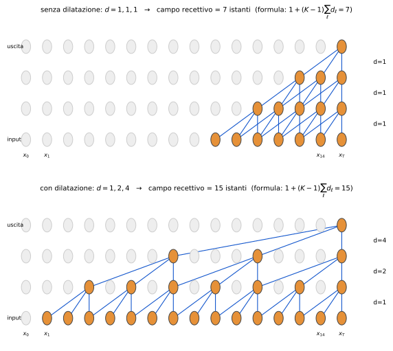
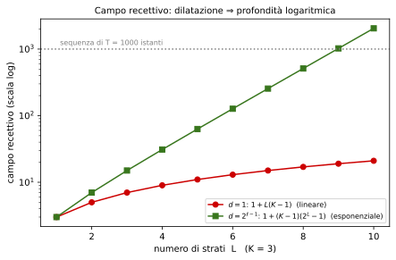

La figura (calcolata) mostra le due reti a 3 strati con $K=3$: senza dilatazione $R=7$, con $d=1,2,4$ si ottiene $R=15$. Le uscite dipendono dall'**insieme** degli istanti raggiunti: è stato verificato che per $d=1,2,4$ e $K=3$ si coprono **tutti** gli offset $0,\dots,14$ (**«w/o gaps»**, senza buchi).

**Perché senza buchi [Aggiunta].** Con $K=2$ e $d_\ell=2^{\ell-1}$ gli offset raggiunti sono le somme di sottoinsiemi di $\{1,2,4,\dots,2^{L-1}\}$, cioè **tutti i numeri da $0$ a $2^L-1$ scritti in binario**, ciascuno **una sola volta**. Con $K\ge2$ la copertura resta completa; con dilatazioni più grandi del kernel (es. $K=2,d=3$) ci sarebbero buchi.

**Costo.** La dilatazione **non aggiunge parametri** ($K\,C_{in}C_{out}$ per strato come prima), solo la distanza tra i campioni letti.

**Predizione del passo successivo (figura a destra, $x_T\to x_{T+1}$).** In addestramento l'uscita in $t$ è il bersaglio $x_{t+1}$ per **ogni** $t$ in parallelo (analogo del *teacher forcing*, sez. 4.5). A test, per prevedere $H>1$ passi si procede ricorsivamente (si riaggiunge l'uscita all'ingresso) oppure con una testa a $H$ uscite.

### 3.6 Il blocco residuo della TCN (slide 33)

Bai et al. (arXiv'18): *«a few details make the difference, e.g. the residual connection»* (codice: `github.com/locuslab/TCN`). Il **blocco residuo** $(k,d)$ (figura b della slide):

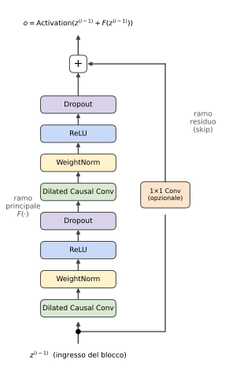

Sia $z$ l'ingresso. Ramo principale:
$$
F(z)=\underbrace{\mathrm{Drop}\circ\mathrm{ReLU}\circ\mathrm{WN}\circ\mathrm{DCConv}}_{\text{secondo}}\ \circ\ \underbrace{\mathrm{Drop}\circ\mathrm{ReLU}\circ\mathrm{WN}\circ\mathrm{DCConv}}_{\text{primo}}(z),
\qquad o=\mathrm{Activation}\big(z+F(z)\big).
$$

- **Dilated Causal Conv**: sez. 3.4–3.6; stesso $K,d$ nelle due convoluzioni.
- **ReLU** e **Dropout**: nota 2, sez. 2.3 e 7.2 (il dropout riduce l'overfitting).
- **Connessione residua** $z+F(z)$: la derivata è $\partial o/\partial z=I+\partial F/\partial z$, quindi il gradiente ha un **percorso diretto** (il termine $I$) che non attraversa le convoluzioni: attenua lo svanire del gradiente in reti profonde (come nei ResNet, MSRA 2015, slide 3). Se $z$ e $F(z)$ hanno **canali diversi** non si possono sommare ⇒ una **convoluzione $1\times1$ opzionale** proietta $z$ ($\tilde z=W_sz$, solo mescolando i canali). La figura (c) mostra $k=3,d=1$ con la «Identity Map (or 1×1 Conv)» in verde.
- **WeightNorm** [Aggiunta]: ogni vettore di pesi è riparametrizzato $w=g\dfrac{v}{\|v\|}$, con scala $g$ (scalare appreso) e direzione $v/\|v\|$ separate. Il gradiente è
$$
\frac{\partial\mathcal L}{\partial g}=\frac{v^\top\nabla_w\mathcal L}{\|v\|},\qquad
\frac{\partial\mathcal L}{\partial v}=\frac{g}{\|v\|}\Big(I-\frac{vv^\top}{\|v\|^2}\Big)\nabla_w\mathcal L ,
$$
perciò il passo su $v$ è sempre **ortogonale a $v$** (la direzione cambia, la norma non esplode). A differenza della BatchNorm (nota 2, sez. 5) **non usa statistiche del batch**: funziona anche con batch piccoli e sequenze di lunghezza variabile.

### 3.7 Risultati (slide 34)

Bai et al. confrontano una **TCN generica** con LSTM, GRU e RNN vanilla. Per le loss, perplexity e bpc **meno è meglio**; per l'accuratezza **più è meglio**. Valori in **grassetto** nella slide = migliori.

| Compito | Dim. modello | LSTM | GRU | RNN | TCN |
|---|---|---|---|---|---|
| Seq. MNIST (accuracy) | 70K | 87.2 | 96.2 | 21.5 | **99.0** |
| Permuted MNIST (accuracy) | 70K | 85.7 | 87.3 | 25.3 | **97.2** |
| Adding problem $T=600$ (loss) | 70K | 0.164 | **5.3e-5** | 0.177 | 5.8e-5 |
| Copy memory $T=1000$ (loss) | 16K | 0.0204 | 0.0197 | 0.0202 | **3.5e-5** |
| Music JSB Chorales (loss) | 300K | 8.45 | 8.43 | 8.91 | **8.10** |
| Music Nottingham (loss) | 1M | 3.29 | 3.46 | 4.05 | **3.07** |
| Word-level PTB (perplexity) | 13M | **78.93** | 92.48 | 114.50 | 89.21 |
| Word-level Wiki-103 (perplexity) | – | 48.4 | – | – | **45.19** |
| Word-level LAMBADA (perplexity) | – | 4186 | – | 14725 | **1279** |
| Char-level PTB (bpc) | 3M | 1.41 | 1.42 | 1.52 | **1.35** |
| Char-level text8 (bpc) | 5M | 1.52 | 1.56 | 1.69 | **1.45** |

**Definizioni [Aggiunta].** *Perplexity* $=\exp\!\big(-\frac1N\sum_i\log p(w_i\mid w_{<i})\big)$: «fattore di ramificazione effettivo» (quante parole equiprobabili la rete sta ancora considerando); *bpc* (*bits per character*) $=-\frac1N\sum_i\log_2p(c_i\mid c_{<i})$.

**Lettura.**
- La TCN vince quasi ovunque, soprattutto dove serve **memoria lunga**: *Copy memory* ($3.5\cdot10^{-5}$ contro $\approx0.02$ di LSTM/GRU/RNN, che non imparano) e *Seq. MNIST*, dove il pixel decisivo è lontano.
- La RNN vanilla è la peggiore (21.5% su Seq. MNIST): conferma «vanilla RNNs … don't work very well» (slide 171, sez. 4.9).
- **Eccezioni**: *Adding problem* (GRU 5.3e-5 contro 5.8e-5, praticamente un pareggio) e **Word-level PTB**, dove la LSTM (78.93) batte la TCN (89.21).
- Slide: *«easy to train and exceeding expectations»*, ma **«needs compromise on flexibility, e.g. variable number of input frames»**: la TCN ha un campo recettivo **fisso** e a inferenza deve conservare in memoria gli ultimi $R$ ingressi; una RNN ha invece uno stato di dimensione costante.

**[Aggiunta] Cautele.** I numeri sono quelli di una pubblicazione con configurazioni *generiche* (non ottimizzate per ogni compito) e non coprono tutte le celle (i «–» indicano risultati non riportati).

### 3.8 Take-home sulla TCN (slide 35)

| | Motivo |
|---|---|
| **Pro**: banale da parallelizzare | uscite indipendenti tra loro all'interno dello strato, nessuna dipendenza sequenziale |
| **Pro**: sfrutta dipendenze locali | il kernel è un operatore locale, con pochi parametri e bias induttivo verso pattern locali |
| **Contro**: «interaction distance» lineare o logaritmica | una posizione «vede» un'altra solo se il campo recettivo la include: $R=1+L(K-1)$ o logaritmica con dilatazione |
| **Contro**: dipendenze a lunga distanza richiedono molti strati | più strati = più costo e profondità |

---

## 4. Reti Neurali Ricorrenti (slide 36–171)

### 4.1 L'idea: uno stato interno che si aggiorna (slide 39–45)

Una RNN ha un **«internal state» aggiornato man mano che la sequenza viene processata** (slide 40). A ogni passo applica la **formula di ricorrenza**:
$$
\boxed{h_t=f_W(h_{t-1},x_t)}\qquad\text{(nuovo stato = funzione di vecchio stato e input corrente)},
$$
$$
y_t=f_{W_{hy}}(h_t)\qquad\text{(l'uscita è generata dal nuovo stato, slide 43).}
$$
(slide 42: «some function with parameters $W$»; slide 43: «another function with parameters $W_{hy}$»). **Punto chiave (slide 45): la stessa funzione e lo stesso insieme di parametri sono usati a ogni passo.** Questo dà una rete che accetta **qualunque lunghezza** con un numero **fisso** di parametri.

**Srotolamento** (*unrolled*, slide 41 e 44): si disegna una copia della cella per ogni istante, collegate da $h_0\to h_1\to h_2\to\cdots$. $h_0$ è lo stato iniziale (di solito zeri, oppure appreso). Lo stato $h_t$ è un **riassunto compresso** di $x_{1:t}$: per induzione, $h_t$ è funzione di $h_0,x_1,\dots,x_t$.

### 4.2 La RNN «vanilla» (o di Elman) (slide 46)

Lo stato è un singolo vettore nascosto $h$ (slide 46):
$$
\boxed{h_t=\tanh\big(W_{hh}h_{t-1}+W_{xh}x_t\big)},\qquad y_t=W_{hy}h_t .
$$
Dimensioni: $x_t\in\mathbb R^D$, $h_t\in\mathbb R^H$, $y_t\in\mathbb R^C$ ⇒ $W_{xh}\in\mathbb R^{H\times D}$, $W_{hh}\in\mathbb R^{H\times H}$, $W_{hy}\in\mathbb R^{C\times H}$. Aggiungendo i bias, **parametri** $=H(D+H)+CH+H+C$, *indipendenti da $T$*.

**Forma equivalente (slide 145).** Impilando $[h_{t-1};x_t]$:
$$
h_t=\tanh\!\Big(\begin{pmatrix}W_{hh}&W_{hx}\end{pmatrix}\begin{pmatrix}h_{t-1}\\x_t\end{pmatrix}\Big)=\tanh\!\Big(W\begin{pmatrix}h_{t-1}\\x_t\end{pmatrix}\Big),\quad W=(W_{hh}\ W_{xh}).
$$
**[Nota]** La slide 145 scrive $W_{hx}$ dove la 46 scrive $W_{xh}$: è la stessa matrice, solo una notazione diversa. «Elman RNN» dal nome del prof. Jeffrey Elman.

**Perché tanh.** È zero-centered e limitata in $[-1,1]$, quindi lo stato non cresce senza limite (nota 2, sez. 2.2). Il prezzo è il suo gradiente $\le1$ (sez. 4.9).

### 4.3 Il grafo computazionale (slide 47–53)

Si «srotola» il calcolo (slide 47–49): $h_1=f_W(h_0,x_1)$, $h_2=f_W(h_1,x_2)$, $h_3=f_W(h_2,x_3),\dots,h_T$. **Si riusa la stessa matrice $W$ a ogni passo** (slide 50, frecce curve che partono dal quadrato $W$).

**Many-to-many (slide 51–53).** Ogni stato produce un'uscita $y_t$ (slide 51), ogni uscita ha una loss $\mathcal L_t=\ell(y_t,\hat y_t)$ (slide 52), e la loss totale è
$$
\mathcal L=\sum_{t=1}^{T}\mathcal L_t\qquad(\text{slide 53; spesso si divide per }T).
$$

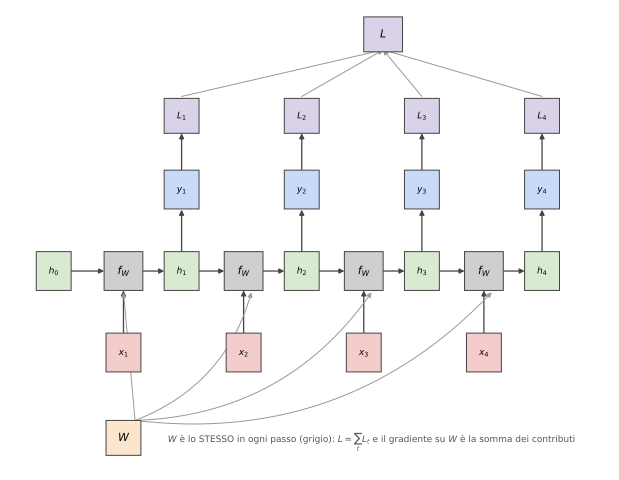

**Gradiente quando $W$ è riusato [Aggiunta].** Si immaginano $T$ copie $W^{(1)},\dots,W^{(T)}$ vincolate a essere uguali; per la regola della catena sui rami (i gradienti si **sommano** dove un nodo è usato più volte, nota 1, sez. 9):
$$
\frac{\partial\mathcal L}{\partial W}=\sum_{t=1}^{T}\frac{\partial\mathcal L}{\partial W^{(t)}}.
$$
Ogni $\partial\mathcal L/\partial W^{(t)}$ dipende a sua volta da **tutte le loss successive**, perché $h_t$ influenza $h_{t+1},h_{t+2},\dots$ (sez. 4.6).

**Many-to-one.** Si tiene la loss solo sull'ultimo stato: $\mathcal L=\mathcal L_T$.

**One-to-many (slide 59).** Un solo ingresso $x$ (all'inizio); a ogni passo successivo l'ingresso è **l'uscita del passo precedente** ($y_1,y_2,\dots,y_{T-1}$ nella slide): $h_t=f_W(h_{t-1},y_{t-1})$ e $y_t$ viene prodotto dallo stato.

### 4.4 Sequence-to-sequence: many-to-one + one-to-many (slide 60–61, Sutskever et al., NIPS 2014)

Per tradurre una frase in un'altra (lunghezze diverse) si **concatenano** due RNN con pesi diversi:

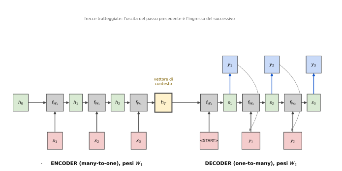

1. **Encoder** (*many to one*, slide 60, pesi $W_1$): legge $x_1,\dots,x_T$ e codifica **l'intera sequenza in un singolo vettore** $h_T$ (vettore di contesto):
$$
h_t=f_{W_1}(h_{t-1},x_t),\quad t=1,\dots,T .
$$
2. **Decoder** (*one to many*, slide 61, pesi $W_2$): parte dal contesto e genera la sequenza di uscita
$$
s_0=h_T,\qquad s_t=f_{W_2}(s_{t-1},y_{t-1}),\qquad p(y_t\mid y_{<t},x)=\mathrm{softmax}(W_{hy}s_t),
$$
con $y_0=$ `<START>` e arresto quando si genera `<END>`. La probabilità della sequenza è
$$
p(y_{1:T'}\mid x_{1:T})=\prod_{t=1}^{T'}p\big(y_t\mid y_{<t},h_T\big).
$$

**[Aggiunta] Collo di bottiglia.** Tutto ciò che il decoder sa della frase di partenza passa da **un solo vettore di dimensione fissa** $h_T$: per frasi lunghe l'informazione si degrada. Questo ha portato al meccanismo di *attention*, tema delle lezioni successive.

### 4.5 Esempio: language model a livello di carattere (slide 62–68)

**Setup (slide 62).** Vocabolario $[h,e,l,o]$ ($V=4$ simboli); sequenza di training **«hello»**. Ogni carattere è un vettore **one-hot** $x_t\in\{0,1\}^4$ ($h=(1,0,0,0)$, $e=(0,1,0,0)$, $l=(0,0,1,0)$, $o=(0,0,0,1)$). L'obiettivo è predire il **carattere successivo**: dagli ingressi $h,e,l,l$ i bersagli sono $e,l,l,o$.

**Calcolo (slide 63–64).** Con $H=3$ unità nascoste: $W_{xh}\in\mathbb R^{3\times4}$, $W_{hh}\in\mathbb R^{3\times3}$, $W_{hy}\in\mathbb R^{4\times3}$ (**$12+9+12=33$ parametri**, senza bias).
$$
h_t=\tanh(W_{hh}h_{t-1}+W_{xh}x_t),\qquad z_t=W_{hy}h_t,\qquad p_t=\mathrm{softmax}(z_t).
$$
Moltiplicando un one-hot per $W_{xh}$ si **seleziona la colonna** corrispondente al carattere (è un *lookup*, cioè un embedding).

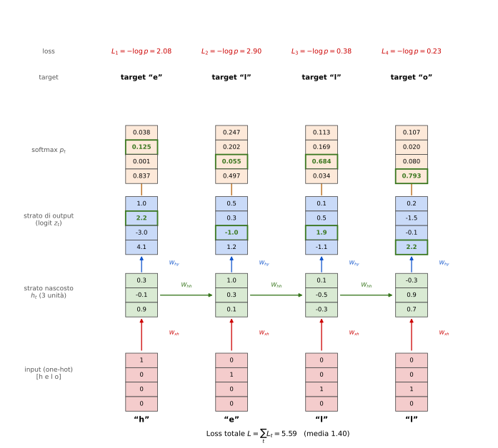

Gli stati nascosti e i logit mostrati nella slide 64 sono nella figura; i bersagli sono in verde. La figura riporta le probabilità e le loss **calcolate** con la softmax dai logit mostrati:

| $t$ | input | target | $p_{target}$ | $\mathcal L_t=-\log p_{target}$ |
|---|---|---|---|---|
| 1 | h | e | 0.125 | 2.08 |
| 2 | e | l | 0.055 | 2.90 |
| 3 | l | l | 0.684 | 0.38 |
| 4 | l | o | 0.793 | 0.23 |

Loss totale $5.59$ (media $1.40$). Il confronto con la baseline casuale ($-\log\frac14=1.386$ per carattere) mostra che questa rete **non è ancora addestrata**.

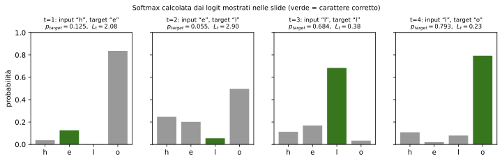

**[Nota] Valori della softmax nelle slide.** Le probabilità scritte nelle slide 65–68 per i passi 1 e 2 (es. `.03 .84 .00 .13`) **non corrispondono esattamente** alla softmax dei logit mostrati (che dà `.038 .125 .001 .837`: il valore 0.84 spetta al logit $4.1$ in posizione «o», non a «e»); per i passi 3 e 4 coincidono. Sono numeri illustrativi: per le derivazioni qui uso i valori calcolati.

**Gradiente della loss rispetto ai logit [Aggiunta].** Con $p=\mathrm{softmax}(z)$ e bersaglio $c$ ($\mathcal L=-\log p_c$):
$$
\frac{\partial\mathcal L}{\partial z_k}=-\frac{\partial}{\partial z_k}\Big(z_c-\log\sum_je^{z_j}\Big)=p_k-\mathbb 1[k=c]\quad\Longrightarrow\quad \nabla_z\mathcal L=p-y .
$$
Es. $t=1$: $p-y=(0.038,\,-0.875,\,0.001,\,0.837)$: spinge su il logit di «e» e giù quello di «o» (il più alto ma sbagliato).

**Training: teacher forcing (slide 64).** Durante l'addestramento l'ingresso al passo $t+1$ è il **carattere vero** (*ground truth*: «aka GT forcing»), non quello predetto. **Test (slide 65–68):** si **campiona** un carattere dalla distribuzione $p_t$, e lo si **rimanda in ingresso**, un carattere alla volta:

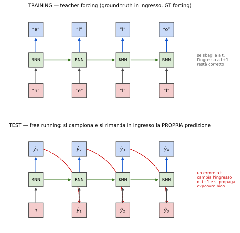

Nelle slide 68 il campionamento produce $e,l,l,o$ con probabilità $0.84,\ 0.50,\ 0.68,\ 0.79$ ⇒ probabilità della traiettoria (dato «h») $0.84\cdot0.50\cdot0.68\cdot0.79\approx0.226$.

**Exposure bias** (nota della slide 64: He, Zhang, Zhou, Glass, ICLR 2020). In training la rete non vede mai *i propri errori* (gli ingressi sono sempre corretti), a test sì: un errore cambia l'ingresso successivo e può **propagarsi** (distribuzione di training ≠ distribuzione di test).

**[Aggiunta] Campionare vs argmax.** Lo *sampling* produce testi diversi a ogni esecuzione; l'argmax è deterministico ma ripetitivo. Con la **temperatura** $\tau$ la distribuzione diventa $p_k\propto e^{z_k/\tau}$: $\tau\to0$ = argmax, $\tau\to\infty$ = uniforme.

### 4.6 Backpropagation Through Time (slide 70)

Slide 70: *«Forward through entire sequence to compute loss, then backward through entire sequence to compute gradient.»* È la backprop (nota 1, sez. 9) applicata al grafo srotolato.

**Language modelling.** La slide usa la frase «cat sat on mat»: si vuole un modello $P(\text{parola successiva}\mid\text{precedenti})$ e si vorrebbero **alte** le probabilità
$$
P(\text{cat}\mid\langle S\rangle),\ P(\text{sat}\mid\langle S\rangle,\text{cat}),\ P(\text{on}\mid\langle S\rangle,\text{cat},\text{sat}),\ P(\text{mat}\mid\dots),\ P(\langle E\rangle\mid\dots).
$$
Per la regola della catena $P(w_{1:n})=\prod_tP(w_t\mid w_{<t})$, quindi **massimizzare la verosimiglianza = minimizzare la somma delle cross-entropy** $\mathcal L=-\sum_t\log p_t(w_t)$ (sez. 4.5). `<S>` e `<E>` sono i simboli di inizio e fine frase.

**Derivazione completa [Aggiunta].** Per la RNN vanilla (si omettono i bias):
$$
a_t=W_{hh}h_{t-1}+W_{xh}x_t,\quad h_t=\tanh(a_t),\quad z_t=W_{hy}h_t,\quad \mathcal L=\sum_t\mathcal L_t(z_t).
$$
Sia $\delta z_t=\partial\mathcal L_t/\partial z_t$ (es. $p_t-y_t$). Si procede **da $t=T$ a $t=1$**:
$$
\begin{aligned}
\frac{\partial\mathcal L}{\partial W_{hy}}&=\sum_t\delta z_t\,h_t^\top,\\
\frac{\partial\mathcal L}{\partial h_t}&=\underbrace{W_{hy}^\top\delta z_t}_{\text{dalla loss al passo }t}+\underbrace{W_{hh}^\top\,\delta a_{t+1}}_{\text{dal futuro attraverso }h_{t+1}}\quad(\delta a_{T+1}=0),\\
\delta a_t&=\big(1-h_t^{\,2}\big)\odot\frac{\partial\mathcal L}{\partial h_t}\qquad(\tanh'=1-\tanh^2),\\
\frac{\partial\mathcal L}{\partial W_{hh}}&=\sum_t\delta a_t\,h_{t-1}^\top,\qquad
\frac{\partial\mathcal L}{\partial W_{xh}}=\sum_t\delta a_t\,x_t^\top .
\end{aligned}
$$
Il termine $W_{hh}^\top\delta a_{t+1}$ è proprio «backpropagation from $h_t$ to $h_{t-1}$ multiplies by $W$ (actually $W_{hh}^T$)» della slide 146. La **somma sui $t$** è la somma sulle copie di $W$ della sez. 4.3.

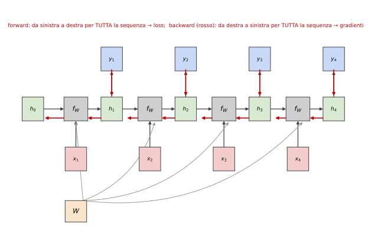

**Costo.** Tempo e memoria $O(T)$ (si devono conservare tutti gli $h_t$ del forward). Per sequenze molto lunghe si usa la **BPTT troncata** [Aggiunta]: si propaga il gradiente solo per $k$ passi pur trasportando lo stato $h$ in avanti.

**Codice (verificato con gradient check numerico, errore $<10^{-9}$) [Aggiunta]:**

```python
import numpy as np
def rnn_loss_grads(Wxh, Whh, Why, xs, targets, h0):
    V = Why.shape[0]
    hs, ps, loss = {-1: h0}, {}, 0.0
    for t, (ix, iy) in enumerate(zip(xs, targets)):            # forward su TUTTA la sequenza
        x = np.zeros((V, 1)); x[ix] = 1                        # one-hot
        hs[t] = np.tanh(Wxh @ x + Whh @ hs[t-1])
        z = Why @ hs[t]
        ps[t] = np.exp(z - z.max()); ps[t] /= ps[t].sum()      # softmax
        loss += -np.log(ps[t][iy, 0])                          # L = somma di L_t
    dWxh, dWhh, dWhy = np.zeros_like(Wxh), np.zeros_like(Whh), np.zeros_like(Why)
    dh_next = np.zeros_like(h0)                                # W_hh^T * delta a_{t+1}
    for t in reversed(range(len(xs))):                         # backward su TUTTA la sequenza
        dz = ps[t].copy(); dz[targets[t]] -= 1                 # p - y
        dWhy += dz @ hs[t].T
        dh = Why.T @ dz + dh_next                              # dL/dh_t
        da = (1 - hs[t]**2) * dh                               # tanh'
        x = np.zeros((V, 1)); x[xs[t]] = 1
        dWxh += da @ x.T
        dWhh += da @ hs[t-1].T
        dh_next = Whh.T @ da
    return loss, (dWxh, dWhh, dWhy)
```

### 4.7 Image captioning (slide 112–125)

**Modello (slide 112–113).** Una **CNN** (rete convoluzionale, rosso) estrae una rappresentazione $v$ dell'immagine; una **RNN** (verde) genera la didascalia parola per parola, partendo da `START` fino a `END`. Esempio: immagine di un uomo con cappello → «straw hat».

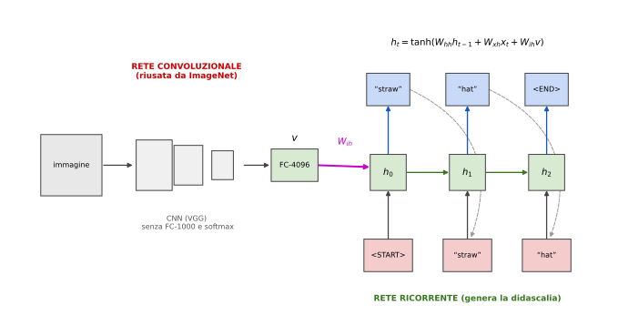

**Passi (slide 114–123).**
1. **Test image** (114).
2. Si usa una CNN (qui VGG: conv-64,…, FC-4096, FC-4096, FC-1000, softmax) (115).
3. Si **elimina** l'ultimo strato FC-1000 e la softmax (la X rossa, 116): non serve classificare, serve il vettore di feature $v\in\mathbb R^{4096}$ dell'ultimo FC-4096. È esattamente il **transfer learning** della nota 2, sez. 9.4 (tenere i conv, buttare il classificatore).
4. Si dà alla RNN il primo ingresso $x_0=$ `<START>` (117).
5. La ricorrenza viene **modificata** per includere l'immagine (118):
$$
\text{prima: }h=\tanh(W_{xh}x+W_{hh}h)\qquad\text{ora: }h=\tanh\big(W_{xh}x+W_{hh}h+W_{ih}v\big),
$$
con $W_{ih}$ una nuova matrice $H\times4096$ che proietta $v$ nello spazio dello stato.
6. Dallo stato $h_0$ si produce $y_0$, una distribuzione sul vocabolario; si **campiona** («straw», 119), lo si rimanda in ingresso, e così via: $h_1\to y_1\to$ «hat» (120–121), $h_2\to y_2\to\langle$END$\rangle$ ⇒ **fine** (122–123).

**[Nota]** Nella formula della slide 118 il termine $W_{ih}v$ compare a ogni passo, ma nel disegno (e nel lavoro originale di Karpathy & Fei-Fei) $v$ entra solo nel **primo** passo; entrambe le varianti esistono. La slide 112 usa i nomi $W_{hi},W_{hx},W_{oh}$ (stesse matrici con altra notazione).

**Training [Aggiunta].** Per ogni immagine si ha la didascalia vera, p.es. `<START> straw hat <END>`. Si usa il *teacher forcing* (sez. 4.5), la loss è la somma delle cross-entropy $\mathcal L=-\sum_t\log p(y_t^{vero}\mid y^{vero}_{<t},v)$, e si fa BPTT sulla RNN; i gradienti possono continuare nella CNN (*fine-tuning*) o fermarsi. Alla generazione si può campionare (come in slide), usare l'argmax, o **beam search**.

**Letteratura citata (slide 112):** Mao et al. (*Explain Images with Multimodal RNNs*), Karpathy & Fei-Fei (*Deep Visual-Semantic Alignments*), Vinyals et al. (*Show and Tell*), Donahue et al. (*Long-term Recurrent Convolutional Networks*), Chen & Zitnick (*Learning a Recurrent Visual Representation…*).

**Risultati (slide 124, `neuraltalk2`).** Didascalie corrette: «A cat sitting on a suitcase on the floor», «A cat is sitting on a tree branch», «A dog is running in the grass with a frisbee», «A white teddy bear sitting in the grass», «Two people walking on the beach with surfboards», «A tennis player in action on the court», «Two giraffes standing in a grassy field», «A man riding a dirt bike on a dirt track».

**Casi di fallimento (slide 125).**

| Immagine | Didascalia generata | Probabile causa [Aggiunta] |
|---|---|---|
| donna con cappotto di pelliccia | «A woman is holding a cat in her hand» | la texture di pelo è associata ai gatti |
| persona in verticale sulle mani (handstand) | «A woman standing on a beach holding a surfboard» | posa insolita; la scena (acqua, riva) è associata a *surfboard* |
| ragnatela su un ramo | «A bird is perched on a tree branch» | «tree branch» spesso accompagnato da uccelli |
| giocatore di baseball in tuffo | «A man in a baseball uniform throwing a ball» | descrive la scena tipica, non l'azione (tuffo) |
| persona con telefono davanti a un laptop | «A person holding a computer mouse on a desk» | oggetti piccoli confusi: statistica scena–oggetti |

Il modello impara **correlazioni statistiche** tra aspetto e parole (e un *prior* linguistico) e non una vera comprensione della scena.

### 4.8 RNN multistrato (slide 143)

Si possono impilare più RNN in **profondità** oltre che in tempo: l'uscita dello strato $\ell$ è l'ingresso dello strato $\ell+1$, allo stesso istante (figura: asse «depth» e asse «time»):
$$
h_t^{(\ell)}=\tanh\!\Big(W^{(\ell)}\begin{pmatrix}h_{t-1}^{(\ell)}\\ h_t^{(\ell-1)}\end{pmatrix}\Big),\qquad h_t^{(0)}=x_t .
$$
Ogni strato ha i propri pesi $W^{(\ell)}$, condivisi nel tempo. In pratica si usano 2–4 strati.

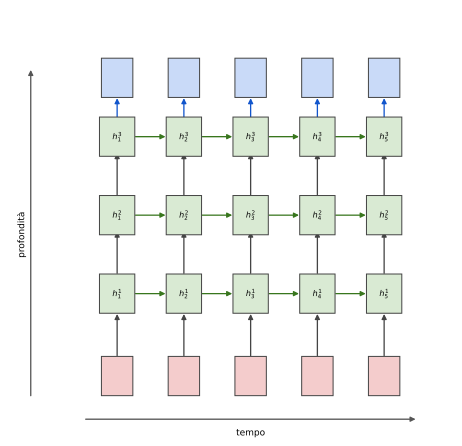

### 4.9 Flusso del gradiente nella RNN vanilla (slide 145–157)

Riferimenti: Bengio et al. 1994 («Learning long-term dependencies with gradient descent is difficult»), Pascanu et al. 2013 («On the difficulty of training recurrent neural networks»).

**Derivata tra due passi consecutivi (slide 146–147).**
$$
\frac{\partial h_t}{\partial h_{t-1}}=\tanh'\!\big(W_{hh}h_{t-1}+W_{xh}x_t\big)\,W_{hh}
\ \ \text{ovvero}\ \ J_t=\operatorname{diag}\big(1-h_t^2\big)\,W_{hh}.
$$
(la slide scrive la forma scalare; nella versione matriciale $\tanh'$ è una matrice diagonale). Nel passaggio all'indietro (grafico di slide 146) il gradiente è moltiplicato per $J_t^\top$, cioè per $W_{hh}^\top$ a ogni passo («Backpropagation from $h_t$ to $h_{t-1}$ multiplies by $W$»).

**Gradiente su più passi (slide 157).** Dalla sez. 4.3 e dalla regola della catena, la loss al tempo $T$ dipende da $W$ attraverso **ogni** passo $k\le T$:
$$
\frac{\partial\mathcal L_T}{\partial W}=\sum_{k=1}^{T}\frac{\partial\mathcal L_T}{\partial h_T}\Bigg(\prod_{j=k+1}^{T}J_j\Bigg)\frac{\partial h_k}{\partial W}\Big|_{\text{diretto}},\qquad
\frac{\partial h_T}{\partial h_k}=\prod_{j=k+1}^{T}\operatorname{diag}(1-h_j^2)\,W_{hh}.
$$
Il termine $k=1$ è quello della slide: $\dfrac{\partial\mathcal L_T}{\partial W}\sim\dfrac{\partial\mathcal L_T}{\partial h_T}\,W^{T-1}\dfrac{\partial h_1}{\partial W}$ (la slide lo scrive $W_{in}^{T-1}$ **[Nota]**: la notazione non è definita, è la potenza $T-1$ della matrice di ricorrenza). Si sta **trascurando la non linearità** (come dice la slide: «neglecting the non-linearity»): rimane la potenza $W^{T-1}$ della **stessa matrice** moltiplicata $T-1$ volte.

**Perché dipende dai valori singolari.** Sia $W=U\Sigma V^\top$ (SVD, valori singolari $\sigma_1\ge\sigma_2\ge\dots\ge0$). Una matrice agisce su un vettore stirandolo di fattori compresi tra $\sigma_{min}$ e $\sigma_{max}$, quindi per le norme $\|Wv\|\le\sigma_1\|v\|$ e per le potenze
$$
\|W^{k}\|_2\le\sigma_1^{\,k}.
$$
Se $W$ è simmetrica, $W^k$ ha valori singolari esattamente $\sigma_i^k$.

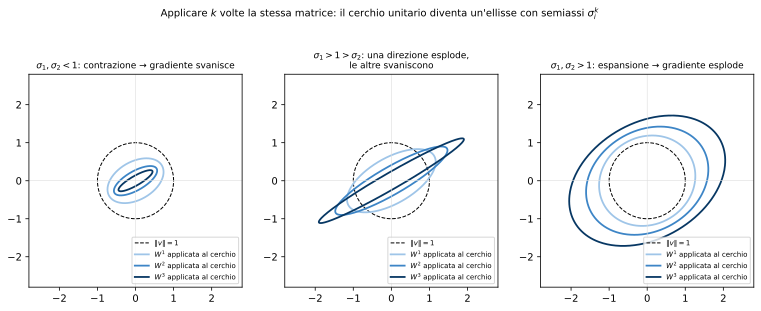

- **Largest singular value $<1$ ⇒ gradienti che svaniscono** (*vanishing*): $\|W^k\|\le\sigma_1^k\to0$ esponenzialmente (garantito). Rimedio (slide): **cambiare architettura** della RNN ⇒ LSTM (sez. 4.11).
- **Largest singular value $>1$ ⇒ gradienti che esplodono** (*exploding*): in direzioni favorevoli la norma cresce come $\sigma_1^k$. Rimedio (slide): **gradient clipping**.

**[Nota] Precisazione.** Il caso $\sigma_1>1$ è solo una condizione *necessaria*, non sufficiente, per l'esplosione: ad esempio $W=\begin{pmatrix}0&2\\0&0\end{pmatrix}$ ha $\sigma_1=2>1$ ma $W^2=0$. La condizione corretta per la crescita esponenziale è che il **raggio spettrale** (massimo modulo degli autovalori) sia $>1$, perché $\rho(W)^k\le\|W^k\|\le\sigma_1^k$. Inoltre con la tanh si ha $\tanh'\le1$: il fattore $\operatorname{diag}(1-h_j^2)$ **riduce** ulteriormente la norma, e le unità sature ($|h|\approx1$) la azzerano (come per la sigmoide, nota 2, sez. 2.1).

**Esperimento numerico (calcolato dallo script).**

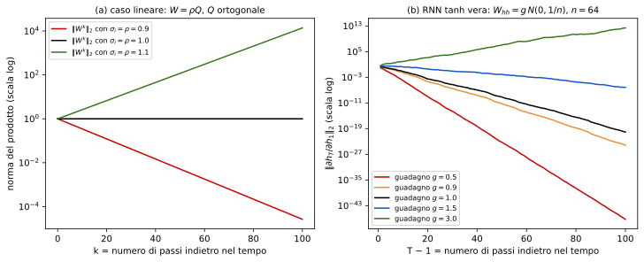

- (a) caso lineare $W=\rho Q$ ($Q$ ortogonale, quindi $\sigma_i=\rho$ per ogni $i$): $\|W^k\|_2=\rho^k$: dopo 100 passi $0.9^{100}\approx2.7\cdot10^{-5}$ e $1.1^{100}\approx1.4\cdot10^{4}$.
- (b) RNN con tanh vera ($n=64$, $W_{hh}$ gaussiana con guadagno $g$, ingressi casuali), norma di $\partial h_T/\partial h_1$:

| guadagno $g$ | $T=10$ | $T=50$ | $T=100$ |
|---|---|---|---|
| 0.5 | $1\cdot10^{-4}$ | $6\cdot10^{-24}$ | $6\cdot10^{-48}$ |
| 1.0 | $7\cdot10^{-2}$ | $7\cdot10^{-10}$ | $9\cdot10^{-21}$ |
| 1.5 | $1.8$ | $9\cdot10^{-3}$ | $7\cdot10^{-7}$ |
| 3.0 | $83$ | $1.2\cdot10^{7}$ | $2.4\cdot10^{12}$ |

Osservazione: a causa della saturazione della tanh serve un guadagno **molto** maggiore di 1 per avere esplosione; già per $g=1$ il gradiente **svanisce** (norma $\approx10^{-20}$ dopo 100 passi): lo svanire è lo scenario **tipico**, l'esplosione è più rara ma più «violenta».

**Conseguenza pratica [Aggiunta].** Nella somma su $k$ della formula precedente i termini con $k$ vicino a $T$ (passato recente) hanno prodotti di poche matrici e **dominano**; quelli con $k\ll T$ svaniscono ⇒ la rete **non riesce a imparare dipendenze a lunga distanza** (slide 158: «in practice, difficult to access information from many steps back»).

**Gradient clipping.** Fissata una soglia $\theta$ sulla norma del gradiente $g=\nabla_W\mathcal L$:
$$
g\leftarrow g\cdot\min\Big(1,\frac{\theta}{\|g\|}\Big).
$$
Si **mantiene la direzione** del gradiente e si limita solo la lunghezza del passo. Serve perché, dove la funzione ha «scogliere» ripide (conseguenza dell'esplosione), un singolo passo di lunghezza enorme farebbe saltare via dai buoni valori (Pascanu et al.). Non risolve lo svanire.

### 4.10 Vantaggi e svantaggi delle RNN (slide 158)

| | Voce (slide) | Spiegazione |
|---|---|---|
| ✔ | Può processare input di **qualunque lunghezza** | basta ripetere la cella |
| ✔ | Il passo $t$ può (in teoria) usare informazione da **molti passi prima** | $h_t$ dipende da tutto il passato |
| ✔ | La dimensione del modello **non cresce** con l'input | $W$ condiviso nel tempo |
| ✔ | Stessi pesi a ogni passo ⇒ **simmetria** nel trattamento degli ingressi | stessa funzione indipendentemente da dove sta la parola |
| ✘ | La computazione ricorrente è **lenta** | $h_t$ richiede $h_{t-1}$: i $T$ passi sono sequenziali, non parallelizzabili |
| ✘ | **In pratica**, difficile accedere a informazione di molti passi prima | svanire del gradiente (sez. 4.9) |

**[Aggiunta] Confronto con la TCN.**

| | TCN | RNN |
|---|---|---|
| Parallelismo sul tempo (training) | **sì** | **no** (sequenziale) |
| Distanza di interazione | $O(L)$ o $O(\log T)$ con dilatazione | $O(T)$ passi, ma il gradiente svanisce |
| Memoria a inferenza | ultimi $R$ ingressi | stato $h$ (dimensione fissa) |
| Lunghezza variabile | campo recettivo **fisso** | **qualunque** |

### 4.11 Long Short-Term Memory (LSTM) (slide 159–165, Hochreiter & Schmidhuber, 1997)

**Idea.** Aggiungere alla RNN uno stato di memoria $c_t$ (*cell state*) che si aggiorna in modo **additivo**, e controllarne scrittura, cancellazione e lettura con dei **gate**. Confronto (slide 159):
$$
\text{Vanilla RNN: }h_t=\tanh\!\Big(W\begin{pmatrix}h_{t-1}\\x_t\end{pmatrix}\Big),
$$
$$
\text{LSTM: }\ \begin{pmatrix}i\\f\\o\\g\end{pmatrix}=\begin{pmatrix}\sigma\\\sigma\\\sigma\\\tanh\end{pmatrix}W\begin{pmatrix}h_{t-1}\\x_t\end{pmatrix},\qquad
c_t=f\odot c_{t-1}+i\odot g,\qquad h_t=o\odot\tanh(c_t).
$$
(slide 160: «four gates», **cell state** $c_t$, **hidden state** $h_t$).

**Dimensioni (slide 161).** Con $h$ unità e ingresso di dimensione $d$ (la slide assume $d=h$) la matrice $W$ è $4h\times(h+d)$ [$4h\times2h$ nella slide]: le quattro attivazioni si calcolano **con un solo prodotto matrice-vettore**, poi si **separano** in quattro vettori di taglia $h$ ($4h\to4\cdot h$) e si applicano sigmoid, sigmoid, sigmoid, tanh. Parametri $=4h(h+d)+4h$ (con bias): **quattro volte** quelli della RNN vanilla (es. $h=3,d=4$: $96$ contro $24$).

**Significato dei gate (slide 161).**

| Gate | Nome (slide) | Funzione |
|---|---|---|
| $i$ | *Input gate* | **se** scrivere nella cella ($\in(0,1)$) |
| $f$ | *Forget gate* | **se** cancellare la cella (0 = cancella, 1 = tieni) |
| $o$ | *Output gate* | **quanto** rivelare della cella |
| $g$ | *«Gate gate» (?)* | **quanto** scrivere: valore candidato $\in(-1,1)$ |

**[Nota]** Nella letteratura $g$ è chiamato **candidato** ($\tilde c_t$): è il *contenuto* che si vorrebbe scrivere, mentre $i$ decide *quanto* ne passa. Le sigmoidi producono «interruttori morbidi» in $(0,1)$ applicati elemento per elemento (⊙). Un altro dettaglio: la LSTM originale del 1997 non aveva il forget gate: fu aggiunto da Gers, Schmidhuber e Cummins (2000), ed è oggi parte standard.

**Diagramma (slide 162):**

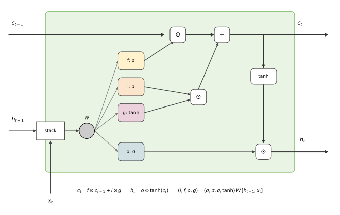

La riga superiore è lo **stato di cella** $c_{t-1}\to c_t$: prima si **scala** per $f$ («dimentica»), poi si **somma** $i\odot g$ («scrivi»). Il ramo inferiore calcola $h_t=o\odot\tanh(c_t)$ (la tanh limita il valore, $o$ lo rivela).

**Gradiente (slide 163–165).** Il punto chiave è il percorso $c_{t-1}\to c_t$:
$$
\frac{\partial c_t}{\partial c_{t-1}}\Big|_{\text{diretto}}=\operatorname{diag}(f_t)\quad\Longrightarrow\quad
\frac{\partial\mathcal L}{\partial c_{t-1}}=f_t\odot\frac{\partial\mathcal L}{\partial c_t}+\ (\text{termini indiretti}).
$$
La slide 163: «Backpropagation from $c_t$ to $c_{t-1}$ only elementwise multiplication by $f$, **no matrix multiply by $W$**»; e non si attraversa nemmeno la derivata di una tanh. Quindi su più passi (slide 164: **«uninterrupted gradient flow!»** lungo $c_0,c_1,c_2,c_3$):
$$
\frac{\partial c_T}{\partial c_k}\Big|_{\text{diretto}}=\prod_{j=k+1}^{T}\operatorname{diag}(f_j).
$$
Se $f\approx1$ il gradiente passa quasi intatto per molti passi; la rete **impara** a tenere $f_j\approx1$ per ciò che deve ricordare (e $f\approx0$ per cancellare).

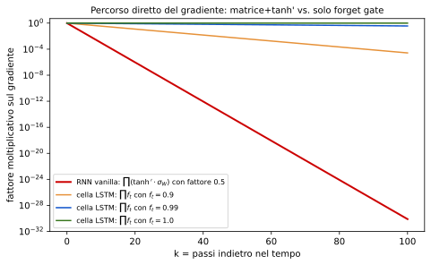

**I termini indiretti (non mostrati nella slide) [Aggiunta].** I gate dipendono da $h_{t-1}=o_{t-1}\odot\tanh(c_{t-1})$, quindi $c_{t-1}$ influenza $c_t$ anche tramite $f_t,i_t,g_t$:
$$
\frac{\partial c_t}{\partial c_{t-1}}=\operatorname{diag}(f_t)+\frac{\partial c_t}{\partial h_{t-1}}\operatorname{diag}\!\big(o_{t-1}\odot(1-\tanh^2c_{t-1})\big),
$$
$$
\frac{\partial c_t}{\partial h_{t-1}}=\operatorname{diag}\big(c_{t-1}\odot f_t\odot(1-f_t)\big)W_f^{h}+\operatorname{diag}\big(g_t\odot i_t\odot(1-i_t)\big)W_i^{h}+\operatorname{diag}\big(i_t\odot(1-g_t^2)\big)W_g^{h},
$$
dove $W_\bullet^h$ è il blocco di $W$ che porta $h_{t-1}$ al gate corrispondente. Questi termini passano da una matrice, ma si **aggiungono** al percorso diretto invece di sostituirlo: anche se sono piccoli, il termine $\operatorname{diag}(f_t)$ rimane.

**Slide 165: «more control».** Il gradiente contiene il vettore di attivazioni del forget gate: i parametri del forget gate permettono di **controllare i valori del gradiente** (se $f$ è vicino a 1 si preserva, se a 0 si azzera deliberatamente). Anche gli altri gate ($i,g,o$) aggiungono controllo e **bilanciano** i valori del gradiente.

**Analogie [Aggiunta].** Il «$+$» della cella è come la connessione residua $z+F(z)$ dei ResNet e del blocco TCN (sez. 3.6): in entrambi si ha $\partial/\partial c=I\ (\text{o }f)+\dots$, quindi un cammino diretto per il gradiente. **Pratica:** si inizializza spesso il bias del forget gate a valori positivi (≈1) in modo che all'inizio $f\approx\sigma(1)\approx0.73$ e la memoria non venga azzerata subito. **Limiti:** la LSTM contrasta lo *svanire* ma **non** l'esplodere: serve comunque il gradient clipping.

**GRU (citata nel summary, slide 171) [Aggiunta].** Variante più semplice con 2 gate e senza cell state separato:
$$
z_t=\sigma(W_z[h_{t-1},x_t]),\quad r_t=\sigma(W_r[h_{t-1},x_t]),\quad \tilde h_t=\tanh(W[r_t\odot h_{t-1},x_t]),\quad h_t=(1-z_t)\odot h_{t-1}+z_t\odot\tilde h_t .
$$
Anche qui l'aggiornamento è **additivo**: $\partial h_t/\partial h_{t-1}\ni\operatorname{diag}(1-z_t)$ (stesso ruolo del forget gate).

---

## 5. Summary (slide 171)

| Affermazione della slide | Spiegazione |
|---|---|
| RNN danno **molta flessibilità** nel progettare l'architettura | one-to-many, many-to-one, many-to-many (sez. 1.2) e combinazioni (seq2seq, captioning) |
| Le **RNN vanilla sono semplici ma non funzionano molto bene** | gradiente che svanisce/esplode (sez. 4.9; risultati sez. 3.7) |
| **Si usa LSTM o GRU**: le loro **interazioni additive** migliorano il flusso del gradiente | $c_t=f\odot c_{t-1}+i\odot g$ (sez. 4.11) |
| Il flusso all'indietro dei gradienti può **esplodere o svanire**. L'esplosione si controlla con il **gradient clipping**, lo svanire con **interazioni additive (LSTM)** | sez. 4.9 e 4.11 |
| **Architetture migliori/più semplici** sono un tema caldo di ricerca, come nuovi paradigmi di ragionamento su sequenze | (Transformer e attention nelle lezioni successive: i ringraziamenti citano Vaswani, Huang, Devlin, Alammar) |
| Serve **una migliore comprensione** (teorica ed empirica) | |

Ultima slide («Thank you»): ringraziamenti (materiale da Fei-Fei Li, Justin Johnson, Serena Yeung, Jeff Donahue, Irtiza Hasan, Marco Cristani, Ashish Vaswani, Anna Huang, Jacob Devlin, Jay Alammar).

---

## 6. Riepilogo operativo

| Situazione | Scelta | Motivo |
|---|---|---|
| Un'etichetta per l'intera sequenza (many-to-one) | usare lo stato finale $h_T$ (RNN) o pooling sulle uscite (TCN) | riassume la sequenza |
| Lunghezze di ingresso/uscita diverse | encoder–decoder | sez. 4.4 |
| Predizione del futuro | convoluzioni **causali** / RNN | niente leakage |
| Serve parallelismo e la memoria richiesta è limitata | TCN con dilatazione | $L\sim\log T$ |
| Memoria lunga con lunghezza variabile | LSTM / GRU | percorso additivo del gradiente |
| Training instabile (loss a NaN) | gradient clipping | sez. 4.9 |
| Generazione di testo | teacher forcing in training, sampling/beam a test | sez. 4.5 |

| Formula chiave | Espressione |
|---|---|
| Convoluzione causale | $y_t=\sum_{k=0}^{K-1}g(k)x_{t-k}$ |
| Campo recettivo TCN | $R=1+(K-1)\sum_\ell d_\ell$; con $d_\ell=2^{\ell-1}$: $1+(K-1)(2^L-1)$ |
| Blocco residuo | $o=\mathrm{Act}(z+F(z))$ |
| RNN vanilla | $h_t=\tanh(W_{hh}h_{t-1}+W_{xh}x_t),\ y_t=W_{hy}h_t$ |
| Loss | $\mathcal L=\sum_t\mathcal L_t$, $\ \nabla_z\mathcal L_t=p-y$ |
| BPTT | $\partial_{h_t}\mathcal L=W_{hy}^\top\delta z_t+W_{hh}^\top\delta a_{t+1}$ |
| Jacobiano RNN | $\partial h_t/\partial h_{t-1}=\operatorname{diag}(1-h_t^2)W_{hh}$ |
| Esplosione/svanimento | $\rho(W)^k\le\|W^k\|\le\sigma_1^k$ |
| Clipping | $g\leftarrow g\min(1,\theta/\|g\|)$ |
| LSTM | $c_t=f\odot c_{t-1}+i\odot g,\ h_t=o\odot\tanh c_t$ |
| Gradiente LSTM (diretto) | $\partial c_T/\partial c_k=\prod_j\operatorname{diag}(f_j)$ |
