# Advanced Machine Learning and Computer Vision — Formalizzazione matematica (4)

**Contenuto:** *07 – Sequence Models II: Transformer Networks* (Prof. F. Galasso, Sapienza, 9 ottobre 2026), 102 slide.
**Scopo:** formalizzare ogni concetto delle slide, esplicitare tutti i passaggi e aggiungere ciò che nelle slide è solo accennato o mostrato come immagine senza spiegazione. La nota continua le precedenti: «nota 1» = *Recap su classificazione, NN e CNN*, «nota 2» = *Training Neural Networks*, «nota 3» = *Sequence Models I* (RNN, LSTM, TCN).

> **[Aggiunta]** = non è nelle slide ma completa il ragionamento.
> **[Nota]** = imprecisione, convenzione o dettaglio delle slide.
> **Numerazione.** Cito le slide con il **numero di pagina del PDF (1–102)**. La numerazione stampata nel footer è non contigua e in molte pagine manca (es. la pagina 38 è la «50» stampata, la 52 è la «87»), quindi è inutilizzabile come riferimento.
> **Figure.** Sono generate da `genera_figure_transformer.py` (stessa cartella). Quelle con numeri (matrici di attention, codifica posizionale, varianza dei punteggi, complessità, non-local means) sono **calcolate**, non disegnate a mano.

---

## 0. Notazione, mappa della lezione, copertura delle slide

| Simbolo | Significato |
|---|---|
| $x_t,\ h_t,\ s_t$ | ingresso, stato dell'encoder, stato del decoder al passo $t$ |
| $c,\ c_t$ | *context vector* (fisso in seq2seq semplice, dipendente da $t$ con attention) |
| $e_{t,i},\ a_{t,i}$ | punteggio di allineamento e peso di attention (decoder passo $t$, encoder posizione $i$) |
| $f_{att}$ | funzione di allineamento (piccola MLP) |
| $N$ | numero di vettori in ingresso (lunghezza della sequenza); $M$ = lunghezza lato decoder |
| $X\in\mathbb R^{N\times D}$ | matrice che ha per righe gli ingressi $x_0,\dots,x_{N-1}$ |
| $W_q,W_k\in\mathbb R^{D\times D_k},\ W_v\in\mathbb R^{D\times D_v}$ | proiezioni di query, chiavi, valori |
| $Q,K,V$ | $XW_q,\ XW_k,\ XW_v$ |
| $d$ (o $d_{model}$) | dimensione dei vettori che attraversano il Transformer (512 in Vaswani et al.) |
| $H$ (heads) | numero di teste di attention |
| $p_t=\mathrm{pos}(t)$ | codifica posizionale della posizione $t$ |
| $\sigma$ / $\mathrm{softmax}$ | sigmoide / $\mathrm{softmax}(z)_i=e^{z_i}/\sum_je^{z_j}$ |

**Perché questa lezione.** Nella nota 3 abbiamo visto che le RNN hanno due difetti: (i) il calcolo è **sequenziale** ($h_t$ richiede $h_{t-1}$) e (ii) il gradiente fatica a coprire **lunghe distanze**. La TCN risolve il primo ma ha un campo recettivo limitato. Questa lezione risponde a: *come si fa interagire direttamente ogni posizione con ogni altra, in parallelo?* La risposta è l'**attention**, e un'architettura fatta solo di attention: il **Transformer**.

```
Sequence Models II (slide 1-102)
 ├─ Verso i Transformer: attention e self-attention   (6-45)
 │    ├─ seq2seq con RNN e collo di bottiglia           (6-12)
 │    ├─ attention di Bahdanau                          (13-27)
 │    ├─ image captioning con attention                 (28-38)
 │    └─ self-attention, cammino massimo, costi         (39-45)
 ├─ Codifica posizionale e masked self-attention      (46-59)
 │    ├─ equivarianza alle permutazioni, positional encoding (48-54)
 │    └─ masked, general vs self, multi-head            (55-59)
 ├─ Transformer Networks                              (60-71)
 │    └─ ... per immagini (self-similarity, Image Transformer, ViT) (72-88)
 └─ BERT                                              (89-101)  → ELECTRA, distillation
```

**Copertura delle slide.**

| Slide (PDF) | Contenuto | Sezione |
|---|---|---|
| 1 | titolo («Sequence Models II: Transformer Networks», 9/10/2026) | – |
| 2 | *Process Sequences*: le 5 configurazioni input/output (figura della nota 3, sez. 1.2) | 1.1 |
| 3, 4, 46, 60, 72, 89 | outline ripetuto (aggiornato a ogni sezione) | 0 |
| 5, 41, 47, 55, 61, 73, 79, 90 | pagine di titolo di sezione | – |
| 6–12 | seq2seq con RNN, collo di bottiglia | 1 |
| 13–27 | RNN + attention (Bahdanau) | 2 |
| 28–38 | image captioning con RNN + attention | 3 |
| 39–45 | self-attention, cammino massimo, perché | 4 |
| 48–54 | equivarianza, codifica posizionale | 5 |
| 56–59 | masked, general vs self, multi-head | 6 |
| 62–71 | Transformer: pre-training, captioning, blocchi, confronto con RNN | 7 |
| 74–88 | Transformer per immagini | 8 |
| 91–101 | BERT, ELECTRA, distillation, conclusioni | 9 |
| 102 | ringraziamenti | 10 |

**Collegamenti con le note precedenti.**
- **Collo di bottiglia e cammino del gradiente:** è il *vanishing gradient attraverso il tempo* (nota 3, sez. 4.9). L'attention accorcia il cammino da $O(T)$ a $O(1)$.
- **Mascheramento = convoluzione causale** (nota 3, sez. 3.4): in entrambi i casi la predizione al tempo $t$ non deve vedere il futuro.
- **Residui + normalizzazione** (nota 2, sez. 5 e 9; nota 3, sez. 3.6): il blocco Transformer ne è fatto.
- **Pre-training + fine-tuning** (nota 2, sez. 9, *transfer learning*): BERT è «l'ImageNet moment» del linguaggio.
- **Gate moltiplicativi** (LSTM, nota 3, sez. 4.11): i pesi di attention sono pesi *dipendenti dall'ingresso*, cioè un gating morbido.

---

## 1. Seq2seq con RNN e il collo di bottiglia (slide 2, 6–12)

### 1.1 Il problema (slide 2 e 6)

La slide 2 richiama le configurazioni *one-to-one … many-to-many* della nota 3 (sez. 1.2). Qui ci interessa quella **encoder–decoder** (many-to-many con lunghezze diverse), con l'esempio motivante della **traduzione automatica inglese → spagnolo**:

- ingresso $x_1,\dots,x_T$ = «we are eating bread» ($T=4$);
- uscita $y_1,\dots,y_{T'}$ = «estamos comiendo pan [STOP]» ($T'=4$, di cui uno è il simbolo di arresto).

**[Nota]** Le lunghezze coincidono per caso: «we are» → «estamos» è una sola parola, e il simbolo `[STOP]` conta come uscita. In generale $T\neq T'$ e l'ordine può cambiare.

### 1.2 Encoder (slide 6–7)

L'encoder è una RNN (nota 3, sez. 4.1) che legge l'ingresso:
$$
h_t=f_W(x_t,\,h_{t-1}),\qquad t=1,\dots,T,\qquad h_0=0 \ (\text{o appreso}).
$$
Dallo **stato finale** si ricavano (slide 7: *«From final hidden state predict»*):
$$
\text{stato iniziale del decoder } s_0,\qquad \text{context vector } c\ \ (\text{spesso } c=h_T).
$$

### 1.3 Decoder (slide 8–10)

Il decoder è un'altra RNN, con pesi $U$ diversi, che genera una parola alla volta:
$$
s_t=g_U\big(y_{t-1},\,s_{t-1},\,c\big),\qquad p(y_t\mid y_{<t},x)=\mathrm{softmax}(W_o\,s_t).
$$
Si parte da $y_0=$ `[START]` e ci si ferma quando si genera `[STOP]`. Le slide 8–10 costruiscono l'esempio passo per passo; lo riassumo:

| passo $t$ | ingresso del decoder $y_{t-1}$ | stato | uscita $y_t$ |
|---|---|---|---|
| 1 | `[START]` | $s_1=g_U(y_0,s_0,c)$ | «estamos» |
| 2 | «estamos» | $s_2=g_U(y_1,s_1,c)$ | «comiendo» |
| 3 | «comiendo» | $s_3=g_U(y_2,s_2,c)$ | «pan» |
| 4 | «pan» | $s_4=g_U(y_3,s_3,c)$ | `[STOP]` |

La probabilità della frase tradotta è, per la regola della catena,
$$
p(y_{1:T'}\mid x_{1:T})=\prod_{t=1}^{T'}p\big(y_t\mid y_{<t},\,c\big).
$$
In addestramento si usa il *teacher forcing* (nota 3, sez. 4.5): l'ingresso $y_{t-1}$ è la parola **vera**.

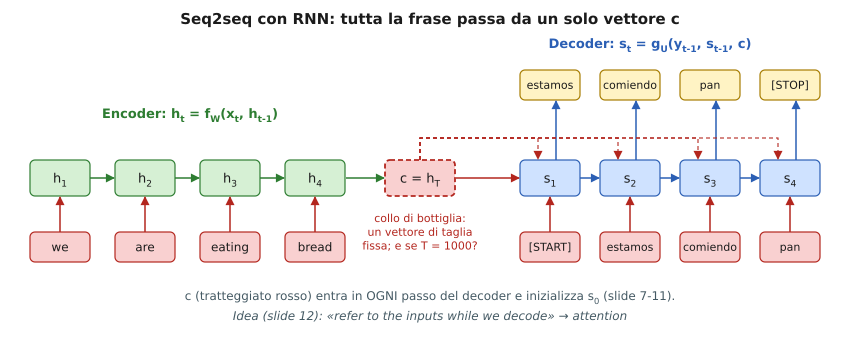

### 1.4 Il collo di bottiglia (slide 11–12)

> **Problem:** *«Input sequence bottlenecked through fixed-sized vector. What if $T=1000$?»*

**Perché è un problema.**
1. **Capacità:** $c\in\mathbb R^{H}$ ha dimensione fissa. Una frase di 5 parole e un paragrafo di 1000 parole vengono compressi nello stesso numero di numeri: più la sequenza è lunga, più informazione si perde.
2. **Cammino del gradiente [Aggiunta]:** per aggiornare ciò che il decoder sa della parola $x_1$, il gradiente di $y_t$ deve tornare indietro per $t$ passi del decoder, attraversare $c$ e poi percorrere $T-1$ passi dell'encoder: in totale $O(T+t)$ prodotti di Jacobiani. Per la sez. 4.9 della nota 3 questo significa gradiente che svanisce.
3. **Tutti i passi del decoder leggono lo stesso $c$:** per produrre «comiendo» serve soprattutto «eating», per «estamos» servono «we are», ma il vettore è **lo stesso**.

**Idea (slide 12):** *«refer to the inputs while we decode»*: a ogni passo il decoder dovrebbe poter **guardare direttamente** gli stati $h_1,\dots,h_T$ dell'encoder, scegliendo quelli rilevanti. Questa è l'attention.

---

## 2. Seq2seq con RNN e attention — Bahdanau et al. (slide 13–27)

Riferimento: Bahdanau, Cho, Bengio, *Neural machine translation by jointly learning to align and translate*, ICLR 2015.

### 2.1 Costruzione passo per passo (slide 13–18)

**Si tengono tutti gli stati dell'encoder** $h_1,\dots,h_T$ (non solo l'ultimo; slide 13), e $s_0$ viene dall'ultimo stato. Per il primo passo del decoder:

**(1) Punteggi di allineamento** (slide 14). Per ogni posizione $i$ dell'ingresso si calcola uno scalare
$$
e_{1,i}=f_{att}(s_0,\,h_i),\qquad i=1,\dots,T,
$$
con $f_{att}$ **una piccola MLP**. Misura «quanto $h_i$ è rilevante per generare la parola che stiamo per produrre, dato lo stato $s_0$ del decoder». **[Aggiunta]** Nel lavoro originale è la forma *additiva*
$$
f_{att}(s,h)=v^\top\tanh(W_s\,s+W_h\,h),
$$
con $v,W_s,W_h$ appresi: una MLP con un solo strato nascosto.

**(2) Pesi di attention** (slide 15). I punteggi si normalizzano con la softmax:
$$
a_{1,i}=\frac{\exp(e_{1,i})}{\sum_{j=1}^{T}\exp(e_{1,j})},\qquad 0<a_{1,i}<1,\qquad \sum_i a_{1,i}=1.
$$
La normalizzazione serve perché i pesi siano una **distribuzione di probabilità** sulle posizioni dell'ingresso.

**(3) Context vector** (slide 16). È la **media pesata** degli stati dell'encoder:
$$
c_1=\sum_{i=1}^{T}a_{1,i}\,h_i .
$$

**(4) Si usa il context nel decoder** (slide 17):
$$
s_1=g_U(y_0,\,s_0,\,c_1)\ \longrightarrow\ y_1=\text{«estamos»}.
$$

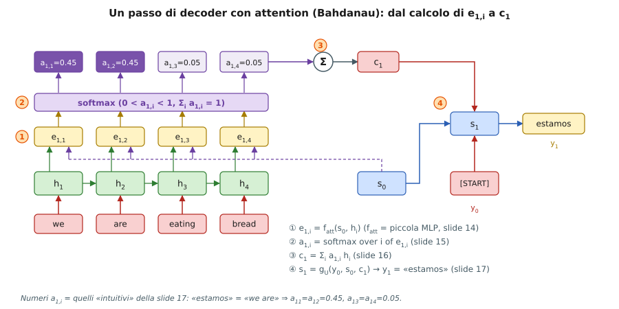

**Intuizione (slide 17).** «estamos» = «we are», quindi i pesi dovrebbero concentrarsi sulle prime due parole, per esempio $a_{1,1}=a_{1,2}=0.45$ e $a_{1,3}=a_{1,4}=0.05$ (somma $=1$).

**Esempio numerico [Aggiunta].** Se, per fissare le idee, gli stati fossero vettori a 2 dimensioni $h_1=(1,0),\ h_2=(0,1),\ h_3=(1,1),\ h_4=(-1,0)$, allora
$$
c_1=0.45\,(1,0)+0.45\,(0,1)+0.05\,(1,1)+0.05\,(-1,0)=(0.45,\ 0.50).
$$
Il context è **vicino** a $h_1$ e $h_2$, come desiderato, e lontano da $h_3,h_4$.

### 2.2 È tutto differenziabile (slide 18)

> *«This is all differentiable! No supervision on attention weights – backprop through everything.»*

Nessuno dice alla rete *dove* guardare: i pesi $a_{t,i}$ sono prodotti da $f_{att}$, i cui parametri sono addestrati con la sola loss di traduzione. **Derivazione del gradiente [Aggiunta].** Sia $g=\partial\mathcal L/\partial c$ il gradiente che arriva sul context. Poiché $c=\sum_ia_ih_i$:
$$
\frac{\partial\mathcal L}{\partial h_i}=a_i\,g\ \ (\text{percorso diretto}),\qquad
\frac{\partial\mathcal L}{\partial a_i}=g^\top h_i .
$$
La softmax ha Jacobiano $\partial a_i/\partial e_k=a_i(\delta_{ik}-a_k)$, quindi
$$
\frac{\partial\mathcal L}{\partial e_k}=\sum_i\frac{\partial\mathcal L}{\partial a_i}a_i(\delta_{ik}-a_k)
= a_k\Big(g^\top h_k-\sum_ia_i\,g^\top h_i\Big).
$$
In parole: il punteggio $e_k$ **cresce** se $h_k$ è più utile della media pesata $\sum_ia_ig^\top h_i$ (cioè se ridurrebbe la loss), e cala altrimenti. Così la rete **impara l'allineamento** da sola.

**Conseguenza sul cammino del gradiente.** $\partial\mathcal L/\partial h_i=a_ig$ non attraversa nessuna ricorrenza: dal decoder a *qualsiasi* $h_i$ il cammino è di **un passo** (poi $h_i$ si propaga all'indietro lungo l'encoder, ma il segnale diretto c'è). Ecco perché il problema del collo di bottiglia scompare.

### 2.3 Si ripete a ogni passo (slide 19–22)

Per il passo successivo si usa $s_1$ al posto di $s_0$ per ottenere **un nuovo** context vector (slide 19):
$$
e_{2,i}=f_{att}(s_1,h_i),\quad a_{2,i}=\mathrm{softmax}_i(e_{2,i}),\quad c_2=\sum_ia_{2,i}h_i,\quad s_2=g_U(y_1,s_1,c_2)\to y_2.
$$
In generale, per ogni passo $t$:
$$
\boxed{\ e_{t,i}=f_{att}(s_{t-1},h_i),\quad a_{t,\cdot}=\mathrm{softmax}(e_{t,\cdot}),\quad c_t=\sum_ia_{t,i}h_i,\quad s_t=g_U(y_{t-1},s_{t-1},c_t)\ }
$$
**Intuizione (slide 21).** «comiendo» = «eating», quindi $a_{2,3}$ deve essere alto: la slide propone $a_{2,1}=a_{2,4}=0.05,\ a_{2,2}=0.1,\ a_{2,3}=0.8$ (somma $=1$). Con gli stessi $h_i$ dell'esempio sopra: $c_2=(0.8,\ 0.9)$, vicino a $h_3=(1,1)$.

**Slide 22 (riassunto).** (i) Il vettore di ingresso **non** è più strozzato in un solo vettore. (ii) A ogni passo del decoder il context vector **guarda parti diverse** dell'ingresso ($c_1,c_2,c_3,c_4$ in figura).

**Costo [Aggiunta].** Si calcolano $T\cdot T'$ punteggi (ogni passo del decoder con ogni posizione dell'ingresso): la computazione cresce come il prodotto delle lunghezze, non è più lineare come nell'encoder–decoder semplice.

### 2.4 Visualizzare i pesi di attention (slide 23–26)

Si può stampare la matrice $a_{t,i}$ (righe = parole di uscita, colonne = parole di ingresso). L'esempio è **inglese → francese**:
- Input: *«The agreement on the European Economic Area was signed in August 1992.»*
- Output: *«L'accord sur la zone économique européenne a été signé en août 1992.»*

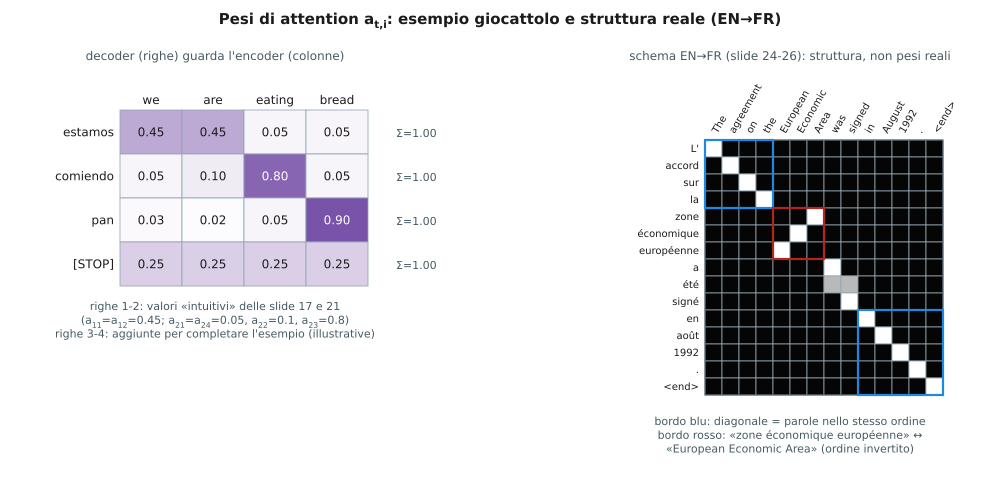

La figura a destra riproduce la **struttura** della matrice delle slide 25–26 (è uno schema, non i pesi reali del paper):
- **Diagonale** (riquadri blu, slide 25): «diagonal attention means words correspond in order», cioè «The agreement on the» ↔ «L'accord sur la» e «in August 1992» ↔ «en août 1992»: stessa posizione relativa.
- **Blocco anti-diagonale** (riquadro rosso, slide 26): *«Attention figures out different word orders»*. L'inglese dice «European Economic Area» (aggettivi prima), il francese «zone économique européenne» (nome prima): la rete impara l'inversione **senza supervisione**.
- «a été signé» = «was signed»: due parole francesi (a, été) cadono sullo stesso «was»/«signed»: i pesi sono **sparsi** su più colonne.

### 2.5 Gli $h_i$ sono un insieme (slide 27)

> *«The decoder doesn't use the fact that $h_i$ form an ordered sequence – it just treats them as an unordered set $\{h_i\}$.»*

Guardiamo le formule: $c_t=\sum_ia_{t,i}h_i$ è una somma e i punteggi $f_{att}(s_{t-1},h_i)$ sono calcolati su ciascun $h_i$ **separatamente**. Se si permutano gli $h_i$ (insieme ai loro pesi) il risultato non cambia. Quindi l'architettura funziona con **qualunque insieme di vettori** $\{h_i\}$, non solo con stati di una RNN (*«Can use similar architecture given any set of input hidden vectors»*). Questo è ciò che permette di applicarla alle immagini (sez. 3) e, più avanti, di toglierle del tutto la RNN (self-attention).

---

## 3. Image captioning con RNN e attention — Show, Attend and Tell (slide 28–38)

Riferimento: Xu et al., ICML 2015. Nella nota 3 (sez. 4.7) un'immagine veniva riassunta in **un solo** vettore $v$ (strato FC della CNN) che entrava nella RNN: lo stesso collo di bottiglia. Qui si conserva **la mappa spaziale** di feature e si guarda dove serve.

**Setup (slide 28).**
- Input: immagine $I$; output: sequenza $y_1,\dots,y_T$ (parole).
- Una CNN pre-addestrata estrae feature spaziali $z\in\mathbb R^{H\times W\times D}$: in figura $3\times3$, con $z_{i,j}\in\mathbb R^D$ vettore della cella $(i,j)$. Ogni $z_{i,j}$ descrive una **regione** dell'immagine.

**Un passo di decoder (slide 29–32).**
1. **Punteggi** (slide 29): uno scalare **per cella**, con $f_{att}$ = MLP:
$$
e_{t,i,j}=f_{att}(h_{t-1},\,z_{i,j})\in\mathbb R^{H\times W}.
$$
2. **Pesi** (slide 30): softmax sulle $H\cdot W$ celle,
$$
a_{t,i,j}=\frac{e^{e_{t,i,j}}}{\sum_{i',j'}e^{e_{t,i',j'}}},\qquad 0<a_{t,i,j}<1,\quad\sum_{i,j}a_{t,i,j}=1.
$$
3. **Context vector** (slide 31, il simbolo «X» è il prodotto di ogni $z_{i,j}$ per il suo peso, poi somma):
$$
c_t=\sum_{i=1}^{H}\sum_{j=1}^{W}a_{t,i,j}\,z_{i,j}\in\mathbb R^D .
$$
4. **Decoder** (slide 32): $y_t=g_V(y_{t-1},\,h_{t-1},\,c_t)$, con **un nuovo $c_t$ a ogni passo** («each timestep of decoder uses a different context vector that looks at different parts of the input image»).

**Esempio «person wearing hat [END]» (slide 32–36).** $y_0=$`[START]`$\to c_1\to h_1\to y_1=$«person»; poi $y_1$ rientra insieme a $c_2$ e dà «wearing»; poi «hat»; poi `[END]`. Ogni parola ha la propria mappa di attention: la figura mostra due passi con numeri **calcolati** (softmax dei punteggi in giallo).

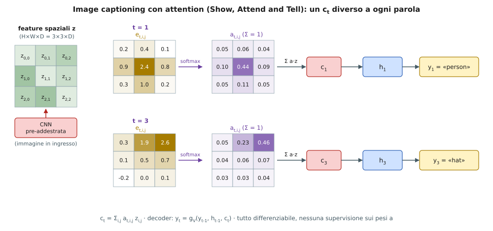

Controllo: per $t=1$ il massimo peso è $0.444$ nella cella centrale (dove «sta» la persona) e per $t=3$ è $0.461$ in alto a destra (dove «sta» il cappello); la somma di ogni mappa è $1$.

**Slide 37.** *«This entire process is differentiable. Model chooses its own attention weights. No attention supervision is required.»* Come in sez. 2.2: nessuno ha disegnato le regioni; basta la loss sulle didascalie.

**Slide 38 (risultati).** Le coppie immagine / mappa di attention mostrano la regione guardata nel momento in cui si emette la parola sottolineata: *frisbee* («A woman is throwing a frisbee in a park»), *dog*, *stop* (il cartello), *girl*, *people*, *trees*. La mappa è un'immagine in cui le zone chiare sono quelle con peso alto: la rete «guarda» l'oggetto giusto nel momento giusto.

**[Aggiunta] Soft vs hard.** Quella descritta è *soft attention* (media pesata, differenziabile). Nel paper esiste anche *hard attention* (si campiona **una** cella) che non è differenziabile e si addestra con metodi di tipo REINFORCE; le slide trattano solo la prima.

**Confronto con la nota 3 (sez. 4.7).**

| | Nota 3 | Qui |
|---|---|---|
| Rappresentazione dell'immagine | un vettore $v\in\mathbb R^{4096}$ | mappa $z\in\mathbb R^{H\times W\times D}$ |
| Come entra nella RNN | una volta (o a ogni passo, identico) | $c_t$ **diverso** a ogni parola |
| Parametri in più | $W_{ih}$ | $f_{att}$ (MLP) |

---

## 4. Self-attention (slide 39–45, 48)

### 4.1 Dall'attention alla self-attention (slide 39–40, 57)

Finora le **query** venivano dal decoder ($s_{t-1}$) e **chiavi/valori** dall'encoder ($h_i$): sono due sequenze diverse. La **self-attention** applica lo stesso meccanismo a **una sola sequenza**: ogni vettore fa da query verso tutti gli altri (e se stesso). Le slide 39–40 la definiscono con questi ingredienti.

**Ingressi:** vettori $x_0,\dots,x_{N-1}\in\mathbb R^{D}$, raccolti in $X\in\mathbb R^{N\times D}$.

**Operazioni (slide 39):**
$$
\begin{aligned}
\text{chiavi:}\quad & k_i=x_iW_k,\\
\text{valori:}\quad & v_i=x_iW_v,\\
\text{query:}\quad & q_j=x_jW_q,\\
\text{allineamento:}\quad & e_{i,j}=\frac{q_j\cdot k_i}{\sqrt{D}},\\
\text{attention:}\quad & a=\mathrm{softmax}(e)\ \ (\text{per ogni } j,\ \text{sugli } i),\\
\text{uscita:}\quad & y_j=\sum_i a_{i,j}\,v_i .
\end{aligned}
$$
con $W_q,W_k\in\mathbb R^{D\times D_k}$, $W_v\in\mathbb R^{D\times D_v}$ e uscite $y_j\in\mathbb R^{D_v}$ (*«context vectors: $y$ (shape: $D_v$)»*). Nella formula delle slide $D$ sotto la radice è la dimensione di query e chiave, cioè $D_k$.

**Significato dei tre ruoli [Aggiunta].**
- **query** $q_j$: «cosa sto cercando?» (domanda posta dalla posizione $j$);
- **chiave** $k_i$: «che cosa offro?» (etichetta con cui la posizione $i$ si fa trovare);
- **valore** $v_i$: «che cosa do, se mi scelgono?» (contenuto che viene trasferito).
Il prodotto $q_j\cdot k_i$ misura la compatibilità tra domanda e etichetta; la softmax la trasforma in una distribuzione; la somma pesata dei **valori** è la risposta. Chiave e valore sono separati perché ciò che serve per **cercare** un'informazione non è necessariamente ciò che serve per **trasportarla**.

**Convenzione di indici [Nota].** Nelle slide $e_{i,j}=q_j\cdot k_i$: $i$ indica la chiave, $j$ la query, e la softmax è «verticale» (freccia $\uparrow$: somma su $i$, per ogni colonna $j$). Nella forma matriciale standard si usa la convenzione trasposta: la riga $j$ è la query $j$ e la softmax è per riga:
$$
E=\frac{QK^\top}{\sqrt{D_k}}\in\mathbb R^{N\times N},\qquad A=\mathrm{softmax}_{\text{per riga}}(E),\qquad Y=AV\in\mathbb R^{N\times D_v}.
$$
Compatta: **$\boxed{\mathrm{Attention}(Q,K,V)=\mathrm{softmax}\!\big(QK^\top/\sqrt{d_k}\big)V}$** (formula della slide 48, scritta $A(Q,K,V)$). Con questa convenzione $A_{j,i}=a_{i,j}$ delle slide e $y_j=\sum_iA_{j,i}v_i$ è la riga $j$ di $Y=AV$.

**Perché un prodotto di matrici.** $Q,K,V$ si calcolano con **tre prodotti** $XW_q,XW_k,XW_v$ e poi si fanno $QK^\top$ e $AV$: nessun ciclo sul tempo, tutto parallelo (ottimo per le GPU).

**Slide 40 (titolo: «attends over sets of inputs»).** La stessa osservazione della slide 27: se si permutano gli ingressi le uscite si permutano in modo corrispondente (dimostrazione in sez. 5.1). La self-attention tratta l'ingresso come un **insieme**.

### 4.2 Esempio numerico completo [Aggiunta]

$N=3$, $D=4$, $D_k=D_v=2$. Ingressi (righe) e pesi:
$$
X=\begin{pmatrix}1&0&1&0\\0&2&0&1\\1&1&1&1\end{pmatrix},\quad
W_q=\begin{pmatrix}1&0\\0&1\\1&0\\0&1\end{pmatrix},\
W_k=\begin{pmatrix}0&1\\1&0\\0&1\\1&0\end{pmatrix},\
W_v=\begin{pmatrix}1&0\\0&1\\1&1\\0&0\end{pmatrix}.
$$
1. **Proiezioni.** Per esempio $q_0=x_0W_q=(1,0,1,0)W_q=(1+1,\ 0+0)=(2,0)$. Risultato:
$$
Q=\begin{pmatrix}2&0\\0&3\\2&2\end{pmatrix},\quad K=\begin{pmatrix}0&2\\3&0\\2&2\end{pmatrix},\quad V=\begin{pmatrix}2&1\\0&2\\2&2\end{pmatrix}.
$$
2. **Punteggi.** $QK^\top=\begin{pmatrix}0&6&4\\6&0&6\\4&6&8\end{pmatrix}$ e, dividendo per $\sqrt{D_k}=\sqrt2\approx1.414$:
$$
E=\begin{pmatrix}0&4.243&2.828\\4.243&0&4.243\\2.828&4.243&5.657\end{pmatrix}.
$$
3. **Softmax per riga.** Per la riga 0: $e^0=1,\ e^{4.243}=69.6,\ e^{2.828}=16.9$, somma $87.5$, quindi $(0.011,\ 0.795,\ 0.193)$. Tutte le righe:
$$
A=\begin{pmatrix}0.011&0.795&0.193\\0.496&0.007&0.496\\0.045&0.187&0.768\end{pmatrix}.
$$
4. **Uscite.** $y_0=0.011\,v_0+0.795\,v_1+0.193\,v_2=(0.41,\ 1.99)$, e in generale
$$
Y=AV=\begin{pmatrix}0.41&1.99\\1.99&1.50\\1.63&1.95\end{pmatrix}.
$$

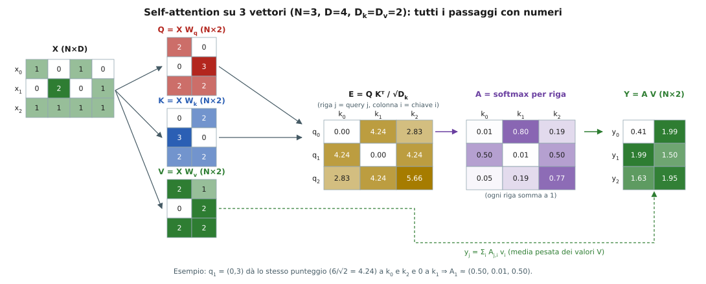

Lettura: la query $q_1=(0,3)$ dà lo stesso punteggio ($6/\sqrt2=4.24$) a $k_0$ e a $k_2$ e punteggio 0 a $k_1$; quindi $y_1$ è (quasi) la media di $v_0$ e $v_2$. La riga 2 ha il punteggio più alto con se stessa ($5.657$): ogni vettore tende a «ascoltare» sé stesso e i simili.

### 4.3 Perché dividere per $\sqrt{D_k}$ [Aggiunta]

La slide scrive $\sqrt D$ senza spiegare. **Derivazione.** Supponiamo componenti di $q$ e $k$ indipendenti con media 0 e varianza 1. Allora $q\cdot k=\sum_{l=1}^{D_k}q_lk_l$ ha
$$
\mathbb E[q\cdot k]=0,\qquad \mathrm{Var}(q\cdot k)=\sum_{l=1}^{D_k}\mathrm{Var}(q_lk_l)=D_k\cdot1\cdot1=D_k,
$$
cioè **deviazione standard $\sqrt{D_k}$**. Se non si scala, per $D_k$ grande i punteggi hanno scala $\sim\sqrt{D_k}$ e la softmax **satura**: un punteggio domina (peso $\approx1$) e gli altri $\approx0$. In saturazione il gradiente della softmax, $a_i(\delta_{ik}-a_k)$, è quasi nullo (come per sigmoide e tanh, nota 2, sez. 2.1–2.2) e l'addestramento si blocca. Dividendo per $\sqrt{D_k}$ la varianza torna a 1.

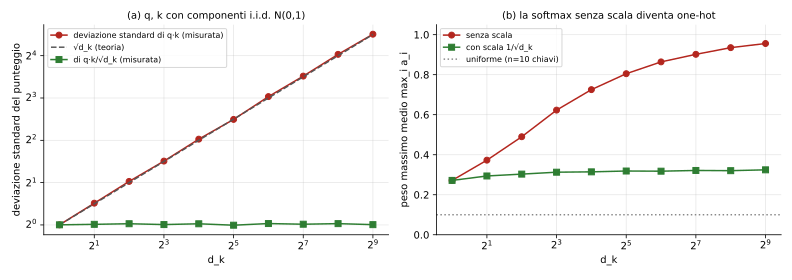

**Verifica numerica (calcolata).**

| $d_k$ | 1 | 8 | 64 | 512 |
|---|---|---|---|---|
| dev. std. di $q\cdot k$ | 1.00 | 2.85 | 8.19 | 22.74 |
| ($\sqrt{d_k}$, teoria) | 1 | 2.83 | 8 | 22.63 |
| dev. std. di $q\cdot k/\sqrt{d_k}$ | 1.00 | 1.01 | 1.02 | 1.01 |
| peso massimo medio (10 chiavi), senza scala | 0.27 | 0.62 | 0.86 | 0.96 |
| peso massimo medio, con scala | 0.27 | 0.31 | 0.32 | 0.32 |

(Con 10 chiavi la distribuzione uniforme darebbe $0.1$.) Senza scala, già a $d_k=512$ la softmax è quasi un *one-hot*.

### 4.4 «Self-attention: weight according to relevance» (slide 41–42)

Slide 41 è il titolo; la 42 riassume il senso: *«weight according to relevance»*. Rispetto a una convoluzione (pesi fissi $g(k)$ che dipendono solo dalla **posizione relativa**, nota 3, sez. 3.1) o a una RNN (la memoria è un solo stato), qui i pesi $A_{j,i}$ dipendono dal **contenuto**: ogni parola decide quali altre contano. Per esempio in «il gatto che ho visto ieri dorme», il verbo «dorme» può dare peso alto a «gatto» (il soggetto) anche se distante 4 parole.

### 4.5 Cammino massimo: RNN contro self-attention (slide 43)

La slide mostra (da un blog che spiega *Attention is all you need*) la frase «I like cats more than dogs» tradotta in giapponese «私は犬より猫が好き». La parola da tradurre per ultima, **好き** («like»), dipende dalla parola inglese **«like»**, che è la seconda.

- **RNN (seq2seq):** l'informazione di «like» deve passare per 4 passi dell'encoder (like → cats → more → than → dogs), 1 passo di collegamento encoder→decoder e 6 passi del decoder (私 → は → 犬 → より → 猫 → が → 好き): **11 passi** (calcolato nella figura). In generale $O(n)$.
- **Transformer:** ogni strato di attention collega **direttamente** due posizioni qualsiasi. In figura bastano 3 salti (self-attention dell'encoder, attention decoder↔encoder, uscita): **$O(1)$**, indipendente da $n$.

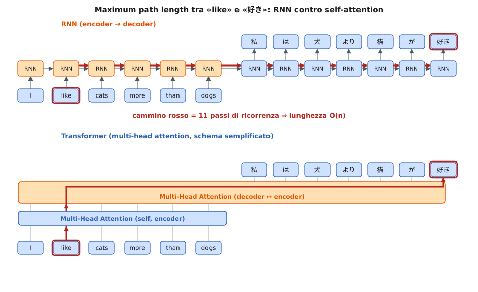

### 4.6 Vantaggi della self-attention (slide 44)

| Voce della slide | Spiegazione |
|---|---|
| *Constant «path length» between any two positions* | ogni posizione vede tutte le altre in **un** strato: i segnali (e i gradienti) non attraversano $n$ passi |
| *Gating/multiplicative interactions* | $y_j=\sum_iA_{j,i}v_i$: i pesi $A$ sono funzione dell'ingresso e **moltiplicano** i valori, come i gate di una LSTM (nota 3, sez. 4.11) ma tra posizioni diverse |
| *Trivial to parallelize (per layer)* | $QK^\top$ e $AV$ sono prodotti di matrici: tutte le posizioni si calcolano insieme; nelle RNN $h_t$ aspetta $h_{t-1}$ |

### 4.7 Costo per strato e tabella della slide 45

I tre criteri (slide 45): **complessità per strato**, **quantità di calcolo parallelizzabile** (operazioni sequenziali) e **lunghezza del cammino** tra dipendenze a lunga distanza. La tabella della slide ($n$ = lunghezza, $d$ = dimensione, $k$ = taglia del kernel, $r$ = vicinato nella attention ristretta):

| Tipo di strato | Complessità per strato | Operazioni sequenziali | Cammino massimo |
|---|---|---|---|
| Self-attention | $O(n^2\,d)$ | $O(1)$ | $O(1)$ |
| Ricorrente | $O(n\,d^2)$ | $O(n)$ | $O(n)$ |
| Convoluzionale | $O(k\,n\,d^2)$ | $O(1)$ | $O(\log_k n)$ |
| Self-attention (ristretta) | $O(r\,n\,d)$ | $O(1)$ | $O(n/r)$ |

**Derivazione di ogni riga [Aggiunta].**
- **Self-attention.** $QK^\top$: $n\times n$ punteggi, ciascuno un prodotto scalare di lunghezza $d_k$ ⇒ $n^2d_k$. $AV$: $n\times n$ per $n\times d_v$ ⇒ $n^2d_v$. Le proiezioni $XW_{q,k,v}$ costano $n\,d^2$ ma sono dello stesso ordine della ricorrente. Totale dominante $O(n^2d)$. Tutto è un prodotto di matrici ⇒ $O(1)$ passi sequenziali; ogni coppia di posizioni è collegata da un peso ⇒ cammino $O(1)$.
- **Ricorrente.** A ogni passo $h_t=\tanh(W_{hh}h_{t-1}+W_{xh}x_t)$ è un prodotto matrice-vettore $d\times d$ ⇒ $d^2$; per $n$ passi $nd^2$. I passi sono in catena ⇒ $n$ operazioni sequenziali; il cammino tra posizioni $1$ e $n$ ha $n$ archi.
- **Convoluzionale.** Ogni posizione di uscita ha $d$ canali, ciascuno somma $k\cdot d$ prodotti ⇒ $k\,d^2$ per posizione, $k\,n\,d^2$ in totale. Una pila di convoluzioni *contigue* con kernel $k$ ha cammino $O(n/k)$; con **dilatazione esponenziale** $O(\log_kn)$ (nota 3, sez. 3.5), che è la riga della tabella.
- **Ristretta.** Ogni query guarda solo $r$ vicini ⇒ $r\,n\,d$; per collegare due posizioni distanti servono $n/r$ strati.

**Quando la self-attention costa meno?** Confronto $n^2d$ con $nd^2$: il rapporto è $n/d$. Con $d=512$ (slide: «$n$ is hundreds, $d=512$ or $1024$») conviene la self-attention quando $n<d$.

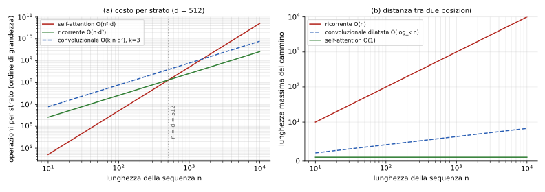

| $n$ (con $d=512$, $k=3$) | $n^2d$ (self-attn) | $nd^2$ (ricorrente) | $k\,n\,d^2$ (conv) |
|---|---|---|---|
| 100 | $5.1\cdot10^{6}$ | $2.6\cdot10^{7}$ | $7.9\cdot10^{7}$ |
| 512 | $1.3\cdot10^{8}$ | $1.3\cdot10^{8}$ | $4.0\cdot10^{8}$ |
| 1000 | $5.1\cdot10^{8}$ | $2.6\cdot10^{8}$ | $7.9\cdot10^{8}$ |
| 4096 | $8.6\cdot10^{9}$ | $1.1\cdot10^{9}$ | $3.2\cdot10^{9}$ |

Il costo quadratico in $n$ è il vero limite per sequenze molto lunghe, e per questo esiste la versione ristretta (usata per le immagini, sez. 8.3).

### 4.8 Self-attention «encoder» (slide 48)

La figura mostra la self-attention per il vettore $e_2$ di una frase di 4 posizioni $e_1,\dots,e_4$: (a) $e_2$ → $\mathrm{matmul}_Q$ → **query**; ogni $e_i$ → $\mathrm{matmul}_K$ → **chiave**; (b) prodotto scalare query·chiave per ogni $i$ (blocchi *dot-prod*), (c) **softmax**, (d) ogni $e_i$ → $\mathrm{matmul}_V$ → **valore**, moltiplicato per il suo peso («×»), (e) somma («+»), (f) una **FFNN** (la stessa per ogni posizione) produce $e'_2$. È la stessa figura della slide 31 della nota 3 (convoluzione + FFNN), con la convoluzione sostituita dalla self-attention. La nota gialla:

> *«Note: for each query, this is permutation invariant to word order.»*

Per **ogni query**, l'uscita è una somma sulle chiavi: se si cambia l'ordine delle chiavi/valori (con i loro punteggi) la somma non cambia. Segue la sezione 5.

---

## 5. Codifica posizionale (slide 46–54)

### 5.1 Il problema: la self-attention non conosce l'ordine (slide 49)

> *«Permutation equivariant. Self-attention layer doesn't care about the orders of the inputs! Problem: How can we encode ordered sequences like language or spatially ordered image features?»*

**Dimostrazione [Aggiunta].** Sia $P$ una matrice di permutazione ($PP^\top=I$) e sia $X'=PX$ (gli stessi vettori in ordine diverso). Allora
$$
Q'=PXW_q=PQ,\quad K'=PK,\quad V'=PV,\qquad
E'=\frac{PQ\,(PK)^\top}{\sqrt{D_k}}=P\,E\,P^\top .
$$
La softmax per riga **commuta** con le permutazioni: permutare le righe permuta le righe dell'output, permutare le colonne non cambia i valori in una riga (la somma al denominatore contiene gli stessi termini): $\mathrm{softmax}(PEP^\top)=P\,\mathrm{softmax}(E)\,P^\top$. Quindi
$$
Y'=A'V'=P\,A\,P^\top P\,V=P\,A\,V=P\,Y .
$$
L'uscita è la stessa, **permutata allo stesso modo**: «equivariante». Per la frase «cane morde uomo» o «uomo morde cane» la rete vedrebbe gli stessi vettori e produrrebbe le stesse uscite (permutate): inaccettabile. Si verifica sull'esempio numerico della sez. 4.2 (scambiando $x_0,x_1$ si ottiene $y_1,y_0$ con gli stessi numeri; l'asserzione è controllata nello script).

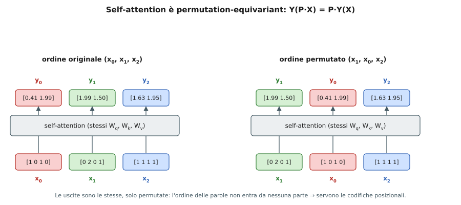

### 5.2 Idea e requisiti di $\mathrm{pos}(\cdot)$ (slide 50)

Si **aggiunge** (o concatena) a ogni ingresso $x_j$ una codifica $p_j$ della sua posizione, $p_j=\mathrm{pos}(j)$ con $\mathrm{pos}:\mathbb N\to\mathbb R^d$. Requisiti (*desiderata*) della slide:

1. **Unico per ogni passo:** posizioni diverse ⇒ codifiche diverse.
2. **Distanza coerente tra frasi di lunghezza diversa:** la distanza tra le posizioni $t$ e $t+\Delta$ deve dipendere da $\Delta$, non da $t$ né dalla lunghezza della frase.
3. **Generalizzare a frasi più lunghe, con valori limitati.**
4. **Deterministica.**

**Somma o concatenazione [Aggiunta].** Se si concatena e poi si applica una proiezione lineare $W$, $W\begin{pmatrix}x\\p\end{pmatrix}=W_xx+W_pp$: equivale a **sommare** una codifica proiettata. La somma mantiene la dimensione $d$ e non aumenta i parametri: è la scelta di Vaswani et al.

### 5.3 Opzione 1: tabella appresa (slide 51)

Si imparano i parametri $\mathrm{pos}(t)$ per $t\in[0,T)$: una **tabella** $T\times d$ ($T\,d$ parametri). Semplice, ma (i) non generalizza oltre $T$ (non esistono righe per le posizioni mai viste) e (ii) la relazione tra posizioni vicine va appresa dai dati.

### 5.4 Opzione 2: funzione fissa sinusoidale (slide 52–54)

Vaswani et al. (slide 52), con $d$ pari e $\omega_k=\dfrac{1}{10000^{2k/d}}$:
$$
p(t)=\big[\sin(\omega_1t),\ \cos(\omega_1t),\ \sin(\omega_2t),\ \cos(\omega_2t),\ \dots,\ \sin(\omega_{d/2}t),\ \cos(\omega_{d/2}t)\big]^\top\in\mathbb R^d .
$$
Cioè coppie $(\sin,\cos)$ con frequenze $\omega_k$ che decrescono geometricamente: **lunghezze d'onda** $\lambda_k=2\pi/\omega_k=2\pi\cdot10000^{2k/d}$ da $2\pi\approx6$ a $\approx10000\cdot2\pi\approx63000$ posizioni.

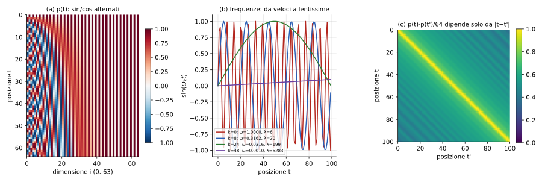

**Intuizione (slide 53): il conteggio binario.** La slide mostra i numeri $0,\dots,15$ in binario:
`0:0000, 1:0001, 2:0010, 3:0011, 4:0100, …, 15:1111`.
Il bit meno significativo cambia a ogni numero (periodo 2), il successivo ogni 2 (periodo 4), il successivo ogni 4 (periodo 8), ecc. Ogni bit è un'**onda quadra con periodo diverso**. La codifica sinusoidale è la versione **continua** di questa idea: ogni coppia $(\sin,\cos)$ è un «bit» che oscilla dolcemente con una propria frequenza; le prime dimensioni (frequenze alte) distinguono posizioni vicine, le ultime (frequenze basse) distinguono posizioni lontane. Così ogni $t$ ha un'impronta unica e il numero di dimensioni cresce solo con il **logaritmo** della lunghezza (come i bit).

**Proprietà (derivate [Aggiunta]).**
1. **Limitata:** ogni componente è in $[-1,1]$ (requisito 3).
2. **Deterministica e unica:** requisiti 4 e 1.
3. **Il prodotto scalare dipende solo dalla distanza.** Dalla formula $\sin a\sin b+\cos a\cos b=\cos(a-b)$:
$$
p(t)\cdot p(t+\Delta)=\sum_{k=1}^{d/2}\big[\sin(\omega_kt)\sin(\omega_k(t+\Delta))+\cos(\omega_kt)\cos(\omega_k(t+\Delta))\big]=\sum_{k=1}^{d/2}\cos(\omega_k\Delta),
$$
indipendente da $t$ (requisito 2). Calcolato con $d=128$ e normalizzato per $d/2=64$: $\Delta=0\to1.000$, $\Delta=1\to0.970$, $\Delta=5\to0.737$, $\Delta=20\to0.608$, **identico** per $t=10$ e $t=60$; il pannello (c) della figura è una banda diagonale costante.
4. **Posizione relativa = trasformazione lineare.** Per ciascuna coppia $(\sin,\cos)$,
$$
\begin{pmatrix}\sin(\omega(t+\Delta))\\ \cos(\omega(t+\Delta))\end{pmatrix}=
\begin{pmatrix}\cos\omega\Delta&\sin\omega\Delta\\-\sin\omega\Delta&\cos\omega\Delta\end{pmatrix}
\begin{pmatrix}\sin\omega t\\ \cos\omega t\end{pmatrix},
$$
una **rotazione** che dipende solo da $\Delta$. Quindi $p(t+\Delta)=R(\Delta)\,p(t)$ con $R$ blocco-diagonale (verificato numericamente nello script): la rete può imparare a «guardare $\Delta$ posizioni avanti» con una trasformazione lineare. Generalizza a posizioni mai viste.

**Slide 54 («Encode each word relative position»).** La figura (da un blog illustrato sul Transformer) mostra la matrice di codifica: **righe = posizioni** (le parole «je suis étudiant»), **colonne = dimensioni**; a sinistra i seni, a destra i coseni (sembra che in quell'implementazione le due metà siano concatenate invece che alternate: stessa informazione, ordine diverso). Si vede che le dimensioni a **frequenza alta** (a sinistra) cambiano rapidamente con la posizione, mentre quelle a frequenza bassa (a destra) sono quasi costanti: per $\omega\to0$, $\sin(\omega t)\approx0$ e $\cos(\omega t)\approx1$, ossia due colori uniformi, come nella figura. Nella slide, il blocco «embeddings + positional encoding = embedding with time signal» è la somma $x_j+p_j$ prima dell'encoder.

**Confronto.** La tabella appresa funziona altrettanto bene nei risultati empirici di Vaswani et al., ma la funzione fissa può essere calcolata per qualunque $t$; per questo, oggi, si usano anche **codifiche relative** (sez. 8.4).

---

## 6. Masked self-attention, attention generale, multi-head (slide 55–59)

### 6.1 Masked self-attention (slide 56)

La slide 55 è il titolo della sezione «The Transformer — *Attention is All You Need*». Quando il Transformer deve **generare** una sequenza (decoder) la posizione $j$ non può vedere le posizioni successive: sarebbe come copiare la risposta (*leakage*, stesso problema delle convoluzioni causali, nota 3 sez. 3.4). La slide dice:

- *Prevent vectors from looking at future vectors.*
- *Manually set alignment scores to $-\infty$* (la slide scrive «$-$nan»).
- *Allows us to parallelize attention across time.*
- *Don't need to calculate the context vectors from the previous timestep first!*

**Definizione.** Nella convenzione delle slide la chiave $i$ è «futura» per la query $j$ se $i>j$: si pone
$$
e_{i,j}\leftarrow-\infty\quad\text{se } i>j,
$$
e dunque $a_{i,j}=0$ per $i>j$ (la matrice dei pesi nella slide ha 0 sotto la diagonale: $a_{1,0}=a_{2,0}=a_{2,1}=0$). Nella convenzione matriciale (riga $=$ query) è il **triangolo superiore stretto** a essere mascherato:
$$
M_{j,i}=\begin{cases}0&i\le j\\-\infty&i>j\end{cases},\qquad A=\mathrm{softmax}\!\Big(\frac{QK^\top}{\sqrt{d_k}}+M\Big).
$$

**Perché $-\infty$ e non «azzerare dopo».** Se si usasse $A\leftarrow A\odot(\text{triangolo})$ dopo la softmax le righe non sommerebbero più a 1. Con $-\infty$ prima della softmax $e^{-\infty}=0$ **esattamente**, e le righe restano normalizzate sui soli elementi visibili. **Numericamente** (nei programmi) si usa un numero molto negativo (es. $-10^9$). Il «nan» della slide compare se **tutta** una riga è $-\infty$ ($0/0$): non accade, perché la diagonale ($i=j$, la posizione guarda se stessa) non è mai mascherata.

**Esempio numerico [Aggiunta]** ($N=4$): la riga 1 ha punteggi $(0.4,\ 1.5,\ \cdot,\ \cdot)$ visibili; $e^{0.4}=1.49,\ e^{1.5}=4.48$, quindi $A_{1}=(0.25,\ 0.75,\ 0,\ 0)$ (la figura riporta tutte le righe).

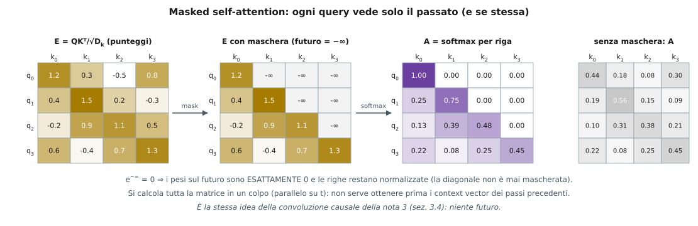

**Perché è parallelizzabile.** In addestramento (teacher forcing) **tutta** la frase target è già nota, quindi si calcola tutta la matrice $A$ in un colpo e l'uscita in $j$ dipende solo da ingressi $\le j$. In una RNN il decoder richiede $h_{t-1}$ per calcolare $h_t$ (sequenziale). A **test** invece i token futuri non esistono ancora: si genera un token alla volta (sez. 7.4).

### 6.2 Attention «generale» contro self-attention (slide 57)

La slide mette a confronto due blocchi:
- **Attention** (a sinistra): **tre insiemi distinti** di ingressi, chiavi $k_0,k_1,k_2$ e valori $v_0,v_1,v_2$ da una parte, query $q_0,q_1,q_2$ dall'altra. È la forma della sez. 2 (query = decoder, chiavi/valori = encoder). Uscita $y_j=\sum_i\mathrm{softmax}_i\big(q_j\cdot k_i/\sqrt{d_k}\big)v_i$ con $N_q\neq N_{kv}$ in generale.
- **Self-attention** (a destra): query, chiavi e valori derivano **tutti** dagli stessi $x_0,x_1,x_2$ ($q=xW_q,\ k=xW_k,\ v=xW_v$).

Nel decoder del Transformer si usano **entrambe**: self-attention mascherata sull'uscita e attention «generale» (detta anche *cross-attention*) in cui le query vengono dal decoder e chiavi/valori dall'output dell'encoder (sez. 7.4).

### 6.3 Multi-head self-attention (slide 58–59)

**Idea.** Invece di **una** attention, se ne eseguono $H$ **in parallelo** (*«multiple self-attention heads in parallel»*), poi si concatenano le uscite. La slide mostra: ingresso → **split** → $H$ teste (head$_0$ … head$_{H-1}$), ciascuna una self-attention, → **concatenate** → uscita.

**Perché (slide 59).** *«We may want to have multiple sets of queries/keys/values calculated in the layer. Similar idea to having multiple conv filters learned in a layer.»* Una sola matrice di attention $A$ dà **una** distribuzione per query: una parola non può contemporaneamente guardare il soggetto (per l'accordo), l'oggetto (per il significato) e la parola precedente (per la morfologia). Con $H$ teste si hanno $H$ distribuzioni diverse, come con più filtri in uno strato convoluzionale (nota 1, sez. 13).

**Formulazione.** Con $d_k=d_v=d/H$, per la testa $h=1,\dots,H$:
$$
Q_h=XW_q^{(h)},\ K_h=XW_k^{(h)},\ V_h=XW_v^{(h)}\quad(W^{(h)}\in\mathbb R^{d\times d/H}),\qquad
\mathrm{head}_h=\mathrm{softmax}\!\Big(\frac{Q_hK_h^\top}{\sqrt{d/H}}\Big)V_h ,
$$
$$
\mathrm{MHA}(X)=\mathrm{Concat}(\mathrm{head}_1,\dots,\mathrm{head}_H)\,W_O,\qquad W_O\in\mathbb R^{d\times d}.
$$
**[Nota]** La slide disegna un **split** dell'ingresso in $H$ blocchi di canali e non mostra $W_O$. Dividere $x$ in $H$ blocchi di $d/H$ canali e dare a ciascuna testa il proprio blocco è il caso particolare in cui le proiezioni $W^{(h)}$ hanno una struttura a blocchi; l'implementazione standard dà a ogni testa una proiezione piena $d\to d/H$ e aggiunge $W_O$ per mescolare le teste dopo la concatenazione.

**Conti [Aggiunta].**
- **Parametri:** $3$ matrici $d\times d$ (la concatenazione delle $H$ proiezioni $d\times d/H$) più $W_O$: $\boxed{4d^2}$ (bias esclusi), **indipendenti da $H$**. Con $d=512$: $4\cdot262144=1048576$.
- **Calcolo:** $H$ teste da $n^2\,(d/H)$ ciascuna ⇒ $n^2d$ in tutto: **lo stesso di una sola testa** con dimensione piena.
- **Memoria:** $H$ matrici $n\times n$ (una per testa): cresce con $H$.
- Vaswani et al.: $H=8$, $d=512$, $d_k=d_v=64$.

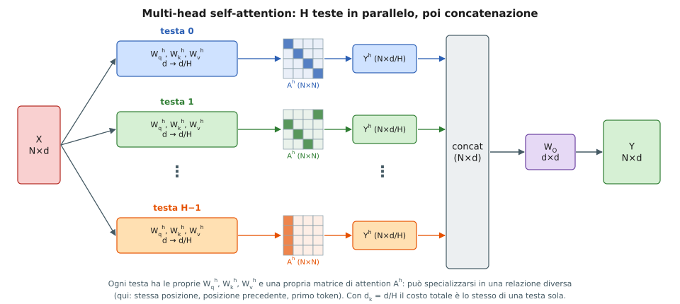

---

## 7. Transformer Networks (slide 60–71)

### 7.1 «ImageNet moment» del linguaggio (slide 62)

La slide mostra la prima pagina del paper *Attention Is All You Need* (Vaswani, Shazeer, Parmar, Uszkoreit, Jones, Gomez, Kaiser, Polosukhin; NeurIPS 2017) e due fasi:

- **Pre-training:** *«Download a lot of text from the internet. Train a giant Transformer model for language modeling.»*
- **Fine-tuning:** *«Fine-tune the Transformer on your own NLP task.»*

Come in visione: pre-addestrare su ImageNet e poi fare fine-tuning (nota 2, sez. 9, *transfer learning*). Il Transformer permette di farlo per il linguaggio perché (i) **scala** (parallelo) e (ii) si addestra su testo **non etichettato** (predizione della parola successiva o mascherata, sez. 9).

### 7.2 Image captioning con Transformer (slide 63–66)

Si ripete il captioning della sez. 3 ma **senza RNN**.

1. **Feature** (slide 63): $z=$ CNN$(I)$, $z\in\mathbb R^{H\times W\times D}$, come prima.
2. **Encoder** (slide 64): $c=T_W(z)$, dove $T_W$ è il **Transformer encoder**. Le $H\cdot W=9$ celle sono viste come $9$ vettori e, tramite self-attention, ogni cella «vede» tutte le altre; $c_{0,0},\dots,c_{2,2}$ sono 9 vettori contestualizzati. **[Aggiunta]** Alle celle si aggiunge una codifica posizionale 2D (sez. 5), altrimenti la griglia sarebbe un insieme.
3. **Chiavi e valori** (slide 65): *«$K$ and $V$ values from the input»*: il decoder userà $c$ per fare da chiavi e valori (cross-attention).
4. **Decoder** (slide 66): $y_t=T_D(y_{0:t-1},\,c)$, con $T_D$ il **Transformer decoder**: ingresso `[START] person wearing hat`, uscita «person wearing hat [END]» (spostata di una posizione).

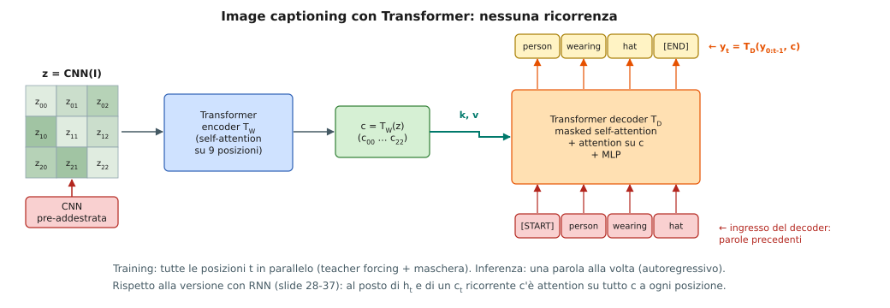

**Differenza con la sez. 3.** Prima il passo $t$ dipendeva da $h_{t-1}$ (catena). Ora, in training, tutte le posizioni $t$ si calcolano **insieme** (con la maschera della sez. 6.1); a test si genera una parola per volta, rimettendo in ingresso la parola appena generata.

### 7.3 Il blocco encoder (slide 67–68)

L'encoder è fatto di $N$ blocchi uguali (pesi propri per ciascun blocco) impilati; in Vaswani et al. $N=6$ e $D_q=512$ (nella slide, la dimensione del modello che chiamo $d$).

**Blocco (dal basso, slide 68):** ingressi $x_0,\dots,x_{N-1}$ → **positional encoding** → **multi-head self-attention** → **+ (residuo) → layer norm** → **MLP** → **+ (residuo) → layer norm** → uscite $y_0,\dots,y_{N-1}$.
$$
\begin{aligned}
x&\leftarrow x+p &&\text{(sez. 5; solo all'ingresso della pila)}\\
z&=\mathrm{LN}\big(x+\mathrm{MHA}(x)\big),\\
y&=\mathrm{LN}\big(z+\mathrm{MLP}(z)\big).
\end{aligned}
$$
I vettori entrano e escono con la **stessa forma**: per questo i blocchi si possono impilare.

**Cosa dicono le note della slide.**
- *«Self-attention is the only interaction between vectors.»* Le posizioni si scambiano informazione **solo** nella self-attention.
- *«Layer norm and MLP operate independently per vector.»* Sono applicate **a ogni posizione separatamente, con gli stessi pesi** (come la FFNN della slide 48).
- *«Highly scalable, highly parallelizable, but high memory usage.»* Parallelo perché non c'è ricorrenza; memoria alta per le matrici $n\times n$ (sez. 7.5).

**Layer normalization [Aggiunta].** Per un vettore $x\in\mathbb R^d$:
$$
\mu=\frac1d\sum_{l=1}^dx_l,\quad \sigma^2=\frac1d\sum_{l=1}^d(x_l-\mu)^2,\quad
\mathrm{LN}(x)=\gamma\odot\frac{x-\mu}{\sqrt{\sigma^2+\epsilon}}+\beta ,
$$
con $\gamma,\beta\in\mathbb R^d$ appresi. Si normalizza **lungo le feature di un solo esempio**, non lungo il batch: a differenza della BatchNorm (nota 2, sez. 5) non dipende dalla dimensione del batch né dalla lunghezza della sequenza, e si comporta allo stesso modo in training e in test.

**MLP [Aggiunta].** $\mathrm{MLP}(z)=W_2\,\mathrm{ReLU}(W_1z+b_1)+b_2$ con $W_1\in\mathbb R^{4d\times d}$, $W_2\in\mathbb R^{d\times4d}$ (in Vaswani et al. $512\to2048\to512$). È il solo punto non lineare «per posizione» del blocco (oltre alla softmax).

**Connessione residua.** $\partial(x+F(x))/\partial x=I+\partial F/\partial x$: il gradiente ha un cammino diretto (nota 3, sez. 3.6) e si possono impilare molti blocchi. **[Nota]** La slide disegna il *post-LN* (LN **dopo** la somma, come nel paper originale); molte implementazioni moderne usano il *pre-LN* ($x+\mathrm{MHA}(\mathrm{LN}(x))$), più stabile da addestrare.

**Parametri per blocco [Aggiunta]** ($d=512$, bias e LN esclusi): attention $4d^2=1\,048\,576$, MLP $2\cdot d\cdot4d=8d^2=2\,097\,152$; **totale $12d^2=3\,145\,728$**; con $N=6$: $\approx18.9\cdot10^6$ parametri nell'encoder.

### 7.4 Il blocco decoder (slide 69–70)

Anche il decoder è una pila di $N=6$ blocchi ($D_q=512$). **Blocco (dal basso, slide 70):** ingressi $y_0,\dots,y_3$ (= `[START] person wearing hat`) → positional encoding → **masked multi-head self-attention** → + → layer norm → **multi-head attention sull'encoder** → + → layer norm → MLP → + → layer norm → **FC** → uscite.
$$
\begin{aligned}
u&=\mathrm{LN}\big(y+\mathrm{MHA}_{\text{mask}}(y)\big)\\
w&=\mathrm{LN}\big(u+\mathrm{MHA}(q{=}u,\ k{=}c,\ v{=}c)\big)\\
o&=\mathrm{LN}\big(w+\mathrm{MLP}(w)\big),\qquad \hat y_t=\mathrm{softmax}(W_{out}\,o_t)\ \ (\text{strato FC finale}).
\end{aligned}
$$
**Cosa dicono le note della slide.**
- *«Masked self-attention only interacts with past inputs.»* (sez. 6.1).
- *«Multi-head attention block is NOT self-attention. It attends over encoder outputs.»* Le **query** $q$ vengono dal decoder (sono $M$ vettori) e le **chiavi/valori** $k,v$ dall'output $c$ dell'encoder (sono $N$ vettori): la matrice di attention è $M\times N$, la stessa della sez. 2 (Bahdanau), ma con prodotto scalare scalato e più teste. È il «ponte» tra le due sequenze.
- *«Highly scalable, highly parallelizable, but high memory usage.»*

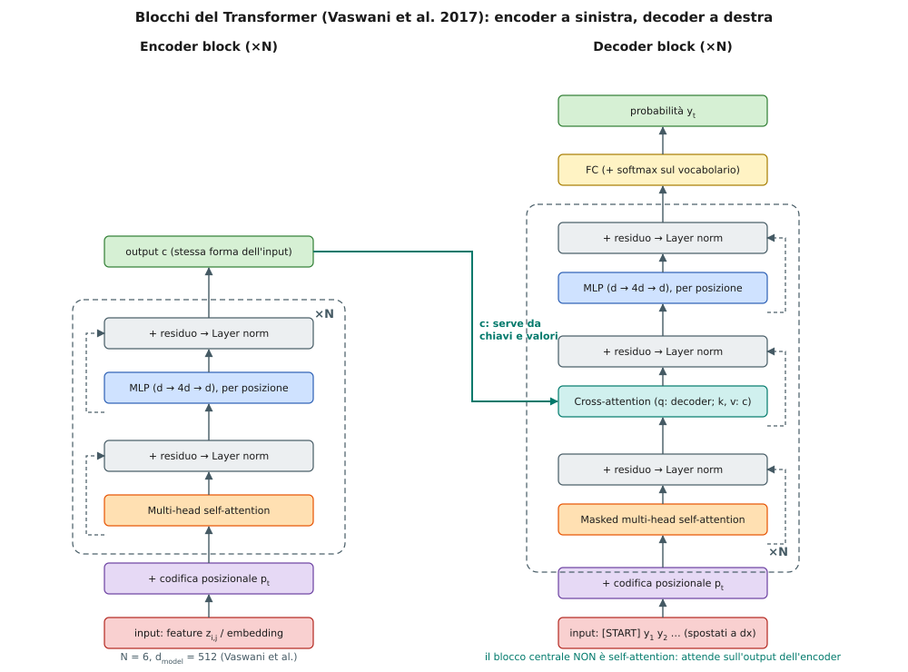

**Training e inferenza [Aggiunta].**
- *Training:* si dà in ingresso la frase target spostata di una posizione e si prevedono **tutte** le uscite insieme, grazie alla maschera; loss = somma delle cross-entropy (nota 3, sez. 4.6).
- *Inferenza:* $y_1$ da `[START]`; poi si rimette $y_1$ in ingresso per ottenere $y_2$; e così via fino a `[END]`. Sono $T'$ passaggi **sequenziali** (l'encoder, invece, si esegue **una volta**). Per non ricalcolare tutto si memorizzano chiavi e valori già calcolati (*KV cache*).
- *Parametri del blocco:* self-attention $4d^2$ + cross-attention $4d^2$ + MLP $8d^2=16d^2=4\,194\,304$ per $d=512$; con $N=6$: $\approx25.2\cdot10^6$.

### 7.5 RNN contro Transformer (slide 71)

| | RNN (slide) | Spiegazione |
|---|---|---|
| (+) | *LSTMs work reasonably well for long sequences* | il percorso additivo della cella (nota 3, sez. 4.11) |
| (−) | *Expects an ordered sequence of inputs* | la ricorrenza *impone* l'ordine |
| (−) | *Sequential computation* | $h_t$ solo dopo $h_{t-1}$: non parallelo |

| | Transformer (slide) | Spiegazione |
|---|---|---|
| (+) | *Good at long sequences. Each attention calculation looks at all inputs.* | cammino $O(1)$ (sez. 4.5) |
| (+) | *Can operate over unordered sets or ordered sequences with positional encodings* | sez. 5 |
| (+) | *Parallel computation: all alignment and attention scores can be done in parallel* | prodotti di matrici |
| (−) | *Requires a lot of memory: $N\times M$ alignment and attention scalers for a single head* | sotto |

**Memoria [Aggiunta].** Per una testa servono $N\times M$ punteggi più $N\times M$ pesi. Per la sola self-attention con $n=1000$ e $H=8$ teste in virgola mobile a 32 bit: $8\cdot10^6\cdot4$ byte $=32$ MB **per strato e per esempio**, che si conservano per la backpropagation. Raddoppiando $n$ si quadruplica. La slide commenta: *«but GPUs are getting bigger and better»*.

---

## 8. Transformer per le immagini (slide 72–88)

### 8.1 Self-similarity: perché l'attention funziona sulle immagini (slide 74–78)

Una serie di slide mostra che molti segnali sono **auto-simili**: parti diverse del segnale si assomigliano, anche se lontane. La self-attention è lo strumento che permette di sfruttarlo: «per capire il punto $p$, guarda i punti simili a $p$, ovunque siano».

| Slide | Esempio | Cosa mostra |
|---|---|---|
| 74 | felce frattale (Wikipedia, *self-similarity*) | ogni foglia è una copia scalata e ruotata dell'intera felce (riquadri colorati) |
| 75 | *Starry Night* (Van Gogh, giugno 1889) | i riquadri gialli racchiudono stelle con lo stesso aspetto in punti diversi del dipinto |
| 76 | musica (pianola: altezza contro tempo) | *«Motifs repeat, immediately and also at a distance»*: le aree evidenziate sono lo stesso motivo ripetuto subito dopo e molto più tardi |
| 77 | Efros & Leung 1999, *Texture synthesis by non-parametric sampling* | si sintetizza un pixel cercando nella texture di esempio i **vicinati simili** a quello già sintetizzato e copiando il pixel centrale |
| 78 | Buades, Coll, Morel 2005, *non-local means* (CVPR) | si **ripulisce** un pixel con una media pesata di pixel **simili**, anche lontani |

**Sintesi di texture [Aggiunta, formalizzazione].** Per il pixel da generare $p$ con vicinato già noto $N_p$, si cercano nell'esempio le posizioni $q$ con $N_q\approx N_p$ e si campiona il valore di uno di quei $q$; equivale a una distribuzione di probabilità sulle posizioni $q$ che cresce con la somiglianza dei vicinati. È «attention» (pesi dati dalla somiglianza) senza parametri appresi.

**Non-local means (slide 78).** Per un'immagine $v$ e un pixel $p$:
$$
\mathrm{NL}[v](p)=\sum_{q}w(p,q)\,v(q),\qquad
w(p,q)=\frac{1}{Z(p)}\exp\!\Big(-\frac{\|v(N_p)-v(N_q)\|^2}{h^2}\Big),\qquad Z(p)=\sum_q\exp\!\Big(-\frac{\|v(N_p)-v(N_q)\|^2}{h^2}\Big),
$$
con $N_p$ il vicinato (*patch*) di $p$ e $h$ un parametro di scala. La figura della slide (*Scheme of NL-means strategy*) mostra tre pixel: $q_1,q_2$ hanno vicinati simili a quello di $p$ ⇒ peso $w(p,q_1),w(p,q_2)$ **grande**; $q_3$ ha un vicinato molto diverso ⇒ peso **piccolo**. Poiché il rumore è indipendente da pixel a pixel, mediare tanti pixel simili lo riduce (la varianza di una media di $m$ valori indipendenti scende di $1/m$) senza sfocare i bordi (si mediano solo punti con lo stesso aspetto).

**Legame con la self-attention [Aggiunta].** L'uscita è $y_p=\sum_qA_{p,q}v_q$ con $A_{p\cdot}=\mathrm{softmax}_q(\cdot)$: stessa struttura. In più
$$
-\|a-b\|^2=2\,a\cdot b-\|a\|^2-\|b\|^2 ,
$$
e nella softmax su $q$ il termine $-\|a\|^2$ (con $a=$ patch di $p$) è **costante** e si semplifica; se le norme delle patch sono simili anche $-\|b\|^2$ è quasi costante, quindi $w(p,q)\approx\mathrm{softmax}_q\!\big(2\,N_p\cdot N_q/h^2\big)$: **un prodotto scalare**, come $q_p\cdot k_q$. La self-attention è un non-local means in cui: la «patch» è una rappresentazione **appresa** ($q=xW_q$, $k=xW_k$), il valore da mediare è anch'esso appreso ($v=xW_v$) e $h^2\leftrightarrow\sqrt{d_k}$.

**Dimostrazione numerica (calcolata, 1D).** Un segnale con lo stesso «motivo» ripetuto 3 volte (aree arancio) più rumore (std $0.15$); patch di 15 campioni.

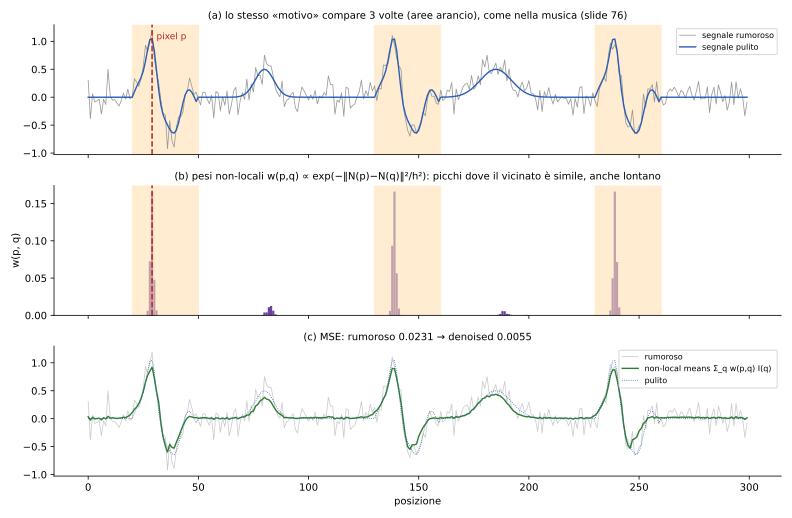

- (b) Per il punto $p=29$ i pesi hanno picchi alle posizioni **corrispondenti nelle altre due ripetizioni** ($139$ e $239$, peso $0.166$ ciascuno, come per $p$ stesso): il $93.6\%$ della massa dei pesi cade nei tre motivi, anche se distano 110 e 210 campioni. (I tre picchi sono uguali perché si usa $\max(\|\cdot\|^2-2\sigma^2,0)$: patch simili quanto lo consente il rumore ricevono lo stesso peso.)
- (c) L'errore quadratico medio passa da $0.0231$ a $0.0055$ (circa $4.2\times$ meno).

**Slide 79** è la pagina «Self-Attention» che apre la sottosezione sull'Image Transformer.

### 8.2 The Image Transformer (slide 80–81)

Le figure (da Parmar et al., *Image Transformer*, ICML 2018 **[Aggiunta: attribuzione]**) mostrano lo **stesso** Transformer applicato ai **pixel**.

**Slide 80.** A sinistra l'encoder: i pixel (quadrati colorati; il colore è il valore del pixel) vengono sommati alle loro codifiche posizionali $p_1,\dots,p_4$, entrano in una self-attention (blocchi *cmp* = confronto query-chiave, softmax, pesi che moltiplicano i valori «×», somma «+») e poi in una **FFNN per posizione** che dà $e'_2$ (qui calcolata per il pixel 2). A destra il **decoder**: i pixel neri sono quelli **non ancora generati** (futuri) e sono esclusi dalla self-attention (maschera, sez. 6.1); poi *encoder-decoder attention*, FFNN, softmax sul valore del prossimo pixel. Si modella l'immagine come sequenza (ordine raster) e si genera pixel per pixel:
$$
p(x)=\prod_{i=1}^{HW}p\big(x_i\mid x_{<i}\big).
$$

**Slide 81 — *Image Transformer layer*.** Il blocco usa **local self-attention**: la query $q$ (con posizione $p_q(x,y)$) confronta solo una **memoria** locale $m_1,m_2,m_3,\dots$ (con posizioni $p_i(x,y)$): *cmp* (usa $W_q$ e $W_k$), softmax, $\mathrm{MatMul}\ W_v$, somma, **FFNN**, **LayerNorm**, **Dropout** e **connessione residua** («+» in alto, da $q$ a $q'$). Nota: la posizione è un punto **2D** $(x,y)$, non un indice 1D.

**Perché locale.** Il costo della self-attention globale è $n^2$ con $n=H\cdot W$ pixel (sez. 4.7). Per le immagini $n$ cresce con il **quadrato** del lato, quindi il costo cresce con la **quarta potenza** del lato. Con un vicinato di $r=7\times7=49$ pixel (calcolato):

| immagine | $n=HW$ | globale $n^2$ | locale $n\cdot r$ | risparmio |
|---|---|---|---|---|
| $32\times32$ | 1 024 | 1 048 576 | 50 176 | $\approx21\times$ |
| $256\times256$ | 65 536 | 4 294 967 296 | 3 211 264 | $\approx1337\times$ |

È la riga «self-attention (ristretta)» della slide 45: costo $O(r\,n\,d)$ e cammino $O(n/r)$ (servono più strati per collegare pixel lontani, come in una CNN: nota 1, sez. 15).

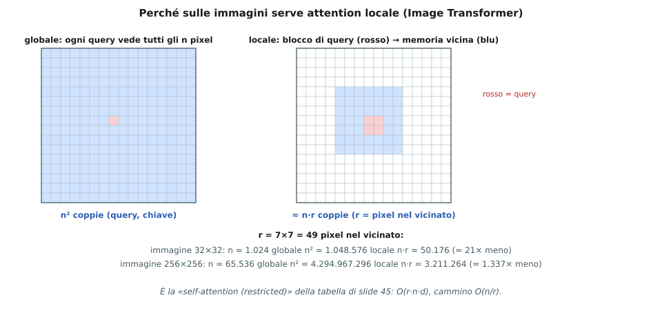

### 8.3 Self-attention con codifica posizionale relativa (slide 82–83)

Riferimento: Shaw et al., NAACL 2018. Le codifiche della sez. 5 sono **assolute** (dipendono da $t$). Per immagini e molte sequenze conta di più la **distanza relativa** $i-j$.

**Self-attention standard (slide 82, a sinistra):**
$$
e_{ij}=\frac{(x_iW^Q)(x_jW^K)^\top}{\sqrt{d_k}},\qquad \alpha=\mathrm{softmax}(e),\qquad z_i=\sum_j\alpha_{ij}\,(x_jW^V).
$$
**Con codifica posizionale relativa (slide 82, a destra):**
$$
e_{ij}=\frac{(x_iW^Q)\,(x_jW^K+a^K_{ij})^\top}{\sqrt{d_k}},\qquad
z_i=\sum_j\alpha_{ij}\,\big(x_jW^V+a^V_{ij}\big),
$$
dove $a^K_{ij},a^V_{ij}$ sono **vettori di embedding appresi, funzione della sola distanza relativa $(i-j)$**.

**Passaggi [Aggiunta].** Sviluppando il prodotto,
$$
e_{ij}=\frac{q_i\cdot k_j}{\sqrt{d_k}}+\frac{q_i\cdot a^K_{ij}}{\sqrt{d_k}},\qquad q_i=x_iW^Q,\ k_j=x_jW^K .
$$
Il primo termine è l'**allineamento di contenuto** (quanto $x_j$ è rilevante per $x_i$); il secondo è un **termine di posizione** che dipende da $q_i$ e dalla distanza $i-j$. Allo stesso modo $a^V_{ij}$ aggiunge ai valori un'informazione sulla posizione relativa.

**Forma matriciale (slide 83):**
$$
\mathrm{softmax}\big(QK^\top+Q\,f(E_{rel})\big),
$$
con $E_{rel}$ l'insieme degli embedding relativi: la matrice $QK^\top$ (cerchi tutti uguali a sinistra) viene **modulata dalle posizioni relative** (cerchi colorati a destra: **lo stesso colore lungo ogni diagonale**, perché uguale $i-j$ ⇒ uguale embedding).

**Struttura (figura).** $a_{ij}$ dipende solo da $i-j$ ⇒ matrice di **Toeplitz**. **[Aggiunta]** Nel paper si **tronca** la distanza a $\pm k$: $a_{ij}=w_{\mathrm{clip}(i-j,-k,k)}$, quindi i vettori da imparare sono $2k+1$ (per $K$ e per $V$), **indipendenti dalla lunghezza della sequenza**; con $k=2$ sono 5 (figura).

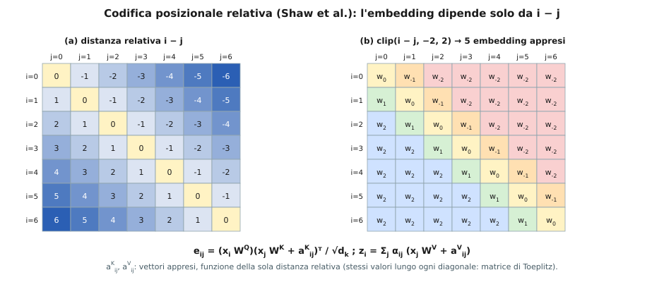

**Vantaggi [Aggiunta].** (i) **Invarianza per traslazione:** il significato di «due pixel a sinistra» è lo stesso ovunque, come per un kernel convoluzionale (nota 1, sez. 13); (ii) si generalizza a sequenze **più lunghe** di quelle viste; (iii) non occorre sommare nulla all'ingresso.

### 8.4 Dal captioning con CNN ai Transformer «puri» (slide 84–86)

Le tre slide ripetono la figura del captioning con Transformer (sez. 7.2) e pongono due domande progressive:

- **Slide 84:** *«No recurrence at all»*: CNN + Transformer encoder–decoder, nessuna RNN.
- **Slide 85:** *«Perhaps we don't need convolutions at all?»* Si può togliere anche la CNN?
- **Slide 86:** *«Transformers from pixels to language»*. Sì: Dosovitskiy et al., *An Image is Worth 16×16 Words: Transformers for Image Recognition at Scale* (2020), cioè il **Vision Transformer (ViT)**. L'immagine diventa direttamente la sequenza in ingresso al Transformer encoder, e l'encoder alimenta un decoder che produce la didascalia.

**Vision Transformer [Aggiunta: formule].** Dato $x\in\mathbb R^{H\times W\times C}$ e una taglia di patch $P$:
1. **Patch:** si divide l'immagine in $N=HW/P^2$ patch $P\times P\times C$ non sovrapposte (con $H=W=224$, $P=16$: $N=196$ «parole»);
2. **Appiattimento:** ogni patch diventa un vettore $x_p^{(i)}\in\mathbb R^{P^2C}=\mathbb R^{768}$;
3. **Embedding lineare:** $E\in\mathbb R^{(P^2C)\times d}$, uguale per tutte le patch: token $=x_p^{(i)}E$. (È equivalente a una convoluzione con kernel $P\times P$ e stride $P$.)
4. **Token di classe + codifica posizionale:** si antepone un token `[CLS]` appreso e si somma una codifica posizionale (appresa, 1D) a ogni token: $z_0=[x_{cls};\ x_p^{(1)}E;\dots;x_p^{(N)}E]+E_{pos}$;
5. **Encoder:** $L$ blocchi Transformer come in sez. 7.3 (self-attention globale tra i $N+1$ token);
6. **Uscita:** per la classificazione, l'uscita di `[CLS]` entra in una MLP; per il captioning (slide 86) l'uscita di tutto l'encoder va al decoder.

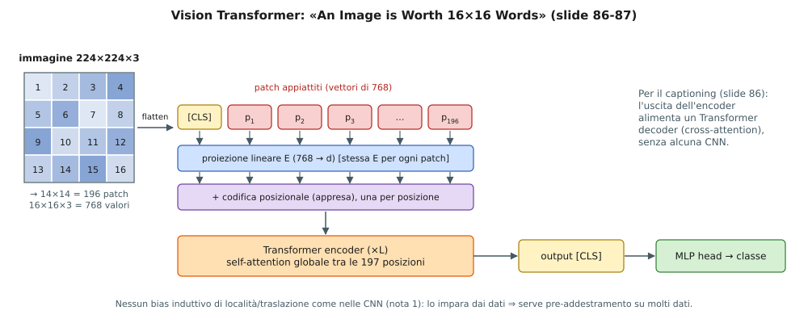

**Bias induttivo [Aggiunta].** Una CNN ha già incorporato che i pixel vicini sono correlati e che i pattern valgono ovunque (località, equivarianza alla traslazione, nota 1); un ViT deve **impararlo**. In compenso non ha limiti di campo recettivo: già al primo strato ogni patch vede tutte le altre.

### 8.5 Vision Transformers contro ResNet (slide 87)

La figura (Fig. 5 del paper ViT) confronta **accuratezza di trasferimento** (asse $y$) e **calcolo totale di pre-training** in exaFLOPs (asse $x$, scala logaritmica, da $10^2$ a $10^4$) in due pannelli: *Average-5* (media su 5 dataset) e *ImageNet*. Tre famiglie: **Transformer (ViT)** (cerchi blu), **ResNet (BiT)** (quadrati grigi), **ibridi** (rombi arancio).

Didascalia (slide): *«Vision Transformers generally outperform ResNets with the same computational budget. Hybrids improve upon pure Transformers for smaller model sizes, but the gap vanishes for larger models.»* Lettura: a parità di calcolo di pre-training i punti ViT stanno sopra i ResNet; per i modelli piccoli un ibrido (CNN + Transformer) aiuta, ma con modelli grandi la differenza scompare.

### 8.6 Altri Vision Transformers (slide 88)

| Lavoro (slide) | Idea | Cosa si vede in figura |
|---|---|---|
| **Multiscale Vision Transformers** (Fan et al., ICCV 2021) | una **piramide**: si passa da risoluzione alta e pochi canali a risoluzione bassa e più canali, come nelle CNN [Aggiunta] | i blocchi a scala 1, 2, 3 con tensori che cambiano forma |
| **Swin Transformer** (Liu et al., CVPR 2021) | attention **locale su finestre** che si spostano da uno strato all'altro (*shifted windows*) e struttura gerarchica ⇒ costo lineare nella dimensione dell'immagine [Aggiunta] | *Patch Partition* → *Linear Embedding* → 4 stadi di blocchi Swin ($\times2,\times2,\times6,\times2$) con *Patch Merging* tra uno stadio e l'altro |
| **DETR** (Carion et al., ECCV 2020) | **detection come predizione di insiemi** | CNN → Transformer encoder–decoder → **insieme di box predetti**, abbinati ai box veri con una *bipartite matching loss*; le predizioni senza oggetto sono «*no object* ($\varnothing$)» |

**DETR in dettaglio [Aggiunta].** Il decoder produce un numero **fisso** $N_q$ di predizioni (classe + box); l'abbinamento ottimo (algoritmo ungherese) fra predizioni e box veri decide quale predizione è responsabile di quale oggetto; le predizioni non abbinate devono prevedere $\varnothing$. Non servono *anchor* né *non-maximum suppression*.

---

## 9. BERT (slide 89–101)

### 9.1 Il problema dei metodi precedenti (slide 91)

> *«Problem: Language models only use left context **or** right context, but language understanding is bidirectional.»*

Un modello del linguaggio (LM) prevede $p(w_t\mid w_{<t})$ usando solo il contesto **a sinistra** (o solo a destra), mentre per capire una frase servono entrambi i lati («bank» in «I sat on the river bank» e in «I went to the bank to withdraw cash» si disambigua con le parole che seguono).

**Perché gli LM sono unidirezionali? (slide 91)**
- **Reason 1:** *«Directionality is needed to generate a well-formed probability distribution.»* Per la regola della catena, $p(w_{1:n})=\prod_tp(w_t\mid w_{<t})$ è una distribuzione **valida** su sequenze (somma 1) e si può **campionare** token per token. Un prodotto di fattori bidirezionali $\prod_tp(w_t\mid w_{\neq t})$ non è in generale una distribuzione di probabilità normalizzata e non dà un modo di generare **[Aggiunta]**.
- **Reason 2:** *«Words can "see themselves" in a bidirectional encoder.»* In un encoder bidirezionale a più strati, la rappresentazione della posizione $t$ al secondo strato ha già mescolato le informazioni di tutte le posizioni, **inclusa la parola $w_t$** (percorso $w_t\to$ posizione 1 $\to$ posizione $t$). Se il compito è prevedere $w_t$ la rete **la copia**: soluzione banale e inutile.

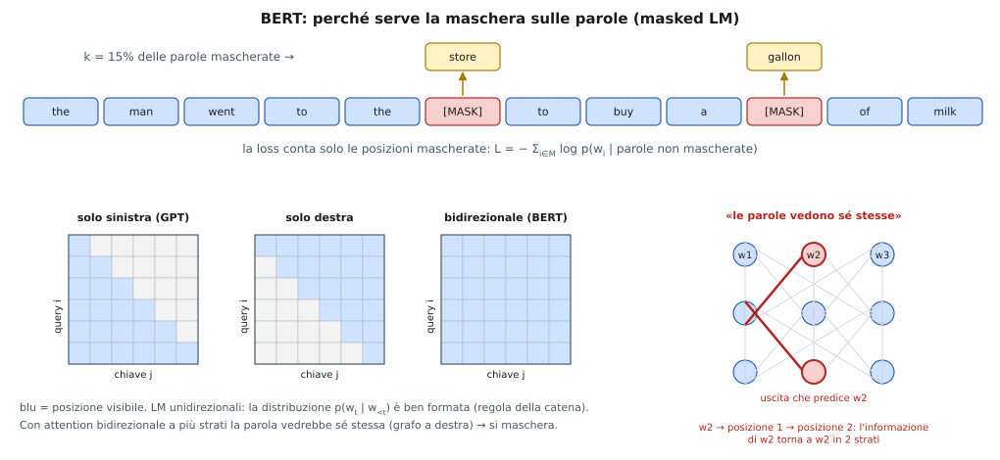

### 9.2 Masked LM (slide 92)

> *«Solution: Mask out $k\%$ of the input words, and then predict the masked words. We always use $k=15\%$.»*

Esempio della slide: *«the man went to the [MASK] to buy a [MASK] of milk»* ⇒ si prevede «store» e «gallon». Le parole mascherate non sono nell'ingresso, quindi nessun percorso può copiarle: la reason 2 non vale più e si può usare attention **bidirezionale**.

**Scelta di $k$ (slide):**
- *Too little masking: too expensive to train.* Con sequenze di $n=512$ token e $k=1\%$ ogni passaggio avanti/indietro dà segnale di apprendimento su ~5 token; con $k=15\%$ su ~77 ($0.15\cdot512$): 15 volte più efficiente.
- *Too much masking: not enough context.* Se si nasconde quasi tutto la frase non contiene informazione per indovinare le parole mancanti.

### 9.3 L'architettura e la loss (slide 93)

La figura (parole $w_1,w_2,w_3,[\mathrm{MASK}],w_5$) mostra, dal basso: **Embedding** → **Transformer encoder** (self-attention **bidirezionale**, senza maschera, sez. 7.3) → uscite $O_1,\dots,O_5$ → **Classification Layer** (*fully-connected + GELU + Norm*) → **Embedding to vocab + softmax** → distribuzioni $w'_1,\dots,w'_5$ (evidenziata $w'_4$, la posizione mascherata). Le slide elencano:

1. *Mask 15% of the words*; 2. *Use context of other words*; 3. *Predict the original value*; per cui servono: uno strato di classificazione, la trasformazione in termini del vocabolario, il calcolo della probabilità di ogni parola.

**Loss — punto chiave della slide:** *«The loss function takes into consideration only the prediction of the masked values and ignores the prediction of the non-masked words.»* Sia $\mathcal M$ l'insieme delle posizioni mascherate e $\tilde x$ la sequenza con le maschere:
$$
\mathcal L=-\sum_{i\in\mathcal M}\log p\big(w_i\mid\tilde x\big),\qquad p(\cdot\mid\tilde x)=\mathrm{softmax}\big(\mathrm{Norm}(\mathrm{GELU}(W O_i))\,E^\top\big),
$$
dove $E$ è la matrice di embedding del vocabolario (la figura dice «embedding to vocab»: si riusa $E^\top$ per ottenere un logit per ogni parola; è la scelta del paper, *weight tying*). Le posizioni non mascherate non contribuiscono (sarebbe copiare). **[Aggiunta]** $\mathrm{GELU}(x)=x\,\Phi(x)$ con $\Phi$ funzione di ripartizione della gaussiana standard: una ReLU «morbida».

**[Aggiunta] Dettagli del paper non nelle slide.** (i) Tra le posizioni scelte (15%): **80%** sostituite da `[MASK]`, **10%** da una parola casuale, **10%** lasciate invariate, perché `[MASK]` non compare nel fine-tuning e così la rete non si abitua a vedere sempre una maschera. (ii) Insieme al masked LM, in pre-training c'è la **Next Sentence Prediction**: data la coppia `[CLS] A [SEP] B`, il vettore di `[CLS]` ($C$) classifica se $B$ segue davvero $A$ (la testa «NSP» della slide 94).

### 9.4 Fine-tuning (slide 94–95)

**Slide 94.** A sinistra il **pre-training** su coppie di frasi A e B non etichettate (maschere sulle parole, NSP su $C$). A destra il **fine-tuning**: lo stesso BERT, con gli **stessi pesi di partenza**, viene specializzato su compiti diversi (*MNLI, NER, SQuAD*), cambiando **solo lo strato di uscita** e i dati: è il *transfer learning* della nota 2 (sez. 9) per il linguaggio. Tutti i pesi vengono aggiornati.

**Slide 95: i quattro tipi di compito.**

| | Compito (slide) | Ingresso | Uscita usata | Loss [Aggiunta] |
|---|---|---|---|---|
| (a) | classificazione di **coppie di frasi**: MNLI, QQP, QNLI, STS-B, MRPC, RTE, SWAG | `[CLS]` frase 1 `[SEP]` frase 2 | $C$ (vettore di `[CLS]`) → etichetta | cross-entropy su $\mathrm{softmax}(W_cC)$ |
| (b) | classificazione di **frase singola**: SST-2, CoLA | `[CLS]` frase | $C$ → etichetta | come (a) |
| (c) | **domanda–risposta**: SQuAD v1.1 | `[CLS]` domanda `[SEP]` paragrafo | uscite del paragrafo → **inizio/fine dello span** | $-\log p_{start}(s^*)-\log p_{end}(e^*)$ con $p_{start}(i)=\mathrm{softmax}_i(S\cdot T_i)$, $p_{end}$ analoga con $E$; $S,E$ vettori appresi |
| (d) | **etichettatura di token**: CoNLL-2003 NER | `[CLS]` frase | una uscita $T_i$ **per ogni token** → etichetta (O, B-PER, …) | cross-entropy per token |

**Glosse dei dataset [Aggiunta].** MNLI/RTE: inferenza (implicazione, neutro, contraddizione); QQP, MRPC: due frasi sono parafrasi/duplicati?; QNLI: la frase risponde alla domanda?; STS-B: similarità (regressione); SWAG: scegliere il continuamento sensato; SST-2: sentimento; CoLA: accettabilità grammaticale; SQuAD: risposta estratta dal paragrafo; CoNLL-2003: riconoscimento di entità (persone, luoghi, …).

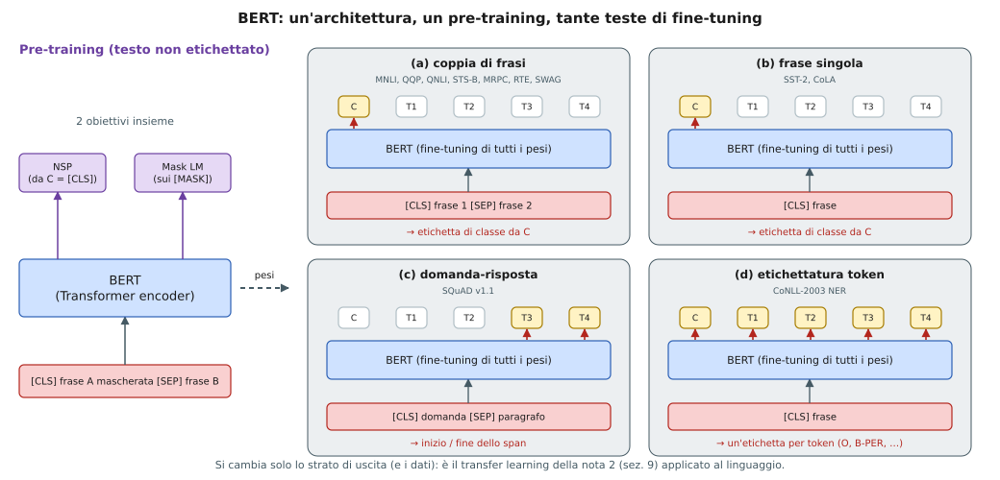

### 9.5 ELECTRA (slide 96–97)

Clark et al., 2020: *«Pre-training Text Encoders as Discriminators Rather Than Generators»*; *«Train model to discriminate locally plausible text from real text.»* Il difetto del masked LM è che si impara solo dal 15% delle posizioni. ELECTRA usa **tutte** le posizioni.

**Schema (slide 96).**
1. Un **generatore** (tipicamente un piccolo MLM) riceve il testo con alcune posizioni mascherate e **campiona** dei token al loro posto.
2. Il **discriminatore** (ELECTRA) riceve il testo «corrotto» e, **per ogni token**, deve dire *original* o *replaced*.

Esempio della slide: reale «the chef cooked the meal»; maschere in posizione 1 e 3; il generatore campiona «the» e «ate»; discriminatore: *original, original, **replaced**, original, original*. Notare: il campione «the» coincide con l'originale, quindi il token resta *original* (anche se è stato campionato).

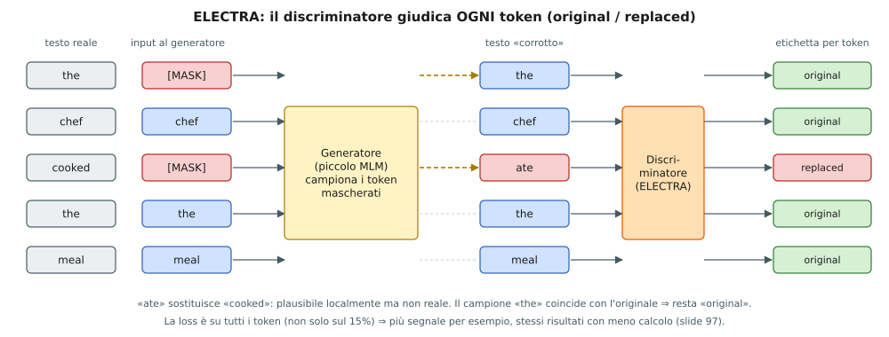

**Loss [Aggiunta].** Sia $\hat x$ il testo corrotto e $D(\hat x,t)\in(0,1)$ la probabilità che il token $t$ sia originale:
$$
\mathcal L_D=-\sum_{t=1}^{n}\Big[\mathbb 1(\hat x_t=x_t)\log D(\hat x,t)+\mathbb 1(\hat x_t\neq x_t)\log\big(1-D(\hat x,t)\big)\Big].
$$
È una classificazione binaria **su ogni posizione**: per $n=512$ si hanno 512 termini invece di ~77. Si addestra insieme al generatore (che resta un MLM) ma non in modo avversario, perché il generatore non è addestrato a ingannare il discriminatore.

**Risultati (slide 97: «SOTA results with less compute»).** Tabella (FLOPs di training in parentesi relativi a $7.1\cdot10^{20}=1\times$; **in grassetto** i valori migliori della slide; «–» = non riportato):

| Modello | FLOPs | Param. | SQuAD 1.1 EM | F1 | SQuAD 2.0 EM | F1 |
|---|---|---|---|---|---|---|
| BERT-Base | $6.4\cdot10^{19}$ (0.09×) | 110M | 80.8 | 88.5 | – | – |
| BERT | $1.9\cdot10^{20}$ (0.27×) | 335M | 84.1 | 90.9 | 79.0 | 81.8 |
| SpanBERT | $7.1\cdot10^{20}$ (1×) | 335M | 88.8 | 94.6 | 85.7 | 88.7 |
| XLNet-Base | $6.6\cdot10^{19}$ (0.09×) | 117M | 81.3 | – | 78.5 | – |
| XLNet | $3.9\cdot10^{21}$ (5.4×) | 360M | **89.7** | **95.1** | 87.9 | **90.6** |
| RoBERTa-100K | $6.4\cdot10^{20}$ (0.90×) | 356M | – | 94.0 | – | 87.7 |
| RoBERTa-500K | $3.2\cdot10^{21}$ (4.5×) | 356M | 88.9 | 94.6 | 86.5 | 89.4 |
| ALBERT | $3.1\cdot10^{22}$ (44×) | 235M | 89.3 | 94.8 | 87.4 | 90.2 |
| BERT (ours) | $7.1\cdot10^{20}$ (1×) | 335M | 88.0 | 93.7 | 84.7 | 87.5 |
| ELECTRA-Base | $6.4\cdot10^{19}$ (0.09×) | 110M | 84.5 | 90.8 | 80.5 | 83.3 |
| ELECTRA-400K | $7.1\cdot10^{20}$ (1×) | 335M | 88.7 | 94.2 | 86.9 | 89.6 |
| ELECTRA-1.75M | $3.1\cdot10^{21}$ (4.4×) | 335M | **89.7** | 94.9 | **88.1** | **90.6** |

**Lettura.** (i) **Stesso calcolo, risultati migliori:** ELECTRA-Base batte BERT-Base ($84.5$ contro $80.8$ EM su SQuAD 1.1, stessi FLOPs $6.4\cdot10^{19}$ e stessi 110M parametri); ELECTRA-400K batte «BERT (ours)» a $1\times$ (EM $88.7$ contro $88.0$, SQuAD 2.0 EM $86.9$ contro $84.7$). (ii) **Meno calcolo di altri modelli grandi:** ELECTRA-1.75M ($4.4\times$) è confrontabile con XLNet ($5.4\times$) e ALBERT ($44\times$) (stesso EM $89.7$ di XLNet su SQuAD 1.1, F1 $94.9$ contro $95.1$) e ha il miglior EM su SQuAD 2.0 ($88.1$). Il numero «SOTA with less compute» significa questo: a parità di punteggio, meno calcolo.

### 9.6 Portare questi modelli in produzione e distillazione (slide 98–100)

**Slide 98.** *«BERT and other pre-trained language models are extremely large and expensive. How are companies applying them to low-latency production services?»* Le due notizie mostrate: Google usa BERT per migliorare **il 10% delle ricerche** (25 ottobre 2019) e Bing lo applica a **tutte le query** a livello globale da aprile (19 novembre 2019): BERT-Large ha 335M parametri, ma una risposta di ricerca deve arrivare in pochi millisecondi.

**Slide 99 — Distillation (a.k.a. model compression).** Idea vecchia (Buciluǎ et al. 2006, *Model Compression*; Hinton et al. 2015, *Distilling the Knowledge in a Neural Network*; Belagiannis, Farshad, Galasso 2018, *Adversarial Network Compression*). Tecnica semplice:
1. **Teacher:** si addestra col migliore pre-training + fine-tuning, massima accuratezza.
2. **Si etichettano** con il teacher moltissimi esempi **non etichettati**.
3. **Student:** modello molto più piccolo (es. **50×**) addestrato a **imitare l'uscita** del teacher.
4. L'obiettivo dello student è tipicamente **MSE** (sui logit) o **cross-entropy** (sulle probabilità).

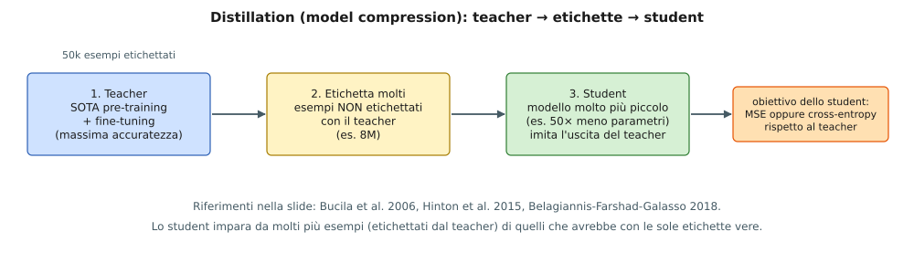

**Perché funziona [Aggiunta].**
- Il teacher fornisce **etichette morbide**: non solo «classe A», ma quanto B e C gli sembrano plausibili: informazione che l'etichetta vera non contiene.
- Con la **temperatura** $T$ (Hinton): $p_i^{(T)}=\dfrac{e^{z_i/T}}{\sum_je^{z_j/T}}$. Per i logit $z=(8,5,2,0,-1)$: a $T=1$ $p=(0.950,0.047,0.002,0.000,0.000)$ (quasi one-hot); a $T=4$ $p=(0.516,0.244,0.115,0.070,0.054)$: emergono le somiglianze tra classi. La loss è la cross-entropy (o KL) tra $p^{(T)}_{teacher}$ e $p^{(T)}_{student}$, moltiplicata per $T^2$ perché i gradienti di $p^{(T)}$ scalano come $1/T^2$.
- Gli esempi non etichettati sono **molti di più** di quelli etichettati: nella slide 100 si usano $50\,000$ etichettati e $8\,000\,000$ non etichettati ($160\times$ di più): lo student vede molti più esempi di quanti avrebbe con le sole etichette vere.

**Slide 100 — risultati** (Turc et al. 2020, *Well-Read Students Learn Better*; accuratezza su *Amazon Book Reviews*). Taglie degli student: Tiny (2 strati, 128 unità nascoste), Mini (4L, 256H), Small (4L, 512H), Medium (8L, 512H), Base (12L, 768H). La linea tratteggiata è il teacher ($\approx88$).

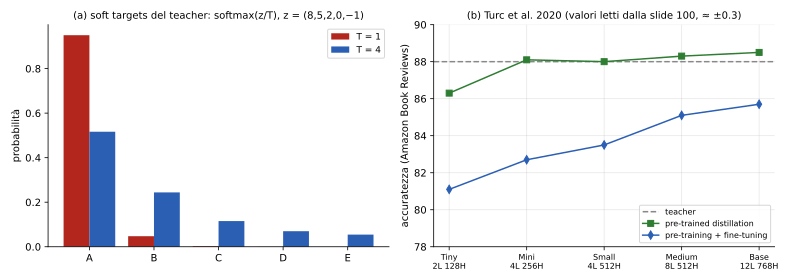

(Valori del pannello (b) letti dal grafico, $\approx\pm0.3$.) Lettura: con la **distillazione** (verde) già lo student **Mini** raggiunge circa il livello del teacher ($\approx88.1$) mentre con **pre-training + fine-tuning** della stessa taglia (blu) si ferma a $\approx82.7$; il modello Base «da solo» arriva a $\approx85.7$, ancora sotto lo student Mini distillato. Conclusione della slide: *«Distillation works much better than pre-training + fine-tuning with smaller model.»*
Quanto è più piccolo il Mini? Per i soli strati Transformer, ogni strato ha $\approx12H^2$ parametri: Base $12\cdot12\cdot768^2\approx84.9\cdot10^6$, Mini $4\cdot12\cdot256^2\approx3.1\cdot10^6$ ⇒ circa **$27\times$** meno (calcolo [Aggiunta]).

### 9.7 Conclusioni su BERT (slide 101)

| Affermazione della slide | Spiegazione |
|---|---|
| *Pre-trained bidirectional language models work incredibly well* | masked LM + fine-tuning (sez. 9.2–9.4) |
| *However, the models are extremely expensive* | 110M–335M parametri e costo $\propto n^2$ (sez. 4.7) |
| *Improvements (unfortunately) seem to mostly come from even more expensive models and more data* | la tabella ELECTRA: XLNet $5.4\times$, ALBERT $44\times$ di calcolo |
| *The inference/serving problem is mostly «solved» through distillation* | sez. 9.6 |

---

## 10. Riepilogo e collegamenti (slide 102)

La slide 102 («Thank you») ringrazia per il materiale: Fei-Fei Li, Justin Johnson, Serena Yeung, Jeff Donahue, Ashish Vaswani, Anna Huang, Jacob Devlin, Jay Alammar.

### 10.1 Formule chiave

| Concetto | Formula |
|---|---|
| Seq2seq (encoder / decoder) | $h_t=f_W(x_t,h_{t-1})$;  $s_t=g_U(y_{t-1},s_{t-1},c)$ |
| Attention di Bahdanau | $e_{t,i}=f_{att}(s_{t-1},h_i)$;  $a_t=\mathrm{softmax}(e_t)$;  $c_t=\sum_ia_{t,i}h_i$;  $s_t=g_U(y_{t-1},s_{t-1},c_t)$ |
| Gradiente sul punteggio | $\partial\mathcal L/\partial e_k=a_k\big(g^\top h_k-\sum_ia_ig^\top h_i\big)$ |
| Attention spaziale (captioning) | $c_t=\sum_{i,j}a_{t,i,j}z_{i,j}$ |
| Self-attention | $\mathrm{softmax}(QK^\top/\sqrt{d_k})\,V$ con $Q=XW_q,K=XW_k,V=XW_v$ |
| Scala | $\mathrm{Var}(q\cdot k)=d_k\Rightarrow$ dividere per $\sqrt{d_k}$ |
| Equivarianza | $Y(PX)=P\,Y(X)$ |
| Codifica posizionale | $p(t)_{2k}=\sin(\omega_kt),\ p(t)_{2k+1}=\cos(\omega_kt),\ \omega_k=10000^{-2k/d}$;  $p(t)\cdot p(t+\Delta)=\sum_k\cos(\omega_k\Delta)$ |
| Maschera | $e_{i,j}=-\infty$ per $i>j$ (chiave futura) |
| Multi-head | $\mathrm{Concat}(\mathrm{head}_1..\mathrm{head}_H)W_O$,  $d_k=d/H$ |
| Blocco encoder | $z=\mathrm{LN}(x+\mathrm{MHA}(x)),\ y=\mathrm{LN}(z+\mathrm{MLP}(z))$ |
| Parametri per blocco ($d$) | encoder $12d^2$, decoder $16d^2$ |
| Non-local means | $\sum_qw(p,q)v(q)$,  $w\propto\exp(-\|N_p-N_q\|^2/h^2)$ |
| Relativa (Shaw) | $e_{ij}=(x_iW^Q)(x_jW^K+a^K_{ij})^\top/\sqrt{d_k}$ |
| Masked LM | $\mathcal L=-\sum_{i\in\mathcal M}\log p(w_i\mid\tilde x)$ |
| ELECTRA | classificazione *original/replaced* su **ogni** token |
| Distillazione | $p^{(T)}=\mathrm{softmax}(z/T)$;  student imita teacher (MSE o CE) |

### 10.2 Quando usare cosa

| Situazione | Scelta | Motivo |
|---|---|---|
| Sequenze lunghe, serve parallelismo, memoria sufficiente | Transformer | cammino $O(1)$, parallelo; costo $n^2$ |
| Sequenze lunghissime o flusso continuo con memoria costante | RNN/LSTM (o attention ristretta) | stato di dimensione fissa |
| Immagini ad alta risoluzione | attention locale (Image Transformer, Swin) | $n\cdot r$ invece di $n^2$ |
| Pochi dati etichettati, testo abbondante | pre-training (BERT) + fine-tuning | sez. 9 |
| Modello troppo lento in produzione | distillazione | student piccolo imita il teacher |
| Generazione di testo | decoder con maschera, token per token | sez. 6.1, 7.4 |

### 10.3 Come si collega tutto

```
RNN seq2seq ──(collo di bottiglia)──► + attention (Bahdanau)
                                         │  gli h_i sono un INSIEME (slide 27)
                                         ▼
                         self-attention (q,k,v dalla stessa sequenza)
                                         │  + posizione (sinusoidale/relativa) + maschera + multi-head
                                         ▼
                    Transformer (encoder / decoder) ── niente ricorrenza
                         │                     │
                         ▼                     ▼
          immagini: Image Transformer,   linguaggio: BERT (masked LM)
          ViT, Swin, DETR                  → ELECTRA (token replaced)
                                           → distillazione per servire i modelli
```

### 10.4 File generati

- `nota4_transformer.md` — questa nota.
- `genera_figure_transformer.py` — script con **tutto** il codice delle figure (23 SVG); eseguendolo si riscrivono gli `.svg` nella stessa cartella e si stampano i numeri calcolati (matrici dell'esempio, tabelle di scala, complessità, ecc.).
- `fig_*.svg` — le figure referenziate nel testo.
