# Advanced Machine Learning and Computer Vision — Formalizzazione matematica (5)

**Contenuto:** *08 – Detection and Segmentation* (Prof. F. Galasso, Sapienza, 16 ottobre 2026), slide numerate fino a 173 (la numerazione stampata ha dei salti: es. 36 → 41, 65 → 79, 86 → 99).
**Scopo:** formalizzare ogni concetto delle slide, esplicitare tutti i passaggi e aggiungere ciò che nelle slide è solo accennato o mostrato come immagine senza spiegazione. La nota continua le precedenti: «nota 1» = *Recap su classificazione, NN e CNN*, «nota 2» = *Training Neural Networks*, «nota 3» = *Sequence Models I*, «nota 4» = *Transformer Networks*.

> **[Aggiunta]** = non è nelle slide ma completa il ragionamento.
> **[Nota]** = imprecisione, convenzione o dettaglio delle slide.
> **Numerazione.** Cito le slide con il **numero stampato nel footer** (2–173). Dove manca (slide solo-immagine) indico il titolo. Le slide hanno salti di numerazione: non è un errore della nota.
> **Figure.** Sono generate da `genera_figure_detection_segmentation.py` (stessa cartella). Quelle con numeri (unpooling, convoluzione trasposta, matrici di convoluzione, metriche, IoU/NMS, RoI Pool/Align, ancore RPN, YOLO, matching di DETR, AP, bersaglio delle maschere, focal loss) sono **calcolate**, non disegnate a mano.
> **Limite.** Molte slide sono immagini (figure di Girshick, grafici di valutazione) di cui il testo estratto contiene solo le didascalie. Dove una cifra non è nel testo (es. tempi di R-CNN) lo segnalo.

---

## 0. Notazione, mappa della lezione

| Simbolo | Significato |
|---|---|
| $I\in\mathbb R^{3\times H\times W}$ | immagine RGB |
| $C$ | numero di classi (di solito incluso lo sfondo) |
| $S\in\mathbb R^{C\times H\times W}$ | mappa dei punteggi per pixel; $\hat y_{h,w}=\arg\max_cS_{c,h,w}$ |
| $(x,y,w,h)$ | box: angolo (o centro) e dimensioni |
| $b=(x_1,y_1,x_2,y_2)$ | box dato dagli angoli (usato per IoU) |
| $\mathrm{IoU}(A,B)$ | $|A\cap B|/|A\cup B|$ |
| $k,s,p$ | taglia del kernel, stride, padding |
| $K$ | numero di ancore per posizione (RPN) |
| $B,S$ | box base per cella, lato della griglia (YOLO) |
| $N_q$ | numero di query di DETR |
| $\mathrm{TP},\mathrm{FP},\mathrm{FN}$ | veri positivi, falsi positivi, falsi negativi |

**Perché questa lezione.** Nelle note 1–4 l'uscita era **un'etichetta per immagine** (classificazione) o una sequenza. Qui l'uscita ha **estensione spaziale**: dobbiamo dire *dove* sono le cose. Le slide percorrono tre livelli di difficoltà crescente, che si riassumono nelle due domande «che cosa c'è in ogni pixel?» e «quali oggetti ci sono e dove?».

```
Detection and Segmentation
 ├─ Segmentazione semantica                       (7-49)
 │    ├─ sliding window → fully convolutional      (10-18)
 │    ├─ upsampling: unpooling, conv trasposta     (19-41)
 │    ├─ U-Net                                     (43-46)
 │    └─ metriche e dati                           (47-49)
 ├─ Object detection                              (52-145)
 │    ├─ single object → multi-object, proposte    (54-65)
 │    ├─ R-CNN → Fast R-CNN → Faster R-CNN         (79-129)
 │    ├─ single-stage: YOLO/SSD/RetinaNet          (131-138)
 │    └─ DETR con Transformer                      (140-145)
 ├─ Instance segmentation: Mask R-CNN             (146-155)
 ├─ Valutazione                                   (158-161)
 └─ Oltre il 2D: captioning denso, scene graph, 3D (163-173)
```

**Collegamenti con le note precedenti.**
- **Fine-tuning e transfer learning** (nota 2, sez. 9): backbone pre-addestrato su ImageNet (slide 57, 156).
- **CNN, pooling, strided conv** (nota 1): qui si studiano le operazioni *inverse* (upsampling).
- **Backprop di una conv = moltiplicazione per $C^\top$** (nota 1): spiega la convoluzione trasposta (sez. 3).
- **Skip connection** (ResNet, nota 1/2): in U-Net si concatena invece di sommare (sez. 4).
- **Attention e Transformer** (nota 4): DETR ne è l'applicazione diretta alla detection (sez. 11).
- **Cross-entropy e regressione** (nota 1): le due loss della detection (sez. 7).

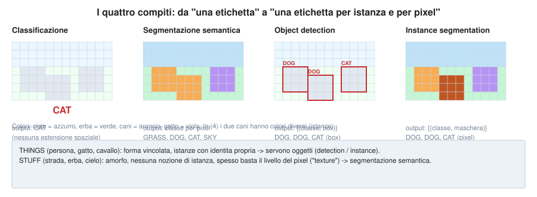

## 1. I quattro compiti (slide 2, 4, 7, 52, 146, 157)

Data un'immagine $I$:

| Compito | Uscita | Formalmente | Slide |
|---|---|---|---|
| **Classificazione** | una classe | $\hat c\in\{1..C\}$ | «CAT», *no spatial extent* |
| **Segmentazione semantica** | una classe per pixel | $\hat y\in\{1..C\}^{H\times W}$ | «GRASS, CAT, TREE, SKY»: *no objects, just pixels* |
| **Object detection** | un insieme di oggetti con box | $\{(c_i,b_i)\}_{i=1}^{N(I)}$, $N$ variabile | «DOG, DOG, CAT»: *multiple objects* |
| **Instance segmentation** | un insieme di oggetti con maschera | $\{(c_i,m_i)\}$, $m_i\in\{0,1\}^{H\times W}$ | «DOG, DOG, CAT» |

La differenza chiave tra semantica e istanza: nella **semantica** due cani adiacenti ricevono la stessa etichetta «DOG» e si fondono in un'unica regione; nell'**istanza** sono due oggetti distinti con due maschere. L'ultima riga della tabella si legge: la detection risponde a *quali oggetti e dove (box)*, l'instance segmentation aggiunge *quali pixel*.

**Things vs stuff (slide 8).**

| THINGS | STUFF |
|---|---|
| persona, gatto, cavallo | strada, erba, cielo |
| forma vincolata | amorfo, senza forma |
| istanze con identità separata | nessuna nozione di istanza |
| può servire guardare l'oggetto | si può fare a livello di pixel («texture») |

**[Aggiunta]** I *things* sono contabili («due cani»), gli *stuff* no («due erbe» non ha senso). La detection è definita per i things; la semantica copre sia things che stuff; la *panoptic segmentation* (non nelle slide) unifica: istanze per i things e classi per gli stuff.

---

## 2. Segmentazione semantica: dalla sliding window alla rete completamente convoluzionale (slide 9–18, 42)

### 2.1 Idea ingenua: sliding window (slide 10–14)

**Compito (slide 9).** Etichettare **ogni pixel** con una categoria, senza distinguere le istanze: $\hat y_{h,w}\in\{1..C\}$.

**Sliding window.**
1. si estrae una patch $P_{h,w}$ centrata nel pixel $(h,w)$;
2. una CNN classifica il pixel centrale: $\hat y_{h,w}=\arg\max_c f_\theta(P_{h,w})_c$ (Farabet 2013, Pinheiro e Collobert 2014).

**Perché serve il contesto (slide 10–11).** Il pixel da solo è inclassificabile: un pixel marrone potrebbe essere pelo di mucca, terra, legno. La patch fornisce il contesto, e il *come includere contesto* (slide 11–12) è esattamente la scelta della dimensione della patch.

**Problema (slide 14):** *molto inefficiente: non riusa le feature condivise tra patch sovrapposte.*

**Quantificazione [Aggiunta].** Due patch $p\times p$ con stride 1 condividono $p(p-1)$ pixel su $p^2$, cioè la frazione $(p-1)/p$ (80% con $p=5$). Per un'immagine $H\times W=256\times256$ e patch $65\times65$:
$$
\#\text{patch}=(256-65+1)^2=36\,864,\qquad \frac{36\,864\cdot65^2}{256^2}\approx2377,
$$
cioè la rete elabora **circa 2400 volte** il numero di pixel dell'immagine.

### 2.2 Rete completamente convoluzionale (slide 15–18, 42)

**Idea (slide 15).** *Progettare la rete come una pila di strati convoluzionali che predice tutti i pixel insieme.* Gli strati conv con padding che mantiene la dimensione producono mappe $D\times H\times W$; l'ultimo strato dà $S\in\mathbb R^{C\times H\times W}$ e
$$
\hat y_{h,w}=\arg\max_{c}\,S_{c,h,w}.
$$


L'addestramento usa la **cross-entropy per pixel**, mediata sui pixel:
$$
\mathcal L=-\frac1{HW}\sum_{h,w}\log\mathrm{softmax}(S_{\cdot,h,w})_{y^\star_{h,w}} .
$$

**Problema (slide 16):** *le convoluzioni a risoluzione originale sono molto costose.* Per uno strato $3\times3$ (dimensione del kernel, quindi $k = 3$) con $D$ canali in ingresso e uscita, a risoluzione $H\times W$, e dato che per ogni numero del kernel abbiamo almeno una somma e una moltplicazione (2 operazioni), abbiamo:
$$
\mathrm{FLOPs}\approx 2 \cdot k^2\cdot D\cdot D\cdot H\cdot W.
$$
**Numeri [calcolati].** Con $D=64$ e $224\times224$: **3.70 GFLOPs** a risoluzione piena, **0.93** a metà ($4\times$ meno), **0.23** a un quarto ($16\times$ meno).

**Soluzione (slide 17, 42; Long, Shelhamer e Darrell 2015; Noh 2015).** *Downsampling e upsampling dentro la rete.*

- Alta risoluzione: $D_1\times H/2\times W/2$; media: $D_2\times H/4\times W/4$; bassa: $D_3\times H/4\times W/4$ (nelle slide).
- **Downsampling:** pooling, convoluzione con stride (nota 1).
- **Upsampling:** come si fa? risolto poi con **unpooling** o **convoluzione trasposta con stride**.

**Perché funziona [Aggiunta].** (i) Il costo cala con il quadrato del fattore di downsampling; (ii) il **campo recettivo** cresce (ogni pixel a bassa risoluzione «vede» una regione ampia), quindi si ottiene il contesto che la sliding window cercava, ma una sola volta per tutta l'immagine; (iii) l'upsampling riporta l'uscita a $H\times W$.

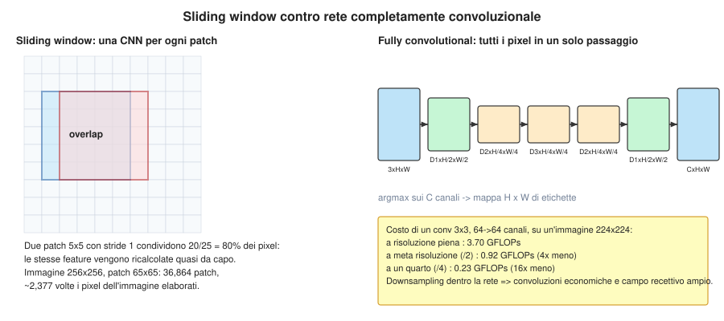

---

## 3. Upsampling dentro la rete (slide 19–41)

### 3.1 Unpooling senza parametri (slide 19–20)

**Nearest neighbor (slide 19).** Ogni valore è ripetuto in un blocco $2\times2$. Con $x=\begin{pmatrix}1&2\\3&4\end{pmatrix}$:
$$
\mathrm{NN}(x)=x\otimes\mathbf 1_{2\times2}=\begin{pmatrix}1&1&2&2\\1&1&2&2\\3&3&4&4\\3&3&4&4\end{pmatrix}.
$$
**«Bed of nails» (slide 19).** Il valore va nell'angolo in alto a sinistra del blocco, il resto è 0:
$$
\mathrm{BN}(x)_{2i,2j}=x_{i,j},\quad \text{altrove }0\ \Rightarrow\ \begin{pmatrix}1&0&2&0\\0&0&0&0\\3&0&4&0\\0&0&0&0\end{pmatrix}.
$$
**Max unpooling (slide 20).** Si usa la posizione del massimo **memorizzata** dal max pooling corrispondente. Nell'esempio della slide l'ingresso del pooling è
$$
A=\begin{pmatrix}1&2&6&3\\3&5&2&1\\1&2&2&1\\7&3&4&8\end{pmatrix}\xrightarrow{\ \text{max pool }2\times2\ }\begin{pmatrix}5&6\\7&8\end{pmatrix}
$$
con massimi nelle posizioni $(1,1),(0,2),(3,0),(3,3)$. Più avanti nella rete il tensore $\begin{pmatrix}1&2\\3&4\end{pmatrix}$ viene «de-poolato» rimettendo i valori in quelle posizioni:
$$
\begin{pmatrix}0&0&2&0\\0&1&0&0\\0&0&0&0\\3&0&0&4\end{pmatrix}.
$$
**Formalmente.** Se $m:\{\text{blocchi}\}\to\{\text{posizioni}\}$ è l'«interruttore» (*switch*) del pooling, $\mathrm{unpool}(x)_{m(i,j)}=x_{i,j}$ e 0 altrove. Gli strati di downsampling e upsampling vanno **a coppie** (slide). **[Aggiunta]** Il max unpooling ricorda *dove* erano le attivazioni forti: preserva la struttura dei bordi meglio di NN. Nessuno di questi tre ha parametri appresi.

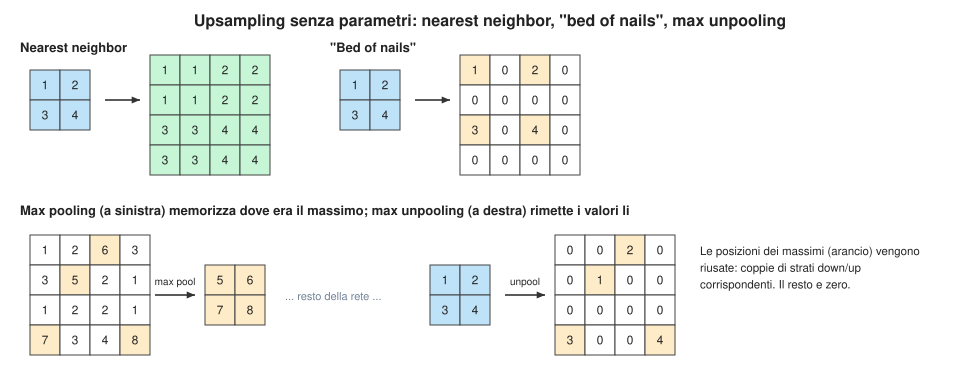


*Descrizione.* Gli strati in rosso corrispondono al maxpooling e la freccia indica il passaggio dall'unpooling al maxpooling corrispondente. In particolare, nel maxpooling vengono memorizzate le posizioni dei massimi trovati e vengono ripristinate nel max unpooling.

### 3.2 Convoluzione trasposta (slide 21–32)

**Ripasso (slide 21–26).** Convoluzione $3\times3$, stride 1, pad 1: ingresso $4\times4$ → uscita $4\times4$; ogni uscita è il prodotto scalare tra filtro e finestra dell'ingresso. Con stride 2, pad 1: ingresso $4\times4$ → uscita $2\times2$ (slide 24–26). In formula:
$$
n_{out}=\Big\lfloor\frac{n+2p-k}{s}\Big\rfloor+1 .
$$
Con $n=4,k=3,p=1$: $s=1\Rightarrow4$; $s=2\Rightarrow\lfloor3/2\rfloor+1=2$, come nelle slide.

> *Il filtro si muove di 2 pixel nell'ingresso per ogni pixel dell'uscita:* lo stride è il rapporto tra i movimenti in ingresso e in uscita.

**Trasposta (slide 27–31).** Si inverte il ruolo: **il pixel d'ingresso fornisce il peso** del filtro; si «stampa» una copia del filtro, scalata dal valore d'ingresso, nell'uscita; il filtro si sposta di **2 pixel nell'uscita per ogni pixel dell'ingresso**; **dove le copie si sovrappongono, si somma.** Ingresso $2\times2$ → uscita $4\times4$ ($k=3$, $s=2$, $p=1$).

**Altri nomi (slide 31):** *deconvolution* (**errato**: non è l'inversa della convoluzione), *upconvolution*, *fractionally strided convolution*, *backward strided convolution*.

**Esempio 1D (slide 32).** Ingresso $(a,b)$, filtro $(x,y,z)$, stride 2:
**1. Moltiplichiamo ogni valore d'ingresso per il filtro:**

$$
a(x,y,z)=(ax,ay,az)
$$

$$
b(x,y,z)=(bx,by,bz)
$$

**2. Posizioniamo i risultati con stride \(s=2\):**

$$
\begin{aligned}
a &: \quad (ax,\ ay,\ az,\ 0,\ 0)\\
b &: \quad (0,\ 0,\ bx,\ by,\ bz)
\end{aligned}
$$

**3. Sommiamo i valori nelle posizioni sovrapposte:**

$$
\boxed{
\underbrace{(ax,\ ay,\ az,\ 0,\ 0)}_{\text{contributo di }a}
+
\underbrace{(0,\ 0,\ bx,\ by,\ bz)}_{\text{contributo di }b}
=
(ax,\ ay,\ az+bx,\ by,\ bz)
}
$$
Con $(a,b)=(1,2)$ e $(x,y,z)=(1,2,3)$ si ottiene $(1,2,5,4,6)$ (lunghezza $(n-1)s+k=5$). Per avere esattamente $2n=4$ elementi **si taglia un pixel** (slide). In forma generale, con $y\in\mathbb R^n$, filtro $w\in\mathbb R^k$:
$$
\mathrm{out}[j]=\sum_{i:\ 0\le j-si<k}y_i\,w_{j-si}.
$$

**Dimensione dell'uscita [Aggiunta].**
$$
n_{out}=(n-1)\,s-2p+k+p_{out},
$$
dove $p_{out}$ è l'*output padding*, che risolve l'ambiguità (più ingressi di conv diretta danno la stessa uscita). Esempio slide: $n=2,k=3,s=2,p=1$: $(2-1)\cdot2-2+3=3$, con $p_{out}=1$ si arriva a $4$.

**Artefatti a scacchiera [Aggiunta].** Quante volte riceve un contributo la posizione $j$ di uscita? Con $n=5$, $s=2$: se $k=3$ i conteggi sono $1,1,2,1,2,1,2,1,2,1,1$ (alternano 1 e 2: uscita non uniforme, artefatto «a scacchiera»); se $k=4$ (multiplo di $s$) sono $1,1,2,2,2,\dots,2,1,1$: uniformi all'interno. Per questo si scelgono $k$ multiplo di $s$ o si usa nearest neighbor seguito da una conv.

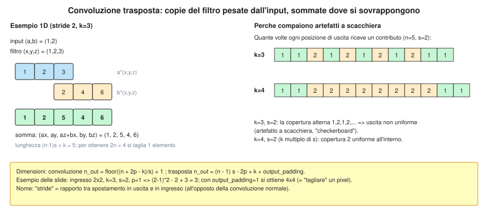

### 3.3 Convoluzione come prodotto di matrici (slide 33–41)

**Idea.** Ogni convoluzione è lineare, quindi si scrive $y=Cx$ con $C$ una matrice (di Toeplitz con strides) che contiene i pesi $w$.

**Esempio (slide 33–34): 1D, $k=3$, $s=1$, $p=1$.** Per ogni uscita $i$ la riga $C_{i,\cdot}$ ha $(w_1,w_2,w_3)$ nelle colonne $i-1,i,i+1$. Per lo stride 2 (slide 34) le righe si spostano di 2 colonne.

**Caso $n=6$, $k=3$, $s=2$, $p=1$ (calcolato).** $m=\lfloor(6+2-3)/2\rfloor+1=3$ uscite; riga $i$ ha il filtro con $w_2$ nella colonna $2i$ (perché la colonna $-1$ cade nel padding):
$$
C=\begin{pmatrix}w_2&w_3&0&0&0&0\\0&w_1&w_2&w_3&0&0\\0&0&0&w_1&w_2&w_3\end{pmatrix}\in\mathbb R^{3\times6}.
$$
**Convoluzione trasposta (slide 35–41):** *moltiplica per la trasposta della stessa matrice*, $x'=C^\top y$, e con $s>1$ **sovracampiona** con un kernel appreso: $C^\top\in\mathbb R^{6\times3}$ porta da 3 a 6 elementi.

**Verifica numerica.** Con $w=(1,2,3)$ e $x=(1,\dots,6)$: $y=Cx=(8,20,32)$ e $C^\top y=(16,44,40,92,64,96)$. Si noti: $C^\top Cx\neq x$. La trasposta **non è l'inversa**: ripristina le *dimensioni*, non i valori (per questo «deconvoluzione» è fuorviante).

**Perché si chiama «gradiente della convoluzione» [Aggiunta].** Se $y=Cx$ e la loss è $\mathcal L$, per la regola della catena $\partial\mathcal L/\partial x=C^\top\,\partial\mathcal L/\partial y$: il backward di una conv con stride $s$ è esattamente una conv trasposta con lo stesso filtro. Quindi i due operatori hanno la stessa struttura di calcolo.

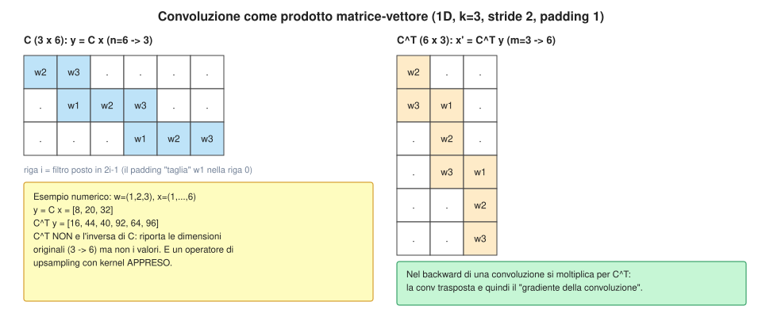

---

## 4. U-Net (slide 43–46)

Ronneberger, Fischer, Brox (2015). Il nome viene dalla forma a «U» dello schema.

- **Fase di downsampling (slide 44):** aumenta il campo visivo (*field of view*) ma **si perde l'informazione spaziale**.
- **Fase di upsampling (slide 45):** crea la mappa ad alta risoluzione.
- **Skip connection (slide 46):** *si concatenano* le feature ad alta risoluzione della fase di discesa con quelle risalite.

**Formalmente.** Sia $e_\ell$ l'uscita dell'encoder al livello $\ell$ (risoluzione $H/2^\ell$) e $u_{\ell+1}$ l'uscita risalita dal livello inferiore, riportata alla stessa risoluzione con una conv trasposta $2\times2$. Il blocco decoder al livello $\ell$ è
$$
d_\ell=\mathrm{Conv}\big(\mathrm{Conv}([\,e_\ell\ ;\ \mathrm{up}(d_{\ell+1})\,])\big),
$$
dove $[\cdot;\cdot]$ concatena lungo i canali ($\mathrm{ch}+\mathrm{ch}\to$ conv $\to\mathrm{ch}$).

**Perché concatenare [Aggiunta].** Le feature profonde sanno *che cosa* c'è ma sono grossolane; quelle superficiali sanno *dove* sono i bordi ma non il significato. Concatenarle dà al decoder entrambe. A differenza di ResNet (che *somma*, nota 1) qui si concatena, quindi i canali raddoppiano e i pesi imparano come combinarle. **Calcolo:** con $H=W=256$ e $C=21$ classi la mappa finale ha $21\cdot256\cdot256=1\,376\,256$ punteggi.

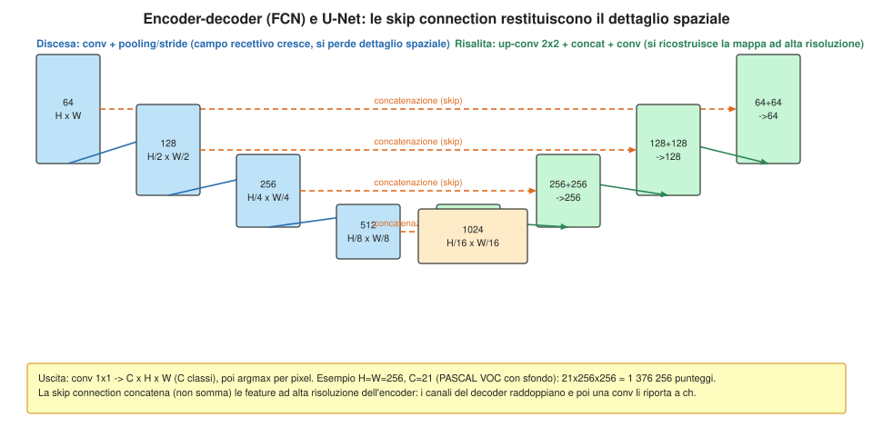

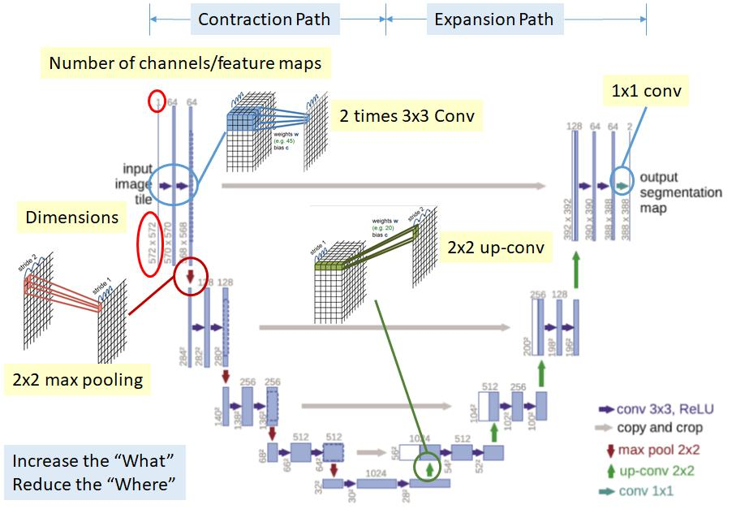

---

## 5. Metriche per la segmentazione (slide 47)

**Classificazione dei pixel, domande della slide.**
- *Accuracy?* **Fortemente sbilanciata**: sfondo e classi frequenti dominano.
- *Intersection over Union*: **media sulle classi e sulle immagini**.
- *Accuratezza per classe*: media sulle classi e sulle immagini.

**Definizioni.** Sia $M_{ij}$ il numero di pixel con classe vera $i$ e predetta $j$ (matrice di confusione). Per la classe $c$:
$$
\mathrm{TP}_c=M_{cc},\quad\mathrm{FN}_c=\sum_{j\ne c}M_{cj},\quad\mathrm{FP}_c=\sum_{i\ne c}M_{ic},
$$
$$
\mathrm{IoU}_c=\frac{\mathrm{TP}_c}{\mathrm{TP}_c+\mathrm{FP}_c+\mathrm{FN}_c},\qquad \mathrm{mIoU}=\frac1C\sum_c\mathrm{IoU}_c,
$$
$$
\mathrm{acc}_{pixel}=\frac{\sum_c\mathrm{TP}_c}{\sum_{ij}M_{ij}},\qquad \mathrm{acc}_{classe}=\frac1C\sum_c\frac{\mathrm{TP}_c}{\mathrm{TP}_c+\mathrm{FN}_c}.
$$
L'IoU di una classe è l'indice di **Jaccard** tra la regione predetta e quella vera.

**Esempio numerico (100 pixel, 3 classi) [Aggiunta, calcolato].**
$M=\begin{pmatrix}70&3&2\\4&12&1\\2&1&5\end{pmatrix}$ (sfondo, gatto, cane).
- $\mathrm{acc}_{pixel}=87/100=0.87$;
- $\mathrm{IoU}$: sfondo $70/81=0.864$, gatto $12/21=0.571$, cane $5/11=0.455$; **mIoU $=0.630$**;
- accuratezza per classe: $0.933,\ 0.706,\ 0.625$; media $0.755$.

**Il caso patologico che spiega «heavily unbalanced».** Un predittore banale che dice «sfondo» ovunque ha $\mathrm{acc}_{pixel}=75/100=0.75$ ma $\mathrm{IoU}=(0.75,0,0)$ e **mIoU $=0.25$**. L'accuratezza di pixel premia un modello inutile; l'IoU no.

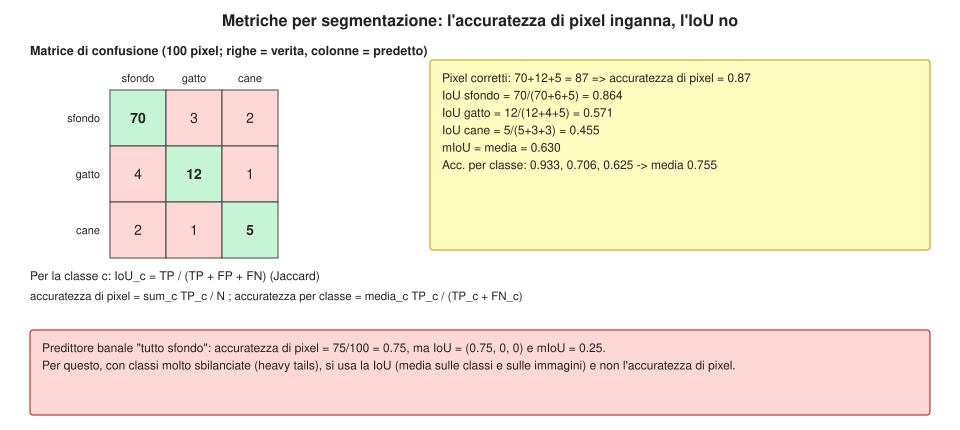

---

## 6. Raccolta dati (slide 48–49)

- *Localizzare con precisione è difficile da annotare;* annotare ogni pixel produce **code lunghe** (molte classi rare).
- **Soluzione comune:** annotare poche classi (spesso *things*) e marcare il resto come «Other».
- **Dataset:** PASCAL VOC 2012 (~1500 immagini, 20 categorie), COCO (~100k immagini, 20 categorie nelle slide). **[Nota]** COCO ha in realtà 80 categorie di oggetti (come mostrano le slide 161) e 200 000 immagini etichettate; il «~100k, 20 categorie» della slide 48 è un'approssimazione per la segmentazione semantica, non coerente col resto.
- **Propagazione di etichette** (Badrinarayanan, CVPR'10): da pochi frame annotati si trasmettono le etichette ai pixel vicini (in spazio e tempo).
- **Strumenti semi-automatici**: *Fluid Annotation* (ACM'18): il modello propone segmenti, l'utente corregge: si passa da «etichette dell'utente» + «etichette sconosciute» a un'annotazione completa.

---

## 7. Object detection: un solo oggetto (slide 54–57)

**Classificazione + localizzazione.** Se nell'immagine c'è **un solo** oggetto, si estende la CNN con due teste che partono dallo stesso vettore $f\in\mathbb R^{4096}$ (l'ultimo strato nascosto):

- testa di classe: FC $4096\to C$ (es. 1000) → softmax, punteggi (Cat 0.9, Dog 0.05, …);
- testa di box: FC $4096\to4$ → $(x,y,w,h)$: **la localizzazione è un problema di regressione** (slide 54).

**Loss multi-task (slide 55–56).**
$$
\mathcal L=\underbrace{-\log p_{c^\star}}_{\text{softmax loss}}+\ \lambda\,\underbrace{\|(x,y,w,h)-(x',y',w',h')\|_2^2}_{L_2}.
$$
Con la **somma** delle due perdite («Multitask loss», slide 56) la rete impara le due cose insieme, e il backbone è **spesso pre-addestrato su ImageNet** (slide 57, *transfer learning*, nota 2 sez. 9).

**[Aggiunta] Il peso $\lambda$.** Le due perdite hanno scale diverse (la CE è in $[0,\infty)$ per probabilità, la regressione in pixel o normalizzata), quindi si usa un iperparametro $\lambda$ per bilanciarle. Una loss più robusta agli outlier è la **smooth $L_1$**:
$$
\mathrm{smooth}_{L_1}(t)=\begin{cases}0.5\,t^2&|t|<1\\|t|-0.5&\text{altrimenti}\end{cases},
$$
usata in Fast/Faster R-CNN. **[Aggiunta]** Se l'oggetto non c'è (classe sfondo) la loss di box non va applicata: $\mathcal L=\mathcal L_{cls}+\lambda\,[c^\star\ne\mathrm{bg}]\,\mathcal L_{box}$.

---

## 8. Object detection: più oggetti (slide 58–118)

### 8.1 Il problema dell'uscita variabile (slide 58–64)

Ogni immagine ha un numero diverso di oggetti: un gatto → **5 numeri** (classe + 4 coordinate) se si conta classe e box, tre oggetti → **15**, molti → **moltissimi** (slide 59). Una rete a uscita fissa non può farlo.

**Idea ingenua (slide 60–64).** Applicare la CNN a **molti ritagli** (*crop*) dell'immagine; per ogni crop classificare: «Dog? Cat? Background?» (slide 60: NO, NO, **YES** background; slide 61–62: Dog **YES**; slide 63: Cat **YES**).

**Problema (slide 64):** servono *moltissime posizioni, scale e rapporti d'aspetto*: costosissimo.

**Quanto? [Aggiunta].** Il numero di box $\{(x_1,y_1,x_2,y_2)\}$ distinti in un'immagine $H\times W$ è
$$
\binom{H+1}{2}\binom{W+1}{2}=\frac{H(H+1)}2\cdot\frac{W(W+1)}2 ,
$$
cioè per $640\times480$: $\approx2.3\cdot10^{10}$ box. Impossibile passarli tutti alla CNN.

### 8.2 Region proposals (slide 65)

Si usa un metodo **rapido e non appreso** per proporre poche regioni «che probabilmente contengono un oggetto»:

- trova regioni «blobby» probabili di oggetti;
- **Selective Search** (Uijlings 2013) dà ~**2000** proposte in pochi secondi sulla CPU.

Altri metodi citati: *Objectness* (Alexe 2012), *BING* (Cheng 2014, 300 fps), *Edge Boxes* (Zitnick e Dollár 2014). **[Aggiunta]** Selective Search: si parte da una segmentazione in superpixel e si fondono gerarchicamente le regioni adiacenti più simili (colore, texture, taglia); i riquadri di ogni livello della gerarchia sono le proposte. Ridurre $\approx10^{10}$ candidati a $\approx2000$ è il guadagno.

### 8.3 R-CNN (slide 79–86)

Girshick et al., CVPR 2014: *Rich feature hierarchies for accurate object detection and semantic segmentation.*

Pipeline (figura delle slide 79–84):
1. immagine in ingresso;
2. **~2000 proposte** (Selective Search);
3. ogni proposta viene **ritagliata e ridimensionata** (*warp*) a una taglia fissa (es. $224\times224$);
4. **una CNN per ogni proposta** (con pesi condivisi) estrae feature;
5. classificatori **SVM** per classe + **regressione del box** per correggere la proposta.

**Problema (slide 85): lentissimo.** *~2k passaggi avanti indipendenti per ogni immagine.* Il costo è $\approx2000\times$ quello di una sola CNN.

**Idea (slide 86):** *elaborare l'immagine **prima** di ritagliare: scambiare convoluzione e ritaglio.*

### 8.4 Sliding window con ConvNet (slide senza numero tra 86 e 99)

Una CNN di classificazione è «conv … conv + FC». Il blocco convoluzionale funziona su **qualsiasi** dimensione d'ingresso. Si vede così: finestra $224\times224$ → feature $6\times6\times256$ → FC → $C$ classi. Se l'ingresso è più grande ($240\times240$) si ottiene una mappa di feature più grande e, con gli FC riletti come convoluzioni $1\times1$, **una griglia di uscite $C$**, una per posizione di finestra. *Non serve calcolare le due finestre separatamente: una sola finestra grande, calcolata in un solo passaggio.*

**Conti [Aggiunta].** Se la rete ha *stride totale* $s_{tot}$ (nell'esempio 16), una finestra di lato $w$ su un'immagine di lato $L$ ha
$$
n_{pos}=\Big\lfloor\frac{L-w}{s_{tot}}\Big\rfloor+1
$$
posizioni per lato: con $w=224$, $L=240$, $s_{tot}=16$ si ottengono $2\times2$ posizioni, tutte calcolate in un colpo solo e condividendo il lavoro. È l'idea portata in avanti dalla Fast R-CNN: i ritagli si fanno sulle **feature**, non sui pixel.

### 8.5 Fast R-CNN (slide 99–105, 117–118)

Girshick, ICCV 2015.

- **Backbone una sola volta:** la CNN processa **l'intera immagine** → mappa di feature (es. $512\times20\times15$ per un ingresso $3\times640\times480$, stride 32).
- Le **proposte** (ancora da Selective Search) si proiettano sulla mappa di feature.
- **RoI Pool** estrae da ciascuna un tensore di taglia fissa (es. $512\times7\times7$).
- Una piccola rete (FC) per ogni RoI predice **classe** e **offset del box**.
- Si addestra tutto *end-to-end* con una loss multi-task (classe + smooth $L_1$ del box).

**Confronto (slide 117–118).** R-CNN vs Fast R-CNN: il tempo di **addestramento** e di **test** crolla (nei grafici di Girshick di ~un ordine di grandezza o più). **Problema (slide 118): il tempo è dominato dalle region proposals** (Selective Search è su CPU e non condivide il calcolo con la rete).

**[Nota]** I valori esatti dei grafici delle slide 117–118 non sono nel testo; la letteratura riporta circa 49 s per immagine per R-CNN, 2.3 s per Fast R-CNN (di cui ~2 s di proposte) e ~0.2 s per Faster R-CNN. Sono ordini di grandezza, non cifre ricavate dalle slide.

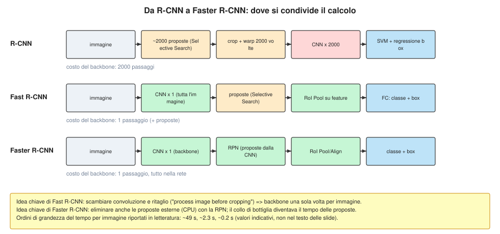

### 8.6 Ritagliare le feature: RoI Pool e RoI Align (slide 106–116)

**Il problema.** Una proposta ha coordinate in pixel (reali, in generale non intere) e **dimensioni diverse** da proposta a proposta; la testa FC richiede un tensore di taglia **fissa**.

**RoI Pool (slide 106–111).**
1. si proietta la proposta sulla mappa di feature (si divide per lo stride);
2. si **«aggancia»** (*snap*) alle celle della griglia (arrotondamento);
3. si divide la regione in una griglia $2\times2$ di sotto-regioni di taglia (circa) uguale;
4. si fa **max pooling** in ogni sotto-regione.
Uscita sempre della stessa dimensione ($512\times2\times2$ nell'esempio, $512\times7\times7$ in pratica), *anche se le regioni d'ingresso hanno taglie diverse*.

**Problema (slide 111): le feature della regione sono leggermente disallineate** (l'arrotondamento sposta la regione e le dà una taglia diversa da quella vera).

**RoI Align (slide 112–116; He et al., Mask R-CNN, ICCV 2017).** *Niente snapping.*
1. proietta la proposta sulle feature **senza arrotondare**;
2. divide la regione in $2\times2$ sotto-regioni (anche con bordi non interi);
3. in ogni sotto-regione, **campiona in punti regolari** con **interpolazione bilineare**;
4. aggrega (max nelle slide; media nell'articolo originale).

**Interpolazione bilineare (slide 114–115).** Il valore nel punto $(x,y)$ è combinazione lineare dei 4 vicini $(x_1,y_1),(x_2,y_1),(x_1,y_2),(x_2,y_2)$, con $f_{11},f_{21},f_{12},f_{22}\in\mathbb R^{512}$ (nella figura $\mathbb R^5$):
$$
f_{xy}=\frac{(x_2-x)(y_2-y)}{(x_2-x_1)(y_2-y_1)}f_{11}+\frac{(x-x_1)(y_2-y)}{(x_2-x_1)(y_2-y_1)}f_{21}+\frac{(x_2-x)(y-y_1)}{(x_2-x_1)(y_2-y_1)}f_{12}+\frac{(x-x_1)(y-y_1)}{(x_2-x_1)(y_2-y_1)}f_{22}.
$$
I pesi sono non negativi e sommano 1 (media pesata), quindi $f_{xy}$ è **differenziabile** rispetto a $f_{ij}$ **e** alle coordinate $(x,y)$.

**Esempio numerico [Aggiunta, calcolato].** Mappa $6\times8$ (un canale, valori in figura) e proposta $(x_0,y_0,x_1,y_1)=(1.3,0.8,5.7,4.6)$:
- **RoI Pool:** snap alle colonne 1–5 e righe 0–4 (regione $5\times5$ invece di $4.4\times3.8$), griglia $2\times2$ → $\begin{pmatrix}9&7\\8&9\end{pmatrix}$;
- **RoI Align** (4 campioni per cella, media) → $\begin{pmatrix}5.42&4.65\\5.30&5.62\end{pmatrix}$ (con max sui campioni: $\begin{pmatrix}6.46&5.84\\7.52&6.88\end{pmatrix}$).
I due risultati sono molto diversi: il pool prende il picco discreto più vicino (9 in cella $(2,2)$), l'align i valori nella regione esatta.

**Perché conta.** Con stride 16 un errore di $0.3$ celle sono ~5 pixel dell'immagine: trascurabile per classificare un'intera regione, **grave per le maschere** (Mask R-CNN, sez. 12).

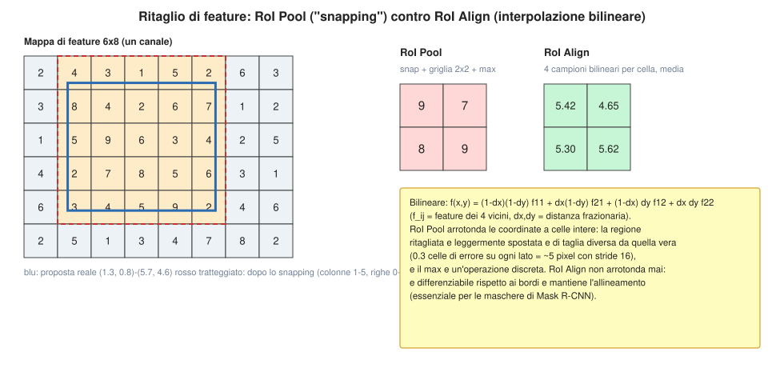

---

## 9. Faster R-CNN e la Region Proposal Network (slide 119–130)

Ren et al., NIPS 2015: *rendere la CNN capace di produrre le proposte.*

**Architettura (slide 119).** *Si inserisce una **Region Proposal Network** (RPN) per predire le proposte a partire dalle feature;* il resto è come Fast R-CNN: ritaglio delle feature per ogni proposta e classificazione.

**Ancore (slide 121).** *Si immagina una scatola («anchor») di taglia fissa in ogni punto della mappa di feature.*

**Teste della RPN (slide 122–125).** Su una mappa $512\times20\times15$:
1. una convoluzione predice, per ogni posizione, **se l'ancora contiene un oggetto** (*per-pixel logistic regression*): uscita $1\times20\times15$ (slide 122);
2. per le ancore positive, un'altra predice la **trasformazione** dall'ancora al box vero: 4 numeri per posizione, uscita $4\times20\times15$ (slide 123);
3. **in pratica si usano $K$ ancore** di scale e rapporti diversi per posizione: uscite $K\times20\times15$ e $4K\times20\times15$ (slide 124);
4. si **ordinano** le $K\cdot20\cdot15$ ancore per punteggio di «oggetto» e si tengono le **~300 migliori** come proposte (slide 125).

**Parametrizzazione del box [Aggiunta].** Per un'ancora $(x_a,y_a,w_a,h_a)$ (centro e dimensioni) e un box vero $(x,y,w,h)$ si predicono
$$
t_x=\frac{x-x_a}{w_a},\quad t_y=\frac{y-y_a}{h_a},\quad t_w=\log\frac w{w_a},\quad t_h=\log\frac h{h_a}.
$$
Le coordinate sono **relative** alla taglia dell'ancora (invarianti alla scala) e il logaritmo garantisce $w,h>0$ e rende simmetrici gli errori moltiplicativi. L'inversa dà il box: $x=x_a+t_xw_a$, $w=w_ae^{t_w}$, ecc. Esempio: ancora $(100,100,128,128)$ e $t=(0.1,-0.2,0.3,-0.1)$ → centro $(112.8,74.4)$, $w=172.8$, $h=115.8$.

**Numero di ancore.** Con $K=9$ (3 scale × 3 rapporti) e mappa $15\times20$: $9\cdot15\cdot20=2700$ ancore, da cui si tengono ~300 dopo NMS.

**Le 4 loss congiunte (slide 126).** Si addestra tutto insieme con quattro perdite:
1. RPN: classificazione oggetto/non oggetto;
2. RPN: regressione delle coordinate del box;
3. punteggio finale di classe (classi di oggetto);
4. coordinate finali del box.
**[Aggiunta]** La loss totale è una somma pesata; per l'RPN, un'ancora è positiva se ha IoU $\ge0.7$ con un box vero (o è l'ancora con IoU massima per quel box) e negativa se ha IoU $<0.3$ con tutti.

**Dettagli «sorvolati» dalle slide (slide 128).**
- **NMS** per scartare proposte sovrapposte (sez. 9.1);
- *come decidere se una proposta è positiva o negativa* (le soglie di IoU sopra);
- *quanti positivi/negativi usare* per addestrare l'RPN (nel paper: 256 ancore per immagine, rapporto positivi:negativi fino a 1:1);
- *come parametrizzare la regressione del box* (formule sopra).

**Faster R-CNN è un detector a due stadi (slide 129).**
- **Primo stadio**, eseguito *una volta per immagine*: backbone + RPN;
- **Secondo stadio**, eseguito *una volta per regione*: ritaglio delle feature (RoI Pool/Align), predizione della classe, predizione dell'offset del box.
La slide 130 chiede: **«serve davvero il secondo stadio?»**, che porta alla sez. 10.

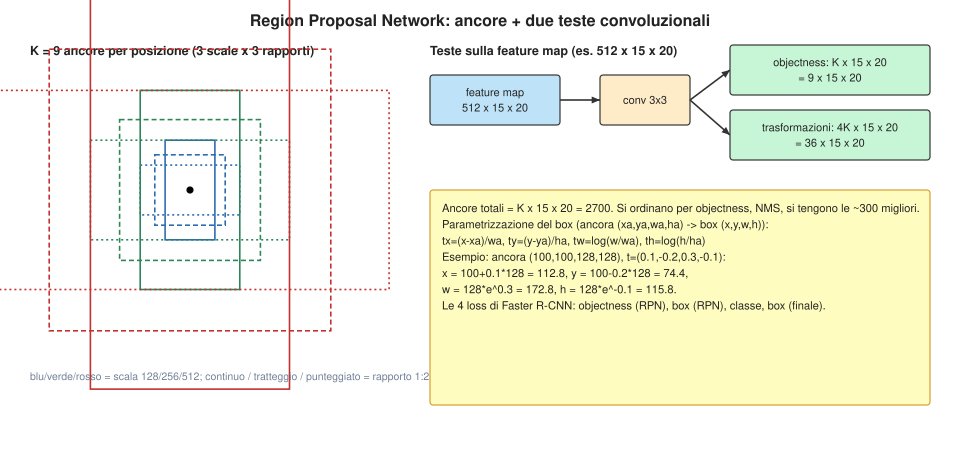

### 9.1 IoU e Non-Maximum Suppression [Aggiunta, ma citata nella slide 128]

**IoU tra box.** Con $b=(x_1,y_1,x_2,y_2)$:
$$
\mathrm{IoU}(A,B)=\frac{\big(\min x_2-\max x_1\big)_+\big(\min y_2-\max y_1\big)_+}{\mathrm{area}(A)+\mathrm{area}(B)-\text{intersezione}}\in[0,1].
$$
**NMS (greedy).** Tutti i detector producono **molti box sovrapposti** sullo stesso oggetto (ogni ancora vicina vota). L'algoritmo:
1. ordina i box per punteggio decrescente;
2. tieni il migliore, scarta tutti quelli con IoU $>\tau$ (tipicamente $\tau=0.5$) con esso;
3. ripeti sui rimanenti.

**Esempio [calcolato].** Cinque box in due gruppi: $A(0.95),B(0.90),C(0.60)$ intorno a un cane, $D(0.85),E(0.55)$ intorno a un altro. $\mathrm{IoU}(A,B)=5250/7550=0.695$, $\mathrm{IoU}(A,C)=0.592$, $\mathrm{IoU}(D,E)=0.730$. NMS tiene $A$ (sopprime $B,C$) e $D$ (sopprime $E$): risultato $\{A,D\}$.

**Limite.** Due oggetti veri molto vicini (folla) possono avere IoU alto e uno viene soppresso: è la motivazione di DETR (sez. 11), che non ha bisogno di NMS.

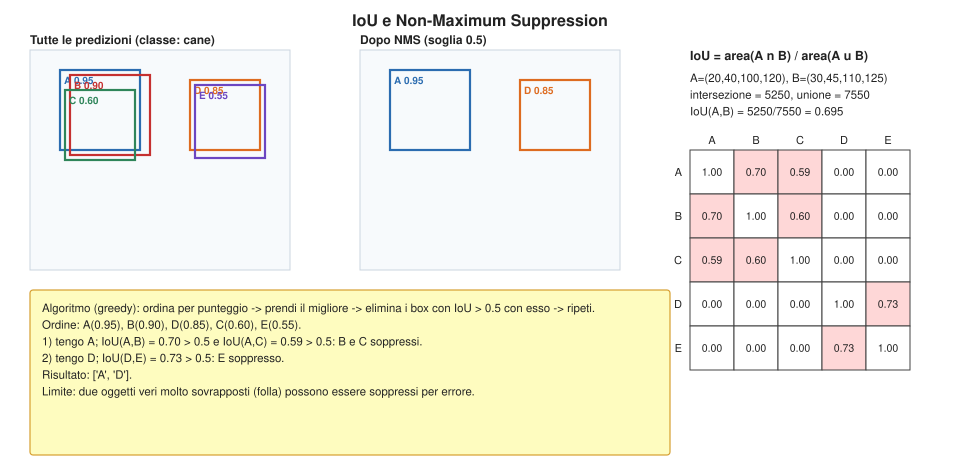

---

## 10. Detector a singolo stadio (slide 131–139)

### 10.1 Schema YOLO / SSD / RetinaNet (slide 131)

**Idea.** Eliminare il secondo stadio: la rete produce direttamente classe e box in una sola passata (*«looks a lot like RPN, but category-specific!»*).

1. Si divide l'immagine in una **griglia $S\times S$** (qui $7\times7$);
2. in ogni cella si immaginano **$B$ box base** (qui $B=3$) centrati sulla cella;
3. per ciascuno dei $B$ box base si regredisce a un box finale con **5 numeri** $(dx,dy,dh,dw,\text{confidenza})$;
4. si predicono i punteggi per **$C$ classi** (incluso lo sfondo come classe);
5. **uscita: $7\times7\times(5B+C)$.**

**Conto [calcolato].** Con $B=3$ e $C=20$: $7\cdot7\cdot(15+20)=1715$ numeri; i box candidati sono $49\cdot3=147$. **[Nota]** In YOLOv1 originale $B=2$ e le classi sono per cella (non per box): $7\cdot7\cdot(5\cdot2+20)=1470$.

### 10.2 YOLO (slide 132–138)

Redmon et al., *You Only Look Once* (2015/CVPR 2016). Per ogni cella:
- $P(\mathrm{object})$: probabilità che il box contenga un oggetto;
- $B$ box $(x,y,h,w)$;
- $P(\mathrm{class}\mid\mathrm{object})$: probabilità di appartenere alle classi.
Il risultato è un insieme di **molti box con probabilità diverse** (slide 137); poi **NMS** e soglia sulla confidenza (slide 138).

**Punteggio finale [Aggiunta].** Per il box $b$ nella cella $i$ e la classe $c$:
$$
\mathrm{score}(b,c)=P(\mathrm{object})\cdot\mathrm{IoU}^{pred}_{truth}\cdot P(c\mid\mathrm{object}),
$$
dove la confidenza di un box è addestrata a valere $P(\mathrm{object})\cdot\mathrm{IoU}$ con il box vero. **Responsabilità:** la cella che contiene il **centro** dell'oggetto è responsabile di predirlo. Esempio: centro $(170,130)$ px con celle da 40 px → riga 3, colonna 4, offset $(0.25,0.25)$ nella cella.

**Perdita (YOLOv1) [Aggiunta].** Somma di errori quadratici su centri, radici delle dimensioni (per ridurre il peso dei box grandi), confidenze e probabilità di classe, con pesi $\lambda_{coord}=5$ e $\lambda_{noobj}=0.5$ (le celle senza oggetto sono molte).

### 10.3 Focal loss (citata: Lin et al., RetinaNet, ICCV 2017) [Aggiunta]

**Problema.** Un detector a singolo stadio valuta $\sim10^4$–$10^5$ candidati, quasi tutti **sfondo facile**: la loss è dominata dai molti esempi facili. La **focal loss** attenua i facili:
$$
\mathrm{FL}(p_t)=-(1-p_t)^\gamma\log p_t,\qquad p_t=\begin{cases}p&y=1\\1-p&y=0.\end{cases}
$$
Con $\gamma=0$ è la cross-entropy. **Numeri [calcolati]** con $\gamma=2$: esempio facile $p_t=0.9$ → $0.00105$ (CE: $0.105$); esempio difficile $p_t=0.1$ → $1.865$ (CE: $2.303$). Il rapporto difficile/facile passa da $21.9$ (CE) a $\approx1770$ (FL).

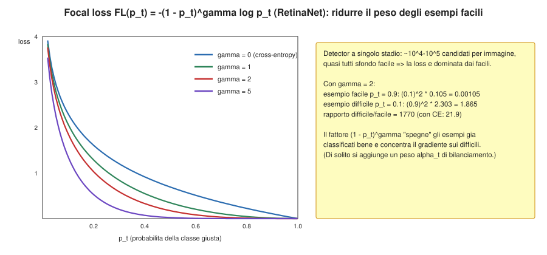

### 10.4 Un esempio di YOLO

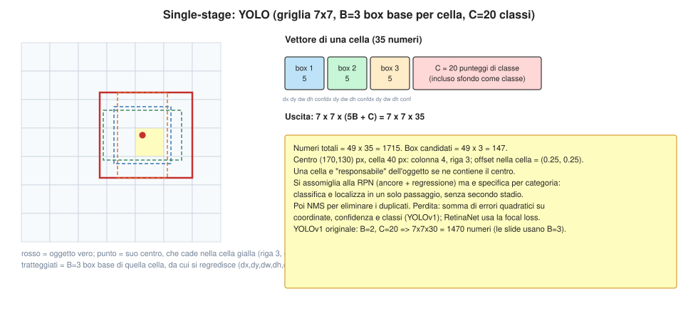

### 10.5 Confronto tra meta-architetture (slide 139)

«Object detection: lots of variables…»: ci sono molte scelte combinabili.
- **Backbone:** VGG16, ResNet-101, Inception V2, V3, Inception-ResNet, MobileNet;
- **Meta-architettura:** *a due stadi* (Faster R-CNN), *a un solo stadio* (YOLO, SSD), *ibrida* (R-FCN);
- **Altro:** dimensione dell'immagine, numero di proposte…

**Conclusioni della slide (Huang et al., CVPR 2017):**
1. **Faster R-CNN è più lento ma più accurato;**
2. **SSD è molto più veloce ma meno accurato;**
3. **backbone più grandi e profondi funzionano meglio.**
**[Aggiunta]** Il compromesso velocità/accuratezza è il tema centrale: si sceglie in base al vincolo (tempo reale su dispositivo mobile → single-stage con MobileNet; massima accuratezza → due stadi con ResNet profondo).

---

## 11. Detection con Transformer: DETR (slide 140–145)

Carion et al., *End-to-End Object Detection with Transformers*, ECCV 2020 (nota 4).

**Idea (slide 140).** Pipeline semplice: **dare in uscita direttamente un insieme di box da un Transformer**; *niente ancore, niente regressione di trasformazioni di box*; si **abbinano i box predetti ai box veri con un matching bipartito** e si addestra a regredire le coordinate.

**Architettura [Aggiunta, dalle figure delle slide 141–145].**
1. Una CNN estrae feature $z\in\mathbb R^{d\times H'\times W'}$, a cui si somma una codifica posizionale (nota 4, sez. 5);
2. un **Transformer encoder** (self-attention, nota 4) contestualizza i $H'W'$ vettori;
3. un **Transformer decoder** riceve **$N_q$ query appresi** (*object queries*) e, tramite self-attention tra query e cross-attention con l'encoder, produce $N_q$ vettori;
4. una piccola FFN per ogni vettore predice **(classe, box)**, dove la classe include «nessun oggetto» ($\varnothing$). $N_q$ è fisso e **maggiore** del massimo numero di oggetti.

**Abbinamento bipartito.** Siano $\{(c_j,b_j)\}_{j=1}^M$ i veri oggetti (completati con $\varnothing$ fino a $N_q$) e $(\hat p_i,\hat b_i)$ le predizioni. Si cerca la permutazione di costo minimo
$$
\hat\sigma=\arg\min_{\sigma}\sum_{j=1}^{M}\Big[-\hat p_{\sigma(j)}(c_j)+\lambda_{L1}\|b_j-\hat b_{\sigma(j)}\|_1+\lambda_{giou}\,\mathcal L_{GIoU}(b_j,\hat b_{\sigma(j)})\Big],
$$
risolta con l'**algoritmo ungherese** in $O(N_q^3)$. La **loss** è poi calcolata sulle coppie abbinate; le predizioni **non abbinate** devono predire $\varnothing$.

**Perché non serve NMS [Aggiunta].** L'abbinamento è **uno-a-uno**: se due query predicono lo stesso cane, solo una è abbinata e l'altra è penalizzata se non dice $\varnothing$; la rete impara a non duplicare.

**Esempio [calcolato].** 4 query, 2 oggetti veri (cane, gatto), costo $C_{ij}=-p_i(c_j)+5\|b_i-g_j\|_1$ (matrice in figura): l'abbinamento ottimo è query 1 → cane, query 2 → gatto, costo $-1.40$; la query 4 (duplicato del cane, costo $-0.0$) viene lasciata a $\varnothing$.

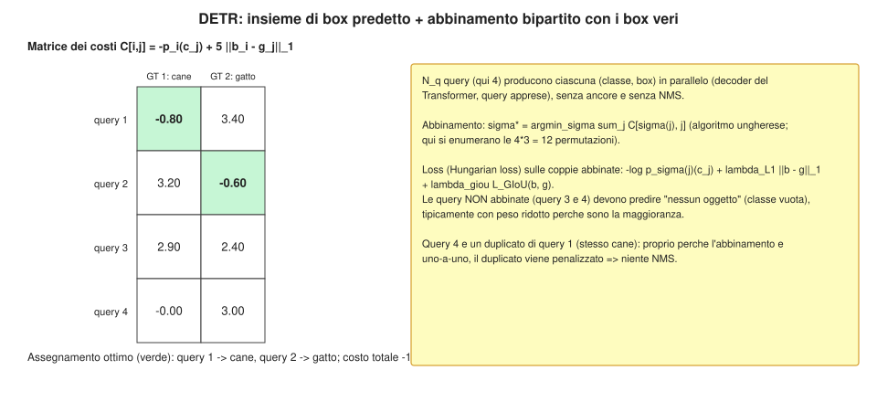

---

## 12. Instance segmentation: Mask R-CNN (slide 146–156)

**Il compito (slide 146).** Combina detection (box per ogni oggetto) e segmentazione (pixel di ogni oggetto).

**Architettura (slide 148–149; He et al., ICCV 2017).** Si parte da Faster R-CNN (slide 147) e si aggiunge **una piccola rete di maschere** che opera su ogni RoI e predice una **maschera binaria $28\times28$** (slide 148):
- backbone CNN + RPN; **RoIAlign**;
- ramo classificazione (punteggi $C$) e ramo box ($4C$ coordinate, per classe);
- **ramo maschera:** $256\times14\times14$ → conv → $256\times14\times14$ → conv trasposta ($2\times$) → $256\times28\times28$ → conv $1\times1$ → **$C\times28\times28$** (una maschera per ciascuna delle $C$ classi).

**Bersagli di addestramento (slide 150–153).** Per ogni proposta positiva si prende la maschera vera, la si **ritaglia** sulla proposta e la si **ridimensiona** a $28\times28$ (le slide ne mostrano 4 esempi). Esempio ridotto [calcolato]: maschera vera $16\times16$, proposta = righe 2–13, colonne 3–13 → ritaglio $12\times11$ → bersaglio $8\times8$.

**Loss della maschera [Aggiunta].** Entropia incrociata binaria per pixel, **solo sul canale della classe vera $k$**:
$$
\mathcal L_{mask}=-\frac1{28^2}\sum_{u,v}\Big[t_{uv}\log\sigma(m^{(k)}_{uv})+(1-t_{uv})\log\big(1-\sigma(m^{(k)}_{uv})\big)\Big],\qquad \mathcal L=\mathcal L_{cls}+\mathcal L_{box}+\mathcal L_{mask}.
$$
Le altre $C-1$ maschere non contribuiscono: la scelta di *cosa* è l'oggetto spetta al ramo di classificazione, *dove* sono i pixel alla maschera (nessuna competizione tra classi, a differenza della softmax per pixel).

**Risultati (slide 154–155).** «Impressive results»: maschere precise per più istanze nella stessa immagine; **estende anche alla stima della posa** (slide 155) con un ramo che predice maschere per i punti chiave (keypoints).

**Framework open source (slide 156).** *TensorFlow Detection API* (Faster R-CNN, SSD, R-FCN, Mask R-CNN), *Caffe2 Detectron* (Mask R-CNN, RetinaNet, Faster/Fast R-CNN, RPN, R-FCN), *DETR* (github facebookresearch/detr): si fa **fine-tuning su un dataset proprio** partendo da modelli pre-addestrati.

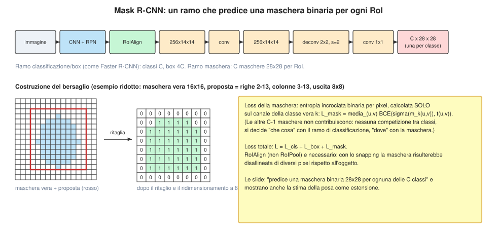

---

## 13. Valutazione della detection (slide 158–161)

Le slide 158–160 sono immagini (grafici/tabelle) senza testo estraibile; la slide 161 riporta: **80 categorie di oggetti, 200 000 immagini, oltre 500 000 annotazioni** (COCO). **[Nota]** Ricostruisco il protocollo standard.

**Un'istanza è un successo se** IoU con un oggetto vero (non già abbinato) $\ge\tau$ e la classe è corretta (TP), altrimenti è un falso positivo (FP); gli oggetti non trovati sono FN.

**Precisione e richiamo** (ordinando le detezioni per confidenza e scorrendo la soglia):
$$
\mathrm{precision}=\frac{\mathrm{TP}}{\mathrm{TP}+\mathrm{FP}},\qquad \mathrm{recall}=\frac{\mathrm{TP}}{\#\text{oggetti veri}}.
$$
**Average Precision.** L'AP è l'**area sotto la curva precisione-richiamo**, con precisione interpolata ($p_{int}(r)=\max_{r'\ge r}p(r')$):
$$
\mathrm{AP}=\sum_k(r_k-r_{k-1})\,p_{int}(r_k),\qquad\mathrm{mAP}=\frac1C\sum_c\mathrm{AP}_c .
$$
**Esempio [calcolato].** 8 detezioni ordinate (TP, TP, FP, TP, FP, FP, TP, FP) su 5 oggetti: precisione $(1,1,0.667,0.75,0.6,0.5,0.571,0.5)$, richiamo $(0.2,0.4,0.4,0.6,0.6,0.6,0.8,0.8)$, interpolata $(1,1,0.75,0.75,0.6,0.571,0.571,0.5)$ ⇒ **AP $=0.664$** (il recall non raggiunge 1: un oggetto non è mai trovato).

**COCO.** L'AP si media su **soglie IoU** $0.50,0.55,\dots,0.95$ (premia la localizzazione precisa) e si riportano anche AP per taglia (piccoli/medi/grandi).

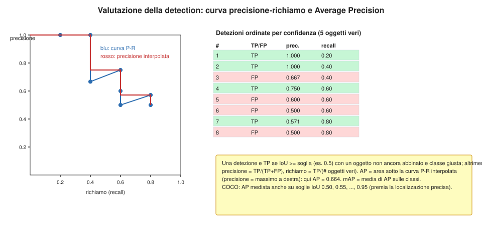

---

## 14. Oltre la detection 2D (slide 163–173)

### 14.1 Dense captioning (slide 163–166)

**Idea.** *Object detection + captioning = dense captioning* (Johnson, Karpathy, Fei-Fei, CVPR 2016, DenseCap): invece di una didascalia per immagine, si **localizzano molte regioni** e per ciascuna si genera una frase (rete convoluzionale di localizzazione + RNN, note 3 e 4). **[Aggiunta]** Una regione si descrive con un vettore e un decoder (RNN o Transformer) genera il testo. *Dense video captioning* (Krishna et al., ICCV 2017, slide 166): lo stesso per **eventi** in un video, con localizzazione temporale.

### 14.2 Scene graph (slide 167–168)

**Oggetti + relazioni = scene graph** (Visual Genome, Krishna et al., IJCV 2017): un grafo i cui nodi sono oggetti (con attributi) e gli archi sono relazioni tipo $\langle\text{soggetto},\text{predicato},\text{oggetto}\rangle$, es. $\langle\text{uomo},\text{cavalca},\text{cavallo}\rangle$. **Predizione di scene graph** (Xu et al., CVPR 2017, *iterative message passing*): si usa un passaggio di messaggi iterativo tra nodi (oggetti) e archi (relazioni) per raffinare le predizioni.

### 14.3 Detection 3D (slide 169–171)

**Modello di camera semplice (slide 170).** Un punto 2D sul piano immagine corrisponde a un **raggio 3D** (dentro il *frustum* della camera). Nel modello a foro stenopeico, per un punto $(X,Y,Z)$ nel riferimento della camera:
$$
u=f\frac XZ+c_x,\qquad v=f\frac YZ+c_y .
$$
Ad esempio $f=500$, $X=1$, $Z=5$ dà $f X/Z=100$ pixel dal centro; **tutti** i punti $(X,Y,Z)\propto(1,\,\cdot,\,5)$ cadono sullo stesso pixel: da un'immagine sola la profondità $Z$ è **ambigua**.

**Detection 3D monoculare (slide 171; Chen et al., CVPR 2016).** Si usa una rete tipo Faster R-CNN che predice un **box 3D** $(x,y,z,w,h,l,\theta)$ (centro, dimensioni, orientamento) sfruttando priors (tipiche dimensioni delle auto, piano della strada) per risolvere l'ambiguità di scala.

### 14.4 Forme 3D (slide 172–173)

**Rappresentazioni (slide 172).**

| Rappresentazione | Forma | Esempio di taglia |
|---|---|---|
| nuvola di punti (*point cloud*) | $V\times3$ float | $2048\times3=6144$ |
| voxel | $D\times D\times D$ binario | $32^3=32\,768$; $128^3=2\,097\,152$ |
| mesh | $V\times3$ float, $F\times3$ int | $V=2562$, $F=5120$ ⇒ $7686+15\,360$ |

Lavori citati: 3D-R2N2 (voxel, Choy 2016), Point Set Generation (nuvola, Fan 2017), Pixel2Mesh (mesh, Wang 2018). **[Aggiunta]** I voxel crescono come $D^3$ (cubica), la nuvola è compatta ma senza connettività, la mesh ha **connettività** (facce) e per una superficie chiusa $F\approx2V$ (formula di Eulero).

**Distanza di Chamfer [Aggiunta].** Per confrontare due nuvole $A,B$:
$$
d_{CD}(A,B)=\frac1{|A|}\sum_{a\in A}\min_{b\in B}\|a-b\|^2+\frac1{|B|}\sum_{b\in B}\min_{a\in A}\|a-b\|^2 .
$$

**Mesh R-CNN (slide 173, Gkioxari et al., ICCV 2019).** Si estende Mask R-CNN con un ramo che predice una **mesh 3D** per ogni oggetto rilevato: prima una forma grossolana in voxel, poi una **mesh raffinata** (rete a grafo).

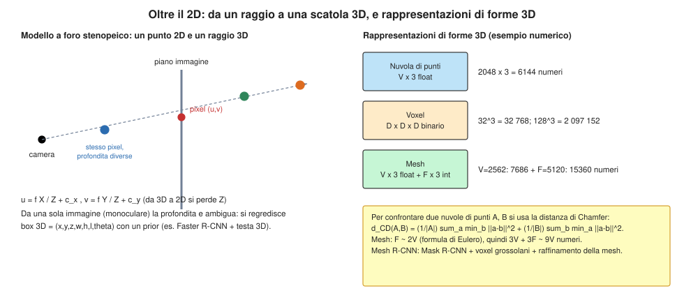

---

## 15. Riepilogo e collegamenti

### 15.1 Formule chiave

| Concetto | Formula |
|---|---|
| Segmentazione per pixel | $\hat y_{h,w}=\arg\max_cS_{c,h,w}$; loss = CE per pixel |
| Conv: uscita | $\lfloor(n+2p-k)/s\rfloor+1$ |
| Conv trasposta: uscita | $(n-1)s-2p+k+p_{out}$ |
| Conv come matrice | $y=Cx$; trasposta: $x'=C^\top y$; backward: $\partial\mathcal L/\partial x=C^\top\partial\mathcal L/\partial y$ |
| Max unpool | $\mathrm{unpool}(x)_{m(i,j)}=x_{i,j}$ |
| U-Net | $d_\ell=\mathrm{Conv}(\mathrm{Conv}([e_\ell;\mathrm{up}(d_{\ell+1})]))$ |
| IoU di classe | $\mathrm{TP}/(\mathrm{TP}+\mathrm{FP}+\mathrm{FN})$ |
| Loss single object | $\mathcal L_{cls}+\lambda\,\mathcal L_{box}$ |
| Bilineare | media pesata dei 4 vicini, pesi $\ge0$ somma 1 |
| Box regression | $t_x=(x-x_a)/w_a$, $t_w=\log(w/w_a)$ |
| IoU box | $|A\cap B|/|A\cup B|$ |
| NMS | greedy, soglia $\tau$ |
| YOLO | uscita $S\times S\times(5B+C)$ |
| Focal | $-(1-p_t)^\gamma\log p_t$ |
| DETR | $\hat\sigma=\arg\min_\sigma\sum_jC(j,\sigma(j))$ (ungherese) |
| Mask R-CNN | $\mathcal L=\mathcal L_{cls}+\mathcal L_{box}+\mathcal L_{mask}$ (BCE per pixel, canale della classe vera) |
| AP | area sotto la curva P-R interpolata |

### 15.2 Quando usare cosa

| Situazione | Scelta | Motivo |
|---|---|---|
| Etichetta per pixel, immagini mediche con pochi dati | U-Net | skip + decoder, pochi dati |
| Massima accuratezza di detection | Faster R-CNN (due stadi) | secondo stadio raffina |
| Tempo reale / dispositivi mobili | YOLO / SSD con backbone leggero | un solo passaggio |
| Molti sfondi facili, sbilanciamento | focal loss (RetinaNet) | attenua i facili |
| Serve la maschera per oggetto | Mask R-CNN (RoIAlign) | ramo maschera allineato |
| Evitare ancore e NMS | DETR | matching uno-a-uno |
| Una sola immagine, scena 3D | detection 3D monoculare con priors | profondità ambigua |

### 15.3 Come si collega tutto

```
Classificazione ──► + localizzazione (regressione 4 numeri)
        │                    │ uscita variabile?
        ▼                    ▼
Segmentazione        proposte di regioni ──► R-CNN (2000 CNN)
(FCN, upsampling,            │                 │ scambia conv e crop
  U-Net)                     ▼                 ▼
        │              Fast R-CNN (RoI Pool → RoI Align)
        │                    │ proposte lente
        │                    ▼
        │              Faster R-CNN (RPN, due stadi)
        │                    │ serve il 2° stadio?       │ + ramo maschera
        │                    ▼                           ▼
        │              YOLO / SSD / RetinaNet       Mask R-CNN
        │                    │ niente ancore/NMS?
        │                    ▼
        └─────────────► DETR (Transformer, matching bipartito)
```

### 15.4 File generati

- `nota5_detection_segmentation.md` — questa nota.
- `genera_figure_detection_segmentation.py` — script con **tutto** il codice delle figure (17 SVG); eseguendolo si riscrivono gli `.svg` nella stessa cartella e si stampano i numeri calcolati (unpooling, conv trasposta, metriche, IoU/NMS, RoI, ancore, YOLO, matching, AP, ecc.). Richiede solo `numpy`.
- `fig_*.svg` — le figure referenziate nel testo.
