## 11. Doddington Zoo (e Biometric Menagerie)

### 11.0 Idea di fondo

Un sistema biometrico non è "ugualmente bravo" con tutti gli utenti: tipicamente gli errori sono **concentrati su pochi individui**. Doddington (riconoscimento vocale) ha classificato gli utenti in base al comportamento medio dei loro score, collegando ogni tipologia di utente a 4 animali; Yager e Dunstone hanno poi esteso la classificazione con quattro nuovi animali, basati sul piano (media genuini, media impostori).

> **Convenzione.** Gli score $s$ sono **similarità**: più alto = più simile, si accetta se $s>t$. Con le distanze (come in §9–10) tutte le disuguaglianze si invertono.

### 11.1 Definizioni formali

Sia $s(j,k)$ lo score del probe $j$ confrontato con il template $k$ (matrice della §9). Per ogni utente $k$:

$$
G_k=\{\,s(k,k)\,\} \qquad
I_k^{\mathrm{vit}}=\{\,s(j,k)\,\}_{j\neq k} \qquad
I_k^{\mathrm{att}}=\{\,s(k,j)\,\}_{j\neq k}
$$

$$
I_k = I_k^{\mathrm{vit}}\cup I_k^{\mathrm{att}}
$$

- $G_k$ = score **genuini** di $k$ (diagonale);
- $I_k^{\mathrm{vit}}$ = score ottenuti dagli altri quando **attaccano $k$** (colonna: $k$ è la *vittima*);
- $I_k^{\mathrm{att}}$ = score ottenuti da $k$ quando **attacca gli altri** (riga: $k$ è l'*attaccante*).

**Dove si leggono goat, lamb e wolf.** In questa matrice di similarità (dati simulati con seed fisso) una *goat* è una cella della diagonale più bassa delle altre; un *lamb* è una colonna alta (tanti utenti ottengono score elevati contro il suo template); un *wolf* è una riga alta (il suo probe ottiene score elevati contro molti template). Colonna = vittima, riga = attaccante.

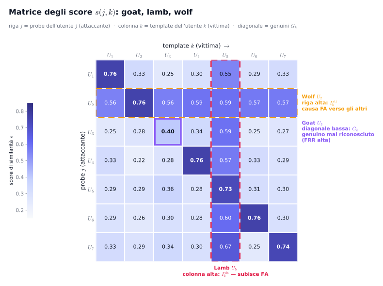

Per ogni utente si calcolano medie e deviazioni standard, e si confrontano con quelle della popolazione ($\mu_G,\sigma_G,\mu_I,\sigma_I$):

$$
\mu_G(k)=\mathbb{E}[G_k],\quad \mu_I(k)=\mathbb{E}[I_k],\quad
z_G(k)=\frac{\mu_G(k)-\mu_G}{\sigma_G},\quad
z_I(k)=\frac{\mu_I(k)-\mu_I}{\sigma_I}
$$

Un utente è "anomalo" quando $|z|$ supera una soglia $\tau$ (tipicamente un percentile, es. 5–10% estremo).

### 11.2 Il piano $(\mu_G,\ \mu_I)$ — Yager e Dunstone

Ogni utente è un punto $(\mu_G(k),\mu_I(k))$ nel piano; le medie di popolazione dividono il piano in quattro quadranti.

**Il piano $(\mu_G,\mu_I)$.** Ogni punto è un utente (dati simulati). Le due medie di popolazione dividono il piano in quattro quadranti: doves in basso a destra, chameleons in alto a destra, phantoms in basso a sinistra, worms in alto a sinistra; le sheep stanno vicino al centro.

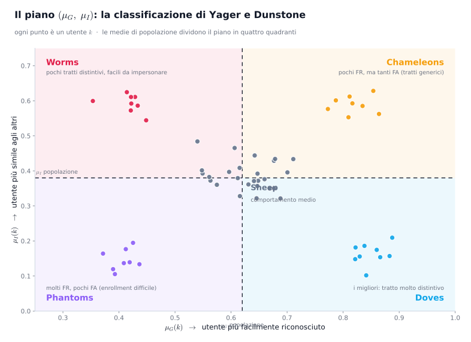

| Categoria | $\mu_G(k)$ | $\mu_I(k)$ | Condizione | Effetto |
|---|---|---|---|---|
| **Doves** (colombe) | alto | basso | $z_G>\tau,\ z_I<-\tau$ | I migliori: tratto molto distintivo, raramente causano errori |
| **Chameleons** | alto | alto | $z_G>\tau,\ z_I>\tau$ | Raramente causano FR, ma facilmente causano FA (tratti generici) |
| **Phantoms** | basso | basso | $z_G<-\tau,\ z_I<-\tau$ | Causano FR, raramente FA (difficoltà di enrollment/estrazione feature) |
| **Worms** (vermi) | basso | alto | $z_G<-\tau,\ z_I>\tau$ | I peggiori: pochi tratti distintivi, facili da impersonare |
| **Sheep** (pecore) | ≈ media | ≈ media | $\lvert z\rvert\le\tau$ | Comportamento normale/buono: la maggioranza della popolazione |

### 11.3 Gli animali di Doddington basati sull'asimmetria

Questi tre animali non guardano solo $\mu_I$ complessivo, ma **quale parte** di $I_k$ è anomala:

| Categoria | Parte anomala | Condizione | Effetto |
|---|---|---|---|
| **Goats** (capre) | $G_k$ (diagonale) | $z_G(k)<-\tau$ | $FRR$ più alta della media: sono mal riconosciuti |
| **Lambs** (agnelli) | $I_k^{\mathrm{vit}}$ (colonna) | $\mu(I_k^{\mathrm{vit}})$ alto | Facilmente impersonabili → più $FA$ **contro di loro** |
| **Wolves** (lupi) | $I_k^{\mathrm{att}}$ (riga) | $\mu(I_k^{\mathrm{att}})$ alto | Bravi a impersonare → causano $FA$ **verso gli altri** |

> Doddington descrive quattro categorie: **sheep** (la maggioranza, comportamento normale), **goats**, **lambs** e **wolves**. Le sheep sono il riferimento rispetto al quale le altre tre risultano anomale.

Perché la distinzione è importante: un agnello è una **vittima** (la colonna $k$ della matrice è chiara), un lupo è un **attaccante** (la riga $k$ è chiara). Lo stesso utente può essere entrambe le cose, o nessuna delle due.

### 11.4 Impatto sulle prestazioni

Per una soglia $t$, gli errori *per utente* sono (accettazione se $s>t$):

$$
FRR_k(t)=P\big(s\le t \mid s\in G_k\big)\qquad
FAR_k(t)=P\big(s> t \mid s\in I_k\big)
$$

Sotto un'approssimazione gaussiana $G_k\sim\mathcal N(\mu_G(k),\sigma^2)$, $I_k\sim\mathcal N(\mu_I(k),\sigma^2)$:

$$
FRR_k(t)=\Phi\!\left(\frac{t-\mu_G(k)}{\sigma}\right) \qquad
FAR_k(t)=1-\Phi\!\left(\frac{t-\mu_I(k)}{\sigma}\right)
$$

dove $\Phi$ è la CDF della normale standard. La separabilità dell'utente è sintetizzata da

$$
d'_k=\frac{\mu_G(k)-\mu_I(k)}{\sigma}
$$

e le prestazioni **globali** sono la media pesata di quelle individuali:

$$
FRR(t)=\frac{1}{N}\sum_{k}FRR_k(t),\qquad
FAR(t)=\frac{1}{N}\sum_{k}FAR_k(t)
$$

Questo è il punto chiave: un **piccolo numero di utenti** (capre, vermi, camaleonti) può dominare gli errori medi.

**Le stesse $t$ e $\sigma$, otto utenti diversi.** Le aree colorate sono gli errori per utente: arancione = FR (genuini sotto soglia), rosso = FA (impostori sopra soglia). I valori di $FRR_k$ e $FAR_k$ sono calcolati dal codice e coincidono con la tabella del testo. Lambs e wolves hanno gli stessi numeri: cambia solo da quale lato della matrice li si osserva.

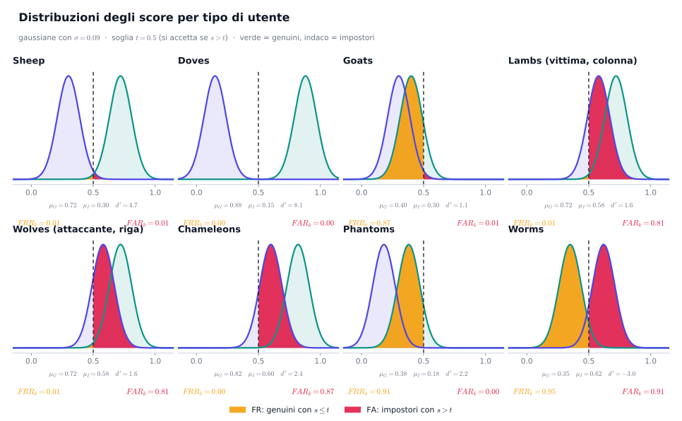

Esempio con $t=0.5$, $\sigma=0.09$ e valori illustrativi:

| Animale | $\mu_G$ | $\mu_I$ | $d'$ | $FRR_k$ | $FAR_k$ | Lettura |
|---|---|---|---|---|---|---|
| Sheep | 0.72 | 0.30 | 4.7 | 0.01 | 0.01 | tutto nella norma |
| Doves | 0.88 | 0.15 | 8.1 | ≈ 0 | ≈ 0 | quasi nessun errore |
| Goats | 0.40 | 0.30 | 1.1 | **0.87** | 0.01 | molti FR, FA normali |
| Lambs | 0.72 | 0.58 (vittima) | 1.6 | 0.01 | **0.81** | molti FA *contro* di loro |
| Wolves | 0.72 | 0.58 (attaccante) | 1.6 | 0.01 | **0.81** | causano FA verso gli altri |
| Chameleons | 0.82 | 0.60 | 2.4 | ≈ 0 | **0.87** | niente FR, ma tanti FA |
| Phantoms | 0.38 | 0.18 | 2.2 | **0.91** | ≈ 0 | tutti i genuini respinti, nessun FA |
| Worms | 0.35 | 0.62 | −3.0 | **0.95** | **0.91** | falliscono su entrambi i fronti |

> Nota: i valori di $FAR_k$ per Lambs e Wolves sono *per interazione*: il lamb subisce gli attacchi, il wolf li produce. Nel conteggio globale i due contribuiscono alla stessa cella della matrice, ma si individuano guardando **colonna** vs **riga**.

### 11.5 Cosa cambia in pratica

- **Aggiungere la soglia non risolve il problema**: abbassare $t$ aiuta capre e phantoms (meno FR) ma peggiora lambs, wolves e chameleons (più FA).
- **Gli animali "peggiori" sono pochi ma pesano molto**: per questo si riportano anche le prestazioni per utente (o percentili), non solo la media.
- **Rimedi tipici**: normalizzazione degli score *per utente* (z-norm, t-norm), soglie utente-specifiche, enrollment multiplo (più template → meno capre), fusione multimodale.

**Prima e dopo la z-norm.** Con una soglia globale l'agnello subisce molti più FA della colomba; dopo $z=(s-\mu_I(k))/\sigma_I(k)$ le distribuzioni impostori coincidono e ogni utente ha lo stesso $FAR_k$. Anche i genuini si spostano, quindi la soglia va ritarata sul nuovo asse.

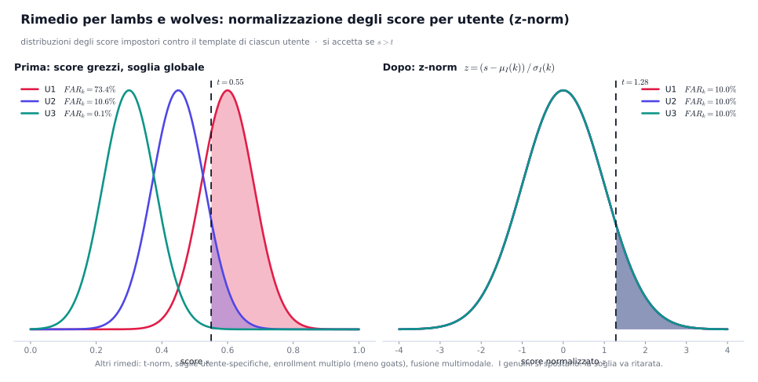
  
---

## 12. Decidability Value

Misura alternativa (usata nelle competizioni di iris recognition) che riassume **in un solo numero** quanto sono separate le distribuzioni dei genuini e degli impostori, senza fissare una soglia.

Si costruiscono due insiemi di distanze: **D^I** (intra-class, stesso soggetto) e **D^E** (inter-class, soggetti diversi). La formula standard (Daugman) è

$$
d' = \frac{\left|\overline{D^E} - \overline{D^I}\right|}{\sqrt{\dfrac{\sigma_I^2 + \sigma_E^2}{2}}}
$$

dove $\overline{D^I},\overline{D^E}$ sono le medie e $\sigma_I,\sigma_E$ le deviazioni standard dei due insiemi: al denominatore c'è la **media quadratica** delle due deviazioni, non una deviazione standard generica. Si legge come "distanza tra le medie, misurata in unità di deviazione standard".

**Come leggere la figura.** Le tre righe hanno le stesse $\sigma$ e medie sempre più lontane ($d' = 1.5, 3, 5$). Le aree arancione (FR) e rossa (FA) sono gli errori alla soglia dell'EER (il punto medio tra le due medie). Quando le due distribuzioni sono gaussiane con la stessa $\sigma$, l'EER dipende **solo** da $d'$:

$$
EER = \Phi\!\left(-\frac{d'}{2}\right)
$$

dove $\Phi$ è la CDF della normale standard. A destra la curva mostra quanto velocemente l'EER scende al crescere di $d'$: nella zona $d'\approx 3\text{–}6$ servono circa due unità in più di $d'$ per abbassare l'EER di un ordine di grandezza (da 6.7% a 0.6% passando da $d'=3$ a $d'=5$).

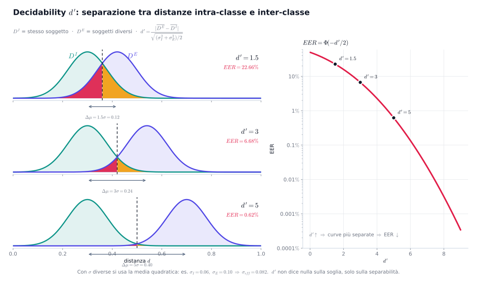

Punti da notare:

- **$d'$ non contiene la soglia**: dice quanto il sistema *potrebbe* separare, non dove lo si fa funzionare. Due sistemi con lo stesso $d'$ possono avere ROC diverse se le distribuzioni non sono gaussiane o hanno $\sigma$ molto diverse.
- **$d'$ negativo**: con le **similarità**, se gli impostori ottengono score *più alti* dei genuini (es. i *worms* del §11.4, con $d'=-3.0$) la differenza delle medie cambia segno. Nella formula di Daugman si usa il valore assoluto, quindi il segno va controllato a parte: un $d'$ firmato negativo significa che il sistema sta funzionando "al contrario" per quell'utente.
- **Con gli utenti**: $d'_k$ per singolo utente (§11.4) permette di individuare gli utenti difficili; $d'$ globale è la loro sintesi.

---

## 13. Reliability of an Identification System (SRR)

La **reliability** di una singola risposta è diversa dall'accuratezza globale del sistema (FAR/FRR/CMS): riguarda **quanto ci si può fidare di una specifica decisione**. C'è una differenza di fondo tra una **misura di qualità del campione in ingresso** (si calcola prima del riconoscimento, sull'immagine) e una **misura di reliability della risposta** del sistema (si calcola dopo, sulla lista ordinata dei candidati). Un sistema può avere un EER ottimo e, ciononostante, restituire per una certa probe una risposta fragile.

### 13.1 Catena logica
1. Valutare la **qualità della probe** prima del riconoscimento (pre-processing).
2. Eseguire il riconoscimento.
3. Valutare la **reliability della risposta** dopo il riconoscimento.

### 13.2 Misure di qualità dell'immagine (esempio volto)

Una misura di qualità dei campioni di input permette di **scartare a priori** (prima del riconoscimento) quelli affetti da distorsioni troppo elevate, che porterebbero a una risposta sbagliata o non affidabile.

- **SP (Score Pose):**
$$
SP = \alpha\cdot(1-\text{roll}) + \beta\cdot(1-\text{yaw}) + \gamma\cdot(1-\text{pitch})
$$
  - **Roll** = rotazione attorno all'asse x (facile da correggere: angolo tra i centri degli occhi).
  - **Yaw** = rotazione attorno all'asse z (si perde parte del volto; corregibile solo se moderato, tramite simmetria dₗ vs dᵣ).
  - **Pitch** = rotazione attorno all'asse y (difficile da correggere, basata sul rapporto tra distanza occhi-naso e naso-mento).

- **SI (omogeneità dei livelli di grigio):**
$$
SI = 1 - F(\text{std}(mc))
$$

- **SY (simmetria del volto):**
$$
SY = \sum_{(i,j)\in X} sym(P_i, P_j)
$$

Nelle slide compaiono nei grafici altre due misure: **UIQI** (Universal Image Quality Index) e **SE**; la loro definizione non è riportata nelle slide fornite.

#### Come misurare la «qualità» di una misura di qualità

Servono almeno due test.

**Test 1 — distribuzione dei valori.** Si controlla come sono distribuiti, rispetto ai valori restituiti dalla misura, i campioni di un dataset. Questo permette di capire **qual è il livello medio di qualità di un dataset di volti rispetto a quella specifica misura**. Due o più misure si confrontano calcolando la **correlazione** dei valori che restituiscono sulle stesse immagini del dataset.

Dalle slide (FERET/fa, LFW, SCface) si leggono comportamenti molto diversi: SP concentrata su valori alti (circa 0.7–0.95), SI molto più larga, SY su valori bassi, SE vicinissima a zero, UIQI che restituisce **sempre lo stesso valore (0.5)**. Un valore costante non discrimina nulla e la sua correlazione con altre misure non è nemmeno definita. La figura qui sotto ricostruisce questo tipo di analisi su **dati simulati** (la forma è quella delle slide, i numeri non sono quelli originali): a sinistra le distribuzioni per dataset, a destra la matrice di correlazione tra le misure (due misure molto correlate portano la stessa informazione).

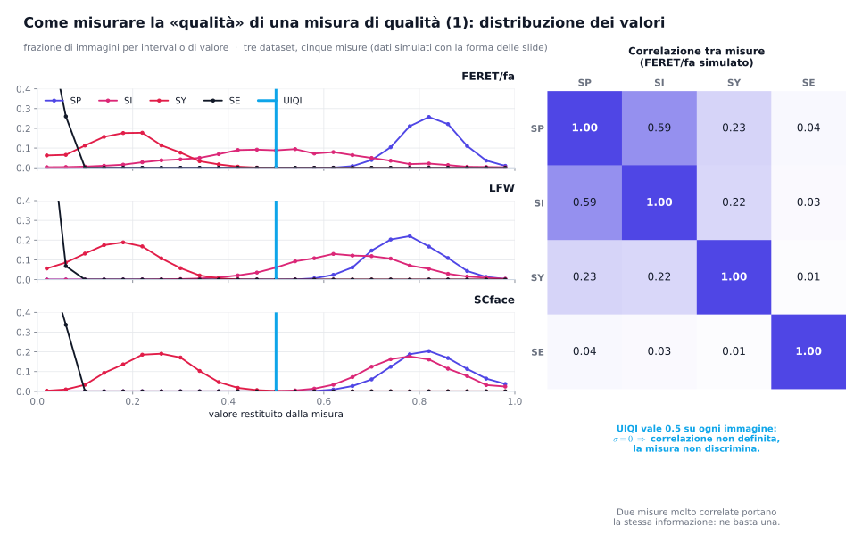

**Test 2 — effetto sulle prestazioni (EER) al variare della soglia di tolleranza.** Si fissa una soglia sul valore della misura, si scartano i campioni sotto soglia e si misura quanto cala l'EER, tenendo sott'occhio anche il **tasso di immagini adeguate** (quante ne restano). Una buona misura di qualità deve **ridurre l'EER scartando il minor numero possibile di campioni** (bilanciare accuratezza e throughput del sistema).

Dalle annotazioni delle slide si leggono, in modo approssimato, EER di partenza molto diversi per dataset (circa 0.14 su FERET/fa, 0.33 su LFW, 0.19 su SCface) che scendono, con le soglie più severe, a circa 0.07–0.10, 0.27–0.31 e 0.15–0.18. Nella figura simulata il pannello A è nel formato delle slide (tasso di immagini adeguate al variare della soglia); il pannello B mette in relazione EER e campioni scartati: la misura con la curva più ripida è quella che «vede» la qualità che conta davvero. Con pochi campioni rimasti l'EER è stimato su insiemi piccoli e va letto con cautela.

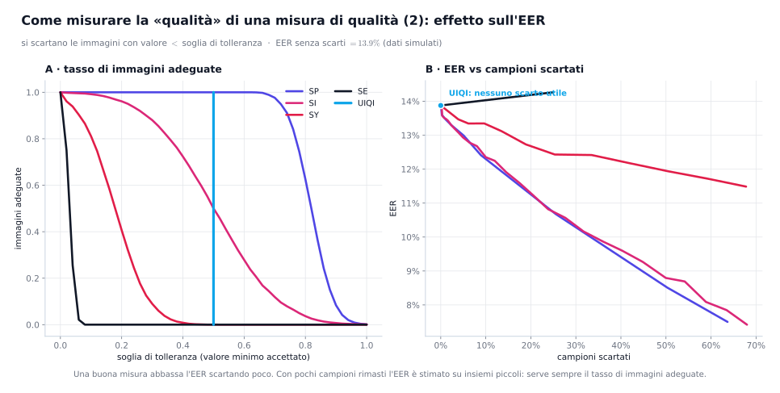

**Compromesso errore/scarti.** Si ordinano i campioni dal peggiore al migliore secondo la misura, si scarta una frazione $f$ dei peggiori e si ricalcola l'EER sui rimanenti: è la curva *error vs reject*. Nell'esempio simulato lo score dei genuini cresce con la qualità vera $q$ (pannello A, gli impostori ne sono indipendenti). Nel pannello B tre misure a confronto: la **misura ideale** (conosce $q$) riduce l'EER molto più in fretta, una **misura mediocre** (qualità vera + rumore) migliora ma molto meno, lo **scarto casuale** lascia l'EER invariato e serve solo a ridurre il numero di campioni. Una misura che scarta il 20% dei campioni senza abbassare l'EER è inutile e danneggia il throughput.

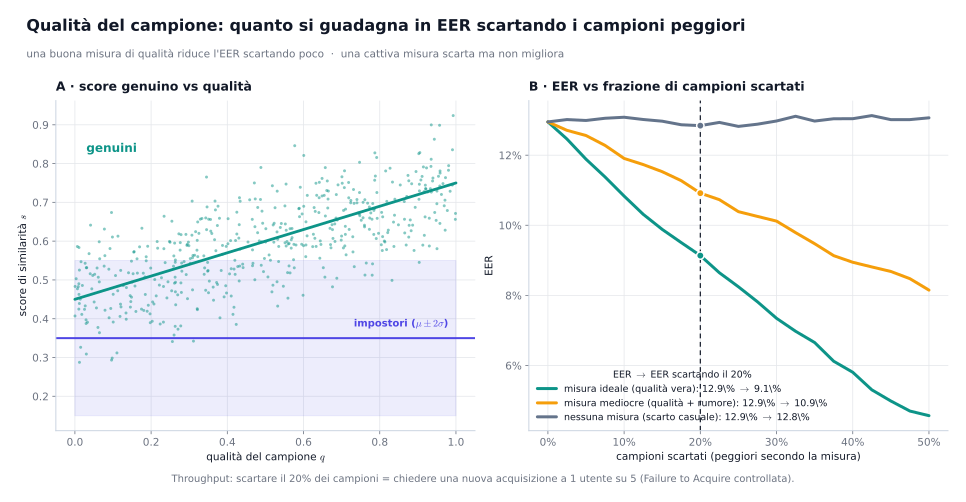

### 13.3 Margini basati sulla stima dell'errore (Poh e Bengio, 2004)

Un approccio diverso non guarda l'immagine ma il **punteggio** del sistema. Le prestazioni sono misurate con

$$
FAR(\Delta) = \frac{\text{n. di FA}(\Delta)}{\text{n. di accessi impostore}} \qquad
FRR(\Delta) = \frac{\text{n. di FR}(\Delta)}{\text{n. di accessi client}}
$$

e il **margine** è definito come

$$
\mathcal{M}(\Delta) = \left|\,FAR(\Delta) - FRR(\Delta)\,\right|
$$

**Come leggere la figura.** In A, FAR(Δ) (tratteggiata rossa) vale 1 per soglie molto basse e scende a 0; FRR(Δ) (blu) fa il contrario; si incrociano all'EER. In B il margine è **0 proprio all'EER** e cresce verso 1 allontanandosi da quel punto, dove un solo errore domina. Interpretazione (il margine è usato come misura di *confidenza*): dove il margine è piccolo FAR e FRR sono confrontabili, quindi la decisione è incerta; dove è grande il verdetto è più netto e affidabile. Qui i dati sono gaussiani e ricostruiti sulla scala delle slide.

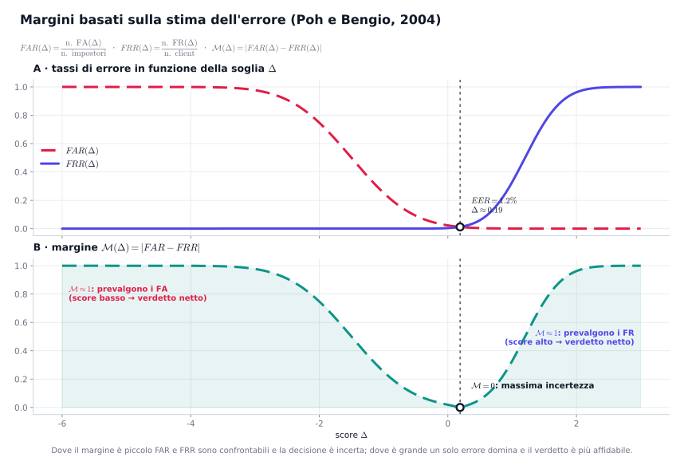

### 13.4 System Response Reliability (SRR)

L'indice **srr** misura la capacità di un sistema di identificazione di separare genuini da impostori **su base di singola probe**. Si appoggia su una funzione $\varphi$, di cui sono state definite e testate due versioni: la **Relative Distance** e il **Density Ratio**. Entrambe misurano la quantità di «confusione» tra i possibili candidati. Si assume che il risultato di un'identificazione sia **l'intera gallery ordinata per distanza dalla probe, o almeno una short list**.

> **Nota sull'intervallo.** Le slide scrivono $srr\in[0,1]$, ma con la formula finale riportata più sotto l'indice, così com'è scritto, vale $-1$ per $\varphi=0$, $0$ per $\varphi=\bar\varphi$ e $+1$ per $\varphi=1$ (con $SRR>0$ per le risposte ritenute affidabili). Se serve un indice in $[0,1]$ basta riscalarlo con $(SRR+1)/2$. Qui si usa la forma delle slide.

**Idea: la nuvola attorno al soggetto restituito.** Nuvola «poco affollata» = risposta più affidabile; nuvola «molto affollata» = risposta meno affidabile.

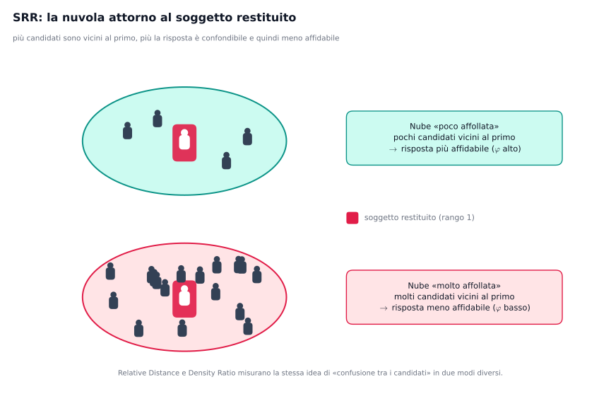

#### Relative Distance

Data una probe $p$ e un sistema $A$ con gallery $G$, la **Relative Distance** è

$$
\varphi(p) = \frac{F\big(d(p,g_{i_2})\big) - F\big(d(p,g_{i_1})\big)}{F\big(d(p,g_{i_{|G|}})\big)}
$$

dove $F$ è la funzione (di normalizzazione) applicata alle distanze, che le slide non specificano qui.

- Numeratore: differenza tra la prima e la seconda distanza (quanto sono vicini i primi due candidati).
- Denominatore: distanza massima calcolata con la probe (l'ultimo della lista, o della short list).
- **Più basso è il numeratore rispetto al denominatore, maggiore è la possibile confusione tra i primi due candidati, minore è l'affidabilità.**

**Esempio delle slide.** Distanze dei primi candidati $0.15,\ 0.25,\ 0.28,\ 0.45$: numeratore $0.25-0.15=0.10$, denominatore $0.45$, quindi $\varphi = 0.10/0.45 \approx 0.22$ (bassa: i primi due sono vicini rispetto alla scala della lista).

#### Density Ratio

$$
\varphi(p) = 1 - \frac{|N_b|}{|G|}, \qquad N_b = \{g_{i_k} \in G \mid F(d(p,g_{i_k})) < 2\cdot F(d(p,g_{i_1}))\}
$$

Conta quanti template hanno distanza dalla probe inferiore al doppio della prima distanza (nube di candidati «vicini» al primo). **Nube meno affollata → maggiore affidabilità → $\varphi$ più alto è meglio.**

> **Convenzione delle slide.** Sia $|N_b|$ sia $|G|$ si calcolano **senza considerare l'elemento in prima posizione**, per avere un valore massimo pari a 1 (ma non è strettamente necessario).

**Esempio delle slide.** Distanze $0.15,\ 0.25,\ 0.31,\ 0.45$: $2\times0.15=0.30$; l'unico altro candidato sotto $0.30$ è $0.25$, quindi $|N_b|=1$ su $|G|=3$ (primo escluso) e $\varphi = 1-\tfrac13 \approx 0.66$. Con il primo incluso si avrebbe $1-\tfrac24 = 0.5$.

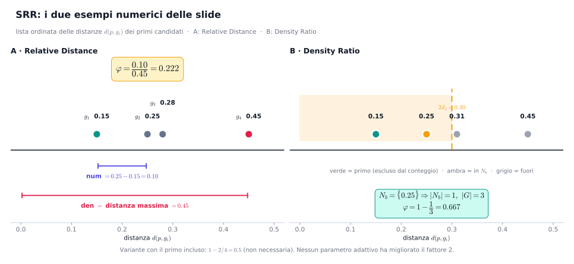

**Relative Distance o Density Ratio?** Il Density Ratio è **meno sensibile agli outlier** e di solito funziona meglio della Relative Distance: quest'ultima guarda solo i primi due candidati, quindi basta un secondo candidato molto vicino al primo (o un solo outlier lontano che gonfia il denominatore) per falsarla. Contropartita del Density Ratio: la sua definizione porta a considerare **nuvole più strette quando la prima identità recuperata è più vicina alla probe**; viceversa, una distanza grande porta a una nuvola più ampia, che ci si aspetta comunque più affollata. Sostituire il fattore 2 con un parametro adattivo non ha dato risultati migliori.

La figura seguente mostra due probe con la stessa gallery di 40 template (dati simulati): la probe A ha il primo candidato isolato, la B una nube di 12 candidati poco più lontani. Per B la Relative Distance è quasi nulla (i primi due sono vicinissimi) e il Density Ratio la penalizza per l'intera nube.

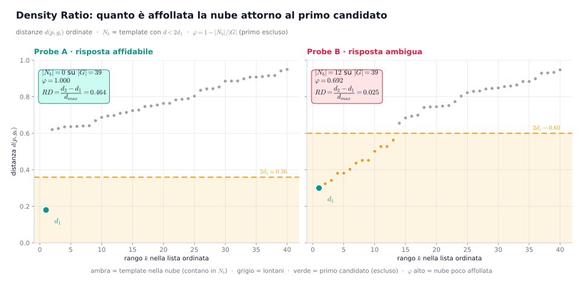

#### Valore critico $\varphi_k$

Serve un valore che favorisca una corretta separazione tra **false esclusioni di soggetti iscritti** e **riconoscimenti sbagliati di non iscritti**, entrambi sostenuti dal valore di reliability.

Il valore critico $\varphi_k$ è quello che minimizza le stime sbagliate della funzione $\varphi(p)$, cioè: non iscritti riconosciuti per errore (FA, per distanza sotto la soglia di accettazione o similarità sopra) **con $\varphi(p)$ sopra $\varphi_k$**; oppure genuini respinti o non confermati **con $\varphi(p)$ sotto $\varphi_k$**. La distanza tra $\varphi(p)$ e $\varphi_k$ è significativa per l'affidabilità.

**Come leggere la figura (stile delle slide).** In alto, la «reliability di $\varphi(p)$ rispetto alla soglia»: la curva raggiunge un massimo (il $\varphi_k$ ottimo). In basso, $\varphi(p)$ per ciascuna probe: **cerchi rossi = GA**, **quadrati blu = FA**. Quadrati blu **sopra** $\varphi_k$ = FA *confermati* da un valore alto di $\varphi$; cerchi rossi **sotto** $\varphi_k$ = GA *non confermati* per un valore basso di $\varphi$. I dati sono simulati con la forma delle slide (il Density Ratio ha $\varphi_k$ piccolo, la Relative Distance intermedio).

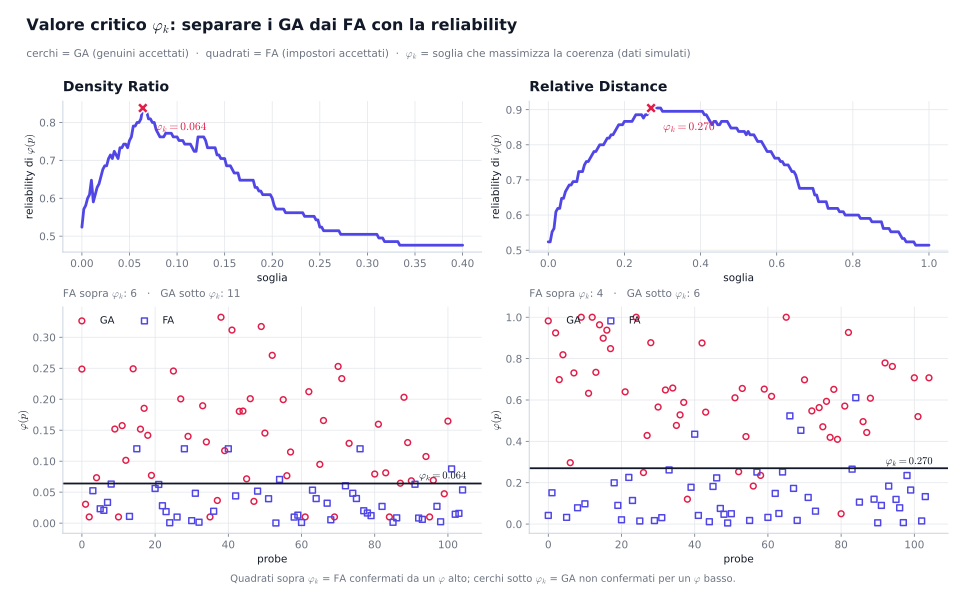

#### Normalizzazione finale (SRR)

Si definisce $S$ come la **larghezza del sottointervallo da $\bar\varphi$ all'estremo opportuno** dell'intervallo $[0,1)$ dei valori possibili, a seconda del confronto tra il $\varphi(p)$ corrente e $\bar\varphi$ (cioè $\varphi_k$):

$$
S(\varphi(p), \bar\varphi) =
\begin{cases}
1 - \bar\varphi & \text{se } \varphi(p) > \bar\varphi \\
\bar\varphi & \text{altrimenti}
\end{cases}
\qquad\qquad
SRR = \frac{\varphi(p) - \bar\varphi}{S(\bar\varphi)}
$$

Nella formula finale delle slide la $S$ è scritta $S(\bar\varphi)$: la dipendenza da $\varphi(p)$ è implicita nel caso scelto. Sopra il valore critico si divide per lo spazio disponibile verso 1, sotto per quello verso 0.

Con **due soglie** finali nel sistema, una per l'accettazione (FAR/FRR) e una per la reliability della risposta, si può **rifiutare un'identificazione anche se formalmente accettata**, se non ritenuta affidabile.

**Come leggere la figura.** A sinistra la funzione $\varphi\mapsto SRR$ con le due probe del grafico precedente ($\bar\varphi = 0.8$): A ($\varphi=1$) ha $SRR=+1$, B ($\varphi\approx0.69$) ha $SRR\approx-0.13$. A destra il piano delle due decisioni: asse $x$ = distanza del primo candidato (si accetta se $d_1\le t$), asse $y$ = SRR. Tre zone: **accettato e affidabile** (output), **accettato ma non affidabile** (rifiutato dalla reliability), **rifiutato dalla soglia**. La probe B supera la soglia di accettazione ma viene bloccata dalla reliability: è il caso che il solo FAR/FRR non sa gestire.

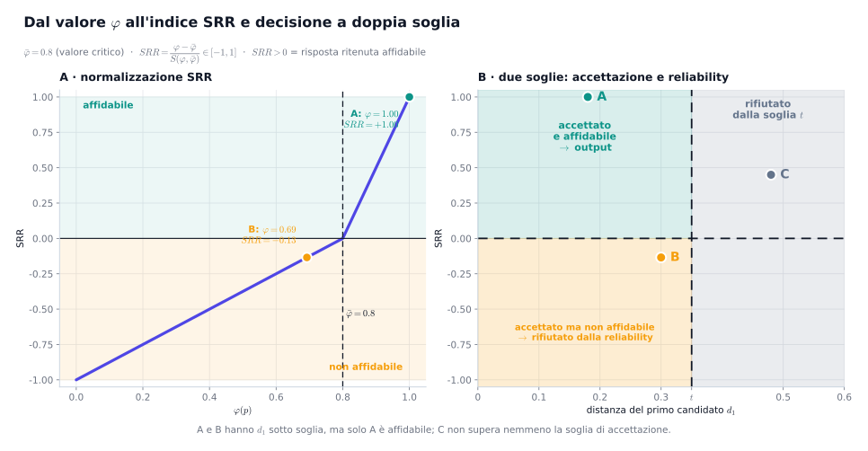

### 13.5 Una soglia per l'SRR: stima automatica (th)

Il **reliability threshold** ($th$) può essere stimato automaticamente sfruttando un certo numero $M$ di osservazioni successive (es. $M$ frame consecutivi di un video, o $M$ acquisizioni ripetute). Si vuole una **media alta** (il sistema è in generale affidabile) e una **varianza bassa** (il sistema è stabile). Per l'i-esimo soggetto/serie di osservazioni $S_i$:

$$
th_i = \left|\frac{E[\overline{S_i}]^2 - \sigma[\overline{S_i}]}{E[\overline{S_i}]}\right|
$$

dove $E[\overline{S_i}]$ è la **media** dei valori di reliability osservati sulle $M$ osservazioni e $\sigma[\overline{S_i}]$ la loro **deviazione standard** (nell'esempio di codice: deviazione standard della popolazione delle $M$ osservazioni).

> La formula coincide con quella delle slide. Si nota che il numeratore mescola una media al quadrato con una deviazione standard (non al quadrato): non è dimensionalmente omogeneo, ma è così che è definita.

> Intuizione: il numeratore penalizza sia una media bassa (poco affidabile) sia un'alta variabilità (poco stabile); dividere per la media normalizza il risultato. La soglia $th_i$ si adatta al comportamento tipico di quel soggetto/sistema, invece di usare un valore fisso globale.

**Come leggere la figura.** Due soggetti con trenta osservazioni ciascuno. Il soggetto **stabile** ha media alta e $\sigma$ piccola: $th$ resta vicina alla media e scarta solo i pochi valori davvero anomali. Il soggetto **instabile** ha media simile ma $\sigma$ molto più grande: $th$ scende, altrimenti quasi metà delle risposte verrebbe giudicata inaffidabile. I punti rossi sono le osservazioni sotto $th$.

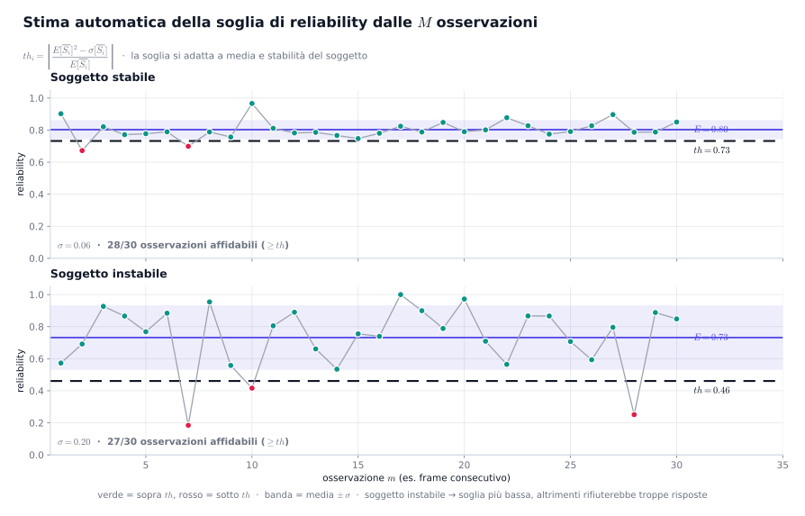

---

## 14. Metrica delle distanze — proprietà formali

Una **metrica** su un insieme X è una funzione `d: X × X → ℝ` che soddisfa, per ogni x, y, z ∈ X:

1. **Non negatività (separazione):** d(x,y) ≥ 0
2. **Identità degli indiscernibili:** d(x,y) = 0 ⟺ x = y
3. **Simmetria:** d(x,y) = d(y,x)
4. **Disuguaglianza triangolare:** d(x,z) ≤ d(x,y) + d(y,z)

Una **semimetrica** soddisfa solo le prime 3 proprietà (non necessariamente la disuguaglianza triangolare) — è il caso tipico delle matrici di distanza biometriche, che sono **simmetriche con diagonale nulla**.

Una misura non simmetrica può essere resa simmetrica calcolando la media nelle due direzioni:
$$
d_{sym}(A,B) = \frac{d(A,B) + d(B,A)}{2}
$$

**Perché interessa la disuguaglianza triangolare.** Se i template stanno in uno spazio metrico, se $x$ è vicino a $y$ e $y$ è vicino a $z$ allora $x$ e $z$ non possono essere lontanissimi: questa garanzia permette di usare strutture di indicizzazione (alberi metrici, pruning) e rende sensate molte analisi sulle matrici di distanza. Le misure di matching reali spesso la violano.

**Come leggere la figura.** Pannello A: con la distanza euclidea il lato $d(x,z)$ è sempre non maggiore della somma degli altri due. Pannello B: con una misura elastica (come la DTW, che allinea le serie temporali "deformandole") può capitare che $x$ e $z$ risultino molto più lontani della somma tramite $y$: la disuguaglianza triangolare è violata e la misura è solo una semimetrica. Pannello C: una misura asimmetrica ($d(A,B)\neq d(B,A)$) viene simmetrizzata con la media, ma ciò non ripristina la disuguaglianza triangolare. In basso il test sulla matrice `M6` del §9, eseguito in codice.

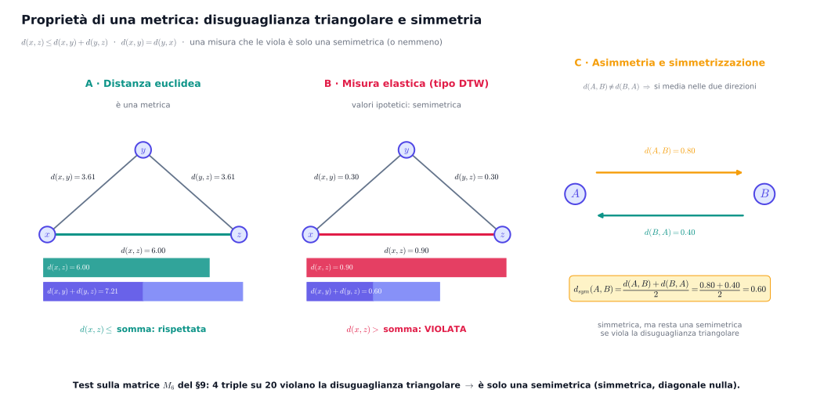

| Misura | Non neg. | Identità | Simmetria | Triang. | Tipo |
|---|---|---|---|---|---|
| Euclidea | sì | sì | sì | sì | metrica |
| Distanza coseno ($1-\cos$) | sì | no (stessa direzione, modulo diverso) | sì | no | semimetrica |
| DTW | sì | no/dipende | sì | no | semimetrica |
| Bhattacharyya | sì | sì | sì | no | semimetrica |
| Divergenza KL | sì | sì | **no** | no | né simmetrica né metrica |

---

## 15. Considerazioni per un confronto affidabile tra sistemi

Per confrontare sistemi in modo equo bisogna considerare:
- Numero e caratteristiche dei dataset usati
- Dimensione delle immagini (risoluzione)
- Dimensione relativa di probe e gallery
- Quantità/qualità delle variazioni tollerate
- Interoperabilità (generalizzazione cross-dataset)

> I dataset pubblici sono stati fondamentali per il progresso della ricerca (misurare e confrontare algoritmi in modo equo), ma rischiano di diventare "mondi chiusi" che restringono la ricerca a battere un singolo numero di benchmark, perdendo di vista lo scopo originale (citando Torralba).

I FoM (**Figures of Merit**: FAR, FRR, EER, ROC, CMS, ecc.) sono misure **ex-post**, legate al dataset/ground truth usato: nel mondo reale il contesto operativo può cambiare (utenti non familiari col sistema, condizioni diverse), quindi la distribuzione degli score può variare.

### 15.1 Un solo numero non basta: due sistemi a confronto

Due sistemi possono avere un'AUC quasi uguale (o una più alta dell'altra) e comportarsi in modo opposto in zone diverse della curva. Nell'esempio il **Sistema A** ha genuini concentrati e impostori larghi; il **Sistema B** ha impostori molto concentrati e genuini molto dispersi. A ha l'AUC più alta, ma le due curve DET si **incrociano** (al FAR ≈ 2.3%):

- a FAR **alto** (applicazioni comode) vince A (FRR più bassa);
- a FAR **basso** (alta sicurezza) vince B, perché i suoi impostori hanno una coda corta.

Il pannello di destra quantifica la differenza con l'FRR a tre valori di FAR fissati. È la regola del §17.1 applicata: *a parità di FAR vince il FRR inferiore*. L'AUC è una sintesi su **tutte** le soglie, anche quelle che non si useranno mai.

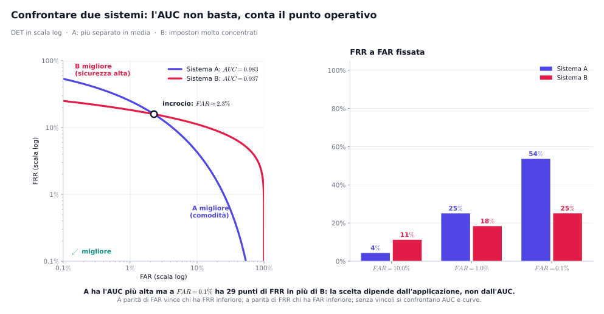

### 15.2 Perché le prestazioni sono "ex-post": il dataset shift

La soglia si sceglie su un insieme di valutazione (offline), ma poi il sistema lavora con utenti nuovi e condizioni diverse. Se la distribuzione degli score cambia, **FAR e FRR cambiano anche a soglia invariata**. Nell'esempio la soglia è scelta all'EER in laboratorio (FAR = FRR = 4.0%); sul campo i genuini hanno medie più basse e code più larghe e gli impostori sono un po' più simili: la stessa soglia produce FAR ≈ 9.4% e FRR ≈ 33.6%. Per questo gli standard distinguono valutazioni *tecnologiche*, *di scenario* e *operative*, e per questo il **template update** (§16) e la ri-calibrazione sul campo sono necessari.

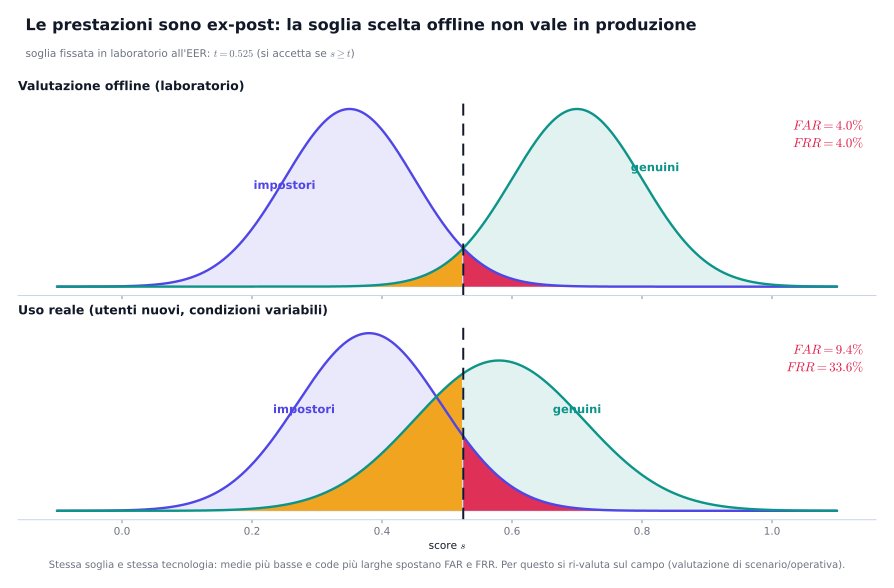

---

## 16. Aggiornamento del template (Template Update)

Per migliorare qualità e affidabilità nel tempo una delle soluzioni è l'aggiornamento dei template.

### 16.1 Che cos'è un template

Le **feature estratte da un sample** di un tratto biometrico, etichettate con l'identità dell'individuo, costituiscono il suo **template**.

- Il matching usa il template, **non il sample**.
- Un template «non dovrebbe permettere di ricostruire» un sample valido.
- La sua dimensione ridotta facilita la codifica e l'archiviazione su più dispositivi.
- **Ogni volta** che l'individuo fornisce un campione biometrico viene generato un template **diverso**.

Durante l'esercizio del sistema diventano disponibili molti più dati biometrici, acquisiti nel tempo: il sistema può usarli per **aggiornare con regolarità i template della gallery**, per affrontare il **template ageing** (il tratto cambia nel tempo) e il **template enhancing** (migliorare i template con più dati).

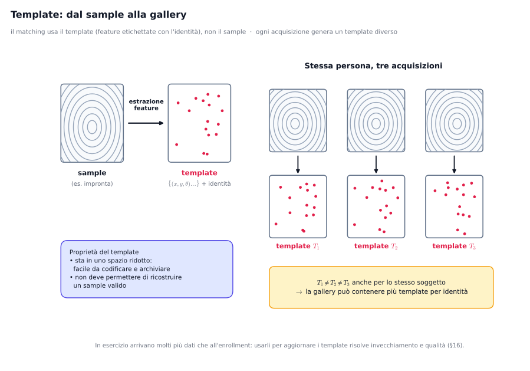

### 16.2 Come si aggiorna: etichette e selezione

Due scelte indipendenti:

- **Assegnazione delle etichette**
  - **Supervised**: serve un supervisore che assegna le identità ai dati acquisiti durante l'esercizio; di solito lavora offline.
  - **Semi-supervised**: usa l'unione di dati etichettati e non etichettati; lavora sia online sia offline (tipicamente con un confronto statistico automatico).
- **Selezione dei template più rappresentativi**
  - **Online**: la selezione avviene appena il sistema acquisisce nuovi dati.
  - **Offline**: la selezione avviene dopo aver raccolto una certa quantità di dati in un certo intervallo di tempo.

Inoltre: si aggiungono nuovi template in gallery quando il riconoscimento è affidabile (mantenendo anche i vecchi, utile contro le intra-class variation), è necessario in caso di **invecchiamento** del tratto, e serve per gestire nuove tecnologie (es. sensori a risoluzione più alta).

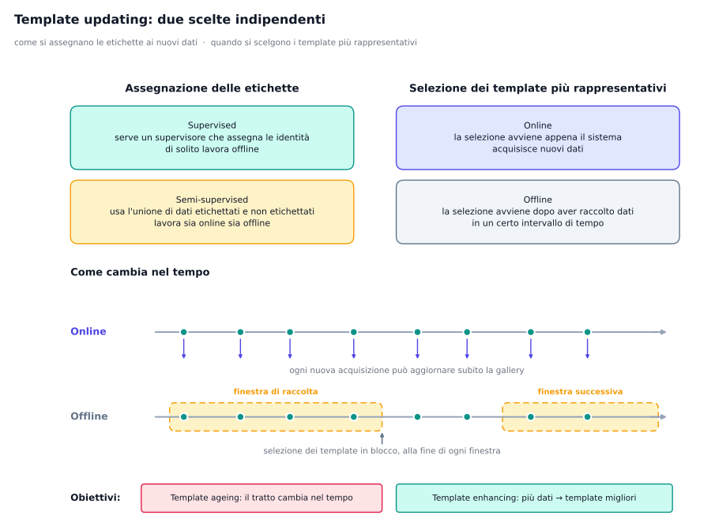

### 16.3 Perché serve: un modello semplice dell'invecchiamento

Si assume che lo score atteso di un genuino diminuisca di 0.05 per ogni sessione di distanza dal template più recente (invecchiamento, cambio di condizioni). Con soglia di accettazione $t=0.55$ e nessun aggiornamento, il FRR sale da pochi punti percentuali a quasi il 100% in dodici sessioni. Tre politiche a confronto, su 3000 utenti simulati:

- **nessun aggiornamento**: lo score medio scende sotto $t$ e il sistema smette di riconoscere l'utente;
- **semi-supervised**: si aggiunge un template solo quando lo score è molto alto (qui $\ge 0.65$): il FRR resta basso ma non nullo, perché chi «scivola» sotto la soglia di update smette di rinnovarsi;
- **supervised**: l'operatore conferma ogni genuino e il template si rinnova sempre.

Il rischio del semi-supervised è l'**avvelenamento della gallery**: un impostore con score sopra la soglia di update verrebbe aggiunto. Per questo la soglia di update è più severa di quella di accettazione e si tengono anche i template vecchi.

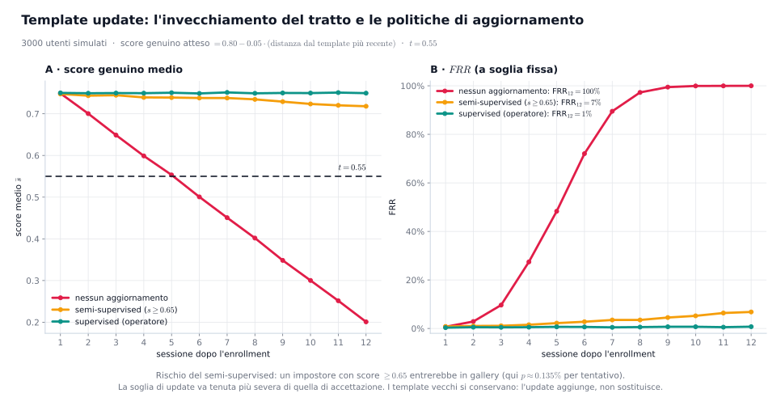