# Performance dei Sistemi Biometrici — Riassunto Completo


---

## 1. Fonti di errore nei sistemi biometrici

### 1.1 Intra-class variation
Variazioni **all'interno della stessa classe** (stessa persona): posa, espressione, occhiali, illuminazione. L'immagine ideale è frontale, con illuminazione omogenea ed espressione neutra.

### 1.2 Inter-class variation (piccola)
Somiglianza **tra soggetti diversi** (es. gemelli, padre/figlio), che può creare confusione soprattutto in certe condizioni (espressione simile, stessa illuminazione).

[Esempio con ]

### 1.3 Acquisizioni rumorose/distorte
Qualità del campione scarsa (es. impronte di lavoratori manuali, pelle secca). Si possono applicare tecniche di normalizzazione dell'illuminazione.

**Normalizzazione dell'illuminazione.** Stesso pattern con illuminazione non uniforme: prima il livello medio cresce da sinistra a destra (due acquisizioni della stessa persona risultano lontane), dopo la normalizzazione resta solo il pattern.

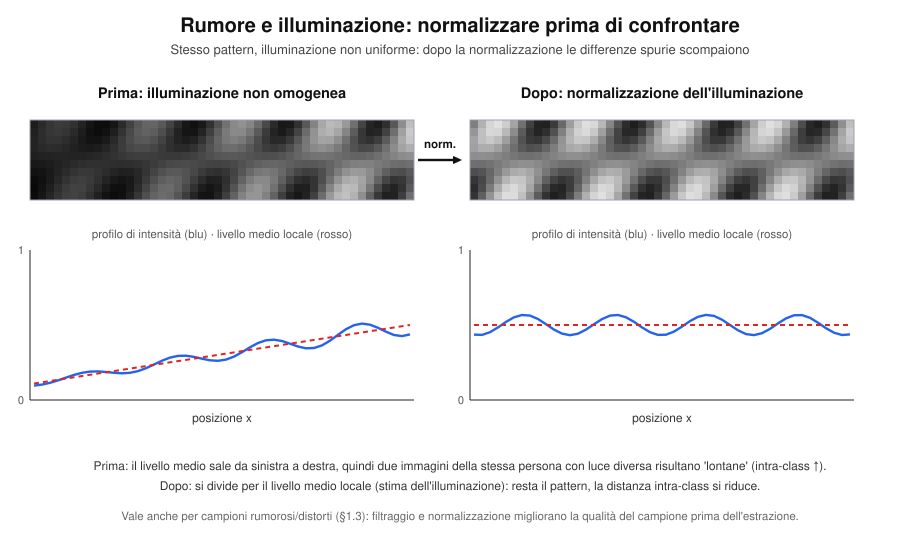


### 1.4 Non universalità
Una parte della popolazione non può essere riconosciuta da un certo tratto (es. ~4% ha impronte di scarsa qualità).

**Da dove nascono gli errori.** A sinistra: persone diverse come cluster nello spazio delle feature; B ha un'alta variazione intra-class, A e C (es. gemelli) sono vicini. A destra: le due distribuzioni delle distanze si sovrappongono, e quella zona è la fonte degli errori una volta fissata la soglia.

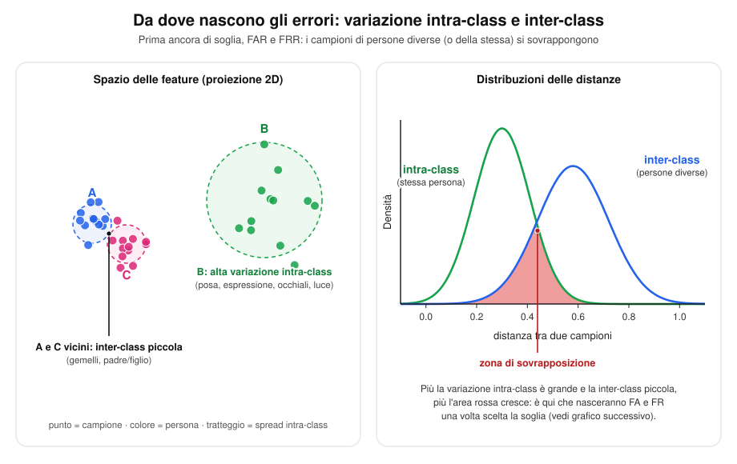

### 1.5 Attacchi di spoofing (architettura del sistema)
Punti di attacco della pipeline **Sensore → Feature Extractor → Matcher → Stored Templates → Application Device**:
1. Biometria falsa al sensore
2. Replay di dati vecchi
3. Override del feature extractor
4. Vettore di feature sintetico iniettato
5. Override del matcher
6. Modifica dei template salvati
7. Intercettazione del canale
8. Override della decisione finale

**Gli 8 punti sulla pipeline.** I colori distinguono presentazione al sensore (1), canali (2, 4, 7), override di moduli (3, 5, 8) e database (6).

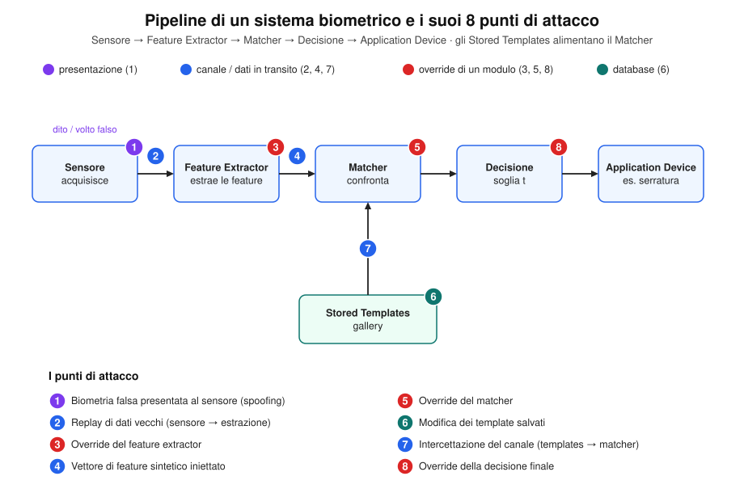


### 1.6 Cosa viene confrontato, e come (tipi di template e misure di similarità)

**Dal sample al template.** Il sample passa dall'estrazione di feature e diventa un template; la forma del template decide la misura di confronto.

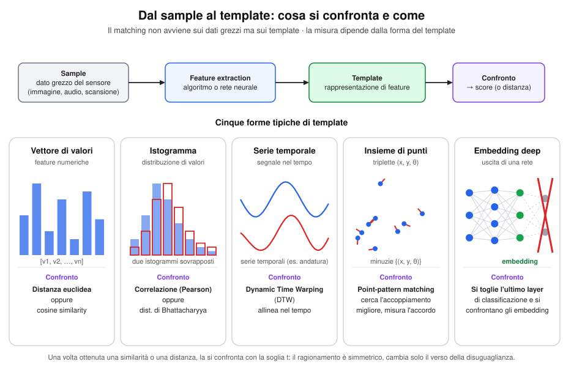


Il matching non avviene mai sui dati grezzi (il **sample**, cioè il dato acquisito dal sensore: un'immagine, una registrazione vocale, una scansione), ma sui **template** — la rappresentazione di feature estratta dal sample. La tecnica di confronto dipende dalla forma del template:

| Tipo di template | Confronto tipico |
|---|---|
| Vettore di valori | Distanza euclidea o cosine similarity |
| Istogramma | Correlazione (di Pearson), oppure distanza di Bhattacharyya |
| Serie temporale (es. accelerometro, andatura) | **Dynamic Time Warping (DTW)** |
| Insieme di punti/triplette (es. minuzie delle impronte $\{(x,y,\theta)\}$) | Point-pattern matching (si cerca l'accoppiamento migliore, poi si misura l'accordo) |
| Embedding di deep learning | Si rimuove l'ultimo layer di classificazione e si confrontano i vettori di embedding risultanti come normali vettori di feature |

**I due confronti meno intuitivi.** A sinistra il **DTW** allinea due serie di lunghezza e ritmo diversi (le linee grigie sono gli accoppiamenti scelti dal cammino ottimo, calcolato dal codice). A destra il **point-pattern matching**: si cerca l'allineamento migliore tra due insiemi di minuzie, poi si misura l'accordo.

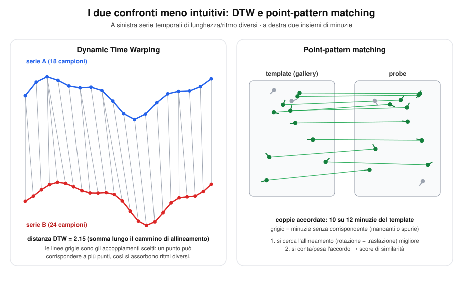

Una volta ottenuta una **similarità** (più alta = più simile) o una **distanza** (più bassa = più simile), il valore viene confrontato con una **soglia di accettazione**: tutto il ragionamento sulle soglie è perfettamente simmetrico che si lavori con similarità o con distanze — cambia solo il verso della disuguaglianza.

---

## 3. Verifica (Verification): i 4 possibili esiti

Nella verifica l'utente **dichiara un'identità**; il sistema confronta il campione con il template della gallery corrispondente a quell'identità.

| Esito | Nome | Significato |
|---|---|---|
| Identità vera, accettato | **GA** (Genuine Acceptance / Genuine Match) | Esito positivo |
| Identità vera, rifiutato | **FR** (False Rejection / False Non Match, errore tipo I) | Punteggio insufficiente |
| Identità falsa, rifiutato | **GR** (Genuine Reject / Genuine Non Match) | Esito positivo |
| Identità falsa, accettato | **FA** (False Acceptance / False Match, errore tipo II) | Il più critico in ambito security |

**La stessa tabella in forma di griglia.** Righe: la rivendicazione è vera o falsa; colonne: decisione del sistema. Sotto, come ciascun esito entra nei tassi.

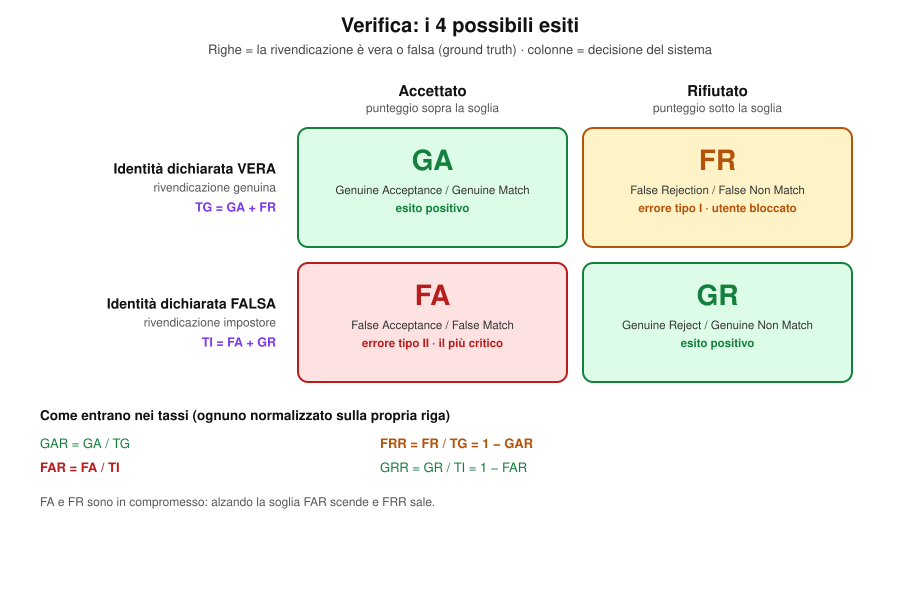


> **FA vs FR:** FA è generalmente il più critico in applicazioni di sicurezza (es. accesso di un impostore), FR crea problemi di usabilità (utenti legittimi bloccati). È un compromesso: non si possono minimizzare entrambi contemporaneamente.

---

## 4. Tassi di errore (Rates)

Le **rate** normalizzano il numero di errori rispetto alla popolazione corretta (non al numero totale di prove), per ottenere una misura indipendente dalla dimensione del probe set.

### 4.1 FAR e FRR — definizione probabilistica

Ipotesi:
- **H₀**: la persona è diversa da quella dichiarata
- **H₁**: la persona è la stessa dichiarata

Decisioni: **D₀** = persone diverse, **D₁** = stessa persona

$$
FAR = P(D_1 \mid H_0 = \text{vero})
$$
$$
FRR = P(D_0 \mid H_1 = \text{vero})
$$

- **FAR** = probabilità di accettare un impostore (calcolata sul numero di **rivendicazioni false**)
- **FRR** = probabilità di rifiutare un utente genuino (calcolata sul numero di **rivendicazioni genuine**)

> **I due scenari di rivendicazione falsa (impostor claim):** una rivendicazione impostore può nascere in due modi, calcolati in modo identico ai fini del FAR: (1) il probe appartiene a qualcuno **non iscritto** in gallery ($P_N$); (2) il probe appartiene a qualcun altro **già iscritto** in gallery, che sta mentendo sulla propria identità. Le rivendicazioni genuine, invece, provengono sempre e solo da $P_G$ (i probe dei soggetti effettivamente iscritti).

**Tre rivendicazioni.** Una genuina (da $P_G$) e due false: un non iscritto ($P_N$) e un iscritto che mente. Le due false finiscono nel denominatore del FAR.

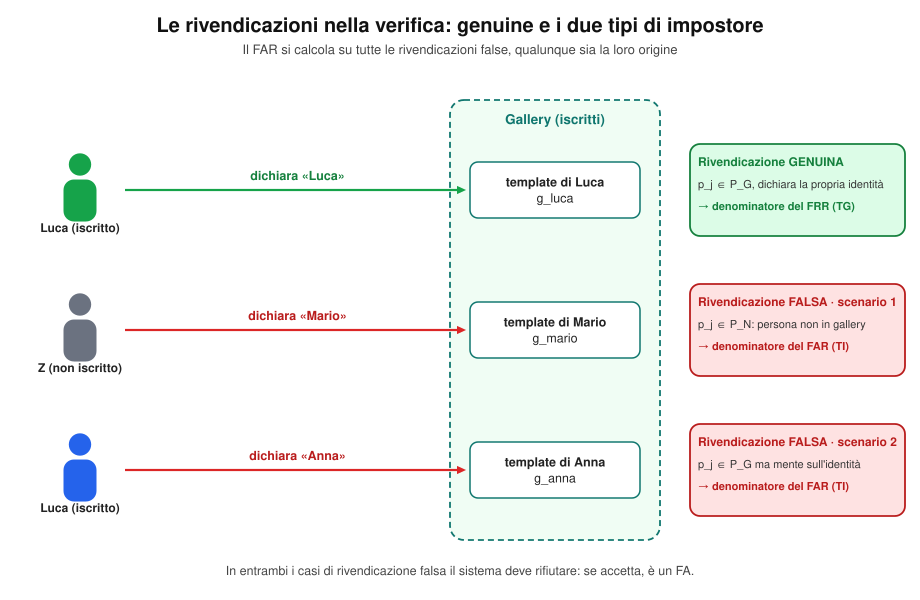


> FAR e FRR sono complementari a GAR e GRR: **FRR + GAR = 1**, **FAR + GRR = 1**

### 4.2 Formule esplicite con soglia t

Sia `s(gₓ, pⱼ)` la similarità tra il template gallery gₓ e la probe pⱼ; `id()` restituisce l'identità vera.

**FRR** (calcolato solo sulle rivendicazioni genuine, insieme Pɢ):

$$
FRR(t) = \frac{|\{p_j : s_{xj} \le t,\ id(g_x) = id(p_j)\}|}{|\{p_j : id(g_x) = id(p_j)\}|}
$$

**FAR** (calcolato solo sulle rivendicazioni false):

$$
FAR(t) = \frac{|\{p_j : s_{xj} \ge t \ \wedge\ id(g_x) \ne id(p_j)\}|}{|\{p_j : id(g_x) \ne id(p_j)\}|}
$$

> ⚠️ **Attenzione classica:** FAR e FRR vanno sempre normalizzati rispetto al numero di tentativi genuini/impostori **reali**, non al numero totale di probe. Esempio: 100 probe, 10 FA e 10 FR.

**Ogni quadratino è una probe.** Normalizzando sul totale (100) si ottiene FAR = FRR = 0.10 e il problema scompare; normalizzando per categoria si vede che FRR = 10/90 ≈ 0.11 ma FAR = 10/10 = 1.

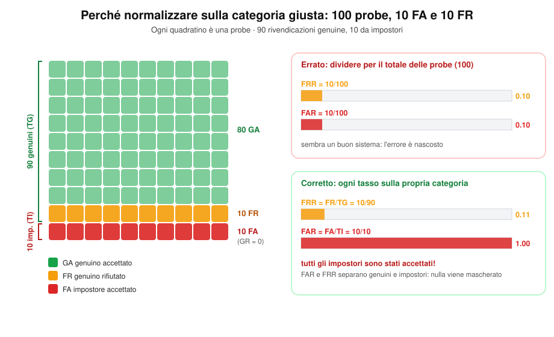


> - Se impostori reali = 10, genuini = 90 → **FRR = 10/90 ≈ 0.11**, **FAR = 10/10 = 1** (!) → tutti gli impostori sono stati accettati!
> - Calcolare erroneamente FAR = FRR = 10/100 nasconde completamente questo problema.

### 4.3 Score genuini e impostori

- **Score genuino (authentic):** confronto tra due campioni della **stessa** persona enrollata.
- **Score impostore:** confronto con il campione di una persona **non enrollata** (o con identità diversa dichiarata).

Le distribuzioni (tipicamente gaussiane) di score genuini e impostori si sovrappongono in parte: in quella zona di intersezione nascono gli errori (FA/FR), a seconda della soglia scelta.

### 4.4 Equal Error Rate (EER)
Punto in cui FAR(t) = FRR(t):

$$
EER = \{x : FRR(t) = x \ \wedge\ FAR(t) = x\}
$$

Non è una soglia, ma il **valore** di errore comune raggiunto a quella soglia.

### 4.5 Altri punti operativi
- **ZeroFAR** (Zero False Match Rate): valore di FRR quando FAR = 0.
- **ZeroFRR** (Zero False Non Match Rate): valore di FAR quando FRR = 0.
- Non è mai possibile avere realmente FAR = 0 o FRR = 0 esatti: sono punti concettuali di riferimento.


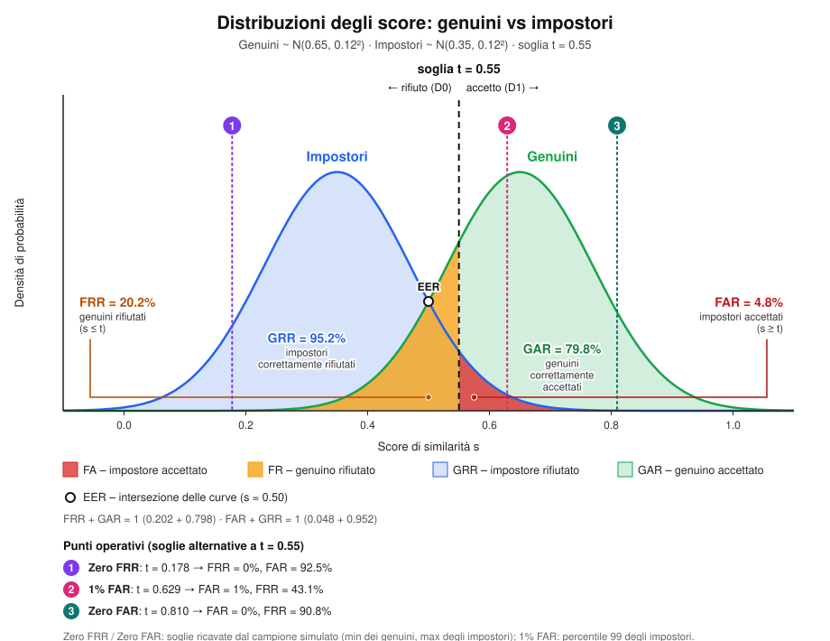

---

## 5. Curve di prestazione (Verifica)

### 5.1 Curva FAR/FRR vs soglia
FAR e FRR hanno **andamento opposto** rispetto alla soglia t: aumentando t (più selettivo), FAR diminuisce e FRR aumenta.


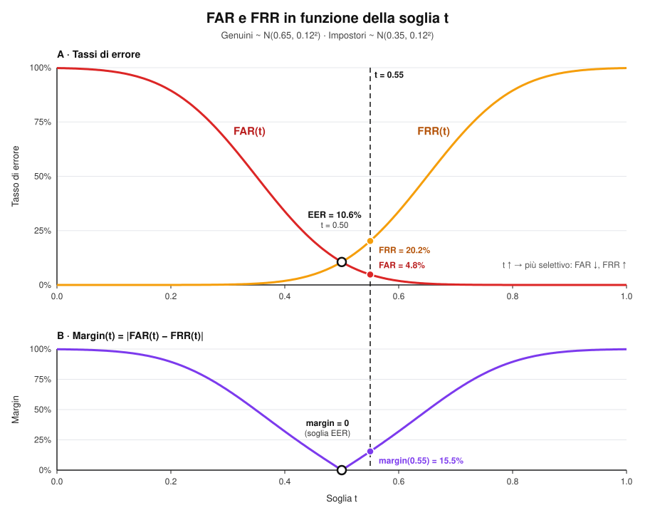

### 5.2 ROC (Receiver Operating Characteristic)
Asse x = FAR, asse y = **1 − FRR** (= GAR). Più la curva è vicina all'angolo in alto a sinistra, migliore è il sistema. Poiché confrontare due curve visivamente può essere ambiguo, si usa una metrica sintetica: l'**AUC (Area Under the Curve)** — l'area sotto la curva ROC. Un'AUC vicina a 1 indica prestazioni eccellenti; un'AUC di 0.5 indica un sistema che si comporta come una scelta casuale (non discriminante).


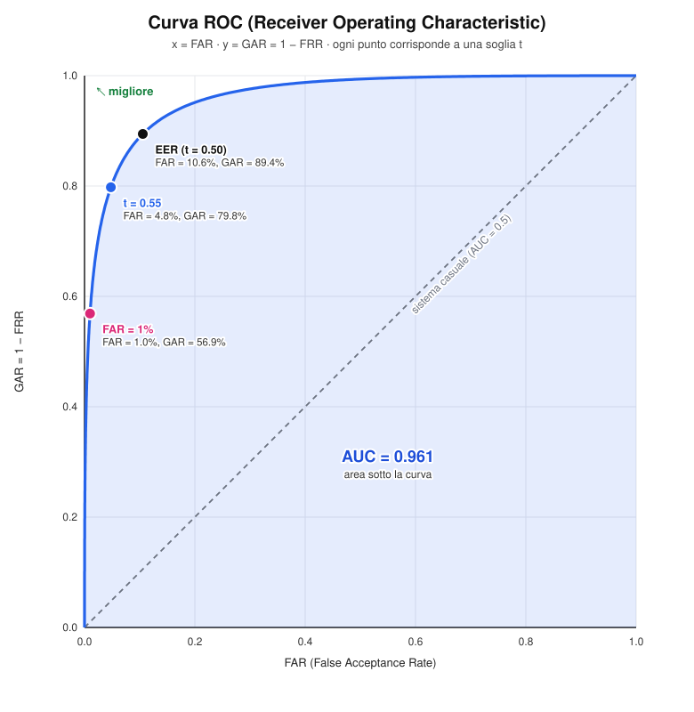

### 5.3 DET (Detection Error Tradeoff)
Asse x = FAR, asse y = FRR (scala logaritmica). Qui **più bassa è la curva, migliore è il sistema** (interpretazione opposta rispetto a ROC).


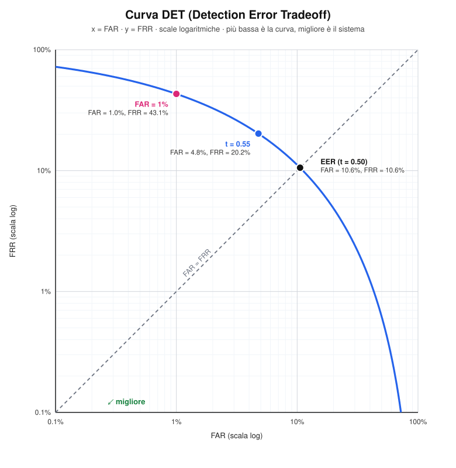

---

## 6. Identificazione Open Set (Watchlist)

A differenza della verifica, **non c'è rivendicazione di identità**: il probe viene confrontato con **tutta** la gallery (1-a-N), e il sistema deve decidere da solo due cose: *se* il soggetto è noto e, in caso affermativo, *chi* è.

### 6.0 Notazione

| Simbolo | Significato |
|---|---|
| $G = \{g_1, \dots, g_N\}$ | Gallery: template delle $N$ identità registrate |
| $id(g_i)$ | Identità associata al template $g_i$ |
| $p_j$ | Probe (campione da identificare) |
| $s_{ij} = sim(p_j, g_i)$ | Punteggio di similarità tra probe $j$ e template $i$ (più alto = più simile) |
| $P_G$ | Insieme dei probe di persone **presenti** in gallery (*genuine*, "noti") |
| $P_N$ | Insieme dei probe di persone **non presenti** in gallery (*impostori*, "ignoti") |
| $t$ | Soglia di accettazione |
| $rank(p_j)$ | Posizione, nella lista dei template ordinata per punteggio decrescente, del template della vera identità di $p_j$ |

### 6.1 Procedura del sistema

Dato un probe $p_j$:

1. **Confronto 1:N**: si calcolano tutti i punteggi $s_{1j}, \dots, s_{Nj}$.
2. **Ordinamento**: si ordinano i template per punteggio decrescente. Il template al rank 1 è $g_{i^*}$ con $i^* = \arg\max_i s_{ij}$.
3. **Test di soglia**: si controlla se $s_{i^*j} \ge t$.
4. **Decisione**:
   - se $s_{i^*j} \ge t$ → il sistema accetta e restituisce l'identità $id(g_{i^*})$;
   - se $s_{i^*j} < t$ → il sistema rifiuta ("soggetto non in watchlist").

Il sistema vede **solo** questo. Se la persona fosse davvero in gallery, o se $id(g_{i^*})$ fosse davvero la sua identità, lo sa solo chi valuta il sistema (ground truth). Gli esiti si definiscono confrontando la decisione con la ground truth.

**Il flusso decisionale in una figura.** Il sistema esegue sempre gli stessi quattro passi: confronto 1:N, ordinamento, test di soglia su $s^*$, decisione. Tutto ciò che sta sotto il rombo (riquadri viola tratteggiati) il sistema **non lo vede**: è la ground truth, usata da chi valuta per etichettare ogni decisione come A, B, C, D o E. Sono due domande indipendenti — *la persona è in gallery?* e *il rank 1 è la sua identità?* — e per questo i casi corretti sono due (A e D) e gli errori tre (B, C, E).

> Questo primo blocco definisce anche gli helper (`rect`, `box`, `arrow`, `diamond`, `mat_cell`, `g_line`, `g_area`) usati da tutti i blocchi successivi.


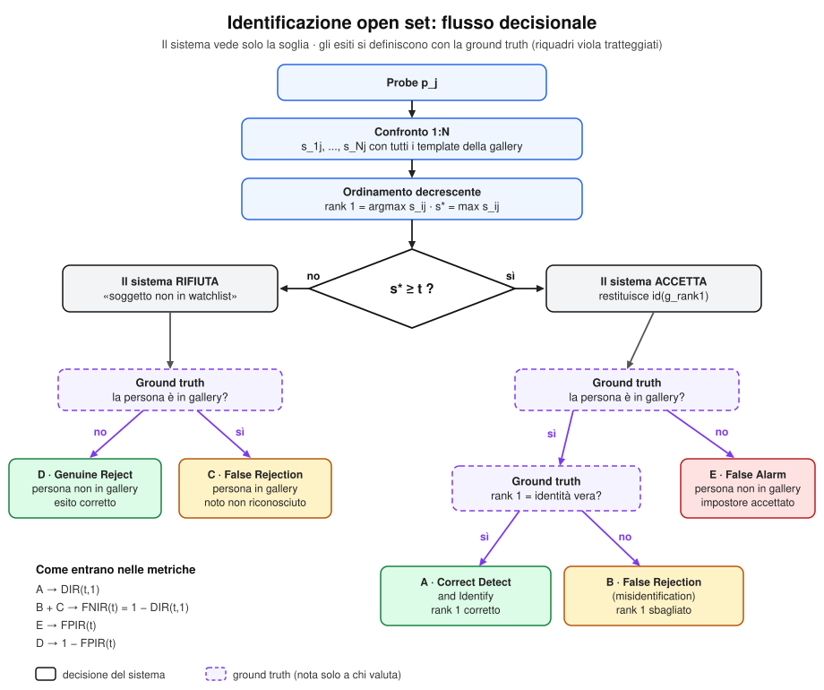

> **Come leggere lo schema.** C'è un solo rombo decisionale (la soglia). Il resto è la ground truth: a sinistra il sistema ha rifiutato, a destra ha accettato. Dentro ogni ramo ci sono gli esiti, che dipendono da due fatti che solo chi valuta conosce: la persona è in gallery? E il rank 1 è la sua identità?

> **Perché l'Identification Open Set è più difficile della Verification?** Nella verifica il sistema deve soddisfare un solo vincolo: confrontare il probe con il template dell'identità dichiarata e verificare che il punteggio superi la soglia (confronto 1:1). Nell'identificazione open set invece bisogna soddisfare **due vincoli contemporaneamente**: (1) effettuare un confronto 1:N con l'intera gallery, ordinare tutti i punteggi e verificare che il migliore superi la soglia di accettazione (per stabilire se il soggetto è noto al sistema); (2) verificare che l'identità associata a quel punteggio massimo sia effettivamente quella corretta. Questo doppio vincolo (soglia + correttezza del match 1:N tra molti candidati) rende l'identificazione open set intrinsecamente più complessa e soggetta a tassi di errore più elevati rispetto alla verifica 1:1.

#### Confronto tra i tre scenari

| | Verifica | Identificazione closed set | Identificazione open set |
|---|---|---|---|
| Domanda | "Sei chi dici di essere?" | "Chi sei, tra gli N noti?" | "Sei uno degli N noti? E se sì, chi?" |
| Confronto | 1:1 | 1:N | 1:N |
| Il probe è sempre in gallery? | Sì (dichiara un'identità) | **Sì** (ipotesi chiusa) | **No** |
| Soglia | Sì | No (si prende il rank 1) | Sì |
| Errori possibili | FAR, FRR | rank 1 sbagliato | falso allarme, falso rifiuto, rank 1 sbagliato |
| Metrica tipica | ROC / DET | CMC (rank-$k$) | DIR e FPIR al variare di $t$ |

### 6.2 Template ordinati, soglia e identità assegnata

Lo schema seguente mostra cosa succede *dentro* il sistema per un singolo probe: i template della gallery vengono ordinati per punteggio, la soglia $t$ divide la lista in due zone, e **solo il template al rank 1** (se sopra soglia) viene restituito come identità.

**Un solo probe, visto dall'interno del sistema.** I template sono ordinati per punteggio e la soglia divide la lista in due zone. Qui tre template superano $t$, ma il sistema ne restituisce uno solo: il rank 1 ($g_3$). Il template vero (★) è $g_7$, al rank 2: la persona è in gallery ma viene scambiata, quindi è il caso B (falso rifiuto per la persona vera). Per vedere il caso A basta impostare `TRUE_ID = "g3"` nello script.


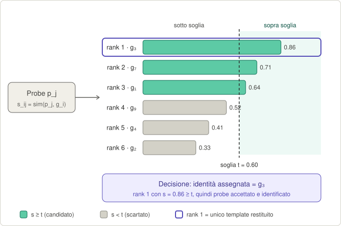

Punti da notare:

- **Il rank non è un'etichetta del sistema.** È la posizione che il template *vero* occupa nella lista. Il sistema conosce solo l'ordinamento, non quale sia quello vero; il rank lo calcola chi valuta.
- **Più template possono stare sopra soglia** (qui $g_3$, $g_7$, $g_1$), ma il sistema ne restituisce uno solo: il rank 1. Gli altri sopra soglia sono candidati scartati.
- **La soglia è un filtro, non un giudice di correttezza.** Superare $t$ significa "abbastanza simile", non "identità giusta". Per questo servono entrambi i vincoli.

### 6.3 Possibili esiti

I cinque casi si distinguono incrociando *dove sta la persona* (in gallery o no) con *cosa fa il sistema*:

**La stessa classificazione in forma di griglia.** Incrociando le tre righe (cosa fa il sistema) con le due colonne (dove sta davvero la persona) si ottengono sei celle, ma una è impossibile: un ignoto non ha un'identità corretta da restituire, quindi "accetta con rank 1 corretto" non può accadere. Le altre cinque sono i casi A–E. In basso, a quale metrica contribuisce ciascun caso.


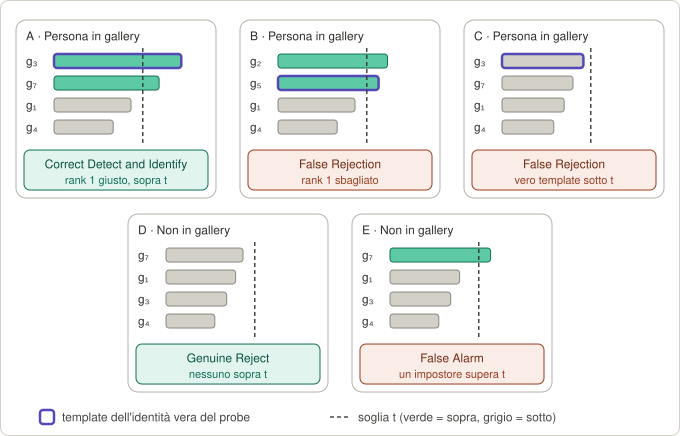

| Caso | Situazione | Esito |
|---|---|---|
| D | Nessun valore sopra soglia, persona non in gallery | Genuine Reject |
| C | Nessun valore sopra soglia, persona in gallery | False Rejection |
| A | Valori sopra soglia, il primo è quello corretto | **Correct Detect and Identify** |
| B | Valori sopra soglia, ma il primo NON è quello corretto | False Rejection (per l'identità corretta) |
| E | Persona non in gallery ma un valore supera la soglia | False Acceptance (**False Alarm**) |

Nel caso B il sistema ha *accettato* qualcuno, ma ha restituito l'identità sbagliata: per la persona vera è comunque un fallimento, quindi conta come falso rifiuto. In altri testi lo trovi anche come *misidentification*.

### 6.4 Rank e Detection and Identification Rate (DIR)

Il **rank** è la posizione nella lista ordinata in cui compare il template dell'identità corretta.

$$
DIR(t,k) = \frac{|\{p_j : rank(p_j) \le k,\ s_{ij} \ge t,\ id(g_i) = id(p_j)\}|}{|P_G|} \quad \forall p_j \in P_G
$$

$$
FRR(t) = 1 - DIR(t,1)
$$

$$
FAR(t) = \frac{|\{p_j : \max_i s_{ij} \ge t\}|}{|P_N|} \quad \forall p_j \in P_N,\ \forall g_i \in G
$$

$$
EER = \{t : FRR(t) = FAR(t)\}
$$

> **Nomenclatura standard ISO nell'open set:** l'equivalente del FRR è la **FNIR (False Negative Identification Rate)** = $1 - DIR(t,1)$; l'equivalente del FAR è la **FPIR (False Positive Identification Rate)**, cioè la probabilità che un impostore ($p_j \in P_N$) venga accettato per errore:
> $$FPIR(t) = \frac{|\{p_j \in P_N : \max_i s_{ij} \ge t\}|}{|P_N|}$$
> Applicazioni tipiche del DIR/open set: videosorveglianza, ricerca persone in grandi database, riconoscimento facciale open-set, applicazioni di *law enforcement*, dove non si sa a priori se il soggetto ripreso sia registrato nel sistema.

### 6.5 Come si derivano le formule

L'idea è una sola: **per ogni tipo di probe si identifica l'evento "errore" o "successo" e se ne calcola la frequenza relativa**. I due tipi di probe ($P_G$ e $P_N$) hanno denominatori diversi perché possono sbagliare in modi diversi.

#### Passo 0: la regola di decisione

Per un probe $p_j$ sia $i^* = \arg\max_i s_{ij}$ e $s^*_j = s_{i^*j} = \max_i s_{ij}$. Il sistema produce

$$
D_t(p_j) = \begin{cases} id(g_{i^*}) & \text{se } s^*_j \ge t \\ \text{rifiuto} & \text{se } s^*_j < t \end{cases}
$$

La soglia $t$ è l'unico parametro. Ogni formula sotto è la frequenza di un evento definito da $D_t$.

#### Passo 1: probe di impostori ($P_N$) → FPIR (il "FAR" dell'open set)

Un impostore non ha un'identità corretta da restituire, quindi qualunque accettazione è un errore. L'evento errore è:

$$
E_N = \{ D_t(p_j) \neq \text{rifiuto} \} = \{ s^*_j \ge t \} = \{\max_i s_{ij} \ge t\}
$$

La frequenza relativa su $P_N$ è la formula FPIR/FAR:

$$
FPIR(t) = \frac{|\{p_j \in P_N : \max_i s_{ij} \ge t\}|}{|P_N|}
$$

Il denominatore è $|P_N|$ perché un falso allarme esiste solo per chi non è in gallery. In termini probabilistici, $FPIR(t) = P(s^* \ge t \mid p \in P_N)$.

**Perché cresce con la dimensione della gallery.** Se per un impostore i punteggi con i singoli template sono indipendenti e ciascuno supera $t$ con probabilità $FAR_{1:1}(t)$ (il FAR della verifica), la probabilità che *almeno uno* dei $N$ lo faccia è

$$
FPIR(t) = 1 - \bigl(1 - FAR_{1:1}(t)\bigr)^N \approx N \cdot FAR_{1:1}(t) \quad (\text{se } N \cdot FAR_{1:1} \ll 1)
$$

Un sistema con $FAR_{1:1} = 0.1\%$ su gallery da $N = 1000$ ha $FPIR \approx 1 - 0.999^{1000} \approx 63\%$. È il motivo quantitativo per cui l'open set è più difficile della verifica e per cui le soglie vanno alzate molto al crescere di $N$. (L'indipendenza è un'assunzione di modello, utile come ordine di grandezza; i punteggi reali sono correlati.)

**La FPIR cresce con N.** Le curve sono $1-(1-FAR_{1:1})^N$ per tre valori di FAR; il tratteggio è l'approssimazione $N\cdot FAR_{1:1}$, che satura a 1 mentre la curva vera no. Il punto evidenziato è l'esempio del testo (FAR 0.1%, N = 1000 → 63%).

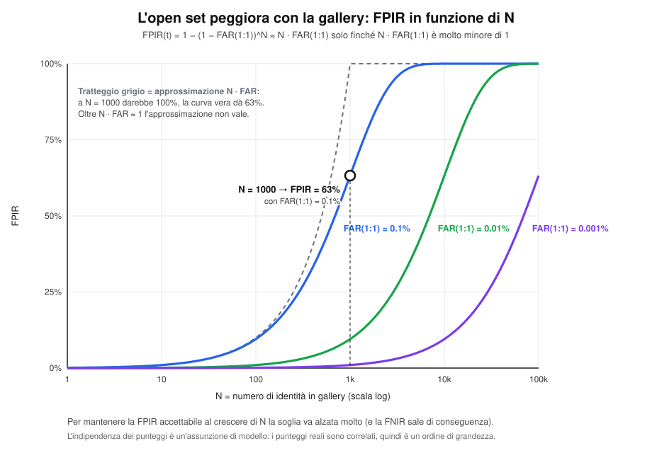

#### Passo 2: probe di persone note ($P_G$) → DIR

Per un probe noto il successo richiede **tre condizioni insieme**:

1. il template vero compare entro i primi $k$ posti: $rank(p_j) \le k$;
2. quel template ha punteggio sopra soglia: $s_{ij} \ge t$;
3. l'identità coincide: $id(g_i) = id(p_j)$ (è la definizione stessa di "template vero").

L'evento successo è quindi $S_k = \{rank(p_j) \le k \ \wedge\ s_{ij} \ge t \ \wedge\ id(g_i) = id(p_j)\}$ e la sua frequenza relativa su $P_G$ è la formula del DIR:

$$
DIR(t,k) = \frac{|\{p_j : rank(p_j) \le k,\ s_{ij} \ge t,\ id(g_i) = id(p_j)\}|}{|P_G|}
$$

Il denominatore è $|P_G|$: solo chi è in gallery può essere "detected and identified". Per $k = 1$ si chiede che il template vero sia **proprio** quello restituito dal sistema, cioè il caso A. Per $k > 1$ si ammette una shortlist (utile se poi decide un operatore).

**Scomposizione utile.** Per $k=1$, condizionando al fatto che il rank 1 sia corretto:

$$
DIR(t,1) = P(\text{rank 1 corretto} \mid p \in P_G) \cdot P(s^* \ge t \mid \text{rank 1 corretto})
$$

Il primo fattore è il *rank-1 identification rate* del closed set (indipendente da $t$); il secondo è la frazione di genuine con punteggio sopra soglia. Cambiando $t$ si agisce solo sul secondo. Quindi $DIR(t,1)$ **non può superare il rank-1 closed set**, e questo spiega perché la FNIR non va a zero nemmeno con $t$ molto basso.

#### Passo 3: FRR = FNIR

Per un probe noto gli esiti possibili sono mutuamente esclusivi ed esaustivi:

- A: rank 1 giusto e sopra soglia → successo;
- B: rank 1 sbagliato → fallimento;
- C: vero template sotto soglia (e quindi rank 1 sotto soglia o sbagliato) → fallimento.

Quindi la probabilità di fallire è il complemento di quella di riuscire:

$$
FRR(t) = FNIR(t) = 1 - DIR(t,1)
$$

Attenzione: questo complemento vale per $k=1$. Con $k>1$ "non successo entro rank $k$" non coincide con l'errore del sistema, perché il sistema restituisce comunque solo il rank 1.

#### Passo 4: andamento con $t$ ed EER

- Alzando $t$, meno impostori superano la soglia → **FPIR scende** (monotona non crescente).
- Alzando $t$, meno noti superano la soglia → $DIR(t,1)$ scende → **FNIR sale** (monotona non decrescente).

Una funzione che scende e una che sale si incrociano: l'**EER** è il valore di $t$ (e del tasso) in cui

$$
FNIR(t^*) = FPIR(t^*)
$$

Nei dati reali, con insiemi finiti, le curve sono a gradini e l'uguaglianza esatta può non esistere: si prende il $t$ che minimizza $|FNIR(t) - FPIR(t)|$. La curva $\bigl(FPIR(t),\, DIR(t,1)\bigr)$ al variare di $t$ è la **ROC dell'open set**; con $DIR(0,k)$ al variare di $k$ si ottiene invece la **CMC**, che è il caso closed set.

**ROC dell'open set.** La curva $(FPIR(t), DIR(t,1))$ non arriva a 1: il limite è il Recognition Rate del closed set, perché $DIR(t,1)\le RR$ per ogni $t$.

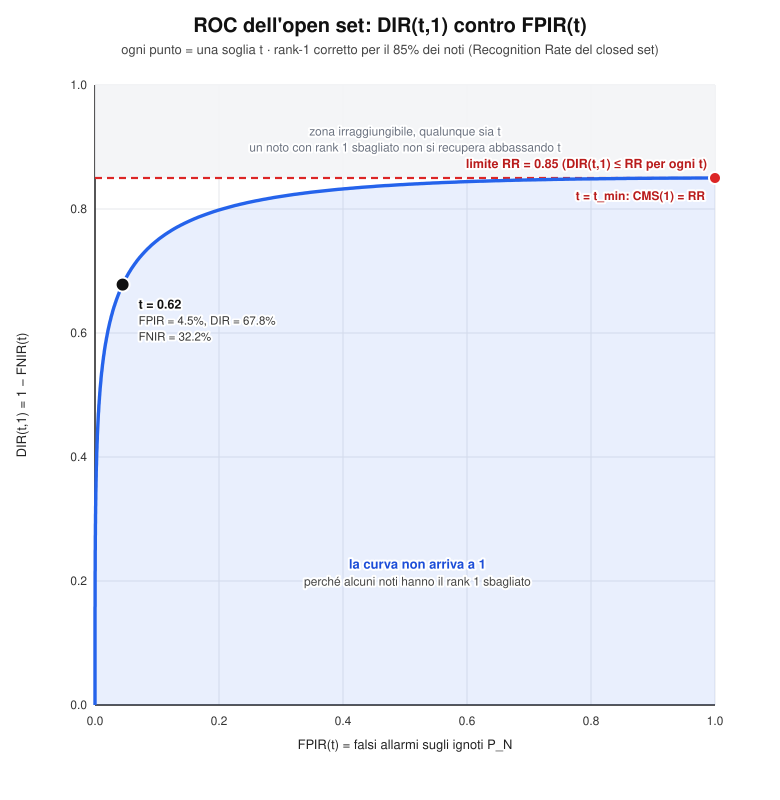


**Le due distribuzioni di $s^*$.** Per ogni probe conta solo il punteggio massimo contro la gallery. Gli ignoti ($P_N$) hanno $s^*$ più alto di quanto avrebbero in una verifica 1:1, perché è il massimo su $N$ template: è il motivo per cui la FPIR cresce con $N$. L'area arancione a destra di $t$ è la FPIR; l'area verde a sinistra è la quota di noti persi per punteggio troppo basso. Alla FNIR si aggiunge poi l'errore di rank, che in questo grafico non compare.


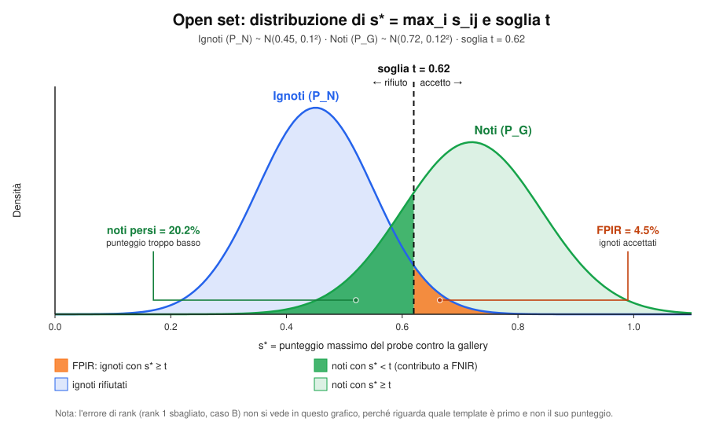

> Nel grafico l'area arancione a destra di $t$ è la FPIR (impostori accettati); l'area verde a sinistra di $t$ è la quota di noti persi per punteggio troppo basso. A questa si somma l'errore di rank, che nel grafico non si vede perché riguarda *quale* template è al primo posto, non il suo punteggio.

#### Esempio numerico

Si valuta un sistema con $|P_G| = 200$ probe noti e $|P_N| = 300$ probe di impostori, con una certa soglia $t$.

- Tra i 200 noti: 150 hanno il rank 1 corretto e sopra soglia (caso A); 30 hanno il template vero sotto soglia (caso C); 20 hanno un rank 1 sbagliato (caso B).
- Tra i 300 impostori: 24 hanno $\max_i s_{ij} \ge t$ (caso E).

Allora

$$
DIR(t,1) = \frac{150}{200} = 0.75, \qquad FNIR(t) = 1 - 0.75 = 0.25 = \frac{30 + 20}{200}, \qquad FPIR(t) = \frac{24}{300} = 0.08
$$

Con una soglia più alta, per esempio, la FPIR potrebbe scendere verso 0.02 ma la FNIR salirebbe oltre 0.25: questo è il compromesso che si legge sulla curva ROC.

### 6.6 Cinque aree operative (scelta soglia watchlist)

La soglia non è un valore "giusto" in assoluto: dipende dal costo relativo dei due errori nell'applicazione. Le cinque aree corrispondono a cinque posizioni sulla curva ROC dell'open set:

| # | Area operativa | Soglia | Quando ha senso |
|---|---|---|---|
| 1 | Falso allarme estremamente basso (es. sorveglianza pubblica) | $t$ molto alta | Ogni falso allarme ferma o disturba una persona innocente: meglio perdere qualche sospetto |
| 2 | Probabilità di detect/identify estremamente alta (falsi allarmi secondari) | $t$ molto bassa | Non si vuole perdere nessun sospetto; i match vengono poi verificati da un operatore |
| 3 | Basso falso allarme e basso detect/identify | $t$ alta | Sistema prudente: pochi allarmi, ma ne riconosce pochi |
| 4 | Alto falso allarme e alto detect/identify | $t$ bassa | Sistema permissivo: riconosce molto, ma genera molti allarmi |
| 5 | Nessuna soglia: si vogliono tutti i risultati con relativa confidenza | assente | Decide l'utente guardando la lista ordinata (ricerca investigativa) |

**Le cinque aree sulla ROC** (FPIR in scala log). Le aree 1 e 3 sono nella zona a bassi falsi allarmi, 4 e 2 a falsi allarmi crescenti, 5 è l'assenza di soglia (lista ordinata, cioè CMC).

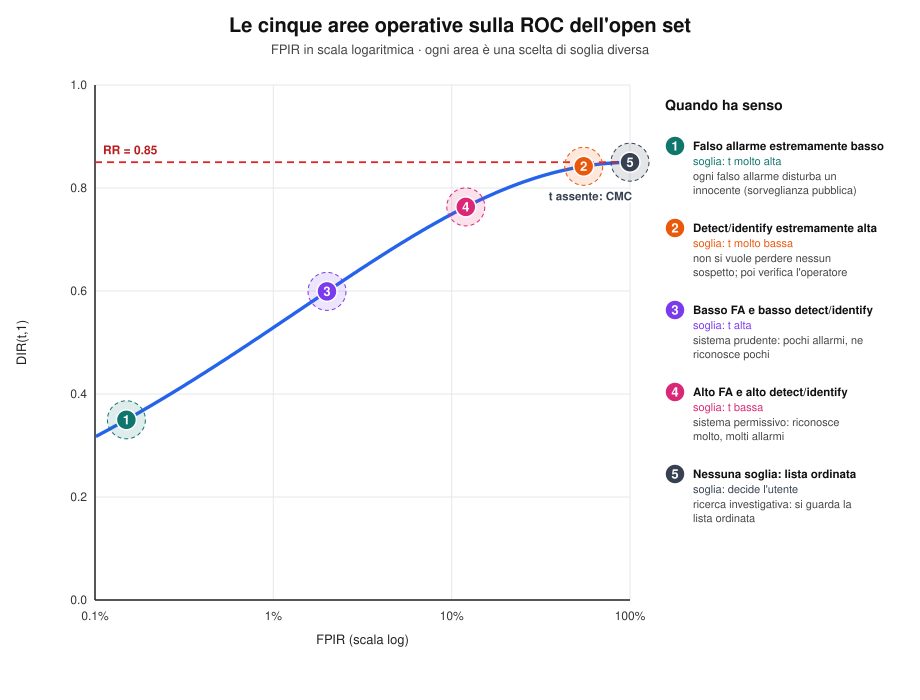


### 6.7 Riepilogo rapido

- **Verifica**: 1:1, un solo vincolo (soglia).
- **Open set**: 1:N, due vincoli (soglia **e** rank 1 corretto).
- **FPIR** si misura sugli impostori ($P_N$): conta chi supera la soglia con *qualunque* template. Cresce circa come $N \cdot FAR_{1:1}$.
- **DIR(t,1)** si misura sui noti ($P_G$): conta chi ha il rank 1 corretto **e** sopra soglia.
- **FNIR = 1 - DIR(t,1)**.
- Alzare $t$ → meno falsi allarmi, più falsi rifiuti. L'**EER** è il punto in cui si equivalgono.

---

## 7. Identificazione Closed Set

Caso speciale: si assume che **ogni probe appartenga a un soggetto enrollato** (non realistico, ma utile per valutare le prestazioni perché più semplice da calcolare).

- **Non c'è soglia.**
- L'unica domanda è: *chi è questa persona?*
- L'unico errore possibile è la **False Rejection** (identità corretta non al primo posto); **non esiste False Acceptance**.
- Il FRR del closed set si calcola come complemento del **Recognition Rate** (= CMS al rango 1):

$$
FRR_{closed} = 1 - CMS(1) = 1 - RR
$$

### 7.0 Notazione e procedura

| Simbolo | Significato |
|---|---|
| $G = \{g_1, \dots, g_N\}$ | Gallery con $N$ identità enrollate |
| $P$ | Insieme dei probe; nel closed set **tutti** hanno l'identità in $G$ (quindi $P = P_G$ e $P_N = \emptyset$) |
| $s_{ij} = sim(p_j, g_i)$ | Punteggio di similarità tra probe $j$ e template $i$ |
| $rango(p_j)$ | Posizione del template della vera identità di $p_j$ nella lista ordinata per punteggio decrescente ($1 \le rango \le N$) |

Procedura per un probe $p_j$:

1. si calcolano i punteggi con **tutti** i template della gallery (confronto 1:N);
2. si ordinano i template per punteggio decrescente;
3. si restituisce l'identità del template al **rank 1**, **senza alcun test di soglia**.

Il sistema risponde quindi sempre con un'identità. Chi valuta, conoscendo la ground truth, guarda a che rank compare il template vero.

**Closed set: nessun rombo di soglia.** Il sistema restituisce sempre l'identità del rank 1. A sinistra il template vero è primo (successo), a destra è al rank 3: l'identità restituita è sbagliata, ma lo stesso probe contribuisce a $CMS(k)$ per ogni $k \ge 3$. È questa la differenza tra "sbagliare" e "essere in una shortlist".


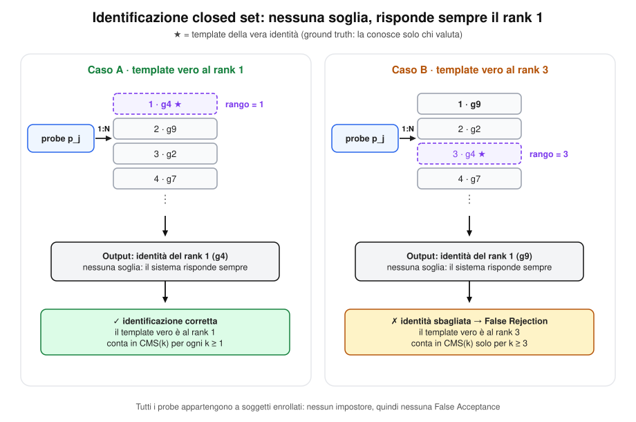

Lo schema mostra due probe:

- **Caso A**: il template vero è al rank 1 → identificazione corretta.
- **Caso B**: il template vero è al rank 3 → il sistema restituisce l'identità sbagliata, quindi per la persona vera è un falso rifiuto. Il probe comunque "conta" nel CMS per ogni $k \ge 3$ (vedi 7.1).

#### Come si derivano RR e FRR

Per un probe sono possibili solo due eventi, mutuamente esclusivi ed esaustivi:

- successo: $rango(p_j) = 1$;
- errore: $rango(p_j) \ge 2$.

La frequenza relativa del successo su $P$ è il Recognition Rate:

$$
RR = \frac{|\{p_j : rango(p_j) = 1\}|}{|P|}
$$

Poiché l'errore è il complemento del successo:

$$
FRR_{closed} = \frac{|\{p_j : rango(p_j) \ge 2\}|}{|P|} = 1 - RR
$$

Non esiste una FAR perché non esistono impostori: non c'è nessuno da "accettare per errore". Nota sulla terminologia: in senso stretto l'errore del closed set è una *misidentification* (il sistema restituisce un'identità, ma sbagliata); lo si chiama False Rejection per coerenza con l'open set, dove lo stesso evento ha lo stesso nome.

#### Relazione con l'open set

Il closed set è l'open set **senza soglia** e senza impostori:

$$
CMS(k) = DIR(t_{min},\,k) \qquad \text{e quindi} \qquad RR = DIR(t_{min},\,1)
$$

dove $t_{min}$ è una soglia così bassa da accettare sempre il rank 1. Poiché alzare $t$ può solo ridurre il DIR, vale

$$
DIR(t,1) \le RR \quad \forall t
$$

cioè il Recognition Rate del closed set è un **limite superiore** per il DIR dell'open set. Per questo il closed set è utile come stima ottimistica (e facile da calcolare) delle prestazioni, ma non basta per valutare un sistema di watchlist.

| | Closed set | Open set |
|---|---|---|
| Il probe è sempre in gallery? | Sì | No |
| Soglia | No | Sì |
| Errori | solo rank 1 sbagliato | falso allarme, falso rifiuto, rank 1 sbagliato |
| Metrica | CMC, RR | DIR e FPIR al variare di $t$ |

### 7.1 Cumulative Match Characteristic (CMC) curve

**CMS (Cumulative Match Score) a rango k** = probabilità che l'identità corretta sia tra le prime k posizioni della lista ordinata.

- CMS a rango 1 = **Recognition Rate** (probabilità che sia esattamente al primo posto).
- La curva CMC raggiunge sempre probabilità 1 (perché tutti sono in gallery, quindi prima o poi compare).
- Area sotto la curva massima = dimensione della gallery; si può normalizzare dividendo per il massimo.
- Si usano spesso CMS a rango 1, 5, 10 come indicatori sintetici.

**La CMC come cumulata dell'istogramma dei rank.** Le barre sono $h(r)$, la linea è $CMS(k)=\sum_{r\le k}h(r)$. La curva parte da $RR=CMS(1)$ (non da zero), non decresce e arriva a 1. La diagonale tratteggiata è il sistema che ordina a caso. Sotto l'asse ci sono i conteggi dell'esempio: da qui si leggono direttamente $RR=0.62$, $CMS(5)=0.92$ e l'AUC normalizzata $0.893$.


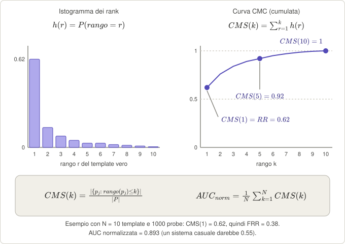

#### Come si deriva la CMC

**1. Istogramma dei rank.** Per ogni probe si registra il rank del template vero. La frazione di probe con rango esattamente $r$ è

$$
h(r) = P(rango = r) = \frac{|\{p_j : rango(p_j) = r\}|}{|P|}, \qquad \sum_{r=1}^{N} h(r) = 1
$$

La somma vale 1 perché ogni probe ha un rango in $\{1, \dots, N\}$.

**2. Cumulata.** Il CMS a rango $k$ è la frazione di probe con rango **al più** $k$:

$$
CMS(k) = \frac{|\{p_j : rango(p_j) \le k\}|}{|P|} = \sum_{r=1}^{k} h(r)
$$

La CMC è quindi la **funzione di distribuzione cumulata** del rango del template vero.

**3. Proprietà (seguono dalla definizione).**

- $CMS(1) = h(1) = RR$: la curva parte dal Recognition Rate, non da zero.
- **Non decrescente**: l'insieme $\{rango \le k\}$ può solo crescere con $k$, quindi $CMS(k+1) \ge CMS(k)$.
- $CMS(N) = 1$: nel closed set il template vero è sempre in gallery, quindi ha rango $\le N$. Nell'open set questo non vale, perché gli impostori non hanno un template vero.
- Un sistema che ordina a caso ha $CMS(k) = k/N$ (retta), che serve da riferimento minimo.

**4. Area sotto la curva.** Sommando su tutti i rank il massimo possibile si ottiene $CMS(k) = 1$ per ogni $k$, cioè un'area pari a $N$. Dividendo per $N$ si ha l'area normalizzata, compresa tra circa $0.5$ (sistema casuale) e $1$ (sistema perfetto):

$$
AUC_{norm} = \frac{1}{N} \sum_{k=1}^{N} CMS(k)
$$

Per un sistema casuale $AUC_{norm} = \frac{1}{N}\sum_{k=1}^{N}\frac{k}{N} = \frac{N+1}{2N}$, che per $N=10$ vale $0.55$.

#### Esempio numerico (quello della figura)

Gallery con $N = 10$ template e $|P| = 1000$ probe. I rank osservati sono:

| rango $r$ | 1 | 2 | 3 | 4 | 5 | 6 | 7 | 8 | 9 | 10 |
|---|---|---|---|---|---|---|---|---|---|---|
| n. probe | 620 | 140 | 80 | 50 | 30 | 30 | 20 | 15 | 10 | 5 |
| $h(r)$ | 0.62 | 0.14 | 0.08 | 0.05 | 0.03 | 0.03 | 0.02 | 0.015 | 0.01 | 0.005 |
| $CMS(r)$ | 0.62 | 0.76 | 0.84 | 0.89 | 0.92 | 0.95 | 0.97 | 0.985 | 0.995 | 1 |

Quindi $RR = CMS(1) = 0.62$, $FRR_{closed} = 0.38$, $CMS(5) = 0.92$ e $AUC_{norm} = 8.93 / 10 = 0.893$.

**Come si leggono gli indicatori sintetici.** $CMS(1)$ dice quanto spesso il sistema "ci azzecca" da solo. $CMS(5)$ e $CMS(10)$ sono interessanti quando l'output è una **shortlist** rivista da un operatore: con $CMS(5) = 0.92$ il template giusto è tra i primi cinque candidati nel 92% dei casi, anche se solo nel 62% è il primo.

### 7.2 Identificazione vs Re-Identificazione

- **Identificazione**: il sistema riceve una probe e deve stabilire **chi è**, confrontandola con l'intera gallery. Orizzonte temporale medio/lungo; può essere open o closed set; l'output è un'**identità precisa** (un nome/ID).
- **Re-Identificazione (Re-ID)**: il sistema deve ritrovare **la stessa persona** in immagini/frame diversi (tipicamente provenienti da telecamere diverse), su un orizzonte temporale breve, **senza necessariamente conoscerne l'identità reale**. Non cerca un nome, ma una corrispondenza tra apparizioni della stessa persona — tipica della videosorveglianza e del tracking multi-camera; è tipicamente closed set, e l'output è "stessa persona / persona diversa" anziché un'identità.
- La Re-ID si valuta con la **CMC** (quando c'è una sola immagine di gallery per query) o con la **mAP (mean Average Precision)**, quando più immagini di gallery corrispondono alla stessa query.
**Stessa pipeline, due domande.** A sinistra il probe è confrontato con persone *enrolled* e l'output è un'identità (ID 42). A destra non c'è nessun nome: si cerca soltanto, tra le apparizioni di un'altra telecamera, quella che corrisponde alla query. Per questo cambiano orizzonte temporale, tipo di gallery e metriche (CMC per un solo match, mAP per più match).


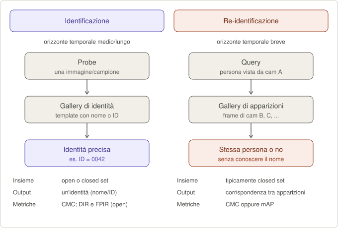

#### Perché la mAP e non solo la CMC

Nella CMC conta **solo la posizione del primo match corretto**: se per una query il primo è al rank 1, il resto della lista è irrilevante. Questo va bene quando c'è una sola immagine corretta in gallery. In Re-ID, invece, la stessa persona compare di solito in **più** frame di gallery, e un buon sistema deve metterli tutti in alto: la CMC non lo misura, la mAP sì.

#### Come si deriva la mAP

**1. Precisione al rango $k$** (per una query $q$): frazione di immagini corrette tra le prime $k$.

$$
P(k) = \frac{\text{n. di immagini corrette nei primi } k}{k}
$$

**2. Average Precision.** Si media $P(k)$ **solo nei rank dove compare un'immagine corretta**, usando $rel(k) = 1$ se l'immagine al rank $k$ è la stessa persona e $0$ altrimenti:

$$
AP(q) = \frac{1}{|R_q|} \sum_{k=1}^{n} P(k)\, rel(k)
$$

dove $R_q$ è l'insieme delle immagini corrette per $q$ e $n$ la lunghezza della lista. Il fattore $\frac{1}{|R_q|}$ normalizza: $AP = 1$ solo se **tutte** le immagini corrette sono ai primi posti, e ogni corretta messa in basso abbassa il valore.

**3. Media sulle query.**

$$
mAP = \frac{1}{|Q|} \sum_{q \in Q} AP(q)
$$

**Average Precision passo per passo.** In alto i risultati ordinati (corretti ai rank 1, 3, 6). Al centro $P(k)$ a ogni rank: solo le barre verdi, cioè quelle dove compare un'immagine corretta, entrano nella media. In basso lo stesso insieme di immagini corrette messo in cima o in fondo alla lista: l'AP passa da 1.00 a 0.28, mentre la CMC non se ne accorgerebbe.


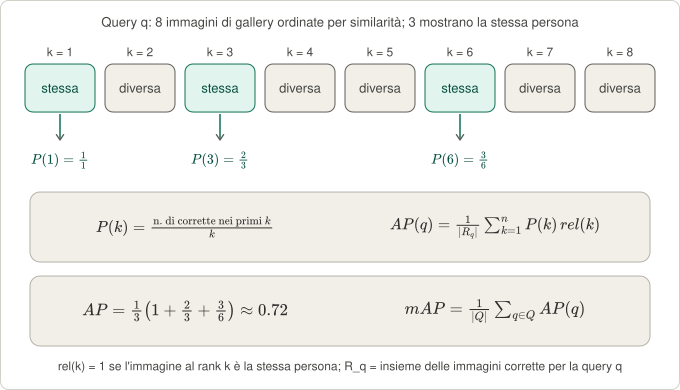

**Esempio (quello della figura).** Le immagini corrette sono ai rank 1, 3 e 6, quindi $|R_q| = 3$ e

$$
AP = \frac{1}{3}\left(\frac{1}{1} + \frac{2}{3} + \frac{3}{6}\right) \approx 0.72
$$

Se le tre corrette fossero ai rank 1, 2, 3 si avrebbe $AP = \frac{1}{3}(1 + 1 + 1) = 1$; se fossero ai rank 6, 7, 8, $AP = \frac{1}{3}(\frac{1}{6} + \frac{2}{7} + \frac{3}{8}) \approx 0.28$.

**CMC e mAP a confronto.**

| | CMC / CMS($k$) | mAP |
|---|---|---|
| Cosa guarda | posizione del **primo** match corretto | posizione di **tutti** i match corretti |
| Quando usarla | una sola immagine corretta in gallery per query | più immagini corrette per query |
| Risposta | "il match giusto è nei primi $k$?" | "quanto in alto stanno tutti i match giusti?" |

### 7.3 Riepilogo rapido

- **Closed set**: nessuna soglia, nessun impostore; l'unico errore è il rank 1 sbagliato.
- $RR = CMS(1)$ e $FRR_{closed} = 1 - RR$.
- $CMS(k) = \sum_{r=1}^{k} h(r)$: la CMC è la cumulata dell'istogramma dei rank; parte da $RR$, non decresce e arriva a 1.
- $DIR(t,1) \le RR$: il closed set è un limite superiore per l'open set.
- **Re-ID** = ritrovare la stessa persona su più telecamere, senza nome; si valuta con CMC (un solo match) o mAP (più match).

---

## 8. Progettazione sperimentale (Offline Evaluation)

La valutazione statistica avviene **offline**, su dataset con **ground truth** noto (`id(template)` restituisce l'identità vera). In produzione questo non è disponibile (es. attacco "zero effort").

### 8.1 Tre scelte di partizionamento del dataset

1. **Training vs Testing (TR/TS)**
   - Necessario per approcci machine learning.
   - **Nessuna sovrapposizione** tra campioni di training e testing.
   - Il training deve includere campioni di qualità/condizioni varie per garantire **generalizzabilità**.
   - Partizionamento per **soggetti** (subject mai visti = never seen subjects) o per **campioni** (stesso soggetto in TR e TS ma campioni diversi).

2. **Probe vs Gallery (P/G)**
   - Scelta 1: campioni migliori in gallery, condizioni variabili nel probe.
   - Scelta 2: condizioni variabili anche in gallery (per riconoscere meglio in diverse condizioni).
   - Sempre nessuna sovrapposizione tra probe e gallery.

3. **Open set vs Closed set**
   - Closed set: tutte le probe appartengono a soggetti in gallery.
   - Open set: probe = PG ∪ PN (soggetti in gallery + soggetti fuori gallery).
   - Non influisce sulla verifica (dipende solo dal claim), ma è cruciale nell'identificazione open set.

**Le tre scelte.** Training vs Testing (per soggetti o per campioni), Probe vs Gallery (gallery con il campione migliore o variabile), closed vs open set (con probe $P_N$ fuori gallery).

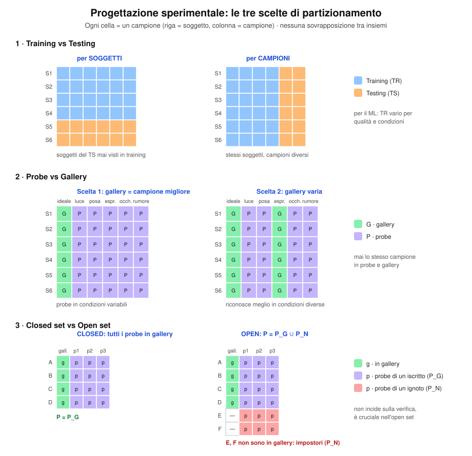

### 8.2 K-Fold Cross Validation

Il dataset è diviso in k sottoinsiemi; si ripete k volte l'addestramento usando k−1 sottoinsiemi come training e 1 come test, ruotando. L'errore finale è la **media** sui k trial. Tipicamente **k = 5 o 10**.

**K-fold con k = 5.** A ogni trial un fold diverso è il test e gli altri quattro sono il training; l'errore finale è la media dei k errori.

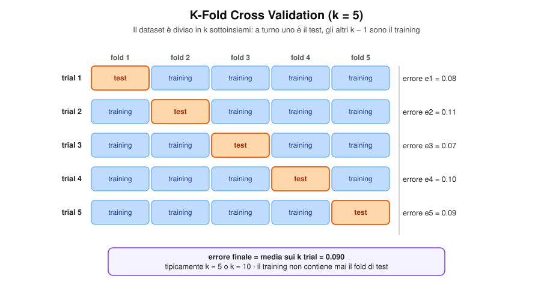

---

## 9. Strategia All-Against-All

Invece di simulare **una sola rivendicazione d'identità per ogni probe** (es. "sono Mario"), si valutano **tutte le coppie possibili**: ogni probe $i$ viene confrontato con ogni campione $j$ della galleria, come se potesse dichiarare *qualsiasi* identità.

Grazie al **ground truth** (si conosce $\mathrm{label}(\cdot)$ di ogni campione) non serve ripetere gli esperimenti: si calcola **una sola volta** la matrice $M$ delle distanze (o similarità) e poi ogni cella viene classificata come *genuina* o *impostore*. Ogni riga della matrice rappresenta quindi **più esperimenti**.

### 9.1 Matrice delle distanze

$$
M \in \mathbb{R}^{|P|\times|G|}, \qquad M[i,j] = d\big(\text{probe}_i,\ \text{gallery}_j\big)
$$

$$
\text{la cella } (i,j) \text{ è }
\begin{cases}
\textbf{genuina} & \mathrm{label}(i)=\mathrm{label}(j)\\
\textbf{impostore} & \mathrm{label}(i)\neq\mathrm{label}(j)
\end{cases}
$$

**Anatomia della matrice.** Con $N=3$ soggetti e $S=2$ template ciascuno, la matrice è $6\times6$. I blocchi viola sulla diagonale contengono le celle genuine, tutto il resto è impostore; la diagonale vera e propria ($i=j$) è lo stesso campione confrontato con sé stesso e viene esclusa. Ogni riga è già un insieme di esperimenti: 1 genuino e 4 impostori.


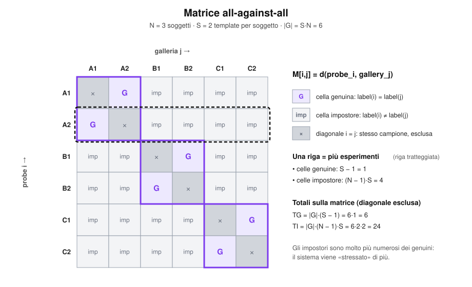

**Vantaggi**

- Facile da programmare; calcola una "media" su tutte le possibili distribuzioni genuino/impostore.
- Gli impostori sono molto più numerosi dei genuini (rapporto $\frac{(N-1)S}{S-1}$ per riga) → si può **stressare molto** il sistema.

**Svantaggi**

- Tempo computazionale elevato: $O(|G|^2)$ confronti.
- Non permette di analizzare distribuzioni genuino/impostore *specifiche* (es. solo certi soggetti).
- Non adatto se il dataset ha **sessioni** temporalmente separate: campioni della stessa sessione sono più simili tra loro, quindi i genuini risultano troppo vicini e le prestazioni **ottimisticamente falsate**. In tal caso si usa la variante **All-Against-All Probe vs Gallery** (§10): una sessione = galleria, un'altra = probe.

### 9.2 Notazione

| Simbolo | Significato |
|---|---|
| $N$ | numero di soggetti |
| $S$ | numero di template per soggetto |
| $\lvert G\rvert = S\cdot N$ | cardinalità della galleria (campioni totali) |
| $i$ | indice di riga (probe) |
| $j$ | indice di colonna (galleria) |
| $\mathrm{label}(i),\ \mathrm{label}(j)$ | identità associate |
| $t$ | soglia di decisione: si **accetta** se $M[i,j]\le t$ |
| $TG,\ TI$ | numero totale di tentativi genuini / impostori |
| $GA,\ FR,\ FA,\ GR$ | genuine accept / false reject / false accept / genuine reject |

### 9.3 Come la soglia classifica le celle

Fissata $t$, ogni esperimento ha uno di quattro esiti:

$$
\begin{array}{c|cc}
 & M[i,j]\le t \ (\text{accettato}) & M[i,j]> t \ (\text{rifiutato})\\ \hline
\text{genuino} & GA & FR\\
\text{impostore} & FA & GR
\end{array}
$$

con le relazioni

$$
GA+FR = TG, \qquad FA+GR = TI
$$

$$
GAR(t)=\frac{GA}{TG},\quad FRR(t)=\frac{FR}{TG}=1-GAR(t),\quad
FAR(t)=\frac{FA}{TI},\quad GRR(t)=\frac{GR}{TI}=1-FAR(t)
$$

**La soglia taglia le due distribuzioni di distanza.** Qui si lavora con distanze, quindi si accetta a sinistra di $t$. Le quattro aree sono i quattro esiti GA, FR, FA, GR, e i tassi si ottengono dividendo per il numero di tentativi della *propria* categoria (TG per i genuini, TI per gli impostori), non per il totale.


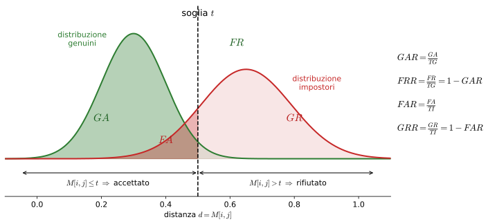

> Spostare $t$ a destra **aumenta** $GAR$ ma anche $FAR$; spostarla a sinistra fa il contrario. Variando $t$ si ottengono le curve ROC / DET.

---

### 9.4 Verifica — Single Template

Ogni campione della galleria è confrontato **singolarmente**. Per ogni riga $i$ (escludendo la diagonale $i=j$):

- celle genuine: gli altri $S-1$ campioni della stessa identità;
- celle impostore: gli $(N-1)\cdot S$ campioni delle altre identità.

$$
\boxed{TG = |G|\cdot(S-1)} \qquad \boxed{TI = |G|\cdot(N-1)\cdot S}
$$

```
for each threshold t
    for each cell M[i,j] con i ≠ j
        if M[i,j] ≤ t then
            if label(i) = label(j) then GA++
            else FA++
        else
            if label(i) = label(j) then FR++
            else GR++
    GAR(t) = GA/TG ;  FAR(t) = FA/TI
    FRR(t) = FR/TG ;  GRR(t) = GR/TI
```

**Esempio numerico** ($N=3,\ S=2,\ |G|=6$, $t=0.40$): $TG=6\cdot1=6$, $TI=6\cdot2\cdot2=24$. Le celle con contorno verde sono quelle accettate ($M[i,j]\le t$).

**L'esempio numerico, cella per cella.** Ogni cella fuori diagonale è un esperimento ed è etichettata GA/FR/FA/GR. Il codice conta gli esiti e verifica con un `assert` che i totali siano quelli del testo ($GA=4$, $FR=2$, $FA=4$, $GR=20$). Questa stessa matrice `M6` viene riusata nel blocco successivo.


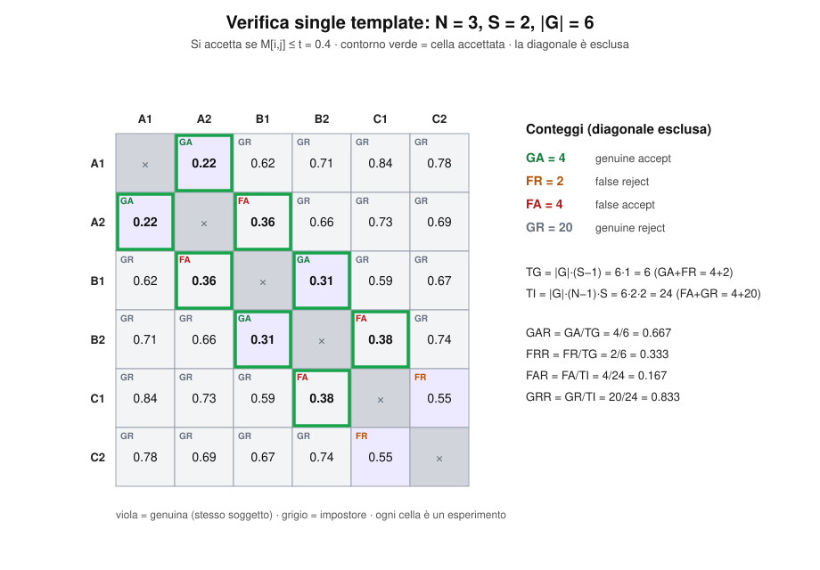

Si verifica che $GA+FR=4+2=6=TG$ e $FA+GR=4+20=24=TI$.

---

### 9.5 Verifica — Multiple Template

Quando la galleria ha $S$ template per soggetto, la decisione è **per identità**, non per campione: per ogni riga $i$ le colonne si raggruppano per label,

$$
\mathcal{M}_X = \{\, M[i,j] \;:\; \mathrm{label}(j)=X,\ j\neq i \,\}
$$

e di ogni gruppo si tiene il **miglior match** (distanza minima):

$$
d_X = \min \mathcal{M}_X
$$

Poiché ogni riga produce **un esperimento per identità** ($N$ in tutto, di cui 1 genuino e $N-1$ impostori):

$$
\boxed{TG = |G|} \qquad \boxed{TI = |G|\cdot(N-1)}
$$

```
for each threshold t
    for each row i
        for each gruppo M_label di celle M[i,j] con stessa label(j), escludendo M[i,i]
            diff = min(M_label)
            if diff ≤ t then
                if label(i) = label(M_label) then GA++
                else FA++
            else
                if label(i) = label(M_label) then FR++
                else GR++
    GAR(t) = GA/TG ; FAR(t) = FA/TI ; FRR(t) = FR/TG ; GRR(t) = GR/TI
```


**Da $6\times6$ a $6\times3$.** Per ogni riga, le colonne vengono raggruppate per identità e si tiene solo il minimo del gruppo (il pallino colorato indica quale cella vince). A parità di matrice e soglia, il FRR resta $2/6$ ma il FAR sale da $4/24$ a $4/12$: è l'effetto di $S$ descritto nel riquadro sotto.


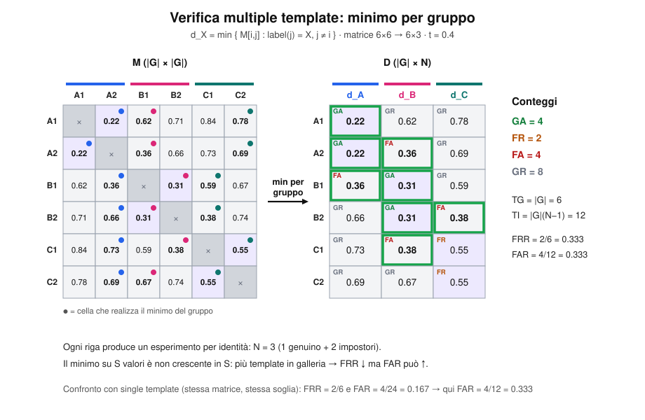

Nell'esempio la matrice $6\times6$ si riduce a una matrice $6\times3$ ($|G|\times N$); con $t=0.40$ si ottiene $GA=4,\ FR=2$ (somma $=TG=6$) e $FA=4,\ GR=8$ (somma $=TI=12$).

> **Effetto di $S$ sul compromesso errori.**
> Più campioni in galleria per soggetto → **diminuisce $FRR$** (più occasioni di trovare un match corretto, perché il minimo di più valori è più piccolo) ma **può aumentare $FAR$** (più occasioni per un impostore di assomigliare a un template).
> In formula: $\min$ su $S$ valori è non crescente in $S$, quindi sia i genuini sia gli impostori si spostano verso distanze minori.

**Distribuzione del minimo di S distanze.** Con più template per soggetto sia i genuini sia gli impostori si spostano verso distanze minori: a parità di soglia FRR scende e FAR sale. Sotto, i valori per S da 1 a 5, calcolati assumendo campioni indipendenti.

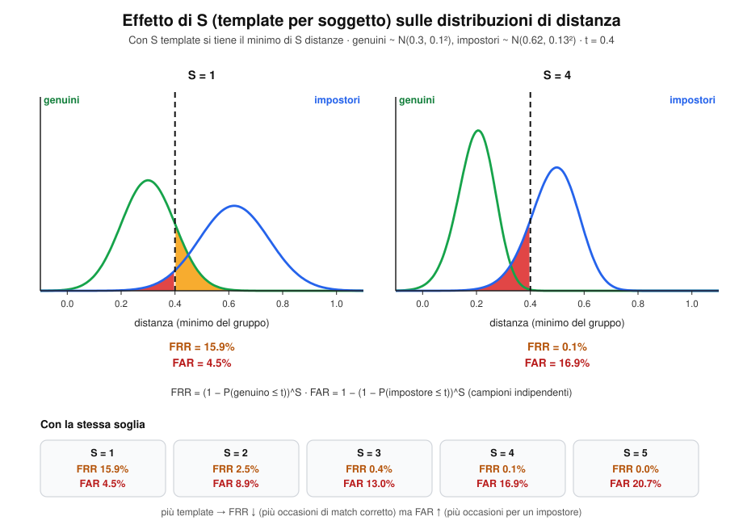

---

## 10. All-Against-All — Probe vs Gallery (sessioni separate)

Probe e galleria provengono da **sessioni diverse** e **non condividono campioni**: non esiste diagonale da escludere. Si ha $|P|=|G|=S\cdot N$ e tutte le $|P|\cdot|G|$ celle sono utilizzabili.

**Due sessioni, nessuna diagonale.** Righe e colonne provengono da sessioni diverse: ogni cella è utilizzabile e ogni riga ha $S$ genuini (non $S-1$). È la configurazione da preferire quando i campioni della stessa sessione sono troppo simili tra loro.


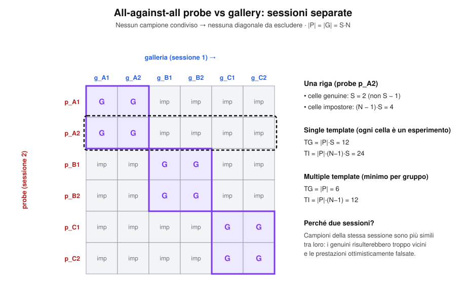

### 10.1 Verifica

**Single template** (ogni cella è un esperimento):

$$
TG = |P|\cdot S \qquad TI = |P|\cdot(N-1)\cdot S
$$

**Multiple template** (min per gruppo, un esperimento per identità):

$$
TG = |P| \qquad TI = |P|\cdot(N-1)
$$

Confronto con il caso §9 (con diagonale): al posto di $S-1$ genuini per riga se ne hanno $S$, perché il campione di probe non è presente in galleria.

### 10.2 Identificazione Open Set (multiple template)

Qui **non c'è un claim**: il sistema deve decidere *chi* è il probe, oppure rispondere "sconosciuto". Per questo ogni riga rappresenta **2 esperimenti**, uno per ciascuno scenario:

| Scenario | Situazione | Esito |
|---|---|---|
| **Genuino** | l'identità del probe **è** in galleria | valutiamo se viene riconosciuta al rango $k$ |
| **Impostore** | l'identità del probe **non è** in galleria (si rimuove) | valutiamo se viene erroneamente accettata |

$$
\boxed{TG = |G|} \qquad \boxed{TI = |G|}
$$

Per ogni riga $i$ si costruisce la lista $L[i]$ delle distanze (una per identità, minimo per gruppo) **ordinata in modo crescente**, e $L[i,k]$ è il $k$-esimo elemento.

$$
L[i,1]\le L[i,2]\le\dots
$$

**Due esperimenti per riga.** Nello scenario genuino si cerca a che rango compare l'identità del probe e si controlla che la sua distanza sia $\le t$. Nello scenario impostore la stessa identità viene rimossa dalla galleria: qualunque elemento con distanza $\le t$ è un'accettazione errata (FA), altrimenti è un GR.


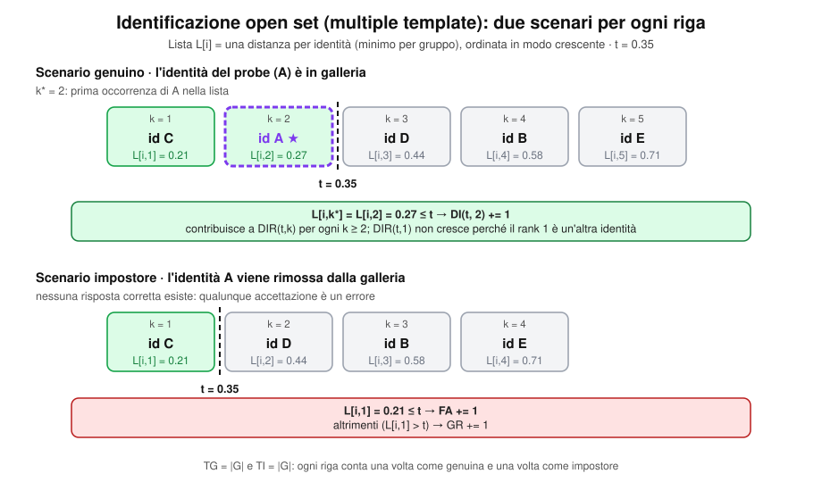

**Scenario genuino.** Sia $k^*$ il rango della prima occorrenza con $\mathrm{label}=\mathrm{label}(i)$. Si ha un'identificazione corretta al rango $k^*$ se

$$
L[i,k^*]\le t \quad\Longrightarrow\quad DI(t,k^*)\mathrel{+}=1
$$

**Scenario impostore.** Rimossa l'identità del probe, qualunque elemento $L[i,1]\le t$ è un'accettazione errata:

$$
L[i,1]\le t \Longrightarrow FA\mathrel{+}=1, \qquad \text{altrimenti } GR\mathrel{+}=1
$$

**Metriche.**

$$
DIR(t,1)=\frac{DI(t,1)}{TG}, \qquad FRR(t)=1-DIR(t,1)
$$

$$
DIR(t,k)=\frac{DI(t,k)}{TG}+DIR(t,k-1) \quad (k\ge2)
$$

$$
FAR(t)=\frac{FA}{TI}, \qquad GRR(t)=\frac{GR}{TI}
$$

$DIR(t,k)$ è il **Detection & Identification Rate** al rango $k$: frazione di probe genuini correttamente riconosciuti *entro* i primi $k$ candidati e con distanza $\le t$.

Pseudocodice concettuale:

```
for each threshold t
    for each row i
        L[i] = lista ordinata crescente delle distanze M[i,j] (esclusa diagonale)
        if L[i,1] ≤ t then                          # potenziale accettazione
            if label(i) = label(L[i,1]) then DI(t,1)++     # caso genuino
            cerca il primo L[i,k] con label diversa e ≤ t → se esiste: FA++   # caso impostore
            altrimenti cerca il primo L[i,k] con stessa label e ≤ t
                → se esiste: DI(t,k)++ ; FA++
        else GR++
    DIR(t,1) = DI(t,1)/TG ;  FRR(t) = 1 - DIR(t,1)
    FAR(t) = FA/TI ;  GRR(t) = GR/TI
    # per ranghi superiori:
    DIR(t,k) = DI(t,k)/TG + DIR(t,k-1)
```

### 10.3 Identificazione Closed Set

Si assume che il probe **sia sempre in galleria**: non esistono impostori e **non serve soglia**. Si misura solo *a che rango* compare l'identità corretta.

$$
TA = |P|
$$

Per ogni riga si ordina $L[i]$ e si cerca il primo $k$ tale che $\mathrm{label}(i)=\mathrm{label}(L[i,k])$; si incrementa $CMS(k)$ (Cumulative Match Score). Poi:

$$
CMS(1)=\frac{n_1}{TA}=RR, \qquad
CMS(k)=\frac{n_k}{TA}+CMS(k-1)\quad (k=2,\dots,K)
$$

dove $n_k$ è il numero di probe la cui identità corretta compare **per la prima volta** al rango $k$, e $K=|G|-1$ (caso con diagonale) oppure $K=|G|$ (probe vs gallery).

**CMS con la strategia all-against-all.** $n_k$ conta i probe la cui identità corretta compare per la prima volta al rango $k$; la CMS è la somma cumulata di $n_k/TA$. Nell'esempio, 60 probe: $RR=30/60=0.50$ e la curva arriva a 1 al rango $K=9$.


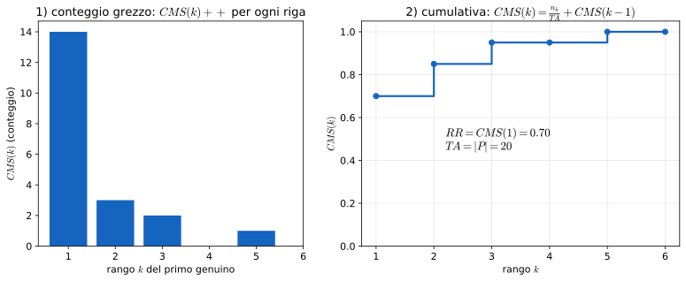

Proprietà utili:

- $CMS(k)$ è **non decrescente** e $CMS(K)=1$ (la risposta giusta è sempre da qualche parte).
- $RR = CMS(1)$ è il **Recognition Rate** (rango-1).

```
for each row i
    L[i] = lista ordinata crescente delle distanze M[i,j]
    trova il primo L[i,k] tale che label(i) = label(L[i,k])
    CMS(k)++
CMS(1) = CMS(1)/TA ;  RR = CMS(1)
for k = 2 to |G|-1
    CMS(k) = CMS(k)/TA + CMS(k-1)
```
**Mappa delle strategie.** Per ogni strategia, i totali di esperimenti genuini e impostori con la diagonale (§9) e con due sessioni (§10), con l'esempio N = 3, S = 2.

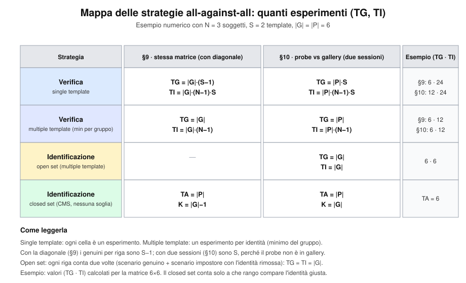

---

## 17. Approfondimenti e domande frequenti aggiuntive

### 17.1 Come scegliere il sistema migliore tra due candidati?

- **A parità di FAR:** si sceglie il sistema con il **FRR inferiore** a quella stessa soglia (più utenti genuini vengono accettati, GAR più alto).
- **A parità di FRR:** si sceglie il sistema con il **FAR inferiore** (maggiore sicurezza contro gli impostori).
- **In senso globale (nessun vincolo di parità):** si confronta l'**AUC** delle rispettive curve ROC. Si seleziona il sistema con l'AUC maggiore, perché indica prestazioni complessivamente migliori su tutto il range di soglie possibili.

> Attenzione: se le curve si incrociano (figura del §15.1), l'AUC maggiore non garantisce di vincere nella zona operativa che interessa. In quel caso si confrontano i FRR **al FAR richiesto dall'applicazione**.

### 17.2 Detection Rate vs Identification Rate

- **Detection Rate (DR):** probabilità che un soggetto genuino venga **rilevato come presente** in gallery (il sistema capisce "è uno dei nostri"). Nell'open set coincide con $DIR(t,1)$ considerato come semplice "detezione" (senza guardare se l'identità restituita è esatta).
- **Identification Rate (IR):** probabilità che un soggetto genuino venga **correttamente identificato**, cioè che il sistema scelga proprio l'identità giusta. Nel closed set corrisponde al Rank-1 Identification Rate, cioè $CMS(1)$.

> La distinzione è utile perché nel closed set il problema è solo "trovare chi è" (esiste solo detezione implicita, dato che tutti sono in gallery), mentre nell'open set c'è anche il problema preliminare di "riconoscere se il soggetto appartiene al sistema" prima ancora di provare a identificarlo.

### 17.3 Perché l'accuracy "classica" del Machine Learning non basta?

Se si calcolassero i tassi di errore dividendo semplicemente per il **numero totale di probe** (come fa l'accuracy standard in ML), si otterrebbe un valore che **nasconde comportamenti critici asimmetrici**. 

**Esempio:** un sistema può mostrare un'accuracy dell'80% pur accettando il 100% degli impostori (FAR = 1, gravissimo per la sicurezza) oppure rifiutando il 100% degli utenti legittimi (FRR = 1, sistema inutilizzabile). L'accuracy aggrega tutto in un unico numero medio e può mascherare uno dei due errori. Le metriche biometriche FAR/FRR, invece, **separano sempre genuini e impostori**, rendendo visibile ogni comportamento anomalo.

**Come leggere la figura.** Tre sistemi con **lo stesso numero di errori** (10 FR + 10 FA su 100 probe) e quindi la stessa accuracy dell'80%, ma con composizioni diverse del test set. Il Sistema 1 ha il 100% di FAR, il Sistema 3 il 100% di FRR, il Sistema 2 (test bilanciato) ha 20% e 20%. Solo FAR e FRR rendono visibile la differenza.


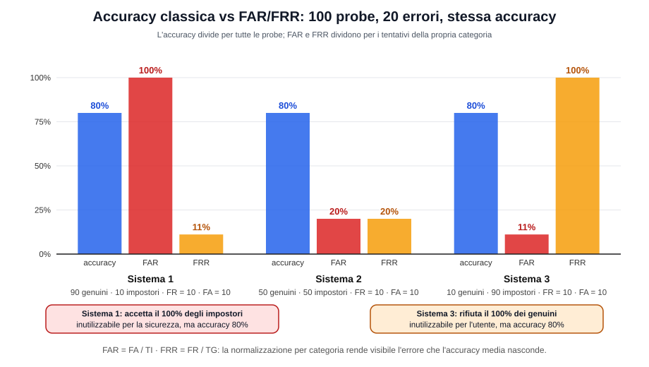

### 17.4 FAR/FRR vs Precision/Recall (confronto con le metriche ML)

Le metriche ML classiche si basano sui **risultati corretti** (veri positivi):

$$
Precision = \frac{TP}{TP+FP} = \frac{GA}{GA+FA}
\qquad\qquad
Recall = \frac{TP}{TP+FN} = \frac{GA}{GA+FR}
$$

Le metriche biometriche si basano invece sugli **errori**, sempre separati per categoria di utente:

$$
FRR = \frac{FR}{GA+FR} = \frac{FN}{TP+FN}
\qquad\qquad
FAR = \frac{FA}{FA+GR} = \frac{FP}{FP+TN}
$$

> Le due coppie partono da prospettive opposte e complementari: Precision/Recall valutano **quante risposte positive sono corrette**; FAR/FRR valutano **quanto spesso il sistema sbaglia** su ciascuna categoria di utenti (genuini vs impostori). Per questo in ambito biometrico si preferisce sempre riportare FAR/FRR (o la coppia EER/ROC) piuttosto che una singola accuracy aggregata.

**Come leggere la figura.** La stessa matrice di confusione è letta in due modi. A sinistra: la *Precision* usa la **colonna** degli accettati (GA su GA+FA), la *Recall* la **riga** dei genuini; a destra FRR e FAR usano due **righe** distinte, ciascuna normalizzata per i propri tentativi (TG e TI). Una conseguenza pratica, calcolata nel riquadro: se si moltiplicano per 10 gli impostori mantenendo lo stesso comportamento, **FAR e FRR non cambiano**, mentre la Precision crolla da 0.93 a 0.58. FAR e FRR descrivono il sistema; la Precision dipende anche dalla composizione del traffico.


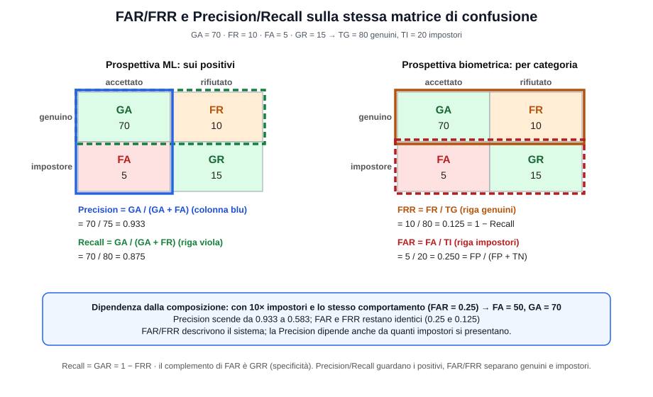

### 17.5 Relazione tra CMC, ROC, FAR e FRR

Bolle et al. (2005) hanno dimostrato un risultato importante: quando un matcher 1:1 viene usato per ordinare i candidati (cioè per costruire la lista ordinata usata nel closed/open set), la **curva CMC è direttamente derivabile da FAR e FRR** — non aggiunge quindi nuova informazione statistica rispetto alla curva ROC, che già mostra il trade-off FAR/FRR al variare della soglia.

> In sintesi: **CMC, ROC, FAR e FRR sono tutte rappresentazioni diverse della stessa informazione**, contenuta a monte nella Distance/Similarity Matrix (DM) calcolata tra probe e gallery. Cambia solo il modo in cui questa informazione viene "letta" e visualizzata (per rango vs per soglia).

**Come si deriva (closed set, impostori indipendenti).** Si fissa lo score $s$ del genuino. Il suo rango è $1+$ il numero di impostori della gallery che lo superano; con $N-1$ impostori indipendenti, ciascuno sopra $s$ con probabilità $FAR(s)$, quel numero è una binomiale. Il genuino è entro il rango $k$ se **al più** $k-1$ impostori lo superano:

$$
CMS(k) = \int f_G(s)\ \sum_{m=0}^{k-1}\binom{N-1}{m}\,FAR(s)^{m}\,\bigl(1-FAR(s)\bigr)^{N-1-m}\, ds
$$

Nell'esempio (matcher gaussiano, $N=10$) la curva calcolata con questa formula (linea verde) coincide con quella ottenuta simulando 4000 probe (cerchi): $RR=CMS(1)\approx0.57$. Con la sola ROC (che contiene $FAR(s)$ e $f_G$) si ricostruisce quindi **tutta** la CMC. L'indipendenza degli impostori è un'ipotesi: nei dati reali i punteggi contro i diversi template sono correlati, e la formula è un'approssimazione.


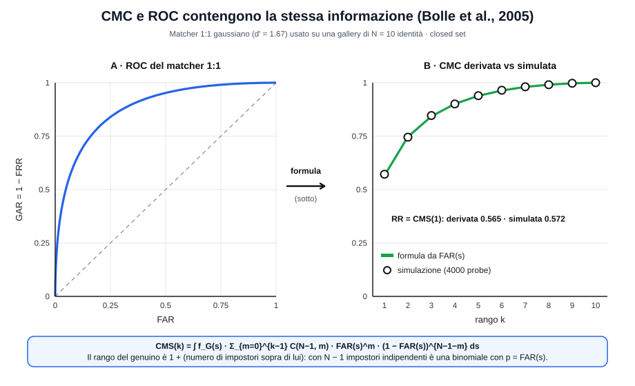

### 17.6 Regola pratica sulla soglia di accettazione

La soglia $t$ decide se accettare o respingere un match, e la regola dipende dal tipo di score usato:

- se si usa una **distanza** → si accetta se $\text{distanza} \le t$ (più bassa = più simile);
- se si usa una **similarità** → si accetta se $\text{similarità} \ge t$ (più alta = più simile).

Cambiando $t$, FAR e FRR si muovono sempre in direzioni opposte: soglia più **alta/restrittiva** → FAR minore ma FRR maggiore; soglia più **bassa/permissiva** → FRR minore ma FAR maggiore. Non esiste una soglia "oggettivamente migliore": si sceglie il punto operativo in base al tipo di applicazione (sicurezza vs comodità utente), valutando le prestazioni su una griglia di soglie tramite le curve ROC/DET.

**Similarità vs distanza.** La figura applica le due regole agli **stessi dati** (la distanza è $d=1-s$): i quattro tassi risultano identici (il codice lo verifica con un `assert`). L'unica differenza è il verso dell'accettazione e quindi cosa significa "più restrittivo": $t$ più alta per la similarità, $t$ più bassa per la distanza.


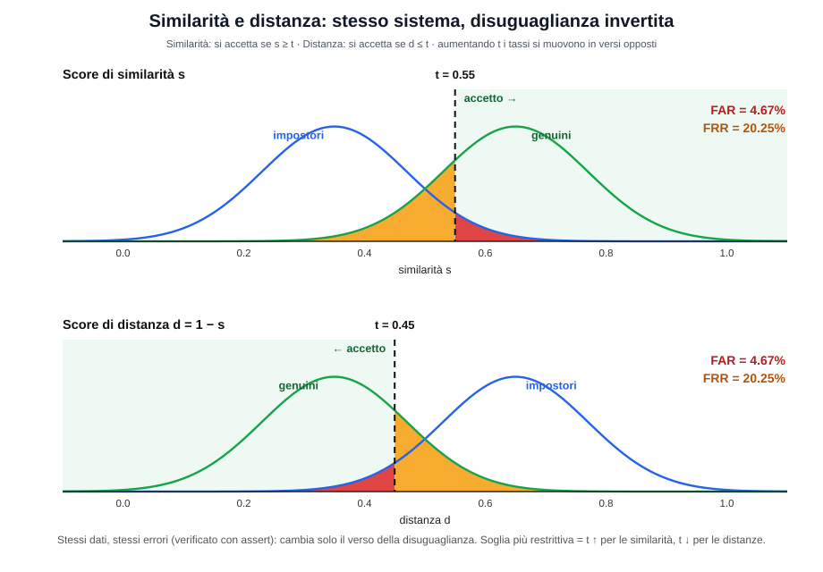

**Come si sceglie $t$ in pratica.** Un approccio è minimizzare un **costo atteso**

$$
C(t) = C_{FA}\cdot P_{imp}\cdot FAR(t) + C_{FR}\cdot P_{gen}\cdot FRR(t)
$$

dove $C_{FA}$ e $C_{FR}$ sono il costo di una falsa accettazione e di un falso rifiuto, e $P_{imp}, P_{gen}$ le probabilità a priori dei due tipi di tentativo. Nella figura, con $P_{imp}=5\%$: un'applicazione ad **alta sicurezza** ($C_{FA}=200$) spinge la soglia in alto (FAR ≈ 0.5%, FRR ≈ 9%); una **commerciale** sta nel mezzo; una **forense/di indagine** ($C_{FR}=10$, non perdere nessun sospetto) la abbassa (FRR ≈ 0%, FAR alto ma gestibile da un operatore). Sono i tre punti operativi sulla DET; coincidono con le "aree operative" del §6.6.


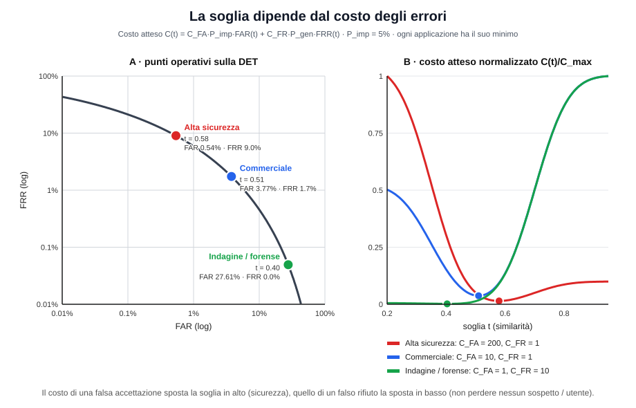

### 17.7 Tabella riassuntiva: Verification vs Closed Set vs Open Set

| Aspetto | Verification (1:1) | Closed Set (1:N) | Open Set (1:N) |
|---|---|---|---|
| Obiettivo | Validare l'identità dichiarata | Trovare l'identità corretta (soggetto sempre registrato) | Rilevare se il soggetto è registrato e, in caso, identificarlo |
| Rivendicazione (claim) | Sì | No | No |
| Impostori possibili | Sì | No | Sì |
| Soglia di accettazione | Sì | No | Sì |
| Errori possibili | GA, FR, GR, FA | Solo False Rejection (rango > 1) | Correct D&I, False Rejection, False Acceptance, Genuine Reject |
| Metriche principali | FAR, FRR, EER, ROC, DET | CMS, CMC, Recognition Rate (RR) | DIR al rango k, FAR, FRR, FNIR/FPIR |

---

## 18. Riepilogo — mappa concettuale delle formule chiave

$$
\boxed{FAR(t) = \frac{FA}{TI}} \qquad
\boxed{FRR(t) = \frac{FR}{TG}} \qquad
\boxed{GAR = \frac{GA}{TG} = 1-FRR} \qquad
\boxed{GRR = \frac{GR}{TI} = 1-FAR}
$$

$$
\boxed{EER: \ FAR(t^*) = FRR(t^*)}
$$

$$
\boxed{DIR(t,1) = \frac{\text{correct detect \& identify a rango 1}}{|P_G|}} \qquad
\boxed{FRR(t) = 1 - DIR(t,1)}
$$

$$
\boxed{CMS(k) = P(\text{identità corretta nei primi } k \text{ posti})}, \quad CMS(1) = \text{Recognition Rate}
$$

$$
\boxed{d' = \frac{|\overline{D^E}-\overline{D^I}|}{\sqrt{(\sigma_I^2+\sigma_E^2)/2}}} \qquad
\boxed{EER=\Phi(-d'/2)\ \text{(gaussiane, } \sigma\text{ uguali)}}
$$

**Come leggere la mappa.** Tutte le metriche nascono dalla stessa matrice dei punteggi probe × gallery, con ground truth. Si leggono in tre modi: **per soglia** (verifica: FAR/FRR, ROC, DET, EER, $d'$), **per rango** (identificazione: CMS/CMC, mAP, DIR/FPIR) e **per utente** (cause: Doddington Zoo, SRR, qualità). Il collegamento di Bolle (§17.5) mostra che le prime due viste contengono la stessa informazione. In basso il promemoria che le prestazioni sono ex-post: dipendono da dataset, partizionamento e condizioni operative.


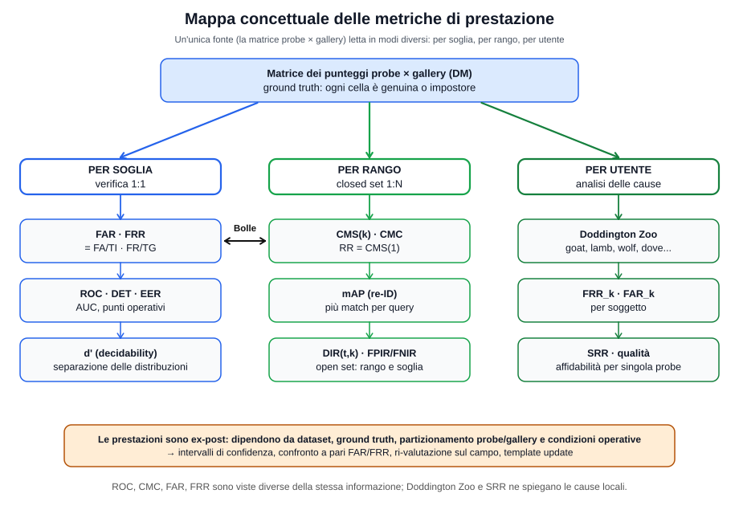

**Schema dei task e loro errori possibili:**

| Task | Claim identità | Soglia | Errori possibili |
|---|---|---|---|
| **Verifica** | Sì | Sì | GA, FR, GR, FA |
| **Identificazione Open Set** | No | Sì | Correct D&I, False Rejection, False Acceptance, Genuine Reject |
| **Identificazione Closed Set** | No | No | Solo False Rejection (nessuna FA) |